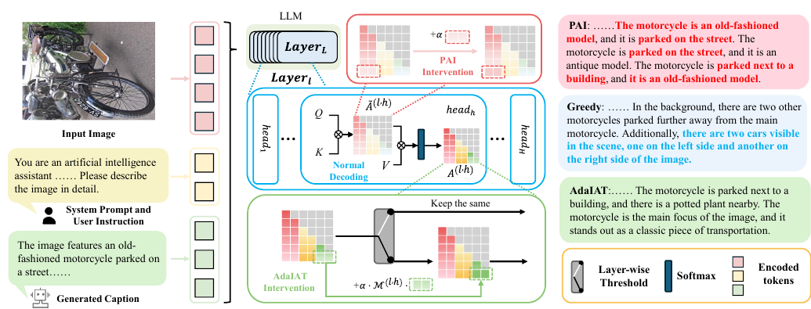

# AdaIAT: Adaptively Increasing Attention to Generated Text to Alleviate Hallucinations in LVLM

核对日期：2026-10-22。实验数值均为作者报告；本地完成原文阅读与讲解自检，未复现实验。

## 一句话总结

AdaIAT在注意力偏低时适度增强对已生成文本的关注，缓解图像描述中的物体幻觉并减少重复；它依赖离线真实/幻觉样本统计，既不是无校准方法，也不是对任意视觉事实的真实性保证。（PDF第1–6页）

## 研究背景与动机

直接提高图像token注意力可减少某些幻觉，却可能压低对前文的注意，使模型反复描述同一物体。作者观察到真实物体token比幻觉物体token更关注已生成文本，于是把前文看作已经融合指令相关视觉信息的中间载体。这个相关性提供设计动机，但前文同样可能含错误，不能推导“越相信自己写过的内容越可靠”。（PDF第1–4页）

## 方法总览

原论文Fig.2，PDF第3页。仅裁切相关图示，保留图内科学标签；著作权属于原作者，用于本篇方法分析，不并入本站原创图授权。[来源与作者](https://openaccess.thecvf.com/content/CVPR2026/html/Zhong_AdaIAT_Adaptively_Increasing_Attention_to_Generated_Text_to_Alleviate_Hallucinations_CVPR_2026_paper.html) · [PDF](https://openaccess.thecvf.com/content/CVPR2026/papers/Zhong_AdaIAT_Adaptively_Increasing_Attention_to_Generated_Text_to_Alleviate_Hallucinations_CVPR_2026_paper.pdf)。点击可打开高清图。

图2对比PAI、正常解码和AdaIAT。基础IAT在中间层增强指向已生成文本Tp的注意力；AdaIAT先依据层级阈值判断是否需要介入，再用不同头的统计比值决定增强幅度。阈值和比值由COCO上真实与幻觉物体的注意力统计得到，评估其他数据集时保持固定。运行时没有更新模型权重，但需要访问或修改内部注意力。（PDF第3–6页）

## 核心创新与关键设计

基础IAT修改softmax之前的logit：\(\tilde A_i\leftarrow\tilde A_i+\alpha|\tilde A_i|\)，仅作用于Tp。AdaIAT则在softmax之后修改概率，两者不能混写。（PDF第4、6页）

令真实/幻觉样本对前文的头级平均注意力为 \(A^r_{Tp},A^h_{Tp}\)，层阈值 \(T=\bar A^h_{Tp}+\beta(\bar A^r_{Tp}-\bar A^h_{Tp})\)，当前注意力低于阈值才触发。头倍率 \(M=A^r_{Tp}/A^h_{Tp}\)，增强 \(A_i\leftarrow(1+\alpha M_{l,h})A_i\)，最后对全部token重新归一化。（式9–12，PDF第5–6页）

式(4)把头聚合称作平均却打印为求和，具体归一化应查实现；比值还需要处理分母接近零、没有已生成token以及生成长度改变的情况。离线分类依赖物体标注，因此“无需重新训练”不等于无需标注校准。

## 实验与关键结果

作者统计分析使用COCO2014的10,000张图；CHAIR描述评估及参数比较另有500图设置，文中第4.2节又引用第3.1节配置，准确评测图ID与划分仍需代码确认。模型含LLaVA1.5 7B/13B、Janus-Pro7B、Qwen2.5-VL7B，最大生成512token，默认greedy。（PDF第3–6页）

| LLaVA1.5-7B，表1 | Greedy | HGAI | IAT | AdaIAT |
|---|---:|---:|---:|---:|
| CHAIR-S/%↓ | 49.0 | 31.4 | 29.8 | 31.4 |
| CHAIR-I/%↓ | 13.3 | 6.9 | 9.0 | 8.3 |
| 物体F1↑ | 77.9 | 78.3 | 76.8 | 79.4 |
| Distinct-1↑ | 0.60 | 0.50 | 0.61 | 0.60 |

AdaIAT的幻觉率不是全部最低，优势是与F1和文本多样性的折中。相对greedy，CHAIR-S下降17.6个百分点，约35.9%相对下降；CHAIR-I下降5个百分点，约37.6%相对下降。摘要的35.8/37.1%与表中舍入值略有差异，保留表格可重算口径。（PDF第1、6页）

OpenCHAIR的2,000图结果CO为0.292→0.252，Distinct-1保持0.61；IIW-400上AdaIAT的Self-BLEU0.071接近greedy0.058，优于PAI0.242，但BertScore-deberta58.29仍低于greedy59.48。（表2–3，PDF第7页）

## 消融实验与证据强度

IAT增强α从0.8提高到1时CHAIR-S29.8→13.6，看似更好，但F176.8→68.4，Distinct-10.61→0.52。只优化幻觉率会牺牲描述能力。IAT施加到5–31层时CHAIR-S仅1.1，却F130.3、Distinct-10.036，已经退化为严重贫乏输出。（表4、6，PDF第8页）

AdaIAT选中间5–18层时F179.4，比0–18层77.2更均衡。β=0.5为所选折中；β0.1→0.3的CHAIR-S32.2→32.6并非正文所说严格连续下降，因此曲线趋势应按实际数值解释。主文缺少完整移除阈值/移除头倍率的等配置分解，不能单独量化两者全部因果贡献。（PDF第8页）

## 局限与讨论

CHAIR主要覆盖已标注物体名词，不能充分测量数量、关系、OCR或开放知识。Distinct-1高不代表连贯或正确，文本长度也会影响它。离线校准与评估COCO样本是否充分隔离需进一步核查。HalluBench采用GPT-4辅助判断，仍受评审模型影响；正文没有完整延迟和显存表，不能因为不重训就承诺低开销。强化错误前文的累积效应和更长生成的阈值漂移也值得测量。（PDF第4–8页）

## 复现提示

[作者仓库](https://github.com/XianguiKang/AdaIAT)待核查commit、许可证与注意力实现，本轮未安装或推理。复现应保存校准图ID、物体匹配规则、每层每头T/M、稳定除法和触发统计，再固定模型、prompt、种子、长度与采样策略，联合报告幻觉、物体召回、多样性和耗时。只有内部注意力可访问的模型才能直接应用；作者的GPT辅助评估不在本轮执行范围，未调用付费API。（PDF第3–8页）

## 相关工作与阅读顺序

先理解自回归注意力与CHAIR，再对比PAI/HGAI的图像token增强和IAT的前文增强。VCD属于输出分布对比，Woodpecker属于外部核查修订，机制和成本不同。最终用表1与表6理解“低幻觉率”必须结合描述信息量；一句几乎不说具体内容的话，也可能获得很低的幻觉率。（PDF第2、6–8页）

## 来源与校验

- [CVF官方论文页](https://openaccess.thecvf.com/content/CVPR2026/html/Zhong_AdaIAT_Adaptively_Increasing_Attention_to_Generated_Text_to_Alleviate_Hallucinations_CVPR_2026_paper.html) · [所读PDF](https://openaccess.thecvf.com/content/CVPR2026/papers/Zhong_AdaIAT_Adaptively_Increasing_Attention_to_Generated_Text_to_Alleviate_Hallucinations_CVPR_2026_paper.pdf)。页码均为PDF页序。
- 所读版本：2026-10-22从CVF下载的开放接收稿；PDF SHA-256：`b8fa8db507f350398f675209c0617d9c941b372d963f1b373ab35ee0c803e16e`。
- 阅读范围：正文、方法公式、实验与消融；补充材料、代码及权重未逐项核验。reviewed表示本地讲解自检，不表示独立同行评审或实验复现。
- 方法图与关键公式/表格已渲染核对，所引原图已单独检查；未对新文章进行浏览器交互验收。作者图示与本站原创素材权利分开记录。
