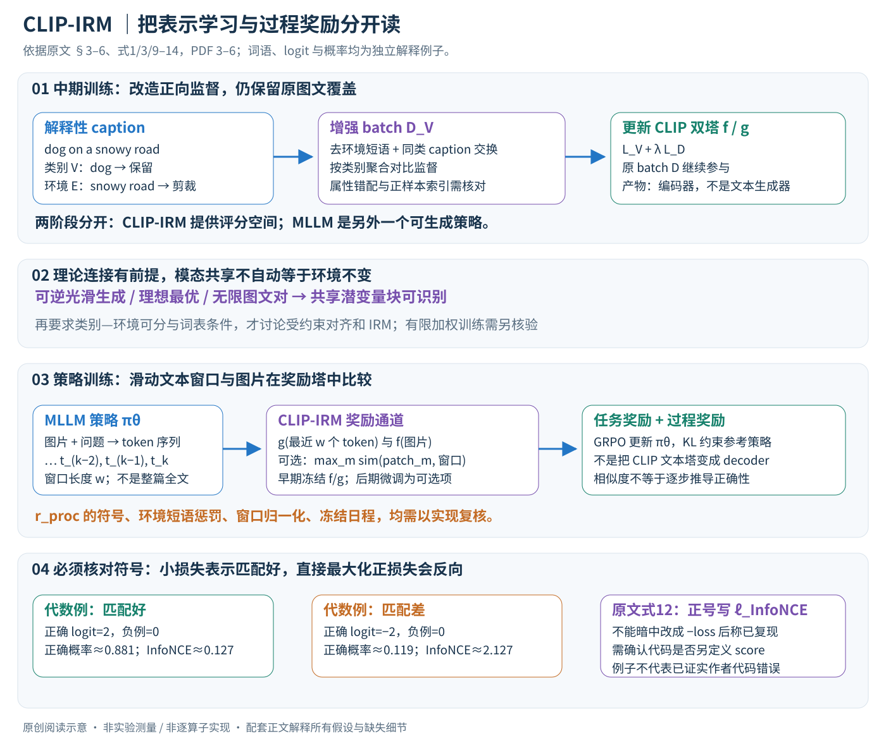

# CLIP-IRM：从环境不变表征到多模态过程奖励

论文：**A Causal Marriage between VLM and IRM from Understanding to Reasoning**，Ziliang Chen、Tianang Xiao、Jusheng Zhang、Yongsen Zheng、Yang Liu、Zhao-rong Lai、Liang Lin，CVPR 2026。

[官方页](https://openaccess.thecvf.com/content/CVPR2026/html/Chen_A_Causal_Marriage_between_VLM_and_IRM_from_Understanding_to_CVPR_2026_paper.html) · [PDF](https://openaccess.thecvf.com/content/CVPR2026/papers/Chen_A_Causal_Marriage_between_VLM_and_IRM_from_Understanding_to_CVPR_2026_paper.pdf)

分类：多模态 / 分布外泛化 / 因果表示 / 推理奖励。最后核对：2026-10-20。正文精读、自检完成，理论证明及实现未独立复现；页码为PDF页码。

方法与配图详细版返工：2026-10-23。重读§3–6及式1–14，核对第5–6页公式；分开理论条件、中期训练与策略奖励，补充张量与数值解释，未复现。

## 一句话总结

在一组明确假设下，把CLIP的图文对齐与环境不变学习联系起来，通过区分类别词和环境词构造中期训练数据，再把得到的CLIP-IRM用于视觉语言模型推理过程的奖励。

## 研究背景与动机

模型可能靠“背景里的雪”识别某类动物，而非真正依赖动物特征。换环境后，这种捷径可能失效。IRM希望找到在不同环境中仍能由同一个预测器稳定使用的表征；CLIP已经有较强跨域能力，但普通图文对比学习是否天然满足这种不变性，需要理论条件和实验区分。[§1–3，PDF 1–3]

这里的causal不应读成模型已经知道真实世界所有因果关系。论文讨论的是特定潜变量生成模型及类别／环境分解，而非从观察数据无条件发现任意因果图。

## 方法总览

### 先分清交付的两个模型

第一阶段以现有CLIP双塔编码器为起点，对图文数据做类别/环境词处理后继续训练，得到CLIP-IRM。它仍把图片和文字映射到可比较的向量，不会自回归生成答案。第二阶段使用单独的多模态大模型作为生成策略，把CLIP-IRM的对齐评分转成过程奖励，用GRPO训练该策略。不能把它画成“CLIP经过IRM后就变成推理大模型”。（§5–6，PDF第5–6页）

原创阅读图依据§3–6、式1/3/9–14，PDF第3–6页。图中的词语和二选一损失是解释例子；奖励符号问题按原文保留，不把自行修正后的公式冒充作者实现。理论条件、继续训练和策略优化三个层次分别标注。

| 阶段 | 输入与可学习对象 | 输出 |
|---|---|---|
| CLIP中期训练 | 原图文对、类别词表V、环境词表E；更新图像塔f与文本塔g | CLIP-IRM双塔及共享嵌入空间 |
| 零样本理解 | 图像、待分类类别的文本prompt | 类别相似度/归一化分类结果 |
| 过程奖励评估 | 图像、MLLM已生成的滑动文本窗口；可加候选图像patch | 每步对齐与环境惩罚组合的分数 |
| GRPO策略训练 | 多条生成轨迹及任务/过程奖励；更新生成策略\(\pi_\theta\) | 一个不同于CLIP文本塔的MLLM |

这个区分也决定了冻结边界：中期训练需学习f/g；策略训练早期冻结f/g作为奖励通道，后期可选小学习率交替微调。是否实际开启可选项、何时切换及具体超参数，正文指向补充材料，不能将一种选择写成唯一已验证配置。（§6末段，PDF第6–7页）

## 核心创新与关键设计

### 1. 从普通CLIP的相似度矩阵开始

一个batch含B对图片与文本。归一化图像/文本特征分别为\(F,G\in\mathbb R^{B\times d}\)，得到\(S=FG^\top/\gamma\in\mathbb R^{B\times B}\)，其中\(\gamma\)是温度。行是图片查询、列是文本候选；原始配对通常在对角线上。图片到文字损失的一项为

\[\ell_i^{I\to T}=-S_{ii}+\log\sum_{j=1}^B e^{S_{ij}}.\]

文字到图片交换查询方向，沿另一维归一化，双向相加。正文式1按样本求和，平均/缩放只是实现中需另核对的归一化，不能拿它影响的学习率量级混为同一配置。（§3.1、式1，PDF第3页）

该目标鼓励对应图文接近，但原始caption如果同时含“某动物”和“雪地”，模型可以利用两种共现信号。**跨模态共享信息不等于跨环境稳定的类别信息**：图像与caption都能描述背景，图文对齐本身没有要求把共同背景删掉。这是论文还需引入IRM与词表约束的原因。

训练后零样本分类，把候选类名放入prompt，比较图像向量与各类文本向量。输出归一化是在当前候选类别集合上进行；更换类别集合会改变分母，不能把其数值当成对所有开放世界类别都校准的真实概率。（式2，PDF第3页）

### 2. IRM究竟比“平均风险低”多要求了什么？

IRM的理想约束是

\[\min_{\Phi,w}\sum_{e\in E}R^e(w\circ\Phi),\quad
w\in\arg\min_{\bar w}R^e(\bar w\circ\Phi),\ \forall e.\]

\(\Phi\)提取表示，w是同一套分类器。普通多环境训练只需总风险小，IRM还要求这个w在每个环境中分别最优。一个只靠背景的表示可能在某环境有效，却需要换一套分类器才能适应另一个环境；它因此不满足这个同时最优条件。（式3，PDF第3页）

例如某类动物在训练环境经常伴随雪，测试时却出现在草地。如果表示真正区分动物本身，改变背景时同一分类规则仍可能适用。但这只是动机，不是说“删除任何环境信息都能改善任何任务”：识别“正在下雪”时，雪本身就是目标信息。类别/环境的角色依赖所选任务词表V。

### 3. 理论连接先恢复共享潜变量，再要求类别/环境可分

Assumption 1用潜变量生成图片和可变长文本：\(z_{inv}\)是跨模态共享语义，另有各模态私有量及图像相关量；文本token按已生成token与共享语义递归生成。Theorem 2在可逆光滑生成映射、连续正密度、光滑编码器及理想优化条件下，讨论共享潜变量块的可识别性：编码可在一个可逆变换意义下恢复该块，而非恢复唯一、逐坐标命名的真实语义。（式5–7、Assumption 1、Theorem 2，PDF第4页）

其对齐泛函包含特征距离和负微分熵：

\[L_{MMAlign}=\mathbb E\|f(x)-g(t)\|-H(f(x))-H(g(t)).\]

距离项让配对接近，熵项限制所有输入塌缩成同一个常量。这里的熵是编码分布的微分熵，不是一个样本softmax的类别熵。Corollary 3把理想对齐和无限训练对下最优双向InfoNCE联系起来；它不意味着一个有限数据、有限宽度、尚未收敛的现成CLIP已经严格恢复这些潜变量。

更关键的是共享块仍可能包含环境。Definition 4再要求：待分类集合与词表一致\(Y=V\)；prompt背景上下文不包含类别token；共享块能按当前任务分解为\(z_{inv}=(z_{env},z_{cls})\)，并使上下文token按指定环境生成关系产生。词面上把V与E去重，只能部分实现前两条的操作意图，不能据此证明潜在生成机制已满足第三条。（PDF第4–5页）

多义词是一个实际反例来源：“orange”可以是颜色也可以是类别，“snow”在一种任务是背景、在另一种任务是目标。原文理想模型假设的角色分解，不能由自动抽取词表完全替代。Theorem 5所讨论的等价，必须连同这些条件一起阅读。

### 4. 理论约束目标与实际加权损失分别是什么？

原文式9把文本变为保留类别y、删除环境e的\(t_{y/e}\)，用它构造词表监督对齐泛函；熵项也对应处理后文本的分布。式10要求在基础跨模态对齐的最优编码器集合中，继续优化这个词表目标。也就是不仅要“删环境后接近”，还要保留基础对齐能力。（Theorem 5、式9–10，PDF第5页）

实际中期训练用两类batch的双向对比损失：

\[L_{mid}=L_{V}^{I\to T}+L_{V}^{T\to I}
+\lambda\big(L_D^{I\to T}+L_D^{T\to I}\big).\]

原始D负责语义覆盖和稳定性，改造后的\(D_V\)负责类别相关、环境弱化的监督。第二项并不是一个普通的“权重正则”，它仍然需要原始图文样本和对比计算。\(\lambda\)太小或太大可能改变平衡；本文正文未给出足以确定全部实践细节的数值配置，不能凭空补默认值。（式11、§5，PDF第5–6页）

需要保留理论与实现的距离：在原始对齐最优解集合中施加约束，是一个理想受约束问题；有限权重的单阶段损失是实践形式。即使作者称其实现该约束，也不能在没有条件和优化误差分析的情况下，推断任何\(\lambda\)、任何有限训练都严格等价IRM。本次重读没有独立重做附录证明。

### 5. 数据改造如何削弱背景捷径？

§5的操作是从LAION构建类别词表V和环境词表E，按词/短语粒度识别、删除环境描述，并在同类样本中交换不含环境词的caption，形成增强batch，再与原始batch交错训练。它没有要求改变CLIP双塔架构，而是改变哪些图文关系被作为正向监督。（PDF第5–6页）

**解释例子。** 假设原文案为“dog on a snowy road”和“dog on green grass”，V含dog，E含两种背景短语。删除后都保留dog，再在同类图像之间重组文本。学习目标希望两种背景的dog都靠近类别语义，而不是必须匹配自己的独有背景。例子不是作者数据，也不表示实际系统只保留一个类名单词。

同类caption交换还会引入细节错配：一张图是坐着的狗，另一条caption可能提奔跑；若动作属性是下游目标，交换会损伤信号。因此需要检查短语角色、类别粒度、属性保留及匹配规则。不能把所有同类句子视为对每张图都逐细节为真。

式11的增强损失在分子、分母中还按类别词w聚合配对，而不只是原CLIP逐对对角正样本。正样本集合如何构造，会影响同类样本是否被当成负例。正文的索引写法及batch规则不足以仅凭一行公式唯一确定多正样本实现，本讲解不悄悄用某个熟悉的supervised-contrastive模板替换它；精确复现需核对附录C或源码。

### 6. CLIP-IRM怎样给生成中的文本片段打分？

生成模型\(\pi_\theta\)根据图片及文本上下文逐token产生\(t_{1:T}\)。第k步截取最近w个token组成窗口\(t_{k-w+1:k}\)，送入CLIP文本编码器g，得到\(h_k\in\mathbb R^d\)。图像由f得到\(v\in\mathbb R^d\)，两者可在相同嵌入空间比较。前缀短于w时的截取与padding、CLIP最大长度和跨窗口缓存策略，正文没有完整展开。（§6、式12，PDF第6页）

这个接口有两个目的：CLIP文本塔不必承担长文本生成，生成大模型也可接受外部图文对齐信号。窗口评分是对一段局部文本的表征评分，不等于为每个逻辑推导步骤做了符号验算。相邻窗口高度重叠，一个token可能影响多次评分，也使窗口长度和奖励累加方式成为重要配置。

原文式12写为

\[r_k^{proc}=\ell_{InfoNCE}(v,h_k;V)
-\alpha\ell_{env}(t_{k-w+1:k};E).\]

环境项惩罚窗口与E的重合。但怎样按短语计数、是否长度归一化、否定句是否算重合，正文没有完整定义，不能简单说它已剔除一切环境依赖。

### 7. 奖励的正负号为什么是实质问题？

式1的InfoNCE是要**最小化**的负对数损失，式12却将同名量正号放入希望**最大化**的奖励中，并称它遵循式1。若实现真的按相同损失约定直接使用，较不匹配的文本会获得更高这一项奖励，这与目标相反。因此需要确认实现是否使用负损失、对数概率、相似度分数，或另有记号约定。（式1、12–14，PDF第3、6页）

一个二候选代数例子：正确匹配logit为2、负例为0时，正确概率约0.881，损失约0.127；若正确匹配logit降到−2而负例仍0，概率约0.119，损失约2.127。最大化这两个正损失会偏好后一种。图示只用这个例子说明符号风险，**不代表作者实际代码已被证实写错**；本地没有运行实现，也没有擅自修公式后声称复现通过。

### 8. 可选patch奖励补的是局部可见线索

作者还提出由经过校准的proposal网络选择高置信图像patch，编码为\(v_m\)，以

\[r_k^{patch}=\max_{m\in\mathcal M}\operatorname{sim}(v_m,h_k),
\qquad r_k^{proc}\leftarrow r_k^{proc}+\beta r_k^{patch}\]

补充局部grounding。取最大值让“至少有一个局部区域支持窗口语义”即可提高该项，能减少只靠全局背景的某些问题；但一个patch相关不意味着整段推导中所有命题都真实。proposal遗漏关键区域、裁剪破坏空间关系，或窗口包含多个对象关系时，都可能影响有效性。（式13，PDF第6页）

正文未完整给出proposal模型版本、阈值与所有实验是否启用patch项。本笔记保留“可选”，不把局部奖励收益当作主实验每个配置均已独立验证的事实。\(\beta\)是patch项权重，与后面\(\beta_{KL}\)不是同一个超参数。

### 9. GRPO把奖励转成策略更新，奖励网络不等于策略

轨迹总奖励写为

\[R(\tau)=\sum_{k=1}^{T}\left(r_k^{task}+\lambda_{proc}r_k^{proc}\right).\]

任务项来自答案/步骤正确性与格式，过程项来自上述CLIP接口。式14再以优势\(A_k\)驱动GRPO，并用\(\beta_{KL}KL(\pi_\theta\|\pi_{\theta_0})\)限制偏离监督参考策略。原文没有逐项展开GRPO的采样组大小、裁剪区间、优势归一化或每个token的归因，不能把常见开源框架默认值当成本篇精确设置。（PDF第6页）

作为优化器背景，同一问题采多条回答并比较相对奖励，能给高于组内基准的轨迹正向学习信号；这解释为什么无需让CLIP向离散采样token直接求导，也能影响生成策略。早期冻结f/g时，CLIP负责提供分数，策略由概率梯度类目标更新。后续若微调奖励塔，奖励标尺还会变化，需要额外稳定策略，不能把它画成一个端到端可微、天然正确的推理验证器。

作者给出的稳定做法是batch内规范化过程奖励、调整\(\lambda_{proc}\)、先冻结奖励塔，再可选小学习率交替微调。它们降低某些训练不稳风险，不自动排除奖励投机；重复图像相关词、无关但匹配的描述、长回答累计更多窗口分数，都需要由实际评价排查，而不是由“因果”标签保证不会出现。（§6，PDF第6–7页）

### 10. 成本和复现边界要按两个阶段分别记录

中期训练仍需图文编码与batch对比，B×B相似度矩阵随batch增大二次增长；词表处理还涉及短语识别、类别聚合与数据重组。它没有增加一个庞大生成头，但不是零训练成本的prompt编辑。

策略训练在MLLM采样之外增加滑窗CLIP文本编码、图像编码与可选patch评估。若每token都重算长度w的窗口，朴素实现有T次文本编码；固定图像/patch可考虑缓存，但正文没有给出可确认的缓存实现和吞吐。这里不报虚构显存、速度或费用，也未调用付费评判API。

最后，IRM要求跨训练环境同时最优；“有一个经环境词处理的CLIP过程奖励”并不自动证明任意生成策略在所有新域都满足IPO。类别任务和长篇几何推理的信息需求也不同，必要环境词可能正是问题条件。本篇实验可以作为所测配置的证据，不能代替这些条件的独立验证。

复现优先核对增强正样本索引、词表/短语规则、式12符号、窗口与奖励归一化、冻结日程及GRPO参考策略，然后在同一骨干、同一数据预算下比较普通继续训练与CLIP-IRM。当前完成原文方法重读、关键公式页面视觉核对和独立数值自检；补充材料、证明与上游实现尚未逐项核验，**未训练或复现实验**。

## 实验与关键结果

分类测试包括PACS、VLCS、OfficeHome、NICO++、DomainNet。Table 1（PDF 7，已渲染核对）摘选：

| 模型 | PACS | VLCS | OfficeHome | NICO++ | DomainNet |
| --- | ---: | ---: | ---: | ---: | ---: |
| CLIP | 97.7 | 73.4 | 85.4 | 88.7 | 76.7 |
| CLIP-IRM v1 | 95.1 | 78.8 | 83.9 | 87.7 | 72.7 |
| CLIP-IRM v2 | 98.6 | 83.3 | 88.3 | 91.8 | 78.1 |

v1使用ViT-B/16，v2为ViT-L/14；结果差异不能全归因于不变训练。v1也并非相对CLIP逐项提高。表中CLIP的Avg写83.4，但按五列简单平均为84.38，统计口径或排版尚不清楚；本笔记不据此宣称确定的平均提升幅度。

推理使用Qwen2.5-VL-7B-Instruct，训练来源包括Geometry3K约2.1K与MMK12约6.4K样本，并把选择题改为自由回答。评价MathVerse、MathVision、MathVista、WeMath及HallusionBench，Fig.4展示带过程奖励的曲线总体优于GRPO基线。[§7.2，PDF 8]

正文没有提供可直接抄录的完整最终分数表，本讲解不从小图估读精确提升。评价采用贪心解码，并以Gemini-2.5-pro解析输出；复现时应记录评判模型版本及不确定性，不能把该流程当完全无外部依赖。

## 消融实验与证据强度

Fig.3显示CLIP-IRM初始化对若干prompt-tuning方法的新类或目标域性能有帮助，但源域、基础类并非全部提升。[§7.1.2，PDF 7–8] 这支持迁移价值，也提醒不能只展示总体向右上移动的概括。

更多组件消融、词表构造、超参数和统计被放在附录D与补充材料，本轮未读，因此不声称环境词删除、过程奖励和patch项都已在此笔记独立核验其必要性。实验上的OOD改善不能反向证明全部因果假设在真实数据成立。

## 局限与讨论

理论依赖潜变量分解与理想最优，实践使用自动词表与有限优化；两者之间有明显距离。类别相关词也可能携带环境语义，词表剪裁可能删掉有用关系。CLIP评分还容易奖励“提到看起来相关的词”，未必真正验证每一步推导正确。

与传统OOD模型、不同骨干基础模型和闭源MLLM比较，训练规模与推理接口不同，不能只拿平均分证明方法在等预算下全面优越。正文未单列limitations，本段为阅读分析，非作者额外承诺。

## 复现提示

先核对词表的来源、短语切分、类别重叠检查及数据泄漏，再固定相同骨干比较原CLIP、普通继续训练与CLIP-IRM。推理训练需查清式12奖励符号、batch归一化、窗口长度、KL参考策略、奖励权重调度与冻结设置。

正文只列出高层流程，细节在补充材料；本轮未核验代码、commit、许可证、权重或运行成本，未调用付费评判API，未进行训练。若不能取得实现，应标为理论与实验阅读笔记，不伪造可运行配方。

## 相关工作与阅读顺序

CLIP解释图文对比学习，IRM解释跨环境最优预测器，IPO将不变思想扩展到策略，GRPO提供生成策略优化。它们分别承担表示、约束思想与优化器的角色，不能合并成一个无条件等价链。

建议 §3 → Definition 4 → Theorem 5 → §5中期训练 → 式12奖励符号 → Table 1骨干差异 → Fig.4。先读假设，再读“因果保证”的适用范围。

## 来源与校验

正文1–8页已阅读，第7页表格已渲染核对；补充证明、附录和代码未读。PDF SHA-256：`5f45fddf2204a51eafb47b2f58676a0c03965cad89605ab7aace483e06301562`，为本地摘要。AI辅助独立讲解已自检，无独立专家审稿、未复现实验；不转载原文全文或作者图片。
