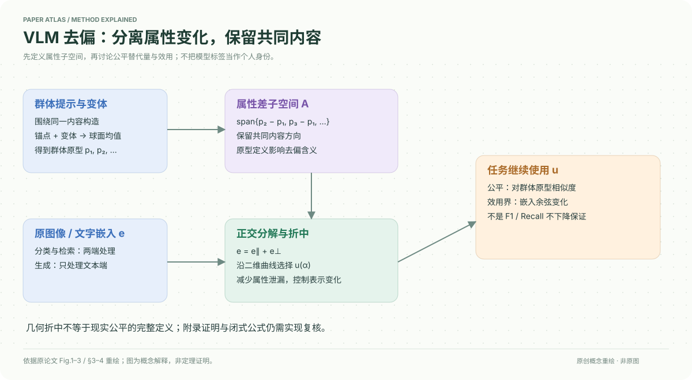

# A Closed-Form Solution for Debiasing Vision-Language Models with Utility Guarantees Across Modalities and Tasks

核对日期：2026-10-20。以下实验均为作者报告；本地完成原文阅读与讲解自检，未复现实验。

## 一句话总结

用群体文本原型的差向量定义属性子空间，在其平行与正交分量之间选择去偏嵌入，以几何界约束效用损失；保证范围限于表示空间。

## 研究背景与动机

直接投影掉“男性医生/女性医生”等完整原型，可能同时删除“医生”的任务语义。作者改为原型之间的差，试图集中移除属性变化；图像与文字共享空间，因此分类和检索需要同时处理两端。[Fig.1、§3，PDF3]

公平性在此被定义为对各群体原型相似度相等或接近，这是一个可优化替代量，并不囊括现实公平的所有定义。

## 方法总览

LLM围绕当前提示构造群体显式锚点与同义变体；冻结文本编码器求球面均值原型；差向量组成属性子空间。将图像或文字嵌入拆成属性分量与正交内容分量，沿二维Pareto曲线折中，之后仍使用原有任务相似度或生成模型。[Fig.2–3，PDF3–5]

## 核心创新与关键设计

令单位嵌入为e，群体原型为p_g。对所有群体相似度相等，等价于对所有差向量正交：
\[\langle u,p_g-p_1\rangle=0.\]
对属性子空间A作正交分解，记a=\(\|e_\parallel\|\)、b=\(\|e_\perp\|\)，候选为
\[u(\alpha)=\alpha\frac{e_\parallel}{a}+\sqrt{1-\alpha^2}\frac{e_\perp}{b},\quad0\le\alpha\le a.\]
属性泄漏L=α，自效用损失V=1−αa−√(1−α²)b。α=0为完全移除该子空间，α=a保留原向量。折中是减少泄漏并避免语义损失过大，并非同时达到两个极端。[§4.2，式1–4]

对单位向量，跨模态相似度变化上界为
\[\ell_{cross}\le\sqrt{2\ell_{self}^{(I)}}+\sqrt{2\ell_{self}^{(T)}}.\]
该界不直接控制类别决策边界或检索排名。[Proposition1]

**原文公式待复核点：**Theorem1给出闭式α及相应V关系；但正文式4写的是原始L、V的最坏权重目标，其后V=(1−b)α/a呈现归一化折中的特征。本文保留其为作者定理陈述，不在未读证明的情况下宣称已独立验证两者完全一致；实现时必须对照附录证明与上游代码，不能凭文本提取直接抄公式。作为本地数值核对，取a=0.6、b=0.8（满足a²+b²=1），按PDF第5页闭式得到α≈0.2392、V≈0.0797；原始max(L,V)网格最小点约α=0.1292，两者不同。这仅指出正文写法需要澄清，不代表已审查附录证明或上游实现。

## 实验与关键结果

正文主要使用CLIP ViT-L/14，另在附录报告其他骨干；分类包括CelebA发色及性别×年龄、FACET多类及性别；检索包括COCO2017性别×肤色和Flickr30K性别。去偏无需额外标注数据，评价仍需要群体标注，且原型构造使用LLM。[§5]

| 作者报告，表值按100缩放 | 原模型 | 本方法 |
| --- | --- | --- |
| CelebA F1↑ | 54.0±0.5 | 56.5±0.5 |
| CelebA 最大EO差↓ | 45.0±0.3 | 40.1±0.3 |
| COCO R@5↑ | 83.8±0.3 | 81.1±0.3 |
| COCO MS@1000↓ | 13.4±0.5 | 10.1±0.4 |
| Flickr R@5↑ | 91.0±0.6 | 90.4±0.5 |

来源Table2–3，PDF7。召回下降说明效用界不等于任务性能不损失。SD2.1生成实验中，SP5从58.6到28.8，但CLIPscore从32.8到24.2、显式性别生成准确率从75.4到74.6；主要优势是在去偏方法之间保留更多效用，不能写成无代价改善。[Table4，PDF8]

## 消融实验与证据强度

Flickr MS@1000：仅锚点13.4、仅变体均值14.1、完整11.8；仅图像13.4、仅文本13.3，双模态更好。CelebA最大EO差，完整40.1，单图像41.7、单文本41.1。替换DeepSeek/Gemini的结果接近默认配置，支持原型构造在所测模型上较稳定，不能保证所有提示都无差异。[Table5，PDF8]

对手方法RoboShot的CelebA公平数值23.3/40.0略优于本文23.6/40.1，不能把“各项都最佳”照搬为笔记结论。

## 局限与讨论

作者明确：保证的是几何空间内语义一致性，不直接保证F1、Recall@K。原型质量、敏感群体定义、非二元与交叉群体覆盖、感知属性标注误差都会影响解释。[Limitations/Ethical Statement，PDF8]

附录证明未读，本地未核验代码中的退化向量、秩亏子空间及数值稳定实现。群体词与感知标签不是个人身份自我认同。

## 复现提示

先固定编码器、提示模板和原型变体，保存LLM版本及生成内容；用QR/SVD核验子空间基与数值秩，检查投影与归一化的退化情形。再分别评估单模态、双模态、公平替代量与真实任务指标。定理实现应先解决上文公式核对问题。

原文代码入口为 `https://github.com/Supltz/Debias_VLM`；本次只作为来源记录，未审查许可证、commit或执行。研究数据建议 `data/vlm-debias/`，遵循原数据集许可；无需为阅读调用论文中的商业LLM。

## 相关工作与阅读顺序

先读CLIP的归一化共享空间，再读Orth-Proj/PRISM类投影方法，理解完整原型子空间与原型差子空间的区别。最后回到本文Proposition1与Limitations，把“表示界”和“任务保证”分开，并在复现前读附录A。

## 来源与校验

- [CVF 官方论文页](https://openaccess.thecvf.com/content/CVPR2026/html/Lian_A_Closed-Form_Solution_for_Debiasing_Vision-Language_Models_with_Utility_Guarantees_CVPR_2026_paper.html) · [所读 PDF](https://openaccess.thecvf.com/content/CVPR2026/papers/Lian_A_Closed-Form_Solution_for_Debiasing_Vision-Language_Models_with_Utility_Guarantees_CVPR_2026_paper.pdf)。页码均为该 PDF 的页序。
- 阅读范围：正文、公式与实验表；补充材料、上游代码与权重未逐项核验。许可证和固定代码 commit 尚未确认，不复制原文全文或数据。
- PDF SHA-256：`395ff8aeff5511803efe82c0799bc82a73a7535d3bc6447e1729097aa22b413e`；版本为本次下载的 CVF 接收稿，核对日期 2026-10-20。

- 视觉核对：已渲染查看 PDF 第5页，核对关键公式或实验表；正文阅读到结论与局限，未读独立补充材料。
