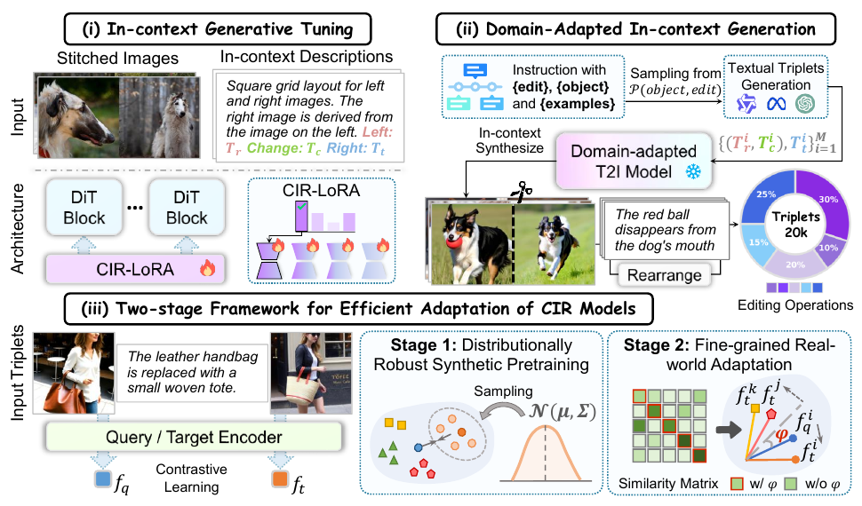

# Adapting In-context Generation for Enhanced Composed Image Retrieval

核对日期：2026-10-22。实验数值均为作者报告；本地完成原文阅读与讲解自检，未复现实验。

## 一句话总结

DAIG用少量真实图文修改三元组微调生成模型，合成领域相关检索训练对，再经合成预训练与真实数据细调提升组合图像检索；检索推理结构不增加，但前置图像生成与训练成本并不小。（PDF第1–5页）

## 研究背景与动机

组合图像检索用“参考图+修改描述”寻找目标图，需要同时保持参考属性与执行修改。真实三元组难标注，通用合成图又可能和目标领域偏离。作者把少样本监督先用于生成器，让它同时画参考/目标两半，再利用合成对训练检索器；所以这是few-shot适应，不是完全无目标域标注的zero-shot检索。（PDF第1–3页）

## 方法总览

原论文Fig.2，PDF第4页。仅裁切相关图示，保留图内科学标签；著作权属于原作者，用于本篇方法分析，不并入本站原创图授权。[来源与作者](https://openaccess.thecvf.com/content/CVPR2026/html/Li_Adapting_In-context_Generation_for_Enhanced_Composed_Image_Retrieval_CVPR_2026_paper.html) · [PDF](https://openaccess.thecvf.com/content/CVPR2026/papers/Li_Adapting_In-context_Generation_for_Enhanced_Composed_Image_Retrieval_CVPR_2026_paper.pdf)。点击可打开高清图。

图2包含三步。32条目标域三元组左右拼接，并将两图caption和相对修改组成描述，用CIR-LoRA适应Flux.1-dev；随后Qwen生成文本三元组，再由适应后的生成器绘制20k拼接图并裁成检索对；检索器先做带视觉统计扰动的DRSP，再用真实标注做带角度间隔的FRA。生成器不进入最终检索推理链，因此部署仍是编码查询与图库匹配。（PDF第3–6页）

## 核心创新与关键设计

CIR-LoRA按描述路由多个低秩专家：\(W'=W+\beta\sum_i r_iB_iA_i\)，本文rank32、2专家。它提供样本相关的领域适应，不等于已经数学证明合成分布“无偏”。DRSP根据batch内视觉特征均值/标准差的波动采样扰动，训练时以0.5概率应用；FRA增加正样本角度，使对比任务更难，所选间隔为0.003。（PDF第3–6页）

**印刷公式需查实现。** 式(2)标准差根号内缺少平方，按定义逐token中心化后求和应近零，不能照式直读。式(4)把扰动均值写在缩放位置、扰动标准差写在平移位置，与常见统计替换形式不同；式(5)打印 \(\exp[\cos(\theta/\tau)]\)，而非通常的 \(\exp[\cos\theta/\tau]\)。本笔记保留这些歧义，不能悄悄改成惯用形式再称为作者实现。（PDF第5页）

## 实验与关键结果

Flux微调用32条、224×448拼接图、15,000步、batch1、学习率10⁻⁵，在单H800上完成；Qwen2.5-VL32B做caption，Qwen2.5-32B生成20k文本对。FashionIQ在验证集评价，CIRR在测试集评价，不能把两者都写成官方测试集。CIRR Avg为(R@5+子集R@1)/2。（PDF第5–7页）

| SPRC比较/% | 基础 | +DAIG |
|---|---:|---:|
| FashionIQ 32-shot平均R@10 | 28.78 | 45.02 |
| FashionIQ 全监督平均R@10 | 53.87 | 55.07 |
| CIRR 32-shot R@5 | 57.61 | 72.41 |
| CIRR 全监督 R@5 | 82.22 | 84.10 |
| CIRR 全监督 Avg | 81.27 | 82.40 |

表1–2（PDF第6–7页）。少样本提升14.80是百分点，不是相对14.80%。也非全部指标第一：CIRR全监督R@10为90.60，低于CCIN91.17。作者估计图像生成每对约2秒、总约10小时，外加数小时生成器微调，不能将“无额外推理”误解成低建设成本。（PDF第8页）

## 消融实验与证据强度

表5的DRSP阶段，零样本合成CIRR R@5为66.10，领域适应普通LoRA70.19，CIR-LoRA71.01，再加扰动72.02；FRA中角度间隔使74.65→75.52。表2的32-shot结果72.41与表5阶段72.02略异，配置口径需分别保存。（PDF第8页）

正文称CIR-LoRA增益1.66，实际是R@1的39.33→40.99；R@5增益是0.82，不能把不同列混用。表4比较20k领域合成数据和百万级其他训练集，但目标域32条监督及生成器先验均不同，不能单凭样本数证明数据效率的全部因果来源。（PDF第7–8页）

## 局限与讨论

生成器可能保留背景捷径、错误编辑和预训练偏差，少样本领域调节并不保证无偏；不做过滤是作者的流程选择，不是合成对从不出错的证据。低分辨率、有限编辑类型与生成模型选择限制泛化。正文缺少重复种子和置信区间，微小榜单差异需谨慎。模型、数据与生成素材各自许可也需分别核查。（PDF第3–8页）

## 复现提示

[作者仓库](https://github.com/JThuge/DAIG)待核查固定commit、许可证、生成模型使用条件与真实三元组划分。本轮未生成图片、训练模型或调用付费API。复现先核对式(2)/(4)/(5)与代码，再记录32条样本ID、路由权重、生成种子、编辑类别及是否人工过滤，严格防止测试三元组进入生成器训练。检索速度应独立测量，并将合成与训练总成本单列。（PDF第3–8页）

## 相关工作与阅读顺序

先读CLIP4CIR、BLIP4CIR或SPRC理解查询融合，再读CoAlign的上下文成对生成。最后理解MoE-LoRA、视觉统计增强和角度间隔各解决哪个环节。评价少样本方案时，既看真实标注节省，也统计预训练生成模型、合成20k对和额外训练的资源投入。（PDF第2–8页）

## 来源与校验

- [CVF官方论文页](https://openaccess.thecvf.com/content/CVPR2026/html/Li_Adapting_In-context_Generation_for_Enhanced_Composed_Image_Retrieval_CVPR_2026_paper.html) · [所读PDF](https://openaccess.thecvf.com/content/CVPR2026/papers/Li_Adapting_In-context_Generation_for_Enhanced_Composed_Image_Retrieval_CVPR_2026_paper.pdf)。页码均为PDF页序。
- 所读版本：2026-10-22从CVF下载的开放接收稿；PDF SHA-256：`940d1ac0c3430b03572413c946223eae0da414477c2983e1c6be931d385f3327`。
- 阅读范围：正文、方法公式、实验与消融；补充材料、代码及权重未逐项核验。reviewed表示本地讲解自检，不表示独立同行评审或实验复现。
- 方法图与关键公式/表格已渲染核对，所引原图已单独检查；未对新文章进行浏览器交互验收。作者图示与本站原创素材权利分开记录。
