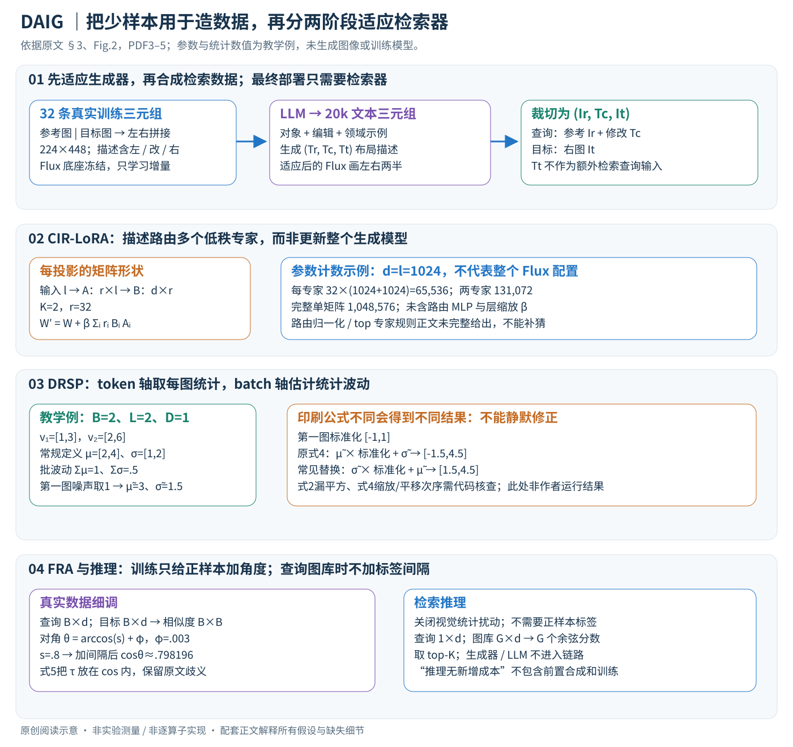

# Adapting In-context Generation for Enhanced Composed Image Retrieval

核对日期：2026-10-30。实验数值均为作者报告；本地完成原文阅读与讲解自检，未复现实验。

## 一句话总结

DAIG用少量真实图文修改三元组微调生成模型，合成领域相关检索训练对，再经合成预训练与真实数据细调提升组合图像检索；检索推理结构不增加，但前置图像生成与训练成本并不小。（PDF第1–5页）

## 研究背景与动机

组合图像检索用“参考图+修改描述”寻找目标图，需要同时保持参考属性与执行修改。真实三元组难标注，通用合成图又可能和目标领域偏离。作者把少样本监督先用于生成器，让它同时画参考/目标两半，再利用合成对训练检索器；所以这是few-shot适应，不是完全无目标域标注的zero-shot检索。（PDF第1–3页）

## 方法总览

原论文Fig.2，PDF第4页。仅裁切相关图示，保留图内科学标签；著作权属于原作者，用于本篇方法分析，不并入本站原创图授权。[来源与作者](https://openaccess.thecvf.com/content/CVPR2026/html/Li_Adapting_In-context_Generation_for_Enhanced_Composed_Image_Retrieval_CVPR_2026_paper.html) · [PDF](https://openaccess.thecvf.com/content/CVPR2026/papers/Li_Adapting_In-context_Generation_for_Enhanced_Composed_Image_Retrieval_CVPR_2026_paper.pdf)。点击可打开高清图。

图2包含三步。32条目标域三元组左右拼接，并将两图caption和相对修改组成描述，用CIR-LoRA适应Flux.1-dev；随后Qwen生成文本三元组，再由适应后的生成器绘制20k拼接图并裁成检索对；检索器先做带视觉统计扰动的DRSP，再用真实标注做带角度间隔的FRA。生成器不进入最终检索推理链，因此部署仍是编码查询与图库匹配。（PDF第3–6页）

## 核心创新与关键设计

### 1. 输入、输出和三个模型的边界

一个真实三元组为\((I_r,T_c,I_t)\)：参考图、相对修改描述、目标图。查询编码器把前两项融合成d维向量，目标编码器把图库图像编码成同空间向量，推理返回余弦相似度最大的图像。生成器负责离线造训练数据，语言模型负责描述与文本三元组，两者都不进入最终检索链。[§3，PDF3–5]

| 环节 | 输入 → 输出及形状 |
| --- | --- |
| 生成器适应 | 32条真实三元组 → 每条224×448×3左右拼接图、一个布局描述 |
| CIR-LoRA | 每投影W∈R^(d×l)，每专家A∈R^(r×l)、B∈R^(d×r)，路由为K个标量 |
| 合成 | 对象与编辑指令 → 文本三元组 → 拼接图 → 两张224×224图及修改描述 |
| DRSP | 检索器视觉特征v∈R^(B×L×D) → 同形扰动特征 → 查询/目标向量B×d |
| FRA | 真实查询与目标向量 → B×B相似度矩阵 → 对角为正样本的交叉熵 |
| 检索 | 一条查询1×d、图库G×d → G个分数 → top-K图像 |

此处d、l按矩阵乘法使用：W作用于l维输入、得到d维输出；原文对input/output的文字次序与矩阵形状不一致，不应把乘法倒过来。视觉token维D、检索嵌入维d和生成器投影维度不必相等。

### 2. 少样本先教生成器“成对且符合领域”

将Ir置左、It置右，并分别用captioner得到Tr、Tt；布局提示同时包含左右描述和修改Tc。比如左边“红色皮革手提包”，修改“换成小型编织托特包”，右边必须同时满足替换与保留的属性，不能只把两段独立caption拼起来。论文以flow matching训练条件生成器；底座冻结，学习CIR-LoRA增量，不是更新整个Flux。[§3.1、Fig.2]

生成器每块的文本条件被编码成K/V，图像状态提供Q；注意力仍为softmax(QKᵀ/√d)V。在一个投影上
\[
W'=W+\beta\sum_{i=1}^{K}r_iB_iA_i,\qquad r=R[\tau_{txt}(T_{ic})].
\]

先把输入从l维经Ai压到r维，再由Bi回到d维；专家输出按当前描述的路由权重混合。主设K=2、rank=32，β为层专属可学习缩放。路由可由MLP实现，但池化方法、是否softmax归一化、是否只激活top专家没有在正文完整给出，因此不能把它当作已验证的稀疏MoE算子。训练目标与路径对增量参数产生梯度，原W冻结；文本编码器具体冻结细节也不能只由“底座冻结”扩展为全部外围模块均已核验。

教学参数计数：若d=l=1024，每专家32(1024+1024)=65,536个低秩参数，两专家131,072，比单个全矩阵1,048,576少，但这未含路由和β，也不是整个Flux模型参数比例。样本相关权重能表达不同编辑偏好，不能证明合成分布严格无偏。

### 3. 合成20k对时，三种文本各有位置

从预定义对象集、编辑集采样，连同目标域样例提示LLM输出(Tr,Tc,Tt)。将其重新装成左右布局描述，适应后的生成器一次画左右两半，再裁成Ir与It；训练检索器时查询用Ir+Tc，目标用It，**不是把Tt作为额外查询提示**。生成器适应完成后，批量合成阶段不继续用检索损失在线修改Flux。[Fig.2(ii)，PDF4]

作者不额外过滤合成对，这是流程选择；左右角色错误、编辑未执行和背景捷径仍是可能失败。32条真实例子必须来自合法训练划分，不能将验证/测试目标图当成生成器示例。文中“少样本”包括这些目标域监督及生成器/LLM先验，绝非完全不接触领域。

### 4. DRSP：先区分token统计和batch统计

对B张图的L个视觉token，在每通道D上沿L取统计，得到B×D的每图均值μ与标准差σ；再沿B求这些统计的波动幅度，得到D维Σμ、Σσ。式3是逐通道平方差，因此实际给的是对角尺度，没有打印D×D完整协方差。将采样噪声广播到对应图与token轴，得到\(\tilde\mu=\mu+\epsilon_\mu\Sigma_\mu\)、\(\tilde\sigma=\sigma+\epsilon_\sigma\Sigma_\sigma\)，再扰动v。批内统计变化大，允许的扰动也大；p=.5是按batch决定是否应用，不是随机删一半视觉token。[式2–4，PDF5]

**原文歧义需保留。** 式2的σ根号内漏了平方，中心化后线性求和为0；式4又打印
\[
\tilde v=\tilde\mu\frac{v-\mu}{\sigma}+\tilde\sigma.
\]

按标准差定义应对中心差平方；常见统计替换会用σ̃作缩放、μ̃作平移，但这里不悄悄改公式。这两处未核对作者源码，因此下面只给“常规定义下的统计教学例”，不能称作者实际扰动结果。

设B=2、L=2、D=1，v第一图[1,3]、第二图[2,6]。常规定义μ=(2,4)、σ=(1,2)，批波动Σμ=1、Σσ=.5。若第一图两种噪声都取1，则μ̃=3、σ̃=1.5；第一图标准化状态为[-1,1]。按**印刷式4**得到[-1.5,4.5]，若按常见替换则为[1.5,4.5]，两者不同。这个对照展示歧义确实会影响计算，不支持自行挑一个作为论文复现。

后续仍走既有检索器的模态融合与对比学习；没有为统计扰动新增可学习网络。训练结束关闭扰动，保留检索器参数。batch太小统计退化、标准差接近0、采样σ̃可能为负等数值边界需要源码中的保护规则，正文没有完整给出。[§3.2]

### 5. FRA：正样本加角度，推理不加标签间隔

合成预训练后，用真实数据细调。对于批中第i条查询与第j张目标图，先算余弦sij，再令
\[
\theta_{ij}=\arccos(s_{ij})+\varphi\mathbf1[i=j].
\]

对角是已知匹配对，才加φ；非对角视作batch内负样本。φ=.003是弧度而非余弦差。阅读补充：若sii=.8，正样本角约.64350；增加.003后，余弦约.798196。正样本被压低，使模型需更强对齐；只在角度仍处于单调区间时这一解释直接成立。

式5打印的logit却是\(\cos(\theta_{ij}/\tau)\)，不是常见\(\cos\theta_{ij}/\tau\)。τ在cos内部会改变周期与单调性，不能不核验就按温度缩放改写。按打印形式定义ℓij后，可明确执行 \(p_{ij}=e^{\ell_{ij}}/\sum_ke^{\ell_{ik}}\)、\(\mathcal L=-B^{-1}\sum_i\log p_{ii}\)，但不保证这就是源码。arccos输入数值裁切与角度上界同样需核实。交叉熵按行对齐查询与目标；是否加反方向损失由底层检索模型决定，正文未统一指定。[式5]

训练阶段可从对比损失回传到既有查询/图像编码和融合模块，具体可训练子集沿底层CIR设置，不能一概说全部解冻。推理时没有正负标签，不添加φ，也不做DRSP；仅计算查询与图库余弦后排序。

### 6. 成本、替代方案与可复现边界

生成器适应15000步batch1虽只用32个真实三元组，仍多次重用这些样本；20k合成对还要存储生成图与文本，不能只报告真实样本数。DRSP统计约O(BLD)，FRA批内相似度约O(B²d)，图库精确检索每查询约O(Gd)，缓存图库特征约Gd个数；前置生成成本不能摊成“无成本”。[§4与复杂度阅读补充]

普通LoRA可作专家路由的对照，合成预训练不扰动可检验DRSP，真实细调不加φ可检验FRA。实验表中不同阶段数值要按各自设定阅读，不能将所有增益相加。当前正文可说明数据与张量如何流动，但式2/4/5、路由归一化和冻结子集仍不足以严格复写实现；本篇明确限定为方法阅读教程，未声称可直接运行的复现。

## 实验与关键结果

Flux微调用32条、224×448拼接图、15,000步、batch1、学习率10⁻⁵，在单H800上完成；Qwen2.5-VL32B做caption，Qwen2.5-32B生成20k文本对。FashionIQ在验证集评价，CIRR在测试集评价，不能把两者都写成官方测试集。CIRR Avg为(R@5+子集R@1)/2。（PDF第5–7页）

| SPRC比较/% | 基础 | +DAIG |
|---|---:|---:|
| FashionIQ 32-shot平均R@10 | 28.78 | 45.02 |
| FashionIQ 全监督平均R@10 | 53.87 | 55.07 |
| CIRR 32-shot R@5 | 57.61 | 72.41 |
| CIRR 全监督 R@5 | 82.22 | 84.10 |
| CIRR 全监督 Avg | 81.27 | 82.40 |

表1–2（PDF第6–7页）。少样本提升14.80是百分点，不是相对14.80%。也非全部指标第一：CIRR全监督R@10为90.60，低于CCIN91.17。作者估计图像生成每对约2秒、总约10小时，外加数小时生成器微调，不能将“无额外推理”误解成低建设成本。（PDF第8页）

## 消融实验与证据强度

表5的DRSP阶段，零样本合成CIRR R@5为66.10，领域适应普通LoRA70.19，CIR-LoRA71.01，再加扰动72.02；FRA中角度间隔使74.65→75.52。表2的32-shot结果72.41与表5阶段72.02略异，配置口径需分别保存。（PDF第8页）

正文称CIR-LoRA增益1.66，实际是R@1的39.33→40.99；R@5增益是0.82，不能把不同列混用。表4比较20k领域合成数据和百万级其他训练集，但目标域32条监督及生成器先验均不同，不能单凭样本数证明数据效率的全部因果来源。（PDF第7–8页）

## 局限与讨论

生成器可能保留背景捷径、错误编辑和预训练偏差，少样本领域调节并不保证无偏；不做过滤是作者的流程选择，不是合成对从不出错的证据。低分辨率、有限编辑类型与生成模型选择限制泛化。正文缺少重复种子和置信区间，微小榜单差异需谨慎。模型、数据与生成素材各自许可也需分别核查。（PDF第3–8页）

## 复现提示

[作者仓库](https://github.com/JThuge/DAIG)待核查固定commit、许可证、生成模型使用条件与真实三元组划分。本轮未生成图片、训练模型或调用付费API。复现先核对式(2)/(4)/(5)与代码，再记录32条样本ID、路由权重、生成种子、编辑类别及是否人工过滤，严格防止测试三元组进入生成器训练。检索速度应独立测量，并将合成与训练总成本单列。（PDF第3–8页）

## 相关工作与阅读顺序

先读CLIP4CIR、BLIP4CIR或SPRC理解查询融合，再读CoAlign的上下文成对生成。最后理解MoE-LoRA、视觉统计增强和角度间隔各解决哪个环节。评价少样本方案时，既看真实标注节省，也统计预训练生成模型、合成20k对和额外训练的资源投入。（PDF第2–8页）

## 来源与校验

- [CVF官方论文页](https://openaccess.thecvf.com/content/CVPR2026/html/Li_Adapting_In-context_Generation_for_Enhanced_Composed_Image_Retrieval_CVPR_2026_paper.html) · [所读PDF](https://openaccess.thecvf.com/content/CVPR2026/papers/Li_Adapting_In-context_Generation_for_Enhanced_Composed_Image_Retrieval_CVPR_2026_paper.pdf)。页码均为PDF页序。
- 所读版本：2026-10-22从CVF下载的开放接收稿；PDF SHA-256：`940d1ac0c3430b03572413c946223eae0da414477c2983e1c6be931d385f3327`。
- 阅读范围：正文、方法公式、实验与消融；补充材料、代码及权重未逐项核验。reviewed表示本地讲解自检，不表示独立同行评审或实验复现。
- 方法图与关键公式/表格已渲染核对，所引原图已单独检查；未对新文章进行浏览器交互验收。作者图示与本站原创素材权利分开记录。

- v2重读：2026-10-30，PDF3–5及原Fig.2、式2/4/5渲染重审；未核验源码与补充材料，保留公式歧义，数值例为独立教学计算。

- 正文与配图v2联合自检：2026-10-30，低秩参数计数、统计示例、角度间隔数值核对；原Fig.2与中文SVG重审、Chrome整图截图视觉检查通过，正文10个公式0渲染错误。未运行生成器或检索模型。
