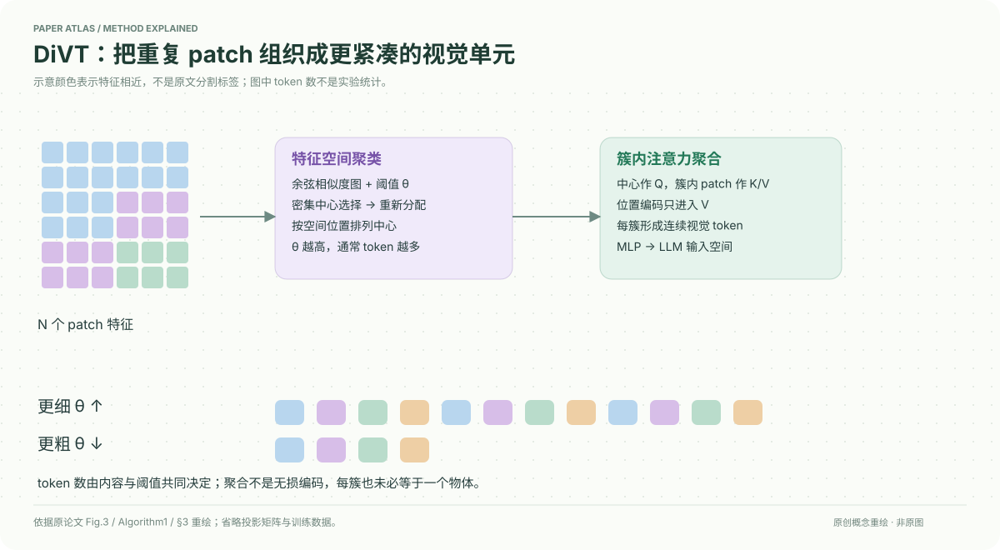

# A More Word-like Image Tokenization for MLLMs

核对日期：2026-10-20。以下实验均为作者报告；本地完成原文阅读与讲解自检，未复现实验。

## 一句话总结

DiVT按视觉特征相似性动态聚类patch，再用簇内注意力生成少量视觉token；它让MLLM输入更紧凑，但token仍是连续嵌入，非真正文字词表。

## 研究背景与动机

固定网格patch重复表达同一对象，也会把对象、背景混进同一token。MLP投影保留这种冗余，增加LLM序列与KV成本。作者希望语义相近patch组成一个单位，复杂图分配更多token，简单图更少。[§1–2，PDF1–3]

“像词”是组织方式比喻，不代表每个簇都必然对应一个可命名物体或无损保留所有细节。

## 方法总览

计算patch余弦矩阵→阈值图中按邻居数选择代表中心→每个patch重新指派给最相似中心→仅簇内cross-attention聚合→MLP映射为LLM视觉token。中心按空间位置排序，保持序列组织。[Fig.3、Algorithm1，PDF3–5]

## 核心创新与关键设计

阈值θ控制邻接：S_ij=cos(x_i,x_j)>θ。选高密度中心后移除其邻居，直到所有patch被覆盖；再按argmax余弦做归属精化，纠正贪心初始分配。[§3.1–3.2]

簇中心作query、patch作key/value，位置信息只加到value，mask限制跨簇读取：
\[t_k=\operatorname{MLP}(\sum_i\operatorname{softmax}(Q_kK_i^\top+M_{ki})V_i),\quad M_{ki}=0\ (i\in C_k),-\infty\ (\text{otherwise}).\]
所有patch参与某个簇不等于其信息无损：聚合仍有容量瓶颈。θ高通常更细、token多，θ低更粗、token少；训练后可改θ，但不能指望超过训练细度就自动获得未学到的细节。[式1–4、§3.4]

训练projector采用语言建模监督，不需额外物体标注；“推理时免训练调token数”不等于整个DiVT无需训练。相似度矩阵本身O(N²)，LLM节省不能直接当作全系统同倍率加速。

## 实验与关键结果

LLaVA1.5 7B替换MLP，其余骨干和数据沿原设置，8个基准分数越高越好。[§4，PDF5–7]

| 作者Table1 | 平均token | MMB | VQAv2 | GQA |
| --- | --- | --- | --- | --- |
| 原MLP | 576 | 64.3 | 78.5 | 62.0 |
| DiVT θ0.75 | 136.5 | 66.7 | 78.2 | 62.0 |
| DiVT θ0.62 | 63.7 | 64.3 | 77.7 | 61.6 |
| DiVT θ0.5 | 35.7 | 65.0 | 77.0 | 60.6 |
| TokenPacker | 36 | 62.8 | 75.0 | 59.6 |

这些是动态token的均值，不是每图固定预算或最大内存上界。θ0.65时，SQA-IMG平均48.3、TextVQA83.4、GQA81.3，不同图内容影响开销。[Table5]

13B中MMB67.7→68.4，但VQAv2 80.0→78.8、TextVQA61.3→59.3；更大LLM也不意味着所有性能无损。[Table3]

## 消融实验与证据强度

Table4把训练θ0.75的模型改到推理θ0.5，平均token136.5→35.7，MMB66.7→65.3，VQAv2 78.2→76.2，体现可调效率/质量折中。随机θ训练使跨粒度较稳，但固定θ在匹配粒度上常更好。[PDF7]

Table2同约64token，DiVT的MM-Vet30.6低于TokenPacker31.7、POPE86.2略低于86.3，因此不能复述“全部projector指标都最好”。正文未提供逐一关闭选中心/重分配/mask的完整受控消融，本地不推断独立贡献数值。

## 局限与讨论

聚类依赖已有编码器的语义质量，小字或细物体仍可能被相似背景合并。θ与编码器特征分布相关，CLIP/SigLIP/DINOv2设置不同。稀疏/变长序列在实际批处理中的padding与内核开销需测量；正文token减少不是本地延迟或显存实测。

连续token之间较低相似度本身不能证明推理因果改善，注意力可视化也不是严格解释性保证。

## 复现提示

源码入口 `https://github.com/snuviplab/DiVT`，本次未核验固定commit与许可证。先固定LLaVA/编码器/训练数据，再检查中心选择、阈值边界、空间排序、mask与位置编码注入。报告每图token分布的均值、P95、最大值，以及真实prefill/decode耗时。

建议 `data/divt/`，本地仅阅读与表格自检，没有训练、权重下载或GPU验证。

## 相关工作与阅读顺序

先读LLaVA的视觉projector，再对照Resampler、TokenPacker和推理token pruning。本文重点是进入LLM前的可训练语义分组，不能与单纯丢弃token、离散图像词表或DeltaTok时间压缩混同。

## 来源与校验

- [CVF 官方论文页](https://openaccess.thecvf.com/content/CVPR2026/html/Lee_A_More_Word-like_Image_Tokenization_for_MLLMs_CVPR_2026_paper.html) · [所读 PDF](https://openaccess.thecvf.com/content/CVPR2026/papers/Lee_A_More_Word-like_Image_Tokenization_for_MLLMs_CVPR_2026_paper.pdf)。页码均为该 PDF 的页序。
- 阅读范围：正文、公式与实验表；补充材料、上游代码与权重未逐项核验。许可证和固定代码 commit 尚未确认，不复制原文全文或数据。
- PDF SHA-256：`e79346cd45cc781fb8c8419608279e92db6fddd11c369dc1e048f41b849334b8`；版本为本次下载的 CVF 接收稿，核对日期 2026-10-20。

- 视觉核对：PDF第5页已渲染查看，核对原表/算法；独立补充材料和上游实现未读。
