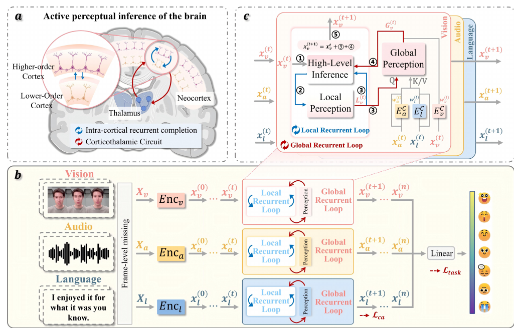

# Active Perceptual Inference: A Corticothalamic-Inspired Dynamic Nested Recurrent Network for Multimodal Sentiment Analysis with Incomplete Data

核对日期：2026-10-22。实验数值均为作者报告；本地完成原文阅读与讲解自检，未复现实验。

## 一句话总结

DNRNet通过模态内纠正与跨模态置信融合反复补全缺失特征，再预测多模态情感评分。

## 研究背景与动机

视觉、语音、文本部分位置缺失时，一次融合可能无法保留局部细节与全局语义。作者借鉴皮层—丘脑循环连接，设计局部和全局双循环修正表示。[§1–2，PDF1–3]

这里“主动”是网络内部迭代，不重新采集丢失数据；脑科学启发没有通过生物机制等价性实验验证。

## 方法总览

原论文Fig.2，PDF第3页。仅裁切相关图示，保留图内科学标签；著作权属于原作者，用于本篇方法分析，不并入本站原创图授权。[来源与作者](https://openaccess.thecvf.com/content/CVPR2026/html/Zhang_Active_Perceptual_Inference_A_Corticothalamic-Inspired_Dynamic_Nested_Recurrent_Network_for_CVPR_2026_paper.html) · [PDF](https://openaccess.thecvf.com/content/CVPR2026/papers/Zhang_Active_Perceptual_Inference_A_Corticothalamic-Inspired_Dynamic_Nested_Recurrent_Network_for_CVPR_2026_paper.pdf)。点击可打开高清图。

视觉/音频经线性层与Transformer，文本先经BERT，统一隐藏表示。局部循环Transformer推断再反馈MLP生成L_m；全局循环预测各模态w_m，对其他模态加权，经交叉注意力提供G_m。残差更新、重复，最终融合池化输出情感分数。[Fig.2、§3，PDF3–5]

训练用完整特征作重建目标，部署只用缺失输入，不能把训练完整目标混进推理。重建的是特征，不是可逐帧验证的原始语音视频。

## 核心创新与关键设计

\[C_m^{(t)}=\sum_{i\ne m}w_i^{(t)}x_i^{(t)},\quad G_m^{(t)}=(1-w_m^{(t)})\operatorname{Attention}(L_m^{(t)},C_m^{(t)},C_m^{(t)}),\]
\[x_m^{(t+1)}=\operatorname{LN}(x_m^{(t)}+\lambda(L_m^{(t)}+G_m^{(t)})).\]
自身置信低时多依赖其他模态。w_m软真值为1-缺失比例，学习保留量代理，不等于校准语义正确概率。[式4–8，PDF4–5]

总损失L_task+αL_ca+βL_rec，前两项MSE、重建平方L2。各模态相加须时间对齐；正文输入长度8，但原始不同长度处理需代码。按批平均相对L2变化<1e-4停止是稳定判据，不保证正确、全局最优或必定收敛。[式9–13]

## 实验与关键结果

MOSI划分1284/229/686、MOSEI16326/1871/4659、SIMS1368/456/457。训练每模态一半样本完整，其余独立随机掩码；测试缺失率0至0.9步长0.1，视觉/音频补零、文本UNK。主表跨缺失率平均。[§4.1–4.2，PDF5–6]

L40S、AdamW、3seed均值，隐藏128、batch64、lr1e-4、200epoch配early stopping；α/β分别MOSI0.5/0.1，MOSEI0.9/10，SIMS0.9/0.1。[§4.3]

| 作者报告 | P-RMF | DNRNet |
| --- | --- | --- |
| MOSI Acc-2负/正 | 72.81% | 74.22% |
| MOSI Acc-2负/非负 | 71.53% | 73.19% |
| MOSI MAE↓ | 1.038 | 1.036 |
| MOSEI Acc-2负/正 | 78.14% | 78.28% |
| SIMS Acc-2 | 73.64% | 73.82% |

来源Table1–2，PDF6–7。两种二分类零分处理不同，不混用。MOSEI仅+0.14pp、SIMS+0.18pp，不能套用摘要1.5–2.0到每项。MOSEI Acc-7 CENET47.18高于本文46.89；SIMS F1本文77.50低于LNLN79.43，非所有指标最优。

## 消融实验与证据强度

MOSI完整Acc-2负/非负73.19、MAE1.036；仅一轮72.57/1.058，去局部72.41/1.049，去全局72.22/1.059，去置信损失71.44/1.072，支持组件作用但没有方差可判断细差异显著性。[Table3，PDF8]

t-SNE及重建箱图是表示与辅助任务证据，低维投影重叠不能证明原数据事实已恢复，也不能单独证明情感类别可分。[Fig.5]

## 局限与讨论

独立随机掩码不等于连续丢包、系统性遮挡或整模态缺失；补出的特征可能合理但错误。保留比例置信监督也难辨别完整但误导的数据。

停止基于批平均，可能受同批其他样本影响；最大迭代和稳定性约束未充分给出，不承诺最少迭代或必定终止。主文缺完整时延预算比较，反复计算有代价。数据集情感评分不等于个人真实心理状态的可靠测量。

## 复现提示

正文未给可确认专用源码入口，commit、许可证和补充材料待查，以CVF官方页为来源起点。建议 `experiments/multimodal/dnrnet/`，数据与特征按各自许可存仓库外。

复现固定BERT、特征提取、对齐、掩码seed及二分类协议，记录每样本迭代分布和批组成；确认完整目标仅用于训练。本地未训练、补全或执行情感预测，全部数值为作者报告。

## 相关工作与阅读顺序

先读缺失数据建模和交叉注意力，再检查w_m监督来源与递归残差。最后分别核对平均缺失率表、单缺失率曲线和停止条件，区分脑科学动机与网络实证。

## 来源与校验

- [CVF官方论文页](https://openaccess.thecvf.com/content/CVPR2026/html/Zhang_Active_Perceptual_Inference_A_Corticothalamic-Inspired_Dynamic_Nested_Recurrent_Network_for_CVPR_2026_paper.html) · [所读PDF](https://openaccess.thecvf.com/content/CVPR2026/papers/Zhang_Active_Perceptual_Inference_A_Corticothalamic-Inspired_Dynamic_Nested_Recurrent_Network_for_CVPR_2026_paper.pdf)。页码均为PDF页序。
- 所读版本：2026-10-21从CVF下载的开放接收稿；PDF SHA-256：`23ea0a1c9645f5802a6f572f689780e10bd96fab88d037fff490e7442616db9c`。
- 阅读范围：正文、方法公式、实验与消融；补充材料、代码及权重未逐项核验。reviewed表示本地讲解自检，不表示独立同行评审或实验复现。
- 方法图与关键公式/表格已渲染核对，所引原图已单独检查；未对新文章进行浏览器交互验收。作者图示与本站原创素材权利分开记录。
