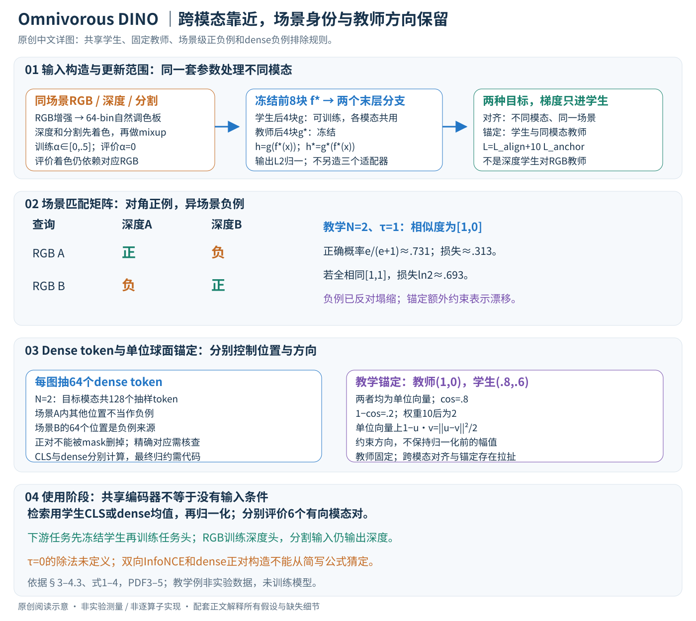

# A Mixed Diet Makes DINO An Omnivorous Vision Encoder

核对日期：2026-10-20。以下实验均为作者报告；本地完成原文阅读与讲解自检，未复现实验。

方法与配图详细版返工：2026-10-25。细化样本配对、InfoNCE归约、dense负例掩码与冻结边界；未复现实验。

## 一句话总结

冻结DINOv2的大部分骨干，仅微调末层，用跨模态对齐和教师锚定双损失，让RGB、深度与分割图在共享特征空间更接近，同时尽量保留原有区分能力。

## 研究背景与动机

同一场景的RGB与深度图，在原DINO特征中的相似度可能接近无关图片；强RGB表示不等于天然跨模态对齐。若只追求对齐，所有特征塌成常量也能满足，因此还需保留场景判别性。[§1，PDF1–2]

本文是训练后的表示适配，不是重新训练一个从任意传感器原始信号都能无条件读取的模型。

## 方法总览

原创图解释共享参数、样本配对和训练目标；二维单位向量及小batch为教学例，不是作者实验特征。

### 输入并非原始传感器流，而是配准并着色的图像

一个训练样本是同一场景的RGB、深度和分割三元组，需保留场景身份与空间对应。它们进入同一视觉编码器，因此深度值与类别ID先转成图像形式。不能把该流程直接替换成任意点云、声音或原始传感器字节，再声称模型“什么都能吃”。（§3，PDF第3–4页）

RGB训练时先做亮度、对比度、色相和饱和度增强，再将像素量化为64个bin形成自然调色板，用于对应深度与分割着色。主文没有充分给出深度数值到色板的映射、类别颜色分配和量化算法，64-bin不能自行扩写成某种聚类实现。**评价也保留对应RGB参与的着色**，只是去掉训练mixup；因此表中的跨模态能力不等于完全没有RGB辅助信息的独立深度推理。（§3.2）

随后训练输入为

\[
x_d^{mix}=(1-\alpha_d)x_d+\alpha_d x_r^{aug},\quad
x_s^{mix}=(1-\alpha_s)x_s+\alpha_s x_r^{aug}.
\]

两种alpha独立逐样本随机采样于[0,0.5]，评价设0。教学像素：着色深度值0.2、RGB值0.8、alpha=.25，混合为.35；实际对RGB三通道逐元素执行，不是在真实深度米数上插入RGB值。alpha=0只表示没有直接像素混合，不能抹去此前色板取自RGB这一事实。

### 一个共享学生，另有固定教师作参照

\[
z_m=f^*(x_m),\qquad h_m=g(z_m),\qquad h_m^*=g^*(z_m).
\]

f*是冻结的早期骨干，g是学生可训练的后期块，g*是冻结教师的对应块。DINOv2 ViT-Base共有12块，默认前8块冻结、后4块微调。g不是额外新增的“小MLP”这一必然结构，而是用原网络后四块实现适配器；它也不是后续任务实验训练的深度预测头。所有模态共用同一g，不各自维护一个RGB/深度/分割专属适配器。（§3.1、Fig.2，PDF第3页）

用N表示场景batch、P表示每图patch token数、D表示特征维，CLS输出可写N×D，dense输出N×P×D。学生和教师输出逐特征L2归一化，因此余弦相似度等于单位向量点积。主文没有在方法段列出完整训练分辨率、patch规格和额外特殊token配置，这里以P、D表示，不猜固定张量尺寸。每种模态都要经过学生和教师末层；冻结层意味着不更新参数，不意味着没有前向计算成本。

## 核心创新与关键设计

### 对齐只在学生之间进行：同场景为正，异场景为负

对模态a到b，构造 \(S_{ij}=\langle h_a^{(i)},h_b^{(j)}\rangle\)，形状N×N。第i行的对角元素是同场景正对，其余列是不同场景负对：

\[
\ell_{a\to b}=-\frac1N\sum_i\log
\frac{\exp(S_{ii}/\tau)}{\sum_j\exp(S_{ij}/\tau)}.
\]

分母包括正对。损失不是让所有模态特征无差别靠近，而是让正确场景在目标模态图库中排名更靠前。三模态有RGB–Depth、RGB–Seg、Depth–Seg三组，不只把两种模态单向拉向RGB教师。（式1–2，PDF第4页）

论文文字称symmetric，但式1本身写的是一个方向的逐行softmax，式2只枚举三组无序模态对。严格双向通常需要对a→b与b→a取平均，这属于常见实现解释；主文公式没有展开这个平均操作，不能把未核对的代码细节当已知。复现应确认是否反向计算、如何归一化及各组权重。

教学N=2且tau=1，某一查询对正确目标相似度1、错误目标0，正确概率为e/(e+1)≈.731，损失≈.313。若两目标相似度都为1，概率变为.5，损失ln2≈.693。由此可见InfoNCE的负例已反对常量塌缩；不能说“仅有对齐损失的全局最优必然是常量”。论文观察到无锚定的退化还涉及优化与表示漂移，锚定给出保留原空间的额外约束。

### 温度调节难度，但文中零端点需实现核对

正文把可学习温度写为tau并裁剪到[0,100]，公式使用exp(sim/tau)。tau=0时表达式未定义；需要核对实现究竟使用正下界、log温度还是逆温度参数。这里不擅自把其改成CLIP式logit_scale。对固定相似度而言，更小的正tau使softmax更尖锐，错配样本的惩罚和梯度尺度会变化，因此不是无关的显示参数。（式1附近文字）

### 教师锚定按同模态对应，不把深度一律拉向RGB教师

\[
\mathcal L_{anchor}=\frac1{|\mathcal M|}\sum_m
[1-\langle h_m,h_m^*\rangle],\qquad
\mathcal L_{total}=\mathcal L_{align}+10\mathcal L_{anchor}.
\]

RGB学生对应RGB教师，深度学生对应深度教师，分割同理。教师输出是固定目标；梯度通过学生末层更新g，不更新f*或g*。L2归一化后的向量满足 \(1-u^Tv=\frac12\|u-v\|_2^2\)，所以锚定可理解为单位球面上距离的惩罚，约束方向而非原始特征幅值。（式3–4）

教学教师向量(1,0)、学生(.8,.6)，两者范数均1，锚定损失为.2，乘权重10为2。实际总损失还要按模态、batch及token分支归约，这个单向量例不代表训练日志的真实量级。跨模态对齐想改变原来不一致的方向，教师锚定想保留各自原位置，两者存在拉扯；加大10不会同时无限提升对齐与判别性。

### Dense token掩码：同图其他位置不自动作为负例

作者对CLS和dense分别算损失，dense每图抽64个token，避免把同一图内token作为负例。若N=2，每个目标模态有128个抽样token；场景A查询面对场景A的其他位置时不能按“不同索引就是负例”处理，异场景B的64个位置才属于允许负例来源。（§3.3）

同图邻近位置可能属于同一物体，硬当负例会与语义对齐冲突；同时必须保留正确正对，否则掩码把整行删除无法定义softmax。原文未完整列出跨模态抽样坐标是否共享、几何增强如何同步、多个有效正对怎么处理，以及CLS与dense损失最终权重，这些都需要实现核对。本讲解只明确它公开的负例排除规则，不伪造精确掩码矩阵。

若直接计算全部抽样token对，相似度矩阵一侧为64N，存储随(64N)²增长。每图抽64可降低相对于全P个位置的代价，但不意味着完全线性于batch；具体实现可分块，主文没有公布这里的实际显存。本段是朴素计算规模说明，不是运行benchmark。

### 训练和使用的边界：适配器训练完后，任务头可另训

训练顺序是：组成配对场景batch→RGB增强→派生色板→深度/分割着色→独立mixup→共享冻结前层→学生末层与冻结教师末层→归一化→CLS和dense对齐/锚定→更新学生末层与温度参数。无需把三种模态在推理时同时送入网络；共享编码器可逐输入提取表示，但输入构造仍须遵守着色条件。

检索时只用适配后的学生，取CLS或dense全局平均并归一化，计算查询与图库余弦；每种方向有自己的排名，再汇总6个有向模态对。适配后的网络在下游评价再次冻结，另外训练线性/DPT等任务头。因此“适配器微调”“下游头训练”“跨模态零样本替换输入”是三个阶段，不能将后两者混成没有任何训练的深度估计。（§4.1–4.3，PDF第5页）

零样本迁移例是：用RGB训练深度头，测试改成分割输入，输出任务仍是深度；不是从分割图生成RGB。未见NOCS的结果提供该特定跨模态迁移证据，少量艺术X-ray展示也不等于医学用途得到验证。

### 为什么保留原空间，以及它没有保证什么

锚定试图降低灾难性遗忘，Table4中ImageNet kNN基本持平支持这一点；但iNat和GLDv2下降说明固定教师约束并不保证所有分布无损。更强下游头可能掩盖表示差别，例如NYUv2 DPT两者RMSE均.297，而线性头显示改进。应分别评价跨模态检索、保留原任务能力、预处理依赖和未知模态泛化，不把共享空间图画成全部特征严格重合。（PDF第5–8页）

## 实验与关键结果

跨模态检索对6个有向模态对求平均，GAP为dense均值、TOK为CLS；MOVi/TartanAir各128场景，ScanNet3072。[Table1，PDF6]

| GAP作者结果 | DINO R@1↑ | 本文 R@1↑ | MedR↓变化 |
| --- | --- | --- | --- |
| MOVi | 15.5 | 86.2 | 19.3→1.0 |
| ScanNet | 4.6 | 46.1 | 401.8→2.0 |
| TartanAir | 46.6 | 90.6 | 1.8→1.0 |

下游线性头，NYUv2 RMSE0.405→0.377，ImageNet TOK+GAP精度80.4→83.8%；更强DPT头的NYUv2两者均0.297。Cityscapes DPT mIoU0.737→0.732，不能说所有任务无损改善。[Table2–3]

NYUv2 RGB训练头、PACE测试时改输入分割：线性RMSE1.536→0.532；未见NOCS输入1.996→1.075。改的是输入模态，任务仍为深度预测，不是直接生成RGB。[Table5，PDF7]

## 消融实验与证据强度

Fig.4改变λ_anchor，低权重更对齐但场景区分下降；λ=0的深度/分割点退化，说明锚定不是可省的装饰。具体mixup范围、冻结层数与替代教师消融主要在未读附录，不能声称逐项核验其数值。[PDF7–8]

ImageNet kNN81.936→81.974基本持平；iNat78.53→77.49、GLDv2 51.90→50.13下降，RP2K66.83→70.48上升。适配后的训练数据偏好仍会影响细粒度识别。[Table4]

## 局限与讨论

测试着色依赖RGB调色板，模态获取与预处理条件应完整说明。高分辨率末阶段微调是否必要尚不明确；未见模态的artwork X-ray主要是少量特征相似度示例，不是医学或普遍X-ray诊断验证。[§5，PDF8]

图示中的共享空间不是每个位置的严格语义等价证明，错误深度/分割标签也会传播偏差。实验未本地复现。

## 复现提示

先核对权重仓库 `https://github.com/google-deepmind/representations4d` 的固定commit与许可，本次仅记录入口。保留RGB到depth/seg着色流程、mixup分布、冻结层数和dense token负例mask，防止遗漏预处理导致不可比。

建议 `data/omnivorous/`，按原数据集许可获取配对数据。评价应额外区分有RGB辅助着色和独立模态输入；此额外对照尚未运行。

## 相关工作与阅读顺序

先读DINOv2与InfoNCE，再看ImageBind/Omnivore的共享空间理念，最后比较本文后期少层适配与全模型多模态预训练的差异。阅读时优先看训练/评价着色条件、Table1检索和Table4不利结果。

## 来源与校验

- [CVF 官方论文页](https://openaccess.thecvf.com/content/CVPR2026/html/Kabra_A_Mixed_Diet_Makes_DINO_An_Omnivorous_Vision_Encoder_CVPR_2026_paper.html) · [所读 PDF](https://openaccess.thecvf.com/content/CVPR2026/papers/Kabra_A_Mixed_Diet_Makes_DINO_An_Omnivorous_Vision_Encoder_CVPR_2026_paper.pdf)。页码均为该 PDF 的页序。
- 阅读范围：正文、公式与实验表；补充材料、上游代码与权重未逐项核验。许可证和固定代码 commit 尚未确认，不复制原文全文或数据。
- PDF SHA-256：`ed985902cd96e9106b48b15249e793eff9bf89ded5d8d8092d35830bd87d439f`；版本为本次下载的 CVF 接收稿，核对日期 2026-10-20。

- 视觉核对：PDF第6页已渲染查看，核对原表/算法；独立补充材料和上游实现未读。

- 2026-10-25详细版：重读PDF第3–5页、渲染第3页；重绘原创图，浏览器上下半部与文章检查通过，6个公式无错误、坏图或横向溢出。
