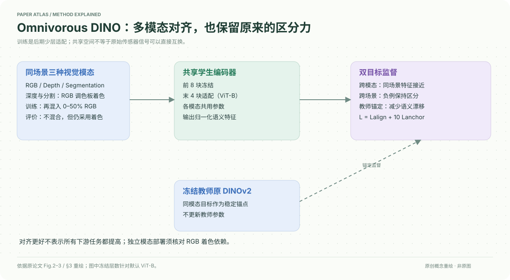

# A Mixed Diet Makes DINO An Omnivorous Vision Encoder

核对日期：2026-10-20。以下实验均为作者报告；本地完成原文阅读与讲解自检，未复现实验。

## 一句话总结

冻结DINOv2的大部分骨干，仅微调末层，用跨模态对齐和教师锚定双损失，让RGB、深度与分割图在共享特征空间更接近，同时尽量保留原有区分能力。

## 研究背景与动机

同一场景的RGB与深度图，在原DINO特征中的相似度可能接近无关图片；强RGB表示不等于天然跨模态对齐。若只追求对齐，所有特征塌成常量也能满足，因此还需保留场景判别性。[§1，PDF1–2]

本文是训练后的表示适配，不是重新训练一个从任意传感器原始信号都能无条件读取的模型。

## 方法总览

RGB、深度、分割共用冻结前8个ViT-B块，学生末4块可训练；教师全冻结。学生各模态互相对齐，同模态学生向教师锚定。深度/分割先用对应RGB的自然色板着色，训练时再与RGB混合0–50%。[Fig.2–3，§3，PDF3–4]

## 核心创新与关键设计

学生\(h_m=g(f^*(x_m))\)，教师\(h_m^*=g^*(f^*(x_m))\)，均L2归一化。总损失
\[L=L_{align}+10L_{anchor},\quad L_{anchor}=\frac1{|\mathcal M|}\sum_m[1-\cos(h_m,h_m^*)].\]
对齐使用不同模态同场景正对、不同场景负对的对称InfoNCE，分别作用于CLS和稠密token；每图抽64个dense token，避免同图token互为负例。[式1–4]

64-bin自然色板使深度/分割的低级颜色统计接近RGB，减少依赖模态颜色捷径。Mixup训练插值不同模态，测试α=0。**着色在评价也使用对应RGB调色板**，因此不能直接把当前结果当成不需要RGB信息的原生深度传感器独立推理。[§3.2]

低锚定权重更对齐但语义漂移，高权重保留原空间却降低对齐；目标是折中，不是两个目标可同时无限提高。

## 实验与关键结果

跨模态检索对6个有向模态对求平均，GAP为dense均值、TOK为CLS；MOVi/TartanAir各128场景，ScanNet3072。[Table1，PDF6]

| GAP作者结果 | DINO R@1↑ | 本文 R@1↑ | MedR↓变化 |
| --- | --- | --- | --- |
| MOVi | 15.5 | 86.2 | 19.3→1.0 |
| ScanNet | 4.6 | 46.1 | 401.8→2.0 |
| TartanAir | 46.6 | 90.6 | 1.8→1.0 |

下游线性头，NYUv2 RMSE0.405→0.377，ImageNet TOK+GAP精度80.4→83.8%；更强DPT头的NYUv2两者均0.297。Cityscapes DPT mIoU0.737→0.732，不能说所有任务无损改善。[Table2–3]

NYUv2 RGB训练头、PACE测试时改输入分割：线性RMSE1.536→0.532；未见NOCS输入1.996→1.075。改的是输入模态，任务仍为深度预测，不是直接生成RGB。[Table5，PDF7]

## 消融实验与证据强度

Fig.4改变λ_anchor，低权重更对齐但场景区分下降；λ=0的深度/分割点退化，说明锚定不是可省的装饰。具体mixup范围、冻结层数与替代教师消融主要在未读附录，不能声称逐项核验其数值。[PDF7–8]

ImageNet kNN81.936→81.974基本持平；iNat78.53→77.49、GLDv2 51.90→50.13下降，RP2K66.83→70.48上升。适配后的训练数据偏好仍会影响细粒度识别。[Table4]

## 局限与讨论

测试着色依赖RGB调色板，模态获取与预处理条件应完整说明。高分辨率末阶段微调是否必要尚不明确；未见模态的artwork X-ray主要是少量特征相似度示例，不是医学或普遍X-ray诊断验证。[§5，PDF8]

图示中的共享空间不是每个位置的严格语义等价证明，错误深度/分割标签也会传播偏差。实验未本地复现。

## 复现提示

先核对权重仓库 `https://github.com/google-deepmind/representations4d` 的固定commit与许可，本次仅记录入口。保留RGB到depth/seg着色流程、mixup分布、冻结层数和dense token负例mask，防止遗漏预处理导致不可比。

建议 `data/omnivorous/`，按原数据集许可获取配对数据。评价应额外区分有RGB辅助着色和独立模态输入；此额外对照尚未运行。

## 相关工作与阅读顺序

先读DINOv2与InfoNCE，再看ImageBind/Omnivore的共享空间理念，最后比较本文后期少层适配与全模型多模态预训练的差异。阅读时优先看训练/评价着色条件、Table1检索和Table4不利结果。

## 来源与校验

- [CVF 官方论文页](https://openaccess.thecvf.com/content/CVPR2026/html/Kabra_A_Mixed_Diet_Makes_DINO_An_Omnivorous_Vision_Encoder_CVPR_2026_paper.html) · [所读 PDF](https://openaccess.thecvf.com/content/CVPR2026/papers/Kabra_A_Mixed_Diet_Makes_DINO_An_Omnivorous_Vision_Encoder_CVPR_2026_paper.pdf)。页码均为该 PDF 的页序。
- 阅读范围：正文、公式与实验表；补充材料、上游代码与权重未逐项核验。许可证和固定代码 commit 尚未确认，不复制原文全文或数据。
- PDF SHA-256：`ed985902cd96e9106b48b15249e793eff9bf89ded5d8d8092d35830bd87d439f`；版本为本次下载的 CVF 接收稿，核对日期 2026-10-20。

- 视觉核对：PDF第6页已渲染查看，核对原表/算法；独立补充材料和上游实现未读。
