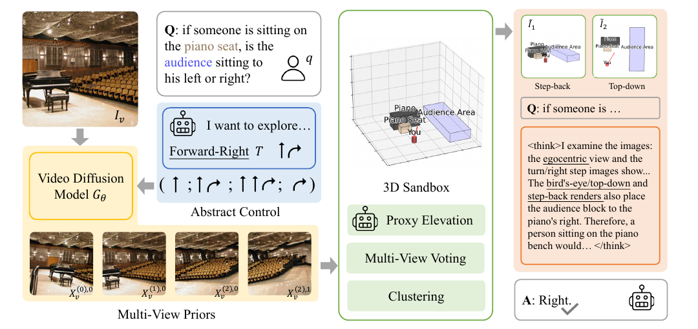

# Abstract 3D Perception for Spatial Intelligence in Vision-Language Models

核对日期：2026-10-20。以下实验均为作者报告；本地完成原文阅读与讲解自检，未复现实验。

## 一句话总结

SandboxVLM把生成多视图提升成稀疏三维代理和物体框，再渲染俯视与后退视图辅助现有VLM回答空间问题，无需额外训练VLM。

## 研究背景与动机

普通VLM容易在视角转换、遮挡和物体关系上犯错。作者选择提供粗三维结构，而非训练新三维编码器或重建完整纹理场景；原始图像仍保留外观信息。[§1–2，PDF1–2]

生成的额外视图来自模型先验，不是新拍摄的独立观测。它们可能补充合理假设，也可能把错误场景变得自洽，因此“信息增加”需区分测量信息和先验展开。

## 方法总览

VLM按问题选左、前左、前、前右或右等抽象探索方向；SEVA生成对应轨迹视频，VGGT估深度/相机，VLM点出相关物体，分割模型生成mask。腐蚀mask后每物体每视图FPS采30个内部点，反投影为3D代理。[Fig.2–3、§3，PDF3–4]

跨视图投票过滤代理，再按类别DBSCAN分实例，以PCA拟合有向包围盒；渲染后退2m与俯视图，连同原始图和问题交给VLM回答。[§3.4–3.5，PDF5]

图：原论文 Fig.2，PDF第3页。仅裁去页边及无关正文，图内内容未改；著作权属于原作者，用于本篇方法分析，不按本站原创图重新授权。[原文与作者信息](https://openaccess.thecvf.com/content/CVPR2026/html/Liu_Abstract_3D_Perception_for_Spatial_Intelligence_in_Vision-Language_Models_CVPR_2026_paper.html) · [PDF](https://openaccess.thecvf.com/content/CVPR2026/papers/Liu_Abstract_3D_Perception_for_Spatial_Intelligence_in_Vision-Language_Models_CVPR_2026_paper.pdf)。点击可查看高清图。

## 核心创新与关键设计

跨视图一致性定义为：\(Agree(p,X_v)=1\)当同类物体在该视图提升出的点集合中存在\(p^\prime\)满足\(\|p-p^\prime\|_2<\delta\)。获得N个视图支持才保留，再聚类拟合盒。[式8]

这要求相机/深度坐标已可比较，δ还依赖尺度。原文式8把v作为输入视图索引，要求v≠v0，而生成轨迹另外用m,t表示；单输入多合成视图时如何计票，符号定义不足，需看补充实现。

PCA轴能概括点集，但平面、对称或稀疏物体方向可能不稳定；固定“后退2m”也依赖尺度标定，不能把所有单目结果都当真实米制地图。

## 实验与关键结果

评估SAT-Real/Synth、BLINK空间/深度、EmbSpatial与PhysBench；SAT合成集为控制API开销做了子采样。主要超参M/T/N/δ、提示和调用预算在补充材料，本次未核验。[§4.1，PDF5–6]

| SAT-Real作者报告平均准确率↑ | 基线 | MindJourney | SandboxVLM |
| --- | --- | --- | --- |
| GPT-4o | 60.3 | 69.4 | 77.7 |
| GPT-5-mini | 75.4 | 78.7 | 84.1 |
| GPT-5 | 80.1 | 72.8 | 84.3 |

来源Table2，PDF6。摘要8.3pp是4o下相对MindJourney；mini相对自基线为8.7pp，相对MindJourney为5.4pp；文中另报相对训练模型3.8pp，比较对象不能混淆。Table1 GPT4o基线SAT-Real为58.3，与Table2的60.3不一致，需协议核验。

PhysBench由MindJourney54.9到58.3，+3.4pp；并非所有子任务最好，例如mini的ActionConsequence81.1→79.4。[Table1–2]

## 消融实验与证据强度

同GPT5mini的SAT-Real消融：原始75.4、多视图78.7、三维点云渲染73.7、坐标文本80.8、代理点渲染77.0、单图Sandbox77.6、完整84.1。[Table3，PDF7]

说明不是“越多三维可视化越好”；噪声点云反而损害结果。不同表示可能同时改变信息量、输入token和计算预算，不能把所有差异都归因于视觉形式本身。

## 局限与讨论

错误会沿生成、定位、分割、深度和聚类传播；多视图投票只能去掉不一致误差，不能排除多张合成图共享同一幻觉。作者仅构建静态Sandbox，不显式建质量、摩擦、材料，无法替代物理模拟。[PDF8]

多模型、多次调用可能昂贵且慢，“training-free”不表示免费或单次推理。现有实验不足以保证机器人安全操作、精确导航或未来更强VLM也总获益。

## 复现提示

建议 `data/spatial-reasoning/sandboxvlm/`，固定原图、问题、合成视图seed、相机变换与尺度、mask、δ/N及DBSCAN设置。分别记录真实输入与生成输入，加入无生成、等调用预算和几何错误对照。

本次只读正文，未核验本项目代码/commit/许可证或补充超参；没有调用论文中的付费VLM API，没有运行SEVA/VGGT，也未真实重建用户场景。

## 相关工作与阅读顺序

先读反投影与相机尺度，再看3D场景图、VGGT和生成多视图的误差来源。最后用Table3理解粗盒为何可能胜过密点云，同时保持对生成先验真实性的区分。

## 来源与校验

- [CVF 官方论文页](https://openaccess.thecvf.com/content/CVPR2026/html/Liu_Abstract_3D_Perception_for_Spatial_Intelligence_in_Vision-Language_Models_CVPR_2026_paper.html) · [所读 PDF](https://openaccess.thecvf.com/content/CVPR2026/papers/Liu_Abstract_3D_Perception_for_Spatial_Intelligence_in_Vision-Language_Models_CVPR_2026_paper.pdf)。页码均为该 PDF 的页序。
- 阅读范围：正文、公式与实验表；补充材料、上游代码与权重未逐项核验。许可证和固定代码 commit 尚未确认，不复制原文全文或数据。
- PDF SHA-256：`d82b09ca0128f1e75e6009d29534437bb02ff588d21cba8ebd9cc7395bad2fca`；版本为本次下载的 CVF 接收稿，核对日期 2026-10-20。
- 视觉核对：PDF第3页及所引流程图已渲染检查；本地未复现实验。
