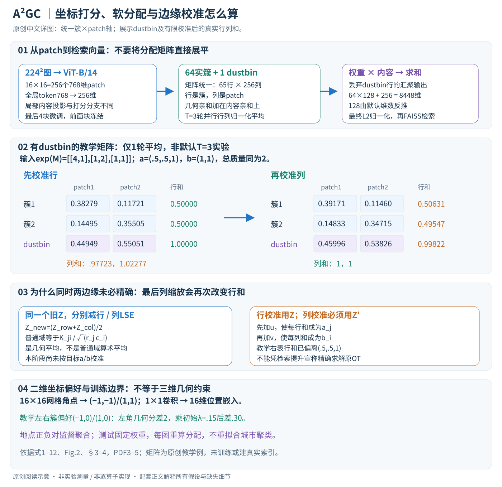
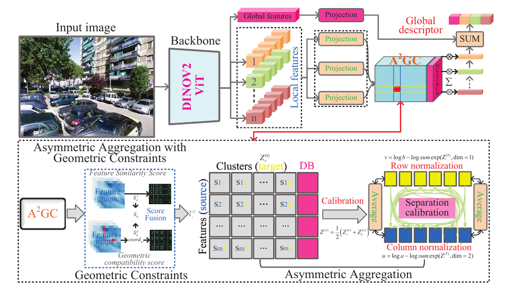

# A2GC: Asymmetric Aggregation with Geometric Constraints for Locally Aggregated Descriptors

核对日期：2026-10-29。以下实验均为作者报告；本地完成原文阅读与讲解自检，未复现实验。

## 一句话总结

A²GC为地点识别的局部特征聚合加入二维坐标偏好，并用行列对数归一化平均及一次边缘校准生成分配权重，提升全局检索描述子的辨别力。

## 研究背景与动机

同一地点跨季节、视角和光照变化很大；DINOv2局部特征好，不代表简单池化就能保留稳定地标。方法沿SALAD路线把patch分配到聚类槽位，并引入位置相关打分。[§1–2，PDF1–2]

需要纠正背景解读：标准Sinkhorn本来就可处理不同维度及不同给定边缘a、b，不要求两种特征“分布相同”。本文的新归一化日程应作为经验设计评价，不能把作者的“Sinkhorn要求对称分布”当作一般最优传输定理。

## 方法总览

DINOv2给出patch与全局token；局部特征相似度加上坐标embedding与聚类位置embedding的内积，经包含dustbin的分配模块得到各聚类加权描述子，再与全局分支拼接并L2归一化检索。[Fig.2、§3，PDF3–4]

坐标是图像二维归一化位置，不是相机位姿或世界三维几何。

图：原论文 Fig.2，PDF第4页。仅裁去页边及无关正文，图内内容未改；著作权属于原作者，用于本篇方法分析，不按本站原创图重新授权。[原文与作者信息](https://openaccess.thecvf.com/content/CVPR2026/html/Li_A2GC_Asymmetric_Aggregation_with_Geometric_Constraints_for_Locally_Aggregated_Descriptors_CVPR_2026_paper.html) · [PDF](https://openaccess.thecvf.com/content/CVPR2026/papers/Li_A2GC_Asymmetric_Aggregation_with_Geometric_Constraints_for_Locally_Aggregated_Descriptors_CVPR_2026_paper.pdf)。点击可查看高清图。

## 核心创新与关键设计

### 1. 一张图怎样变成可检索向量

输入是单幅图像，输出是一个全局描述子；数据库图与查询图都用同一网络编码，再按向量距离检索。这里不直接输出经纬度或相机6DoF位姿。监督来自训练集的地点分组，同地点不同图作为正对；测试的Recall@K则检查前K个数据库候选是否含符合协议的正确地点。[PDF3–5]

| 接口 | 默认设置下的形状与说明 |
| --- | --- |
| DINOv2 ViT-B/14局部特征 | \(768\times H\times W\)，224²输入对应16×16 patch网格，\(n=256\) |
| 全局token \(t\) | 768维，经两层MLP投影为\(g=256\)维 |
| 局部投影 \(v_i\) | 每patch为\(\ell\)维；默认8448维输出对应\(\ell=128\)，由\(64\ell+256=8448\)反推 |
| 实簇打分 | \(m\times n=64\times256\)；本文统一用簇为行、patch为列 |
| dustbin扩展打分 | \((m+1)\times n=65\times256\) |
| 坐标嵌入 | 每patch 16维，每个实簇也有16维的可学习位置偏好 |
| 最终描述子 \(q\) | \(m\ell+g=8192+256=8448\)维，再L2归一化 |

局部投影维度在§4.1句子中漏印具体数值，所以上表明确把128标成维数反推，而不是原句已写明。聚类中心用于打分，与DINOv2本身的patch token、全局token不是同一类可学习参数。[PDF3、5，Table1/3]

### 2. 分配到槽位，再做加权汇聚：为什么需要dustbin

SALAD式聚合先为每个局部特征计算对各簇的亲和分数。局部内容投影与打分网络分开：一个产生被汇聚的\(v_i\)，另一个产生\(S^f\)。分配矩阵\(P_{ji}\)表示patch \(i\)对簇\(j\)的质量；并不要求每个patch硬归属唯一簇。

额外一行dustbin接收不适合聚合到实簇的质量，避免每个瞬时物体、天空或不稳定区域都被迫强烈进入地标描述。学习到的dustbin不等于有人工语义标签的“车辆分割器”。最终仅实簇形成局部输出；dustbin不是第65个照常拼接的检索槽位。其打分参数\(z\)初始化1.0。[PDF3–5，Fig.2]

按图2的求和接口，可将某个簇的汇聚写成阅读展开：
\[
d_j=\sum_{i=1}^nP_{ji}v_i\in\mathbb R^\ell,
\qquad
q=\operatorname{L2Norm}\left([d_1;\ldots;d_m;\phi_t(t)]\right).
\]
这里说明权重与内容的连接，不擅自增加NetVLAD的“减中心残差”操作；每簇是否另做intra-normalization、dustbin删除后是否再缩放等细节正文没有列全，复现仍需对照实现。描述子不是将65×256矩阵直接展平成16640维。

### 3. 几何约束是二维位置偏好，怎样进入打分

按原式9的轴约定，\(x\in\{0,\ldots,H-1\}\)、\(y\in\{0,\ldots,W-1\}\)：
\[
u_{xy}=\left[\frac{2x}{H-1}-1,\frac{2y}{W-1}-1\right],
\quad g_{xy}=\phi_g(u_{xy})\in\mathbb R^{16},
\quad S^g_{ji}=g_{xy}^{\top}c_j^g,
\quad S_{ji}=S^f_{ji}+\lambda_gS^g_{ji}.
\]
\(c_j^g\)是第\(j\)簇的位置偏好，\(\lambda_g\)是可学习标量，初始化.15。原文把特征索引写在前、簇索引写在后，但又把传输矩阵定义成簇×特征；本文明确转置索引来统一维度，不改变内积内容。[PDF4，式9–12]

16×16网格的角点\((0,0)\)映射到\((-1,-1)\)，\((15,15)\)映到\((1,1)\)；网格偶数时没有恰好位于\((0,0)\)的中心patch，\((7,7)\)约为\((-.0667,-.0667)\)。分辨率变化仍映同一坐标区间，但\(H=1\)或\(W=1\)会出现除零，正文未给特殊处理。

教学例将16维简化成2维并令\(\phi_g\)为恒等：左偏好簇\(c_L=(-1,0)\)，右偏好簇\(c_R=(1,0)\)。对左上角\((-1,-1)\)，几何分数分别为1和−1；若两簇内容分数原本相同、\(\lambda_g=.15\)，总分相差.30。它鼓励同样内容在不同位置分配到不同槽位，仍可被更强内容证据覆盖。此二维参数是解释例，不是作者的实际16维权重。

若\(\phi_g\)确为不含额外非线性的1×1卷积，它对坐标是仿射映射，和\(c_j^g\)内积后也是坐标的仿射偏好。因此这不是patch两两欧氏距离损失、三维几何验证或强制空间邻近同簇的约束。正文没有约束\(\lambda_g\)必须为正，不能把初始化的正数当成整个训练始终为正的保证。

### 4. 在对数域初始化：高分表示亲和，不要与运输成本混淆

论文先介绍\(\min_P\langle P,C\rangle-\epsilon H(P)\)的熵正则OT动机，然后实际算法接收**高分更匹配**的log-affinity矩阵\(M\)：
\[
Z^{(0)}=\frac{M}{\max(\tau,10^{-6})},\qquad
Z\in\mathbb R^{(m+1)\times n}.
\]
若上游给的是越小越好的成本，必须转换符号；不能直接把\(C\)代入并仍说高值会被抑制。默认\(\tau=1\)，小温度会放大亲和差异；下限只防除零，不保证整个算法没有上溢、下溢或梯度不稳定。[PDF3，式1–3]

记\(a\in\mathbb R^{m+1}_{>0}\)为行目标质量、\(b\in\mathbb R^n_{>0}\)为列目标质量。两者总质量必须相同，才可能同时满足所有边缘约束。正文定义了\(a,b\)但没有列默认dustbin占比或归一化数值；本文不把SALAD某个版本的边缘配置自动冒充本论文设置。目标质量为0时还需处理\(\log0\)，原式以可取对数为前提。

### 5. 第一个阶段：同一旧矩阵分别归一化，再取平均

对\(T=3\)轮中的每一轮，分别计算
\[
R_j=\operatorname{LSE}_{i}(Z_{ji}),\qquad
C_i=\operatorname{LSE}_{j}(Z_{ji}),
\]
\[
Z^{row}_{ji}=Z_{ji}-R_j,\quad
Z^{col}_{ji}=Z_{ji}-C_i,\quad
Z^{new}_{ji}=\tfrac12(Z^{row}_{ji}+Z^{col}_{ji}).
\]
LSE是稳定的logsumexp；行版和列版都从**同一轮旧Z**出发，不是先把行版结果送去做列归一化。行版指数矩阵的每行和为1，列版每列和为1；平均的Z再取指数，相当于两者的逐元素几何平均，而不是传输矩阵的算术平均。[PDF3，式4]

令\(K_{ji}=e^{Z_{ji}}\)，\(r_j=\sum_iK_{ji}\)、\(c_i=\sum_jK_{ji}\)，这一步在普通域等价于
\[
K^{new}_{ji}=\frac{K_{ji}}{\sqrt{r_jc_i}}.
\]
这有助于看清并行的双向缩放，但实现时应保持对数域，避免先做\(e^Z\)造成数值问题。此阶段尚未加入具体目标\(a,b\)，不能说每轮都已经满足目标行列边缘。

### 6. 第二个阶段：先校准行，再按更新后的矩阵校准列

三轮结束后先算
\[
u_j=\log a_j-\operatorname{LSE}_i(Z_{ji}^{(T)}),
\qquad Z'_{ji}=Z^{(T)}_{ji}+u_j,
\]
再算
\[
v_i=\log b_i-\operatorname{LSE}_j(Z'_{ji}),
\qquad \log P_{ji}=Z'_{ji}+v_i.
\]
关键区别是第二步的列统计必须基于\(Z'\)，不能还用未加\(u\)的旧矩阵。式5–8明确如此；原Fig.2某些紧缩标签没有完整显示依赖，正文公式是本篇核对的依据。[PDF3–4]

普通域理解：先把每行乘到目标\(a_j\)，再把每列乘到目标\(b_i\)。最后一次列缩放一般会再次改变行和；因此一次行校准加一次列校准不保证最终同时精确满足两组约束。不同数量的行列、不同分布的边缘，本来就能由标准Sinkhorn处理；本文“不对称”的归一化日程是一个经验设计，不能以“标准OT要求分布对称”证明其必要性或收敛性。

### 7. 一个包括dustbin的完整小矩阵例

为便于手算，设两个实簇加一个dustbin、两个patch，并把输入log-affinity写成\(M=\log K\)，温度1：
\[
K=\begin{bmatrix}4&1\\1&2\\1&1\end{bmatrix},\qquad
 a=(.5,.5,1),\quad b=(1,1).
\]
仅做**一轮**平均来展示机制，与默认三轮配置区分。初始行和\((5,3,2)\)，列和\((6,4)\)；按上面的几何平均公式得到
\[
K^{new}\approx\begin{bmatrix}.73030&.22361\\.23570&.57735\\.28868&.35355\end{bmatrix}.
\]
校准行后为
\[
K'\approx\begin{bmatrix}.38279&.11721\\.14495&.35505\\.44949&.55051\end{bmatrix};
\]
行和正好\((.5,.5,1)\)，但列和约\((.97723,1.02277)\)。再校准列，得到
\[
P\approx\begin{bmatrix}.39171&.11460\\.14833&.34715\\.45996&.53826\end{bmatrix}.
\]
现在列和为\((1,1)\)，行和却为\((.50631,.49547,.99822)\)。这不是本地训练失败，而是有限日程的代数结果；真实配置的残差需单独测量。

给两个patch投影内容\(v_1=(2,0)\)、\(v_2=(0,4)\)，则两实簇加权和约为\(d_1=(.78342,.45839)\)、\(d_2=(.29665,1.38859)\)。第三行dustbin质量不拼接进检索向量；再拼接全局分支并归一化，才得到最终描述子。这个例子让读者走通“分数—归一化—权重—内容汇聚”，所有数值均为教学构造，不是实际DINOv2输出。

### 8. 训练、推理、复杂度与失败边界

训练时冻结ViT-B/14前面块、微调最后4块；局部/全局投影、打分网络、坐标投影、位置嵌入、dustbin参数与几何权重一起学习。地点内采样4张图，使用MultiSimilarityMiner选择正负对、MultiSimilarityLoss训练；余弦margin .1、损失参数\(\alpha=1,\beta=50\)。这些参数不要与OT温度\(\tau\)混为一谈。正文没有展开引用损失的全部公式与阈值，不能据此伪造完整训练脚本。[PDF5]

反向传播经过加权汇聚、指数/logsumexp和几何打分回到可训练部分；推理固定权重，每图重新计算软分配，而非在测试城市重新拟合64个聚类中心。数据库描述子可离线建索引，查询只需一幅图编码与FAISS距离搜索。对单位范数向量，\(\|q-d\|_2^2=2-2q^\top d\)，所以L2排序等价于余弦相似度排序；对未归一向量不能直接这样替换。

归一化矩阵存储\(O((m+1)n)\)，\(T\)轮双向归一化约\(O(Tmn)\)，加权汇聚约\(O(mn\ell)\)；骨干计算另计。8448维float32描述子单张需33792字节，约33KiB，百万张仅裸向量约33.8GB（十进制），还未计索引及元数据。增大骨干和描述子会提高成本，不能用单图聚合器时间充当全数据库检索延迟。

二维位置偏好有助于稳定布局，也可能受强裁剪、翻转和大视角变化影响；dustbin会弱化不稳定内容，也可能排斥细小但有用地标。论文没有给该有限归一化日程严格OT收敛证明，复现应同时检查检索结果、最终行列残差和分配数值稳定性。

## 实验与关键结果

GSV-Cities约120万图、每地点4张；DINOv2 ViT-B/14默认只微调末4块，224²输入、64聚类、16维坐标、温度1、归一化迭代3。AdamW学习率6e-5、batch60、单V10032G，FAISS对归一化描述子做L2检索。[§4.1，PDF5]

| 作者报告 R@1↑ | SALAD 8448 / ViTb | A²GC 8448 / ViTb | A²GC 33280 / ViTg |
| --- | --- | --- | --- |
| Pitts30k | 92.4 | 94.9 | 95.6 |
| Pitts250k | 95.1 | 97.0 | 97.3 |
| MSLS-V | 92.2 | 93.3 | 93.6 |
| MSLS-C | 75.0 | 80.3 | 80.6 |

来源Table1，PDF6。最大模型并非每个数据集第一：Pair-VPR的MSLS-V/C R@1为95.4/81.7。不能把不同骨干、维度和重排序预算混成聚合器单独的收益。

## 消融实验与证据强度

去掉两项、仅去掉A²、仅去掉GC、完整模型的Pitts30k R@1为92.5/93.9/94.1/94.9。[Table5，PDF7] 全量微调94.0低于只调末4块94.9；描述子变大对R@5也不单调。[Table3–4，PDF6]

Table6的224输入MSLS-V R@1为90.4，与Table1同默认尺寸描述的93.3不一致，配置或协议差异未交代，不能拼接成同一受控实验。Table7 SPED R@10为95.56，而正文写94.56，本笔记按表保留并标记差异。[PDF7–8]

## 局限与讨论

二维坐标偏好可能对大视角变化敏感；大型描述子增加存储和索引开销。ViTg25.06ms相较ViTs1.32ms明显更慢，这仍不是包含数据库检索与重排序的完整延迟。[Table2]

论文写验证涉及Pitts30k validation/test，实际模型选择是否严格隔离test需核实；跨季节实验不能代替未知城市和实际机器人长期定位验证。OT性质、分辨率与指标口径均需实现复核。

## 复现提示

建议 `data/vpr/a2gc/`，按GSV-Cities/Pitts/MSLS/Nordland许可取得图像及地理信息，勿公开个人轨迹。固定正样本距离阈值、数据库/查询划分、输入分辨率、骨干、描述子维度与是否重排序。另输出归一化前后行列边缘误差。

[作者代码](https://github.com/CV4RA/A2GC)在正文给出；commit、许可证与运行结果未核验，本地未训练或建立真实位置索引。

## 相关工作与阅读顺序

先读NetVLAD的软分配与SALAD的dustbin，再复习带不同边缘的熵正则OT。最后看本篇归一化日程与坐标打分，区分经验检索提升和未经证明的求解器解释。

## 来源与校验

- [CVF 官方论文页](https://openaccess.thecvf.com/content/CVPR2026/html/Li_A2GC_Asymmetric_Aggregation_with_Geometric_Constraints_for_Locally_Aggregated_Descriptors_CVPR_2026_paper.html) · [所读 PDF](https://openaccess.thecvf.com/content/CVPR2026/papers/Li_A2GC_Asymmetric_Aggregation_with_Geometric_Constraints_for_Locally_Aggregated_Descriptors_CVPR_2026_paper.pdf)。页码均为该 PDF 的页序。
- 阅读范围：正文、公式与实验表；补充材料、上游代码与权重未逐项核验。许可证和固定代码 commit 尚未确认，不复制原文全文或数据。
- PDF SHA-256：`fdd83710d44c1eb349c392b7cff8ccccf115f189b5f6986934ad7419da3456a5`；版本为本次下载的 CVF 接收稿，核对日期 2026-10-20。
- 视觉核对：PDF第4页及所引流程图已渲染检查；本地未复现实验。

- 2026-10-29方法与图片联合返工：重读PDF3–5，核对原Fig.2与式1–12；新增簇×patch轴与3×2边缘校准详图。Chrome无头全图渲染后视觉检查，文章88处KaTeX公式、0错误；矩阵例用合成数值计算，未训练或建立真实检索库。
