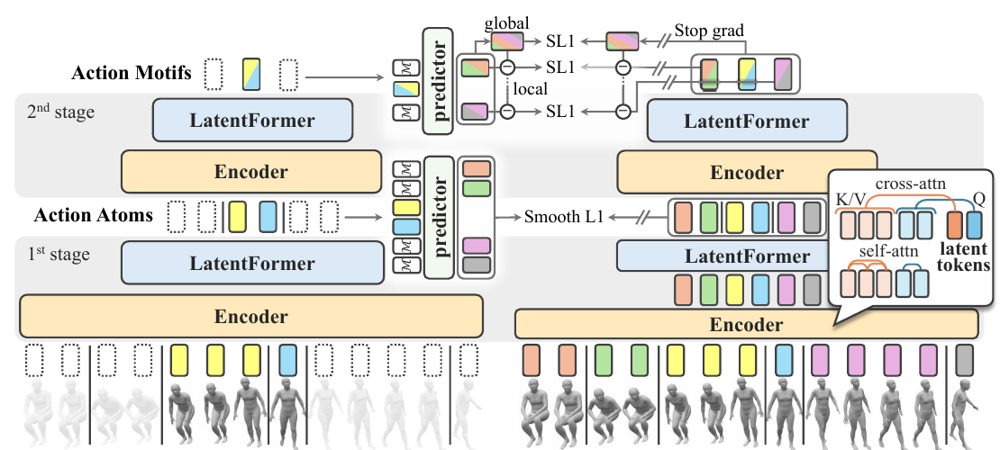

# Action Motifs: Self-Supervised Hierarchical Representation of Human Body Movements

核对日期：2026-10-21。实验数值均为作者报告；本地完成原文阅读与讲解自检，未复现实验。

方法与配图详细版返工：2026-10-25。细化变长聚合、GSP覆盖、层级遮挡、EMA与分解损失；未复现实验。

## 一句话总结

A4Mer先把3D人体运动编码为变长Action Atoms，再发现常见组合形成Action Motifs，用层级掩码预测学习可复用运动表示。

## 研究背景与动机

逐帧表示太细、固定短片可能切断有意义动作、整段视频又会掩盖可复用片段。作者把原子动作与重复组合对应到“词”和“短语”，希望同类运动在不同人、不同任务里仍有接近表示。[§1，PDF1–2]

自监督指表示预训练不需人工动作标签；输入仍需要3D姿态，下游识别也使用动作标签。不是从任意RGB视频直接无标注学会全部行为。

## 方法总览

原论文Fig.2，PDF第4页。仅裁切相关图示，保留图内科学标签；著作权属于原作者，用于本篇方法分析，不并入本站原创图授权。[来源与作者](https://openaccess.thecvf.com/content/CVPR2026/html/Kinoshita_Action_Motifs_Self-Supervised_Hierarchical_Representation_of_Human_Body_Movements_CVPR_2026_paper.html) · [PDF](https://openaccess.thecvf.com/content/CVPR2026/papers/Kinoshita_Action_Motifs_Self-Supervised_Hierarchical_Representation_of_Human_Body_Movements_CVPR_2026_paper.pdf)。点击可打开高清图。

### 输入与层级：帧、Atom和Motif不是同一种token

输入是T帧3D姿态序列；若每帧J个关节，可先记为T×J×3，再嵌入到模型特征维D。主文没有在方法段完整给出关节选择、坐标归一化、投影层与D，本讲解保留符号。输出第一层变长Action Atoms与第二层由Atoms组成的Action Motifs，分别服务于识别、预测和插值。（§3.1–3.4，PDF第3–5页）

不是直接从RGB学习动作边界，也不是每个动作名称对应固定token。预训练不使用人工动作标签，下游识别仍用标签；AMD的拟合姿态也是输入来源的一部分，不能忽略姿态误差。

原创图中的字母码、覆盖选择和一维token均为教学例，不对应作者真实聚类中心。

## 核心创新与关键设计

### Atom边界先由运动学规则获得，网络负责段内压缩

第一层用真实关节轨迹相对线性外推的偏离识别非线性变化，作为细粒度运动边界。阈值、窗口与多关节聚合细节在补充材料，不能随意选加速度阈值并说复现了论文分段。先有s(t)这一帧到段的映射，模型才知道哪些帧属于同一Atom。（§3.2）

段k含Tk个嵌入，Encoder先段内max-pooling初始化z_k，再以z_k为query、该段Tk×D特征为K/V做交叉注意力，压成一个D维token。这里max-pool通常是逐维最大的一般解释，具体嵌入实现需代码核查；不是选最长帧或挑某个最显著关节。不同段时长不同，但输出维度相同，段数K也随输入变化。

Encoder的自注意力限同段，形成块对角可见性；跨段关系交给LatentFormer在K个latent之间建模。教学12帧分成3/5/4帧，段内注意力有3²+5²+4²=50个位置对，而全帧自注意力有144个；跨段层另有3²=9个latent对。这个算例解释职责与规模，不是包含全部层、投影和交叉注意力的精确FLOPs。

### Motif分段：聚类→频繁序列→非重叠覆盖

先训练Atom层，再对训练集Atom表示做512类k-means，把连续向量变成离散代码。GSP从短频繁序列逐步扩展更长模式，只有支持度达到阈值才保留；测试时用已有中心最近邻赋码，不在测试集重新拟合k-means。（§3.2，PDF第4页）

多个模式可能覆盖同一个Atom，因此用动态规划选择无重叠覆盖且模式数量最少的方案。教学代码序列ABABC，假设可用连续模式AB、ABC及单字母，则AB|ABC只需两段，优于A|B|ABC的三段。对“连续区间覆盖”这一教学版本，可定义D[j]为前j码最小段数，枚举合法结尾模式长度l，更新D[j]=min(D[j−l]+1)，再回溯边界。

上述递推只示范明确的连续覆盖情形，不能冒充作者完整GSP实现。GSP的一般子序列可能允许间隔，而变成连续运动段还需规定匹配跨度；主文未完整给出间隔约束、支持度、平局规则和无法覆盖时的回退策略。最少模式倾向用较长已发现组合，不保证每个组合都恰好是人类命名的动作语义。

第二层用与第一层相同的Encoder/LatentFormer结构，把一个Motif内部若干Atom聚合。两阶段结构相同不等于参数共享；原文没有声称两层使用同一权重。训练流程是先第一层、固定离散模式的形成步骤、再联合训练两层，不是全程对聚类和GSP做可微端到端反传。

### JEPA的预测目标来自完整输入，目标分支通过EMA更新

\[
Z=f_{\bar\theta}(X),\quad
\widehat Z=g_\phi(\mathcal M,f_\theta(X_{vis})),\quad
L_{base}=\sum_{k\in\mathcal K}SL1(\widehat z_k-\operatorname{sg}(z_k)).
\]

目标分支读取完整姿态得到真实上下文中的latent，在线分支只读可见段，预测器在缺失latent位置插入可学习mask token。stop-gradient阻止损失经目标直接回传；目标参数由在线参数的指数移动平均更新。常见记法 \(\bar\theta\leftarrow m\bar\theta+(1-m)\theta\)是机制解释，m的数值/调度主文未给，不猜配置。（式1–2）

有EMA与stop-gradient并不构成所有数据分布下不塌缩的数学证明；本文采用该训练机制并用任务实验评价表示。预测目标也不是直接监督姿态XYZ重建，而是学习表示空间的缺失段预测。

### 层级遮挡：上层被遮，构成它的下层也必须遮

联合训练选择Motif作为遮挡单位，并把其内部全部Atoms一并遮掉。例如Motif M2含Atom a3、a4，若只遮M2却仍让下层把a3、a4完整传给上层，就泄露了预测目标的组成信息。论文通过联动遮挡排除这条直接通路，而不是把上层向量置零就算完成。（PDF第5页）

预训练读取前后可见上下文可服务插值；未来预测另接预测头。不能把双向缺失补全预训练直接等同因果在线未来预测，未来任务要确保输入只来自已观测时间段。

### 全局与局部分解：均值只在被遮挡集合上计算

令n=|K|表示本次被遮挡段数：

\[
\widehat z^g=\frac1n\sum_{k\in\mathcal K}\widehat z_k,\quad
z^g=\frac1n\sum_{k\in\mathcal K}z_k,\quad
\widehat z_k^l=\widehat z_k-\widehat z^g,\quad z_k^l=z_k-z^g.
\]

这是被预测位置的均值，不是整段所有可见与不可见token的均值，也不是对特征通道求平均。局部项保留各段相对这组平均运动的偏差，鼓励可复用片段而非只记录整体序列偏置。减均值会把各位置耦合，某一预测变化也会改变其他位置的局部偏差。（式3–4）

教学目标标量(1,3)，预测(2,4)：两边局部偏差都是(−1,1)，局部损失为0，但全局均值2与3差1。相反，预测(0,4)均值也是2，与目标全局完全一致，局部偏差却变(−2,2)，需要局部损失纠正。这说明两项控制不同误差，不是把同一个L1简单拆成两个名称。

### 动态权重有stop-gradient，数值代入不能代替梯度

\[
L_k^l=SL1(\widehat z_k^l-z_k^l),\quad
L^g=SL1(\widehat z^g-z^g),\quad
\lambda_k=\operatorname{sg}(L_k^l/L^g),\quad\alpha=.05.
\]

式5将局部项与带αλ_k的全局项组合，并包含按遮挡数的归约；主文排版对求和作用域未加括号，复现应核对全局项是否按k累计及除数，不能默改成自己的损失。可以确定的是λ在反传时当常数，不能因前向λL^g数值等于L_k^l，就将其整个替换成局部损失。

教学Llocal=.2、Lglobal=.1，则λ=2，α λ Lglobal=.01；这项对Lglobal的局部导数系数为.1，仍推动全局误差。若不detach比值，符号约分会导致不同梯度。Lglobal=0时比值未定义：上面预测(0,4)就展示全局为零而局部不为零的情形，epsilon、裁剪及空遮挡集合的处理都需实现核查。此问题必须标出，但不能据此断言作者代码必然除零。

### 下游如何把变长token变回逐帧任务

识别k-NN先给训练latent贴真实动作标签；若Motif跨标签边界，以段内多数投票确定标签，再对测试token做加权近邻投票。这种“零样本迁移”没有训练新识别头，但仍需带标签参考库。另一方案按段长重复latent到帧数，训练一层Transformer输出逐帧类别。（§3.4）

未来预测头同时输出下一latent及其持续帧数，因为未来分段未知；只预测向量而拿真实未来长度，会泄露目标信息。独立训练的姿态解码器读取预测和已知latent，把每个token按长度重复后恢复帧级姿态。教学段长3、5帧对应8个输出位置，不能把两个token当两帧。

插值在缺失latent位置放可学习token，用可见上下文补全，再解码姿态；缺失帧到latent位置如何处理需要明确分段协议。主文并未把所有长缺口的边界推断细节列出。当前未执行聚类、GSP、训练或下游预测，层级压缩收益与任务数值均以作者实验为证据。

## 实验与关键结果

AMD采集50人、21–69岁、24相机、14.2小时30fps日常活动，利用脚载相机与天花板/桌底ChArUco标记约束遮挡脚部SMPL拟合。它提供多视角视频与拟合标注，不是完全无误差的真实3D测量。[§4，PDF5–6]

模型实验降到5fps，输入30秒；预测未来3秒，插值缺失4–8秒，MPJPE单位mm。[§5，PDF7]

| 作者报告，Table2 | A4Mer | 参考对照 |
| --- | --- | --- |
| AMD预测 / HiK迁移预测MPJPE↓ | 150 / 120 | BehaveMAE167 / 288 |
| AMD插值 / HiK迁移插值MPJPE↓ | 126 / 110 | MacDiff186 / 110 |
| HiK k-NN top1 / top3 | 31.7 / 59.0% | USDRL31.1 / 43.0% |
| HiK训练识别头 | 38.1% | BehaveMAE35.6% |

**表格有冲突**：Table3完整模型却将k-NN/head写成38.1/59.0；Table2的MotionBERT top1/top3为1.77/0.35也不符合通常top-k包含关系。上述按Table2标注列记录，不擅自交换或修正数字。[PDF7] HiK原多标签被合并成自定义粗粒度单标签，不能与原协议排行榜直接比较。

## 消融实验与证据强度

Table3中去分解的预测222mm、仅局部254、局部加未调权全局188，完整150；取消段内注意力212。逐帧或固定10帧片段的预测309/208，支持变长分段对预测的作用。[PDF7–8]

JEPA换成BERT式目标后插值112mm，优于完整126mm，说明优势依任务而异；不能照摘要写所有任务全部严格最好。完整模型平均Motif10.6帧是5fps条件下约2.12秒，不是原30fps下0.35秒。

## 局限与讨论

发现高频组合不保证就是人类语义单元，少见动作可能被频繁模式掩盖。识别所谓零样本迁移仍需带标签参考token做k-NN，不能理解为无需任何动作标签的类别命名。

脚部约束的mask mIoU仅0.906→0.910，评估限于可见全身的10000帧，并非直接量化严重遮挡下关节3D误差。主文把SmoothL1空间称为Manhattan-like也不能推导出普通欧氏k-means自动最优；分段阈值和GSP支持度等需补充材料核查。

## 复现提示

从[作者实验室入口](https://vision.ist.i.kyoto-u.ac.jp/)查找A4Mer/AMD正式发布信息；本文未核验固定代码commit、许可证、数据下载条件和补充材料。建议 `datasets/human-motion/amd/`，原视频与身体扫描、SMPL依赖各按许可存于仓库外。

复现先固定姿态坐标、降采样、人物隔离与HiK标签合并表，再记录聚类/模式字典、掩码规则和预测长度头。表2/3识别列冲突解决前不要声称精确复现识别成绩；本地仅做原文阅读与图表核对。

## 相关工作与阅读顺序

先了解JEPA/EMA目标与变长序列聚合，再读GSP和动态规划覆盖，最后看AMD的标注来源与Table2/3。将表示预训练、带标签识别和未来姿态生成三个阶段分开理解。

## 来源与校验

- [CVF官方论文页](https://openaccess.thecvf.com/content/CVPR2026/html/Kinoshita_Action_Motifs_Self-Supervised_Hierarchical_Representation_of_Human_Body_Movements_CVPR_2026_paper.html) · [所读PDF](https://openaccess.thecvf.com/content/CVPR2026/papers/Kinoshita_Action_Motifs_Self-Supervised_Hierarchical_Representation_of_Human_Body_Movements_CVPR_2026_paper.pdf)。页码均为PDF页序。
- 所读版本：2026-10-21从CVF下载的开放接收稿；PDF SHA-256：`447cb0f3770e0bd826451ec2e85c2c5e73e8d1cc416c2cea174e94a22fce41b6`。
- 阅读范围：正文、方法公式、实验与消融；补充材料、代码及权重未逐项核验。reviewed表示本地讲解自检，不表示独立同行评审或实验复现。
- 方法图与关键公式/表格已渲染核对，所引原图已单独检查；2026-10-25详细版完成浏览器上下半图与正文检查，4个公式无错误、坏图或横向溢出。作者图示与本站原创素材权利分开记录。
