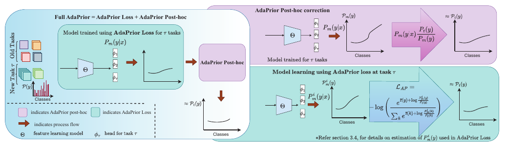

# AdaPrior: Bayesian-Inspired Adaptive Prior Correction for Long-Tailed Continual Learning

核对日期：2026-10-22。实验数值均为作者报告；本地完成原文阅读与讲解自检，未复现实验。

方法详细版返工：2026-10-23。重读原文公式与训练说明，展开Bayes推导、先验统计、双类别例子与梯度方向；代数核查与作者主张分开，未复现实验。

## 一句话总结

AdaPrior用模型预测概率的动态平均估计类别偏置，分别在训练损失与推理logit中校正长尾持续学习；实验显示有效，但正文关于KL分解和固定步长EMA几乎必然收敛的表述需要额外条件，不能直接当作已成立的保证。（PDF第1–8页）

## 研究背景与动机

长尾类增量学习同时面临新旧任务失衡和任务内部类别长尾。历史类只有少量回放样本，新任务又可能由头部类主导。静态类别计数未必反映模型在蒸馏、回放与优化后的实际偏向。作者于是跟踪预测分布的平均值，把它作为模型诱导先验，面向通常类别均衡的评价分布纠偏；这仍依赖类条件近似稳定等假设。（PDF第1–4页）

## 方法总览



原论文Fig.2，PDF第2页。仅裁切相关图示，保留图内科学标签；著作权属于原作者，用于本篇方法分析，不并入本站原创图授权。[来源与作者](https://openaccess.thecvf.com/content/CVPR2026/html/Bhat_AdaPrior_Bayesian-Inspired_Adaptive_Prior_Correction_for_Long-Tailed_Continual_Learning_CVPR_2026_paper.html) · [PDF](https://openaccess.thecvf.com/content/CVPR2026/papers/Bhat_AdaPrior_Bayesian-Inspired_Adaptive_Prior_Correction_for_Long-Tailed_Continual_Learning_CVPR_2026_paper.pdf)。点击可打开高清图。

### 先定义任务：新类不断到来，旧类只能少量回放

长尾类增量学习不是只在一个不平衡数据集上训练一次。任务τ到来时，模型获得新类数据，以及过去类别留下的少量exemplar。旧任务完整数据不可再用；新任务内部也可能存在头部类与尾部类差异。因此模型既要记住旧类，又不能只追随当前样本最多的类别。本文建在LUCIR流程上，先验校正是附加机制，不取代回放、原有表示学习与蒸馏。（§3.1、§4.1，PDF第3、7页）

| 符号 | 含义 | 形状/范围 |
|---|---|---|
| K | 当前已见类别数 | 随任务增加 |
| \(z_\theta(x)\) | 分类器未校正logit | 单样本K维，batch为B×K |
| \(q_\theta(y|x)=\mathrm{softmax}(z)_y\) | 模型原始类别概率 | 每行非负且和为1 |
| \(p_i(y)\) | 第i次迭代的模型诱导先验估计 | 长度K的统计向量 |
| \(\pi(y)\) | 希望对齐的目标类别先验 | 基准常用1/K |
| γ | EMA中当前batch占的权重 | 不同于有些库里“旧值权重”的momentum |
| α | 推理后处理强度 | 原文讨论[0,1] |

本文为区分概率与先验，使用q、p、π统一记号，分别对应原文模型后验、模型诱导先验与目标先验。模型的原始概率需要标签监督来学习；先验统计则是对这些预测求平均。推理不需要真实标签，但整个方法不是无监督训练。（PDF第3–4页）

### 图2分清三个使用模式

**Post-hoc**保持已有训练流程，只在训练后估计预测均值并调整推理logit。**AdaPrior Loss**在训练过程中用动态p调整交叉熵的计算。**Full AdaPrior**先用新损失训练，再估计训练后残余偏向并做推理校正。三者不是同一组logit上连续加减相同数就抵消，因为损失会改变学到的参数，最终统计也可重新估计。（PDF第2、4、6–7页）

## 核心创新与关键设计

### 1. 从Bayes公式推到logit校正，中间不能跳过归一化

先考虑理想的label shift：训练与目标分布只改变类别先验，\(P(x|y)=P_t(x|y)\)保持不变。由Bayes公式，

\[
P_t(y|x)=P(y|x)\frac{P_t(y)}{P(y)}\frac{P(x)}{P_t(x)}.
\]

固定同一个x，最后一个比值与类别y无关，只负责使所有类别概率和为1。因此对分类排序，可先用“原后验×目标先验/训练先验”，再按类别重新归一化。直觉是：训练中过度常见的类别原本就被先验抬高，要把这部分优势扣掉。（式1–3，PDF第3页）

取对数后，乘除变加减：\(z'_y=z_y+\log\pi_y-\log p_y\)。softmax自动去掉与类别无关的常数。AdaPrior把真实训练先验替换为从模型预测估计的p，并加入α温和校正：

\[
z'_y=z_y+\alpha(\log\pi_y-\log p_y),\qquad
q'_y=\frac{q_y(\pi_y/p_y)^\alpha}{\sum_kq_k(\pi_k/p_k)^\alpha}.
\]

第二式是由原文logit式重写出的明确归一化形式。α=0保留原模型；α=1完全应用估计先验比；中间值缓和估计噪声。α不是softmax温度，因为它只控制先验修正项，不统一缩放所有logit。（式5–6，PDF第4页）

目标π均匀时，\(\alpha\log\pi\)对所有类别相同，可以省略，剩下 \(z'_y=z_y-\alpha\log p_y\)。这不是对所有类别同样加分：p越小，负logp越大，尾部类得到的相对提升更多。若实际部署目标并不均衡，不能仍默认均匀π就一定正确。

### 2. 一个两类别例子：校正的是相对优势，而不是直接改标签

设模型平均预测先验p=(0.8,0.2)，目标π=(0.5,0.5)，当前图片原预测q=(0.6,0.4)。取α=1，未归一化权重为 \((0.6\times0.5/0.8,0.4\times0.5/0.2)=(0.375,1.0)\)，归一后约(0.273,0.727)，排序从第一类变成第二类。

等价地省掉均匀π，权重是(0.75,2.0)，归一化完全相同。两类别log-odds增加 \(\log(0.8/0.2)=\log4\) 的尾部相对优势。这个例子只演示公式，不表示第二类一定是真实答案；若p错误或图像证据本来很明确，过强校正也可能把正确预测改错。α就是在这种风险下控制力度的经验参数。（解释性计算，非论文实验）

### 3. 模型诱导先验到底怎么估计？

静态频数先验统计每类有多少训练标签；AdaPrior则对模型在可用数据上的预测概率求平均：\(p(y)\approx|D_\tau|^{-1}\sum_{x\in D_\tau}q_\theta(y|x)\)。不需要把每个样本硬分到argmax类，所有类别的软概率都会贡献。（式4，PDF第4页）

例如某batch两个样本分别预测(0.9,0.1)和(0.5,0.5)，batch均值为(0.7,0.3)，即使两个样本的argmax都落在第一类，第二类仍保留0.3的软质量。这样p反映模型输出倾向，包括置信程度，而不是只记录它最后选了多少次某个标签。

代价是它同时混合了采样频率和分类偏差。一个实际很常见但模型识别很差的类别，也可能得到小p；因此“模型诱导先验”不是对真实世界人口比例的无偏测量。将它放进Bayes校正，是受理论启发的建模选择，仍依赖条件分布稳定和后验足够可靠等近似假设。（PDF第4页）

### 4. EMA怎样跟踪变化：每一步更新K个统计数

训练时模型还在变，不能每步扫描所有历史数据。原文以EMA替代全数据平均：

\[
b_i=\frac1B\sum_{x\in B_i}q_\theta(\cdot|x),\qquad
p_i=(1-\gamma)p_{i-1}+\gamma b_i.
\]

p从类别频数初始化。若旧p=(0.8,0.2)、当前b=(0.7,0.3)、γ=0.05，则新p=(0.795,0.205)。当前batch只改变一点，避免某次尾类偏少就剧烈校正；γ大更快、也更吵，γ小更平滑、也更滞后。原文将p作为detach的运行统计，梯度不通过这个平均过程反向传播。（式9及实现说明，PDF第4、7页）

展开递推可见最近batch权重为γ，更早j步前的权重为 \(\gamma(1-\gamma)^j\)。这段是递推式的直接展开，不是作者新增模块。它说明“历史”是指数衰减保留，不能说EMA完整保存所有旧任务信息。γ=0.05时常用约1/γ=20步作为直觉时间尺度，而不是精确的独立样本数。

新增类别时K会扩大，p如何扩维、旧类质量如何归一、当前batch统计使用更新前还是更新后的模型、是否包含Mixup样本等，正文没有全部说明。logp还要求正值，零频/极小概率通常需要平滑，但具体epsilon不能在未查代码时随意写成作者配置。

### 5. 为什么训练时反而“加”头部先验？

AdaPrior Loss把原logit变成 \(u_k=z_k+\log(p_k/\pi_k)\)，再计算正确标签y的交叉熵：

\[
L_{PA}(x,y)=-\log\frac{e^{z_y}p_y/\pi_y}{\sum_ke^{z_k}p_k/\pi_k}.
\]

这与推理的减法方向相反。原因是**训练时的校正参与定义误差，优化器会学习补偿它；推理时的校正直接决定最终答案**。训练中给头部类一个先验优势，会使尾类样本更难被判对，从而对尾类对应的原始logit施加更强的纠错要求；它不是在推理时继续奖励头部。（式7，PDF第4页）

对detach的p求条件梯度，\(\partial L/\partial z_k=\mathrm{softmax}(u)_k-\mathbf1[k=y]\)。以上是标准交叉熵的导数，便于理解作用方向。沿用p=(0.8,0.2)、均匀π，若原始两类logit相等，普通CE概率是(0.5,0.5)，新损失中的概率是(0.8,0.2)。对真实尾类样本，正确类梯度从-0.5变为-0.8，对错误头类从+0.5变为+0.8，更新会更强地把这次尾类样本分开。这仍不保证所有样本总体梯度一定均衡，因为出现次数和特征质量也不同。

当p均匀且π均匀时，新增项只是类别无关常数，损失退化为普通CE。若p偏差很大，损失也可能过度补偿，因此动态统计质量决定收益。论文没有给此项单独包办全部遗忘控制的保证，不能省掉LUCIR原有策略后期待相同结果。

### 6. 三个模式的计算路径与冻结边界

**只后处理：** 训练好的分类器固定→在规定可用数据上估计最终p→选验证强度α→每个测试样本计算原z→加先验比→softmax或argmax。不应使用测试真实标签去估计p或选α；原文默认α在留出验证划分选择。（PDF第4、7页）

**只改损失：** 常规增量训练中计算原z与预测q→更新detach统计p→利用p构造训练损失→更新分类网络。这个流程顺序展示依赖关系，但原文未明确同一步使用p_i还是p_{i-1}，严格复现需查实现。只改损失模式与Full模式应分别报告，不能自动把推理校正当作已启用。

**Full：** 在Loss模式得到新模型后，再对残余偏置做后处理。它没有再训练一个平衡分类器的独立优化阶段，但并不等于整个增量系统没有训练或没有验证；原方法仍运行多任务SGD、回放和模型选择。（PDF第6–7页）

```text
对每个增量任务：
    新任务数据 + 旧类exemplar → 训练batch
    原模型前向 → z与softmax概率q
    q的batch均值 → detach的K维EMA统计p
    用 z + log(p/目标先验) 计算AdaPrior分类损失
    与所采用LUCIR流程的其他训练项按实现组合，更新网络
任务训练后：
    按规定数据估计最终先验p_final
    若启用post-hoc：输出 z + α[log(目标先验)-log(p_final)]
```

上述是概念路径，不提供未经核查的损失组合权重、任务间重置策略或新类初始化代码。统计头新增O(K)存储，在已有B×K输出上求均值并做逐类logit运算；不需要为它保存另一套激活，但完整训练的骨干、优化器、回放和蒸馏开销仍存在。

### 7. 理论核对一：温和先验校正要重新归一化

α=1且label shift假设成立时，Bayes比值解释直接适用；α介于0与1时是人为引入的温和化权重，需要按类别重新归一。原文式(5)保留 \(P(x)/P_t(x)\) 的写法不能自动为任意α提供正确归一常数；明确的实现表达应回到本节开头的softmax形式。这个区别影响如何解释概率校准，虽然不改变同一组未归一化权重的argmax。（PDF第4页）

### 8. 理论核对二：“等于CE+KL”不能省掉分母

原文式(8)与定理2宣称损失可分解成CE加先验KL。若从规范化的式(7)出发，令 \(q_k=\mathrm{softmax}(z)_k\)、\(r_k=p_k/\pi_k\)，直接代数展开得到：

\[
L_{PA}=-\log q_y-\log r_y+\log\sum_kq_kr_k.
\]

最后一项依赖当前样本的预测，不能当常数删掉。按标签分布P(y)求平均，第二项是 \(-\sum_yP(y)\log[p_y/\pi_y]\)，权重与符号也不直接等于 \(KL(p\|\pi)\)。因此正文的强分解需要额外论证，本笔记没有读补充证明，不把该结论直接当作已成立定理。这是公式一致性核查，不会自动否定前述可实现的损失或实验增益。（PDF第4页）

### 9. 理论核对三：固定EMA步长会留下噪声地板

正文定理3在平稳、有界方差条件下宣称固定γ的EMA几乎必然收敛到均值。考虑简单标量观测 \(b_i=M+\epsilon_i\)，独立零均值噪声方差 \(\sigma^2>0\)。误差递推为 \(e_i=(1-\gamma)e_{i-1}+\gamma\epsilon_i\)，因此

\[
V_i=(1-\gamma)^2V_{i-1}+\gamma^2\sigma^2,
\qquad V_\infty=\frac{\gamma}{2-\gamma}\sigma^2>0.
\]

这是本笔记的解析反例：固定步长可以让期望偏差消失、追踪平稳均值附近，却仍持续波动，不能仅凭这些条件就保证几乎必然收敛到该常数。若改用满足条件的衰减步长、噪声也逐渐消失等情况，结论可能不同，但不能擅自把它们补进作者实现。漂移误差界也应区分期望范数与均方误差，正文未给完整证明，本轮不替作者补证。（PDF第6页）

实践中正因为要追踪变化，保留固定γ有合理价值：更快响应与更高噪声之间做折中，不需要用“必然精确收敛”来说明它。理论表述与经验选择应分别判断。

### 10. 用消融决定该读哪条贡献，而非只看Full名称

Shuffled ImageNet子集LFH10任务表5中，原模型48.98、静态logN55.03、只后处理56.27、只损失58.21、Full59.28，说明两处校正在这一设置下互补。另一方面Ordered ImageNet LFH5任务只损失61.79，Full61.36；Full不是每格都更好。图5偏好的γ约0.05、α约0.6–0.7也说明适度校正是实证折中，而非没有配置选择。（PDF第5、8页）

读完方法应能区分：p是运行统计而不是网络参数；Loss模式会训练网络，post-hoc模式只改输出；推理减先验直接改变预测，训练加先验则通过误差让网络反向补偿。若类别特征已经遗忘、目标条件分布明显变化或p估错，单靠概率头校正都不能恢复丢失的信息。

## 实验与关键结果

在LUCIR流程上，CIFAR100-LT用ResNet32、500轮，ImageNet100类子集和iNaturalist100类子集用ResNet18、180轮；前两者IF100，后者约435。默认每类20个回放样本，主指标为各任务平均增量准确率。LFS从较少初始类开始，LFH从一半类别开始，Ordered/Shuffled顺序分别报告。（PDF第7页）

| 平均增量准确率/% | LUCIR+CE | AdaPrior Loss | Full |
|---|---:|---:|---:|
| Shuffled CIFAR，LFS10任务 | 29.97 | 34.07 | 36.94 |
| Shuffled ImageNet，LFH10任务 | 48.98 | 58.21 | 59.28 |
| Ordered ImageNet，LFH5任务 | 61.18 | 61.79 | 61.36 |
| iNaturalist Ordered，LFH10任务 | 68.98 | 72.52 | 72.26 |

表1–3（PDF第5–6页）。Full并非处处优于只改损失，不能照搬“所有split最优”。表6在ImageNet子集5任务下ECE0.1500→0.1322、NLL2.5242→2.4218，属于验证划分的校准结果，不是独立临床或部署可靠性保证。（PDF第8页）

## 消融实验与证据强度

表5中Shuffled ImageNet LFH10任务：原始48.98，静态logN55.03，只后处理56.27，只损失58.21，Full59.28，支持训练与推理校正互补。在CIFAR LFH5任务，只后处理42.08却略低于静态logN42.37，动态先验没有逐格胜出。（PDF第8页）

去Mixup的表4仍报告增益，图5偏好γ约0.05、α约0.6–0.7；α默认在保留验证集选择，所以不属于完全无调参。Food101、1000类ImageNet与跨骨干结果主要在补充材料，未独立核对其数值。（PDF第7–8页）

## 局限与讨论

先验校正不能恢复已经丢失的类别特征；条件分布显著改变时，Bayes先验比值解释也会失效。预测均值同时混合采样偏差、分类错误与置信度偏差，不是真实人口类别比例。理论条件问题不自动否定表中经验效果，但需要把实践有效与证明有效分开。部分基线来自他文、部分作者重现，缺少统一重复实验误差条，细小差异不宜解释成稳定优势。（PDF第4–8页）

## 复现提示

本轮未核查作者代码、固定commit、许可证或补充证明，也未运行持续训练。复现需记录类别顺序、回放策略、Mixup、蒸馏、EMA初始化、新类扩展和对log零值的平滑；后处理估计用的数据不能泄漏评价标签。应先用独立噪声序列验证固定γ的方差边界，再逐项核查式(7)/(8)的实现含义，不能把本笔记建议修正当作作者原实现。（PDF第3–8页）

## 相关工作与阅读顺序

先理解LUCIR类增量学习，再读静态logit adjustment和balanced softmax，最后阅读AdaPrior的动态统计。查看定理时区分固定步长追踪、期望收敛与几乎必然收敛；查看实验时区分均衡目标先验与真实应用中可能不均衡的目标分布。这些前提比“Bayesian”名称更决定方法是否适合具体任务。（PDF第3–8页）

## 来源与校验

- [CVF官方论文页](https://openaccess.thecvf.com/content/CVPR2026/html/Bhat_AdaPrior_Bayesian-Inspired_Adaptive_Prior_Correction_for_Long-Tailed_Continual_Learning_CVPR_2026_paper.html) · [所读PDF](https://openaccess.thecvf.com/content/CVPR2026/papers/Bhat_AdaPrior_Bayesian-Inspired_Adaptive_Prior_Correction_for_Long-Tailed_Continual_Learning_CVPR_2026_paper.pdf)。页码均为PDF页序。
- 所读版本：2026-10-22从CVF下载的开放接收稿；PDF SHA-256：`a36d8aeb91a603323e86af48ce4e6634f21cc23ce2fd1b8634d2f50e1ebdd265`。
- 阅读范围：正文、方法公式、实验与消融；补充材料、代码及权重未逐项核验。reviewed表示本地讲解自检，不表示独立同行评审或实验复现。
- 方法图与关键公式/表格已渲染核对，所引原图已单独检查；未对新文章进行浏览器交互验收。作者图示与本站原创素材权利分开记录。
