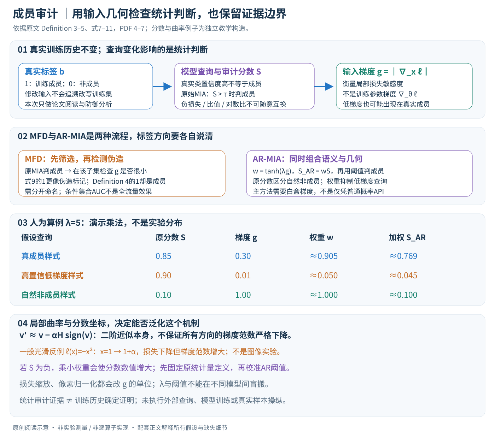

# A Unified Perspective on Adversarial Membership Manipulation in Vision Models

核对日期：2026-10-20。以下实验均为作者报告；本地完成原文阅读与讲解自检，未复现实验。

方法与配图详细版返工：2026-10-23。重读Definition 1–5与主文方法，展开条件筛选、局部曲率、统计量方向和梯度坐标；未运行审计或复现实验。

## 一句话总结

论文指出成员推断也会被查询图像的微小扰动误导，并用输入损失梯度范数构造检测和加权推断，研究隐私审计本身的鲁棒性。

## 研究背景与动机

成员推断通常把低损失或高置信度当成训练成员的证据，却默认待测图像未经对抗修改。把非成员稍微改得更容易分类，可能让审计器误认它出现在训练集中；这改变的是推断结果，不会改变真实训练历史。[§1–2，PDF1–3]

本笔记聚焦授权的模型隐私审计与防御分析，不将统计判别写成训练数据归属的确定证明。

## 方法总览

### 改变的是审计器判断，不是训练历史

成员推断（MIA）给定模型\(f\)、查询样本\((x,y)\)，尝试区分它是否来自模型真实训练集。真实成员标签\(b\)由训练历史确定；推断标签\(\hat b\)来自统计量与阈值，二者必须分开。把非成员输入改成\(x'\)可以改变审计分数，却没有把它追加入已经完成的训练过程。（§2、Definition 1–3，PDF第2–4页）

本文研究三件事：MFA构造容易被误认成成员的非成员查询，MFD在初筛为成员的查询中找出这种伪造，AR-MIA把几何权重直接加入原推断统计量。本笔记把它作为授权隐私审计的可靠性研究，没有对外部模型执行样本操纵或训练数据归属指控。

原创图依据Definition 3–5、式7–11，PDF第4–7页。分数和梯度为独立教学数字，不是作者模型输出，未运行攻击或检测器。

| 名称 | 输入人群 | 要回答的问题 | 权限边界 |
|---|---|---|---|
| 原始MIA | 成员与自然非成员 | 统计上像不像训练成员？ | 因MIA方法而异 |
| MFA | 被选择的非成员 | 小幅修改是否能使审计误报？ | 本文主构造使用白盒输入梯度 |
| MFD | 已被原始MIA判为成员的子集 | 是真实成员还是伪造查询？ | 主检测需要输入梯度 |
| AR-MIA | 真成员、自然非成员、伪造非成员 | 合并两类信号后推断成员标签 | 主方法需要白盒梯度 |

“查询输出可用”不自动等于“输入梯度可用”。附录提到有限差分黑盒变体，但此次未逐项核验其查询预算与效果，不将白盒主表直接宣传为普通API可免费部署。

## 核心创新与关键设计

### 为什么更容易正确分类的图像，反而可能使成员审计出错

原式2统一写\(\hat b=\mathbf1[S(x,y)>\tau]\)，即统计量越大越像成员。低损失MIA若直接用交叉熵，需要采用负损失等相反方向的统计量，不能把正交叉熵原样放进“大于阈值即成员”的公式。

交叉熵\(\ell=-\log p_y\)，所以提高真实类别置信度\(p_y\)会降低损失。MFA的方向与常见让分类器出错的对抗样本不同：它保持真实标签\(y\)，在有限输入邻域中提高其置信度，可能让低损失/高置信度审计器误认其来自训练集。它不是让分类标签翻转，也不是把模型权重重新训练一遍。（§3.1，PDF第4–5页）

作者用带动量和余弦衰减的输入优化，并在候选中保留损失较低者。模型参数\(\theta\)固定，改变的是输入；\(\nabla_x\ell\)与训练模型所用\(\nabla_\theta\ell\)不是同一梯度。扰动限制为\(\ell_\infty\)邻域，像素范围和归一化坐标也须匹配。正文中有一句把标准攻击写成“loss minimization降低真实类置信度”，但对交叉熵应为相反关系；本笔记以式4–6的置信度目标及负梯度输入更新解释，保留文字方向问题供核查。

LiRA、RMIA等还使用影子/参考模型校准。提高\(p_y\)对这些统计量的影响不能仅靠单个标量单调性保证；论文给出实验中的迁移现象，而不是证明任意校准MIA在所有模型上都必然被同一输入改变误导。具体参考分布和阈值仍是原MIA的一部分。

### 几何信号：同样高置信，局部损失敏感度可能不同

作者观察伪造过程中输入损失梯度范数逐步下降，伪造样本常落在高置信度、低梯度区域；一些真实成员虽高置信，仍有较大的局部梯度。定义

\[
g(x,y)=\|\nabla_x\ell(f(x),y)\|.
\]

图5展示优化过程中的梯度变化，图6比较真成员与伪造查询的梯度分布，支持在所测条件下利用这个差异。主方法在查询点计算当前梯度，不要求部署时已知其完整伪造轨迹。（§3.2，PDF第5–6页）

以logit表示\(z(x)\)和softmax概率\(p\)，交叉熵梯度满足

\[
\nabla_x\ell=J_z(x)^\top(p-e_y).
\]

这是独立链式法则解释：高置信度可使\(p-e_y\)变小，但logit雅可比也影响结果；两个具有相同\(p_y\)的输入未必有相同梯度。反过来低梯度也可能出现在真实成员、饱和模型或其他平坦区域。因此“梯度小就是伪造”是统计启发，不是逐样本可靠的充要条件，更不是训练历史证据。

### 局部定理：哪些条件决定梯度范数能否严格下降

原Theorem 1在局部二阶近似条件下，讨论小步长signed gradient descent后梯度范数下降。它没有给出任意步长、所有迭代或整条受约束轨迹的单调保证。（式7–8，PDF第6页）

可以进一步展开其需要的曲率方向。设当前梯度为\(v\)、局部Hessian为\(H\)、\(s=\operatorname{sign}(v)\)，更新输入后有\(v'\approx v-\alpha Hs\)。若讨论二范数，则

\[
\|v'\|_2^2-\|v\|_2^2
\approx-2\alpha v^\top Hs+\alpha^2\|Hs\|_2^2.
\]

对足够小正步长，要严格下降需要相应方向上的曲率项，例如\(v^\top Hs>0\)。仅说函数可二阶近似不够：一维线性损失梯度恒定；局部函数\(\ell(x)=-x^2\)在\(x=1\)沿负梯度方向走到\(1+\alpha\)，损失下降而梯度范数从2增至\(2+2\alpha\)。这些是**一般光滑函数的独立反例**，不是作者图像模型实验，也没有声称它们直接构成本文全部分类设定。

因此本笔记保留“作者观察与局部解释”的证据等级；附录证明可能含更多条件，本次未逐项审计，不把正文简写补成普适定理，也不据反例宣称整套实证无效。

### MFD：先筛选，再检测；检测的1与成员的1不能混用

流程先由原MIA得到\(S>\tau_{\rm MIA}\)的候选，再用小梯度检测可能的伪造。式9写

\[
T(x,y)=\mathbf1[g(x,y)\le\tau_{\rm det}].
\]

按前面“小梯度提示伪造”的动机，这个1更像**异常标记**。但Definition 4用输出1表示真实训练成员，标签方向存在冲突。可在自己的实现中分别命名\(d_{\rm fake}\)与\(b_{\rm member}\)，避免把二者直接比较；这只是清晰的工程记号建议，不声称原文已消除矛盾。（PDF第5–6页）

原始MIA没选中的样本不进入MFD。论文主实验先对50%真成员/50%伪造的集合，用loss攻击在FPR10%阈值下筛选，再在筛选后集合计算MFD指标。因筛选已经改变人群与比例，条件集合的AUC不能直接当作全流量检测效果；还需报告初筛覆盖率、两阶段误报与漏报、不同伪造比例下的表现。（§4，PDF第8页）

### AR-MIA：把几何权重乘到原分数，而不是丢掉原MIA

自然非成员的梯度有时较大，若只把大梯度当成员证据，又会误报自然非成员。AR-MIA保留原MIA负责区分自然成员/非成员，用几何项抑制低梯度伪造：

\[
w(x,y)=\tanh(\lambda g(x,y)),\qquad
S_{\rm AR}=wS,\qquad
\hat b=\mathbf1[S_{\rm AR}>\tau].
\]

对\(\lambda>0,g\ge0\)，权重在\([0,1)\)；小\(g\)时近似\(\lambda g\)，较大时趋近1，因此不会像简单乘\(g\)那样把大梯度自然非成员分数无限放大。它仍依赖原统计量的方向与尺度。（式10–11，PDF第7页）

教学算例选\(\lambda=5\)，不代表论文最佳参数：

| 假设查询 | 原分数\(S\) | 梯度范数\(g\) | \(w\)约值 | 加权分数约值 |
|---|---:|---:|---:|---:|
| 真成员样式 | .85 | .30 | .905 | .769 |
| 高置信低梯度样式 | .90 | .01 | .050 | .045 |
| 自然非成员样式 | .10 | 1.00 | 1.000 | .100 |

这些数字只说明乘法如何工作，没有采集任何人的数据，也不是作者分数分布。若假定阈值\(.5\)，第二行原先越阈、加权后不过阈，但不能从一个人为构造表推算真实准确率或AUC。

### 分数坐标和梯度坐标都会改变结果

原MIA若只按排序阈值判定，对\(S\)做正单调变换可能保留ROC；**乘上不同样本的\(w\)以后，这种不变性通常消失**。例如\(S\)为负时，乘小于1的权重会把它推向0，数值反而增大；给所有分数加常数也会引入不同的\(w\)偏移。因此不能未经核对就把负损失、概率、likelihood ratio、log ratio随意互换后使用同一权重与阈值。应固定作者所用统计量定义，并重新校准AR阈值。

梯度同样有单位。若损失整体乘\(c>0\)，则\(g\)乘\(c\)，原\(\lambda\)的作用改变；若要保持相同权重，需相应调整\(\lambda\)。若标量输入坐标改为\(z=(x-\mu)/\sigma\)，则\(\partial\ell/\partial z=\sigma\,\partial\ell/\partial x\)；不同通道缩放会改变整体范数。计算前必须声明是在原像素、归一化像素还是别的坐标求梯度，以及损失reduce与范数种类。

论文建议用shadow模型、非成员与模拟伪造查询离线校准\(\lambda\)，而不是拿测试真成员标签搜索最优值后声称独立评估。图7显示不同数据与MIA最优\(\lambda\)不一致；较大的\(\lambda\)使多数权重饱和，也可能降低原本的抑制效果，并非越大越好。

### 评价、部署与证据边界

AR-MIA主评估是50%真成员、25%伪造非成员、25%自然非成员。它衡量这一混合任务，不同于MFD条件集合，也不同于MFA使审计失效的Error Area。成员先验比例变化会改变阳性预测价值；即使AUC不变，也不能沿用平衡研究集的“高分可信度”描述真实用户查询。

部署至少需要查询标签\(y\)、目标模型梯度权限、原始MIA统计量及其参考模型、独立校准集和输入预处理定义。相对普通只返回概率的接口，还增加反向传播/模型访问成本。若对抗者知道防御，应单列自适应评估；未读附录的黑盒与自适应结果不补成已完成的本地验证。

本次只重读正文、核对几何公式与绘图，对链式法则、局部二阶项和tanh分数算例作独立自检。未训练影子模型、未制造真实查询、未执行外部审计；统计成员分数不能单独构成个人图像曾被训练使用的确定证明。

## 实验与关键结果

数据CIFAR-10/100、SVHN、CINIC-10、ImageNet-100；模型ResNet18和WideResNet50-2。MFD先在50%真成员/50%伪造成员上，以初始loss攻击FPR10%的阈值筛选，再评价；AR-MIA为50%真成员、25%伪造、25%自然非成员。[§4，PDF8]

| 作者报告 | 设置 | AUC↑ |
| --- | --- | --- |
| MFD / CINIC-10 | ε=1/255→4/255 | 0.6684→0.9063 |
| MFD / SVHN | ε=1/255→4/255 | 0.6882→0.9794 |
| MFD / ImageNet100 | ε=0.5/255→2/255 | 0.6230→0.9800 |
| AR-LiRA / CINIC-10 | 原始→λ5 | 0.6734→0.8166 |
| AR-RMIA / CIFAR10 | 原始→λ35 | 0.6834→0.8065 |

来源Fig.7d–i，PDF7。小扰动更难检出，不能只展示接近0.99的较强扰动结果。MFD是筛选后的条件集合AUC，不等于面对全部真实流量的端到端效果；不同任务的AUC不能直接混比。

## 消融实验与证据强度

四种优化日程消融中，CIFAR10的Error Area从固定步长0.9399到余弦0.9444再到余弦+动量0.9451；CINIC10为0.9198→0.9318→0.9324。[Table1，PDF8]

这些是制造误判更有效的度量，不是检测准确率，动量的附加收益较小。AR-Attack R在SVHN的λ5 AUC0.7185，λ35反而0.5660，说明超参并非越大越好。[Fig.7g] 未逐项阅读附录的自适应、黑盒与额外模型实验，不把正文“universal”视为已验证普遍定理。

## 局限与讨论

置信度和梯度都受损失缩放、输入归一化、模型校准影响，阈值不能跨模型盲搬。实际成员比例及伪造比例与平衡测试不同，会改变阳性预测价值。攻击者知晓检测器时的稳健性需独立自适应评估，正文和局部定理不足以保证完全防住。

成员推断只能提供统计证据；高分或低分均不能单独证明特定图像曾被训练使用。查询权限与梯度开销限制部署范围。

## 复现提示

授权审计应固定训练集合哈希、成员标签、shadow模型和阈值校准集，单列自然与扰动查询的AUC、低FPR检出率、校准误差及梯度成本。建议 `data/privacy-audit/` 只存获许可研究样本；不将隐私照片或成员清单公开。

[论文代码入口](https://github.com/Sjtubrian/Adversarial_Membership_Manipulation)在正文首页给出；本次未核验commit、许可证或运行代码，也未对第三方模型执行查询操纵。

## 相关工作与阅读顺序

先读loss-based MIA与LiRA/RMIA的统计假设，再看本篇几何检测。将检测分数方向、MFD筛选协议、AR-MIA混合比例分别理清，比只记“梯度小就是伪造”更重要。

## 来源与校验

- [CVF 官方论文页](https://openaccess.thecvf.com/content/CVPR2026/html/Gao_A_Unified_Perspective_on_Adversarial_Membership_Manipulation_in_Vision_Models_CVPR_2026_paper.html) · [所读 PDF](https://openaccess.thecvf.com/content/CVPR2026/papers/Gao_A_Unified_Perspective_on_Adversarial_Membership_Manipulation_in_Vision_Models_CVPR_2026_paper.pdf)。页码均为该 PDF 的页序。
- 阅读范围：正文、公式与实验表；补充材料、上游代码与权重未逐项核验。许可证和固定代码 commit 尚未确认，不复制原文全文或数据。
- PDF SHA-256：`3912cb3acd4524f545fd2165e2b677784c0f392606e8bdb3d8740f24d378a27f`；版本为本次下载的 CVF 接收稿，核对日期 2026-10-20。
- 视觉核对：原PDF第6页已渲染检查，核对关键图表及公式排版。原创方法图为概念重绘，细节以原文为准。
