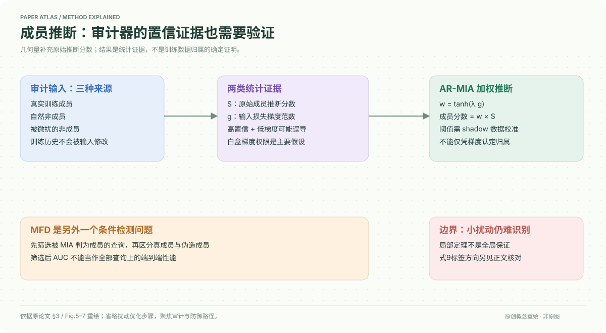

# A Unified Perspective on Adversarial Membership Manipulation in Vision Models

核对日期：2026-10-20。以下实验均为作者报告；本地完成原文阅读与讲解自检，未复现实验。

## 一句话总结

论文指出成员推断也会被查询图像的微小扰动误导，并用输入损失梯度范数构造检测和加权推断，研究隐私审计本身的鲁棒性。

## 研究背景与动机

成员推断通常把低损失或高置信度当成训练成员的证据，却默认待测图像未经对抗修改。把非成员稍微改得更容易分类，可能让审计器误认它出现在训练集中；这改变的是推断结果，不会改变真实训练历史。[§1–2，PDF1–3]

本笔记聚焦授权的模型隐私审计与防御分析，不将统计判别写成训练数据归属的确定证明。

## 方法总览

作者先构造高置信非成员，观察其输入梯度范数在优化中下降；MFD在被初始推断器判为成员的集合中，区分真实成员与伪造成员。AR-MIA进一步把梯度权重乘到原统计量上，同时处理真成员、自然非成员与伪造成员。[§3、Fig.5–7，PDF4–7]

主要检测及稳健推断需要模型梯度，即白盒权限；附录黑盒变体未在本次阅读范围内核验。

## 核心创新与关键设计

核心几何量为\(g(x,y)=\|\nabla_x\ell(f(x),y)\|\)。在作者实验中伪造成员的g较小，于是使用\(w=\tanh(\lambda g)\)抑制其统计量，最终
\[\widehat b=\mathbf1[\tanh(\lambda g(x,y))S(x,y)>\tau].\]
大梯度的自然非成员不会因线性放大而无限增加分数，但仍需要原始S先区分自然非成员。[式10–11，PDF7]

式9写\(T=\mathbf1[g\le\tau_{det}]\)，其1更像表示“检出伪造”，而Definition4使用1表示真实成员；正文检测标签描述存在方向冲突。实现必须明确是异常分数还是成员标签，不可照抄符号混用。[PDF5–6]

Theorem1只在局部二阶近似下声称存在小步长可使梯度下降，不是任意模型/步长的全局保证。仅光滑二阶近似不足以普遍保证：例如一维线性损失梯度恒定，无法严格下降；附录证明的额外曲率条件需另核验。

## 实验与关键结果

数据CIFAR-10/100、SVHN、CINIC-10、ImageNet-100；模型ResNet18和WideResNet50-2。MFD先在50%真成员/50%伪造成员上，以初始loss攻击FPR10%的阈值筛选，再评价；AR-MIA为50%真成员、25%伪造、25%自然非成员。[§4，PDF8]

| 作者报告 | 设置 | AUC↑ |
| --- | --- | --- |
| MFD / CINIC-10 | ε=1/255→4/255 | 0.6684→0.9063 |
| MFD / SVHN | ε=1/255→4/255 | 0.6882→0.9794 |
| MFD / ImageNet100 | ε=0.5/255→2/255 | 0.6230→0.9800 |
| AR-LiRA / CINIC-10 | 原始→λ5 | 0.6734→0.8166 |
| AR-RMIA / CIFAR10 | 原始→λ35 | 0.6834→0.8065 |

来源Fig.7d–i，PDF7。小扰动更难检出，不能只展示接近0.99的较强扰动结果。MFD是筛选后的条件集合AUC，不等于面对全部真实流量的端到端效果；不同任务的AUC不能直接混比。

## 消融实验与证据强度

四种优化日程消融中，CIFAR10的Error Area从固定步长0.9399到余弦0.9444再到余弦+动量0.9451；CINIC10为0.9198→0.9318→0.9324。[Table1，PDF8]

这些是制造误判更有效的度量，不是检测准确率，动量的附加收益较小。AR-Attack R在SVHN的λ5 AUC0.7185，λ35反而0.5660，说明超参并非越大越好。[Fig.7g] 未逐项阅读附录的自适应、黑盒与额外模型实验，不把正文“universal”视为已验证普遍定理。

## 局限与讨论

置信度和梯度都受损失缩放、输入归一化、模型校准影响，阈值不能跨模型盲搬。实际成员比例及伪造比例与平衡测试不同，会改变阳性预测价值。攻击者知晓检测器时的稳健性需独立自适应评估，正文和局部定理不足以保证完全防住。

成员推断只能提供统计证据；高分或低分均不能单独证明特定图像曾被训练使用。查询权限与梯度开销限制部署范围。

## 复现提示

授权审计应固定训练集合哈希、成员标签、shadow模型和阈值校准集，单列自然与扰动查询的AUC、低FPR检出率、校准误差及梯度成本。建议 `data/privacy-audit/` 只存获许可研究样本；不将隐私照片或成员清单公开。

[论文代码入口](https://github.com/Sjtubrian/Adversarial_Membership_Manipulation)在正文首页给出；本次未核验commit、许可证或运行代码，也未对第三方模型执行查询操纵。

## 相关工作与阅读顺序

先读loss-based MIA与LiRA/RMIA的统计假设，再看本篇几何检测。将检测分数方向、MFD筛选协议、AR-MIA混合比例分别理清，比只记“梯度小就是伪造”更重要。

## 来源与校验

- [CVF 官方论文页](https://openaccess.thecvf.com/content/CVPR2026/html/Gao_A_Unified_Perspective_on_Adversarial_Membership_Manipulation_in_Vision_Models_CVPR_2026_paper.html) · [所读 PDF](https://openaccess.thecvf.com/content/CVPR2026/papers/Gao_A_Unified_Perspective_on_Adversarial_Membership_Manipulation_in_Vision_Models_CVPR_2026_paper.pdf)。页码均为该 PDF 的页序。
- 阅读范围：正文、公式与实验表；补充材料、上游代码与权重未逐项核验。许可证和固定代码 commit 尚未确认，不复制原文全文或数据。
- PDF SHA-256：`3912cb3acd4524f545fd2165e2b677784c0f392606e8bdb3d8740f24d378a27f`；版本为本次下载的 CVF 接收稿，核对日期 2026-10-20。
- 视觉核对：原PDF第6页已渲染检查，核对关键图表及公式排版。原创方法图为概念重绘，细节以原文为准。
