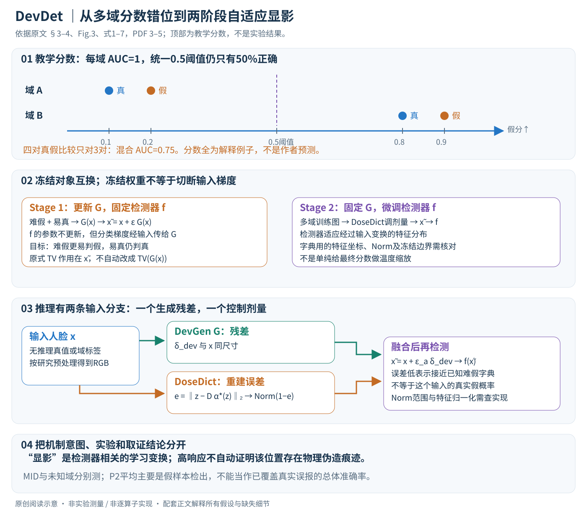

# A Sanity Check for Multi-In-Domain Face Forgery Detection in the Real World

核对日期：2026-10-20。以下实验均为作者报告；本地完成原文阅读与讲解自检，未复现实验。

方法与配图详细版返工：2026-10-23。重读§3–5，核对式1–7；展开多域阈值、两阶段梯度、TV对象、字典与剂量接口，未复现。

## 一句话总结

DevDet先训练“显影”网络强化难伪造样本，再用字典控制显影剂量微调检测器，解决多已见域混合时固定阈值难统一的问题。

## 研究背景与动机

各域内部AUC很高，不代表一个阈值能在混合输入上准确判断真假。数据域差异可能大于真假差异，模型在每域排序不错，却在域未知的单张判断中失准。MID-FFD因此强调多域同时训练、域未指定的逐帧评估。[§1–3，PDF1–4]

这是多已见域校准与学习问题，不应混同为完全未见域的通用深伪检测。

## 方法总览

### 问题不只是排序：域未知时要用一个阈值判断单张图

MID-FFD把多个已见训练域混合起来，测试输入不先告诉检测器它来自哪个数据集。检测器要对单张人脸输出真假分数，再按统一阈值作决策。作者强调域间分数偏移可能比同域真假差异更大，所以“每域AUC都好”不足以说明混合环境可直接部署。（§3，PDF第3–4页）

一个独立教学例子：域A真/假分数为0.1/0.2，域B真/假为0.8/0.9，高分表示假。每域内部排序都完全正确，AUC均为1；混在一起，四对真假比较只对三对，混合AUC为0.75，统一0.5阈值的准确率只有50%。这个例子不是作者测试分数，只说明跨域排序与固定阈值判断是不同问题。

DevDet不只是给最终分数再乘一个温度。它先训练一个输入变换生成器G，使难假图在已有检测器上更容易判假；再固定G，让检测器适应经过该变换的输入，并用DoseDict控制每张图的变换强度。模型、输入转化和剂量共同作用，所以比较时必须保留完整链路。（§4、Fig.3，PDF第4–5页）

原创图依据§3–4、Fig.3、式1–7，PDF第3–5页。四个分数与字典重建是教学例子，不是原实验曲线；显影结果是检测器相关的学习变换，不自动构成真实物理伪造痕迹的证明。

| 量 | 含义与形状 | 注意事项 |
|---|---|---|
| x | 预处理人脸RGB图像，H×W×3 | 研究基于相应人脸裁剪流程 |
| f、\(\theta_p\) | 预训练/微调检测器及参数 | 真假分数高表示fake |
| G、\(\theta_g\) | DevGen及其参数 | 输出与图像同尺寸的残差 |
| \(\delta_{dev}=G(x)\) | “显影剂”残差 | 与输入相加，不是独立真假标签 |
| \(\epsilon,\epsilon_a\) | 固定/自适应剂量 | 不能把任意原始重建误差直接当合法剂量 |
| z | 字典使用的d维检测特征 | 与标量真假分数区分 |
| \(D\in\mathbb R^{d\times K}\) | K个字典原子 | K是原子数，d是特征维度 |
| \(\alpha\in\mathbb R^K\) | 一个输入的稀疏系数 | 不是matting alpha，也不是真假概率 |

## 核心创新与关键设计

### 1. 先训练多域基础检测器，再选难假与易真

基础f按原检测器方案，在多域训练集合\(S_m\)上预训练。之后使用真实标签和当前假分数选两组：真实标签为假的样本中，取假分接近0的一批，称Hard-Fake；真实标签为真的样本中，也取假分接近0的一批，称Easy-Real。两组都低分，但前者是模型看漏的假，后者是已有模型能稳定判断的真。（§4.2，PDF第4页）

这个选样依赖训练真值，不是推理时看到低分就知道它“难假”。同一低分可能是真人脸，也可能是漏检伪造，必须靠后续学习区分。样本数k、是否按域平衡和重选频率会影响训练；正文把更多选样分析放在补充材料，不能仅凭Top-k写法假定一个固定比例。

之所以加入易真，是给G一个约束：不能把所有输入都推向“更假”来投机降低难假损失。它应在难假上帮助检测，同时使易真仍被判真。但只在易真子集上约束，不等于已保证全部难真、未知真域和所有人群都不产生误报。

### 2. Stage 1：检测器冻结，但输入梯度仍要通过它

DevGen输出\(\delta_{dev}=G(x,\theta_g)\)，合成

\[\tilde x=x+\epsilon\delta_{dev},\qquad p=f(\tilde x,\theta_p).\]

固定\(\theta_p\)，用真假交叉熵监督G：

\[L_{dev}=-y\log p-(1-y)\log(1-p).\]

难假y=1时，损失推动变换后p增大；易真y=0时，推动p保持较小。两组目标共用同一个G，不能在测试时根据未知真值临时决定“加哪个残差”。G必须从当前图像本身产生变换。（式1–2，PDF第5页）

“冻结检测器”只是不更新其参数，并不等于切断\(\partial f/\partial\tilde x\)。G仍需通过检测器的输入梯度学习：

\[\nabla_{\theta_g}L_{dev}
=\frac{\partial L_{dev}}{\partial p}
\frac{\partial f}{\partial\tilde x}
\epsilon\frac{\partial G}{\partial\theta_g}.\]

这行是对计算链的独立解释。若实现把f整个前向放进不追踪输入梯度的路径，G就不能从这一损失得到相同学习信号。冻结权重与禁用整条计算图，是复现时要区分的两个操作。

正文基于图像重建网络构造G，但没有在主文充分展开完整架构、输出范围和加法后的裁剪/归一化。这些会影响图像越界与检测行为，不应以一个自选UNet或随意clamp替代后就宣称精确复现。

### 3. TV项按原式作用在变换后的图像，不是默认为残差TV

Stage 1总目标为\(L_{o1}=L_{dev}+\lambda_{tv}L_{tv}\)。原文写

\[L_{tv}=\sum_{i,j}\sqrt{(\tilde x_{i+1,j}-\tilde x_{i,j})^2
+(\tilde x_{i,j+1}-\tilde x_{i,j})^2}.\]

它比较相邻像素变化，用于约束空间振荡。需要精确指出：式子里的量是\(\tilde x\)，不应自动改写为\(TV(\delta_{dev})\)；RGB通道怎样汇总、边界怎样处理和数值稳定项未在该式完整展开。（§4.3、式3前，PDF第5页）

显影是一个贴切比喻，但优化器只知道“让这个检测器分类更好、兼顾正则”。残差可能放大已有取证线索，也可能形成该检测器喜好的统计变化。损失本身没有证明每个高响应位置都是物理伪造痕迹；Grad-CAM也只是决策敏感性可视化，不是独立真值验证。

### 4. 为什么需要第二阶段，而不直接部署G加旧检测器？

G是在旧f的梯度反馈下学到的，但改变输入后，真实/伪造在特征空间的分布也会变化。Stage 2固定G、微调检测器，使它适应显影后的多域样本。两个阶段的顺序和冻结对象相反：先改变输入变换，再调整最终决策器。（§4.4，PDF第5页）

Table 4提供一个重要边界：仅加FFDev使EffNetB4的MID平均准确率从0.7624升至0.7823，却使跨域平均从0.6826降到0.5735。固定剂量微调虽然提高MID，跨域仍低。说明“旧检测器更容易看到已知难样本”与“未知域保持可靠”并不是同一个目标。（PDF第7页）

### 5. DoseDict学的是已知难假特征能否被稀疏重建

从Hard-Fake提取d维特征\(z_i\)，学习字典原子\(d_k\)及各样本稀疏系数：

\[\min_{D,\{\alpha_i\}}\sum_i
\left[\tfrac12\|z_i-D\alpha_i\|_2^2+\lambda\|\alpha_i\|_1\right],
\quad \|d_k\|_2\le1.\]

D有d行K列，\(D\alpha_i\)仍为d维，与zi比较。重建项鼓励表达难假特征，L1鼓励只用少量原子；单位范数约束避免通过无限放大D、缩小alpha来绕过稀疏惩罚。这不是存储每个人脸图片的检索库，也不是一个K类身份分类器。（式4，PDF第5页）

作者交替优化：固定D解稀疏编码，固定系数矩阵A更新D，使\(\|Z-DA\|_F^2\)降低。原式6简写没有重新列出每次更新的列范数处理，实际算法仍需与式4约束一致；不能把正文对Frobenius范数的措辞误解成“自动完成所有参数归一化”。求解器、迭代数和收敛阈值未充分公开在主文。

原文有时复用f表示标量检测和特征提取。为解释本笔记把字典输入记为z，明确它是d维表示；究竟用哪一层、怎样归一化，需要实现核对，不能把一个真假概率当作已经明确的高维字典特征。

### 6. 一个可手算字典例子，说明低误差不等于判假真值

取一维原子\(D=(1,0)^\top\)，稀疏惩罚\(\lambda=0.1\)。对\(z=(0.9,0.1)^\top\)，这个简化目标的最优系数为0.8，重建\((0.8,0)\)，残差范数约0.141；对\(z=(0,1)^\top\)，最优系数为0、残差为1。前者更接近这组原子表达的方向。这是独立代数例子，不是作者特征或剂量测量。

真实系统的低重建误差只说明“在当前特征、字典和稀疏约束下较好重建”，不能直接当作\(P(fake\mid x)\)。真图也可能靠近难假特征，未知假图也可能远离字典。因此DoseDict是剂量调节启发，不是一个有完备开集保证的第二判决真值源。

### 7. 推理剂量怎样进入图像变换？

固定字典后，对输入特征z求稀疏编码\(\alpha^*(z)\)，得到

\[e(z)=\|z-D^*\alpha^*(z)\|_2,\qquad
\epsilon_a=\operatorname{Norm}(1-e(x)).\]

作者希望误差小、接近已知难假时剂量更大；误差大、离开已知范围时减弱变换，再用

\[\tilde x=x+\epsilon_aG(x),\qquad p=f(\tilde x)\]

给最终真假分数。实现说明还在Stage 2把自适应剂量乘0.25，使其尺度与Stage 1固定剂量对齐。（式7、§4.4.2、§5.1，PDF第5、7页）

Norm是必须核对的函数，不是可以省略的装饰。重建误差可能大于1，不归一化的1−e可能为负；按batch做min-max与按固定训练统计映射也会产生不同的单样本部署行为。输出范围、裁剪、特征范数和实际比例需记录，当前正文不能唯一确定全部细节。

### 8. 字典坐标系与微调检测器的关系也是实现接口

字典由检测特征建立，而Stage 2又会更新检测器。如果字典仍固定、提特征网络却变化，原子和输入可能不再处在相同分布。是否保留冻结的提特征副本、重建字典或采用某个固定特征层，需要核对实现；不能在图里默认它已由一个未说明的机制自动解决。

类似地，Norm和稀疏优化的输出是否detach、检测器损失是否回传到剂量特征路径，主文没有完整交代。本笔记只标出不确定接口，不擅自补成端到端可微求解器。G在Stage 2冻结则是正文明确的部分。

### 9. 最终评价不能只看一个AUC或平均数

S-AUC先混合所有测试域再计算排序；F-ACC与R-ACC分别检验假样本检出和真样本正确率。它们比逐域AUC更贴近“域未知的一张图”，但仍受测试域比例、真假基率和阈值影响。一个模型的输出叫confidence，不等于已经做了概率校准。

P2因真实数据重复，正文说明只报告F-ACC及其平均，尽管Table 2表注简写average ACC。所以0.9053不能解释为已同时覆盖真实误报和伪造检出的总体准确率。跨域实验也有下降项，不能把“设计为保持泛化”写成逐骨干逐域保证。（§5.2、Table 2–3，PDF第6–7页）

### 10. 成本和可复现范围

部署不再只有一次基础检测：还有G生成残差、提取字典特征、求稀疏编码和最终检测。部分特征能否复用取决于冻结结构与实现，不能先假定所有都只需一次f。若稀疏求解迭代M次，常见矩阵运算涉及d×K级乘法并重复M次；这只是数量级背景，不是作者报告的实测延迟。

复现应先固定人脸预处理、视频/身份拆分和难样本选择，再保存Stage 1的f/G、Stage 2字典与提特征器版本、Norm映射和最终阈值。公平对照包括原检测器、仅G、固定剂量、并行训练和顺序自适应方案；对未知域还需分别报告真样本误报和假样本漏检，而不只报均值。

本次完成方法与实验重读，式1–7页面渲染核对，补充两阶段梯度路径、字典形状、TV作用对象和独立数值例。代码、许可、补充材料与求解细节尚未逐项核验，**未处理用户人脸、未运行作者代码或复现实验**。

## 实验与关键结果

P1训练FF++、CelebDFv2、DFDCP、WildDeepfake；P2再加DF40与CDF3的多个方法。主对照基于Effort，输入256²或ViT224²、Adam2e−4、batch32、10epoch、单A100；Stage1剂量0.25，Stage2另乘0.25。[§5.1，PDF6–7]

| 作者报告 | Effort | DevDet |
| --- | --- | --- |
| P1混合S-AUC↑ | 0.8951 | 0.9332 |
| P1 M-ACC↑ | 0.7839 | 0.8764 |
| P2 M-ACC↑ | 0.8486 | 0.9053 |

来源Table1–2，PDF6。P2正文因真实样本重复，只报F-ACC及其平均，尽管Table2表注写average ACC；因此不能把P2的0.9053解释成已同时覆盖真实误报和伪造检出的总体准确率。

## 消融实验与证据强度

EffNetB4消融：基础M-ACC/Cross0.7624/0.6826，仅显影0.7823/0.5735，固定剂量微调0.8526/0.5851，顺序自适应0.8676/0.6896。只增强已知难样本会损害跨域，剂量控制是实质折中。[Table4，PDF7]

“保持泛化”不是逐项保证：Table3中Xception/CDF3从0.6996降到0.6739，Effort/DF40从0.8051降到0.7935。笔记保留这些下降，避免将作者总体表述扩展成每骨干每域无损。

## 局限与讨论

多域数据规模、标签可靠性与选难样本都会影响结果；真实人脸裁剪、压缩、身份和采样相关性需控制。未报告的部署基率、固定FPR与公平性不能从AUC推得。显影增加网络与字典开销，正文未充分量化所有部署成本。

没有独立实验确认对任何未知伪造方式有效；本地未执行人脸处理或上传个人照片。

## 复现提示

优先固定DeepfakeBench预处理、身份/视频划分和难假选样阈值，保存每阶段权重、DoseDict与Norm规则。测试应同时报告混合AUROC、固定阈值ACC、真实误报率及分域指标，并避免同视频相邻帧跨集合。

建议 `data/deepfake/devdet/`，仅按官方许可获取公开研究数据；本次上游代码地址、commit与许可证未核验，实验均为作者报告。

## 相关工作与阅读顺序

先理解AUROC只衡量排序，再读域偏移与阈值校准；随后看DevDet的两阶段和DoseDict，最后读Table4中的跨域损失。可与RDD/DID比较，但三者训练要求与任务范围不同，不能直接跨基准排优劣。

## 来源与校验

- [CVF 官方论文页](https://openaccess.thecvf.com/content/CVPR2026/html/Cheng_A_Sanity_Check_for_Multi-In-Domain_Face_Forgery_Detection_in_the_CVPR_2026_paper.html) · [所读 PDF](https://openaccess.thecvf.com/content/CVPR2026/papers/Cheng_A_Sanity_Check_for_Multi-In-Domain_Face_Forgery_Detection_in_the_CVPR_2026_paper.pdf)。页码均为该 PDF 的页序。
- 阅读范围：正文、公式与实验表；补充材料、上游代码与权重未逐项核验。许可证和固定代码 commit 尚未确认，不复制原文全文或数据。
- PDF SHA-256：`643a6d710a078cf8e86ccc77149fd1c4dac73c4a1ab23c671214d5802cf042a7`；版本为本次下载的 CVF 接收稿，核对日期 2026-10-20。
