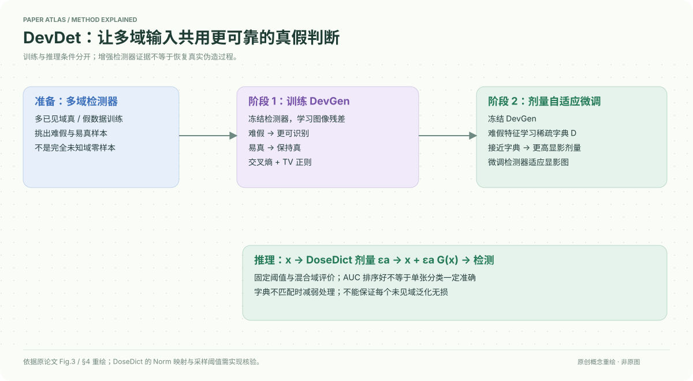

# A Sanity Check for Multi-In-Domain Face Forgery Detection in the Real World

核对日期：2026-10-20。以下实验均为作者报告；本地完成原文阅读与讲解自检，未复现实验。

## 一句话总结

DevDet先训练“显影”网络强化难伪造样本，再用字典控制显影剂量微调检测器，解决多已见域混合时固定阈值难统一的问题。

## 研究背景与动机

各域内部AUC很高，不代表一个阈值能在混合输入上准确判断真假。数据域差异可能大于真假差异，模型在每域排序不错，却在域未知的单张判断中失准。MID-FFD因此强调多域同时训练、域未指定的逐帧评估。[§1–3，PDF1–4]

这是多已见域校准与学习问题，不应混同为完全未见域的通用深伪检测。

## 方法总览

先预训练多域检测器，选低假分的难假样本和易真样本；冻结检测器训练DevGen输出显影残差。再冻结DevGen，学习难假特征字典并微调检测器。推理按字典匹配程度决定残差剂量，再检测处理后的图片。[Fig.3、§4，PDF4–5]

## 核心创新与关键设计

显影输入为\(\tilde x=x+\epsilon G(x)\)。Stage1用真假交叉熵和总变差正则：\(L_{o1}=L_{dev}+\lambda_{tv}L_{tv}\)，既让难假变得可判假，也避免把易真推成假。[式1–3]

DoseDict使用稀疏重建
\[\min_{D,\alpha_i}\sum_i\tfrac12\|z_i-D\alpha_i\|_2^2+\lambda\|\alpha_i\|_1,\quad\|d_k\|_2\le1.\]
低重建误差表示接近已学难假样本，剂量\(\epsilon_a=\operatorname{Norm}(1-e(x))\)较高；离开已知范围则减弱显影。Norm映射的细节需源码/补充材料核验，不能直接把未归一化误差代入成合法剂量。[式4–7]

这种残差是针对检测器学习的输入转化，并未证明找到的全部显著区域都是真实物理伪造痕迹；Grad-CAM只是辅助可视化。

## 实验与关键结果

P1训练FF++、CelebDFv2、DFDCP、WildDeepfake；P2再加DF40与CDF3的多个方法。主对照基于Effort，输入256²或ViT224²、Adam2e−4、batch32、10epoch、单A100；Stage1剂量0.25，Stage2另乘0.25。[§5.1，PDF6–7]

| 作者报告 | Effort | DevDet |
| --- | --- | --- |
| P1混合S-AUC↑ | 0.8951 | 0.9332 |
| P1 M-ACC↑ | 0.7839 | 0.8764 |
| P2 M-ACC↑ | 0.8486 | 0.9053 |

来源Table1–2，PDF6。P2正文因真实样本重复，只报F-ACC及其平均，尽管Table2表注写average ACC；因此不能把P2的0.9053解释成已同时覆盖真实误报和伪造检出的总体准确率。

## 消融实验与证据强度

EffNetB4消融：基础M-ACC/Cross0.7624/0.6826，仅显影0.7823/0.5735，固定剂量微调0.8526/0.5851，顺序自适应0.8676/0.6896。只增强已知难样本会损害跨域，剂量控制是实质折中。[Table4，PDF7]

“保持泛化”不是逐项保证：Table3中Xception/CDF3从0.6996降到0.6739，Effort/DF40从0.8051降到0.7935。笔记保留这些下降，避免将作者总体表述扩展成每骨干每域无损。

## 局限与讨论

多域数据规模、标签可靠性与选难样本都会影响结果；真实人脸裁剪、压缩、身份和采样相关性需控制。未报告的部署基率、固定FPR与公平性不能从AUC推得。显影增加网络与字典开销，正文未充分量化所有部署成本。

没有独立实验确认对任何未知伪造方式有效；本地未执行人脸处理或上传个人照片。

## 复现提示

优先固定DeepfakeBench预处理、身份/视频划分和难假选样阈值，保存每阶段权重、DoseDict与Norm规则。测试应同时报告混合AUROC、固定阈值ACC、真实误报率及分域指标，并避免同视频相邻帧跨集合。

建议 `data/deepfake/devdet/`，仅按官方许可获取公开研究数据；本次上游代码地址、commit与许可证未核验，实验均为作者报告。

## 相关工作与阅读顺序

先理解AUROC只衡量排序，再读域偏移与阈值校准；随后看DevDet的两阶段和DoseDict，最后读Table4中的跨域损失。可与RDD/DID比较，但三者训练要求与任务范围不同，不能直接跨基准排优劣。

## 来源与校验

- [CVF 官方论文页](https://openaccess.thecvf.com/content/CVPR2026/html/Cheng_A_Sanity_Check_for_Multi-In-Domain_Face_Forgery_Detection_in_the_CVPR_2026_paper.html) · [所读 PDF](https://openaccess.thecvf.com/content/CVPR2026/papers/Cheng_A_Sanity_Check_for_Multi-In-Domain_Face_Forgery_Detection_in_the_CVPR_2026_paper.pdf)。页码均为该 PDF 的页序。
- 阅读范围：正文、公式与实验表；补充材料、上游代码与权重未逐项核验。许可证和固定代码 commit 尚未确认，不复制原文全文或数据。
- PDF SHA-256：`643a6d710a078cf8e86ccc77149fd1c4dac73c4a1ab23c671214d5802cf042a7`；版本为本次下载的 CVF 接收稿，核对日期 2026-10-20。
