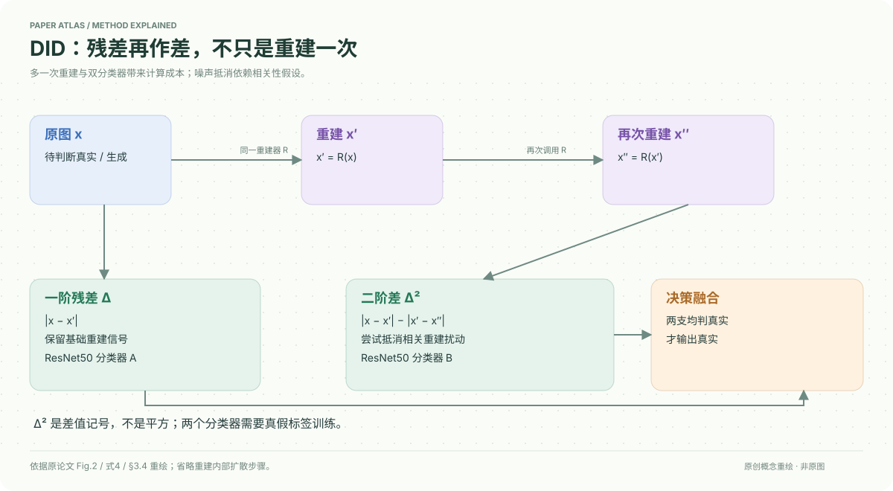

# A Difference-in-Difference Approach to Detecting AI-Generated Images

核对日期：2026-10-20。以下实验均为作者报告；本地完成原文阅读与讲解自检，未复现实验。

## 一句话总结

DID连续重建两次，把两次重建残差再作差，并结合一阶残差训练两个分类器，增强跨生成器检测；它不是免训练方法，也不是因果识别。

## 研究背景与动机

当生成图越来越逼真，真实图与生成图的一阶重建误差差距可能被随机重建扰动淹没。作者把第二次重建作为对照，尝试抵消相关扰动，暴露更细的偏离。[§1、3，PDF1–5]

名称借鉴计量经济学difference-in-differences的“差中差”思想，但这里没有政策处理组、平行趋势检验或因果效应估计。

## 方法总览

x经同一ADM重建器得到x′，再重建为x″。一支输入Δ=|x−x′|，另一支输入Δ²=|x−x′|−|x′−x″|；各自ResNet50分类器使用真假标签训练，最终只有两支都判真实才输出真实。[Fig.2、§3.4，PDF2、5–6]

## 核心创新与关键设计

注意Δ²只是作者的二阶差记号，既不是残差平方，也不是外层绝对值。
\[x^\prime=R(x),\quad x^{\prime\prime}=R(x^\prime),\quad\Delta^2(x)=|x-x^\prime|-|x^\prime-x^{\prime\prime}|.\]
理论用R(x)=Π_M(x)+δ(x)描述流形投影与扰动。当x与x′接近，且两处扰动高度相关，差中差有机会抵消δ；这些是近似与假设，不能说二次重建必然消除所有噪声。[式1–8，PDF4–5]

两个分类器独立交叉熵训练。作者阈值设为1−√0.5≈0.29，宣称用于匹配单分类器0.5的整体误报。阈值代数本身不能保证相同FPR，因为输出分布和两支相关性未知；实际应在独立验证集测量和匹配FPR。[§4.1，PDF6]

## 实验与关键结果

训练一组为ImageNet真实40k+ADM生成40k；较小组为LAION真实10k+Kan3或SDXL生成10k，重建器固定为LSUN-Bedroom预训练ADM，H800运行。主指标ACC↑，对手AEROBLADE免训练，其他方法训练条件需结合协议理解。[§4.1]

| 作者报告的总平均ACC | DID | DIRE | 绝对差 |
| --- | --- | --- | --- |
| ImageNet+ADM训练 | 99.41 | 99.37 | +0.04点 |
| LAION+Kan3训练 | 94.55 | 92.96 | +1.59点 |
| LAION+SDXL训练 | 96.42 | 94.83 | +1.59点 |

来源Table1–2，PDF6–7。文中22.52%/30.66%改善对应错误率的相对下降，例如(7.04−5.45)/7.04≈22.6%，并非准确率提高22.52个百分点；表格用未舍入数计算所以略有差异。GAN测试总平均94.42对92.94，亦是1.48点准确率差。[Table3，PDF8]

## 消融实验与证据强度

用LAION训练数据10%的轻量消融中，LSUN-ADM的DID/仅二阶/DIRE为86.5/69.0/84.0，二阶单用会明显失败；LSUN-PNDM为83.0/81.5/67.5，二阶帮助很大。融合适应不同情形，但不是二阶处处优于一阶。[Table4，PDF8]

大样本、生成器与重建器对齐时，DIRE已经近饱和；小样本与不对齐设置增益更明显，符合作者动机，但两种条件同时改变，不能单独归因于样本量。

## 局限与讨论

二次扩散重建增加时间与内存，正文把详细成本放到未读补充材料。理论依赖相关扰动和近流形假设；若重建随机性不相关，消差可能放大噪声。真实世界混合编辑、压缩、未知生成器及失配阈值需要单独验证。

高阶差和文本检测仅是讨论方向，未据正文完成通用文本检测。本文数字是作者结果，不是本地实测。

## 复现提示

先固定ADM权重、重建步数、噪声种子与缩放，保存x/x′/x″及带符号二阶残差，避免误写成平方。训练数据、分类器和阈值选择要隔离测试集；分别测单支与融合的真实FPR及延迟。

原文代码入口 `https://github.com/Qixinyi1122-lucky/DID`，本次未审查commit/许可证或执行。建议 `data/aigi-detection/did/`，不使用私人图像，不提交大规模生成图或权重。

## 相关工作与阅读顺序

先读DIRE的一阶残差分类器，再用RDD理解另一种误差校正思路，最后看本文式4、Table2与Table4。特别检查相对错误率改善、绝对准确率差和部署误报率三个不同量。

## 来源与校验

- [CVF 官方论文页](https://openaccess.thecvf.com/content/CVPR2026/html/Qi_A_Difference-in-Difference_Approach_to_Detecting_AI-Generated_Images_CVPR_2026_paper.html) · [所读 PDF](https://openaccess.thecvf.com/content/CVPR2026/papers/Qi_A_Difference-in-Difference_Approach_to_Detecting_AI-Generated_Images_CVPR_2026_paper.pdf)。页码均为该 PDF 的页序。
- 阅读范围：正文、公式与实验表；补充材料、上游代码与权重未逐项核验。许可证和固定代码 commit 尚未确认，不复制原文全文或数据。
- PDF SHA-256：`9cc76dbbf60523b2b0df0654faf378c464dcf3bf26a4a9722061559451306c46`；版本为本次下载的 CVF 接收稿，核对日期 2026-10-20。

- 视觉核对：已渲染查看 PDF 第7页，检查关键实验表、公式或局限；正文读到结论，独立补充材料未读。
