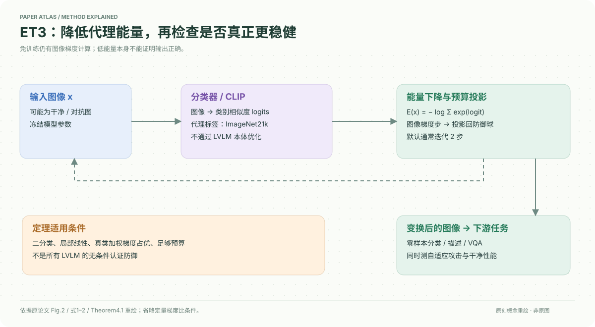

# A Provable Energy-Guided Test-Time Defense Boosting Adversarial Robustness of Large Vision-Language Models

核对日期：2026-10-20。以下实验均为作者报告；本地完成原文阅读与讲解自检，未复现实验。

## 一句话总结

ET3在测试时用分类器/CLIP的负LogSumExp能量引导少量图像梯度步，不训练新模型；理论保证限于满足局部线性与梯度优势条件的二分类器，不能直接推广为所有LVLM的认证防御。

## 研究背景与动机

对抗训练开销高，鲁棒视觉编码器仍可能被扰动击败。测试时转化可直接调整输入，但扩散净化或多视图/提示优化成本较大。作者利用已有分类logits构造能量，不再训练额外生成净化模型。[§1–3，PDF1–4]

免训练不等于不计算梯度；ET3仍在每张输入上执行有预算约束的优化。

## 方法总览

图像进入冻结分类器或CLIP，得到代理类别logits并计算能量，优化图像的小扰动后投影回防御球；迭代结束把变换后的图像送给下游分类/VQA/描述模型。LVLM本体不参与这段优化，CLIP与ImageNet21k代理文本承担引导。[Fig.2、§3，PDF3–4]

## 核心创新与关键设计

能量与更新为
\[E(x)=-\log\sum_k\exp f_\theta(x)_k,\quad x^{(t)}=\Pi_{B_\epsilon(x)}[x^{(t-1)}-\eta\nabla_xE(x^{(t-1)})].\]
降低能量会提高某些logits，但只有正确类方向占优等条件成立时才导向正确分类；低能量本身不是正确性证明。[式1–2]

CLIP将图文相似度作为logits，主要使用ImageNet21k代理词。防御预算默认对TeCoA为L2半径5、FARE为4、T2；攻击常用L∞4/255。不同范数与数值不能直接比较成“防御比攻击只多一点”。[§5.1]

Theorem4.1假设预算邻域内局部线性，真类经softmax加权的logit梯度范数大于错误类且满足定量比值条件，预算也足够。真实标签出现在定理条件中，实际无标签推理无法逐样本自动确认这些条件。证明原型是二分类，不是自由文本生成的全输入保证。[§4，PDF4–6]

## 实验与关键结果

先区分攻击者是否知道防御。零样本14基准Table1为defense-unaware、APGD-CE/DLR各100步；TeCoA4鲁棒平均32.85→40.93、FARE4 32.77→40.60；各数据集干净精度并非都提高。[PDF7]

| 作者Table4，ImageNet RN50自适应评价 | Clean↑ | Robust↑ |
| --- | --- | --- |
| 原鲁棒模型 | 64.02 | 34.96 |
| ET3，转移攻击与APGD/BPDA取最差 | 63.12 | 37.70 |

增益2.74点同时干净下降0.90点。其他净化方法骨干与最强攻击不同，不能把跨行比较当相同算力/攻击的严格排名。[PDF8]

LLaVA1.5-7B，四数据集包含CIDEr与VQA，Table3普通CLIP下COCO受攻击CIDEr2.7→61.1，但Clean115.5→111.3。Table5自适应200样本汇总，普通CLIP的L2投影非自适应16.7降至自适应4.5，说明只报未知防御攻击会显著高估效果。[PDF8]

## 消融实验与证据强度

同一Table5中FARE4的L2投影基线24.1、非自适应32.8、自适应31.0，仍有收益；不同骨干抗自适应程度差异明显。L∞投影不是默认L2的同一实验。更多标签集、预算公平和单步消融在未读附录，本地不虚构细节。[PDF8]

Table2同一鲁棒CLIP ViT-B/32的8基准PGD100，基线鲁棒12.26、ET3 16.51、R-TPT21.41、R-TPT+ET3 23.88，说明单独轻量收益与多增强/调prompt复合方案不是同成本条件。

## 局限与讨论

能量优化可能强化错误高置信类；理论假设对任意大模型/样本不成立。L2防御可能显著改变图像，必须核验预算与视觉语义。正文不同任务平均混合CIDEr与准确率，不应称作统一百分比准确率；2.3%单步开销在附录环境，不能套用所有两步流程。

本地未运行攻击、净化或复现实验；论文标题中的Provable不代表已认证任意LVLM部署。

## 复现提示

固定模型/代理标签、输入归一化、L2与L∞投影、步长和防御步数，分别评估Clean、defense-unaware及含BPDA的adaptive攻击，报告最差值、语义变化与总延迟。若编码器不同，重新核验代理能量与下游相关性。

建议 `data/robustness/et3/`。原文提及GitHub，但本次没有核验固定仓库commit与许可证；不运行未知上游代码，不将说明当作已验证安全防护配置。

## 相关工作与阅读顺序

先读CLIP相似度logits与EBM的负LogSumExp，再读BPDA/EoT为何测试时防御需要自适应评价。最后将Theorem4.1的每个条件与Table5普通CLIP的下降对照，理解理论适用域和经验鲁棒性不同。

## 来源与校验

- [CVF 官方论文页](https://openaccess.thecvf.com/content/CVPR2026/html/Mirza_A_Provable_Energy-Guided_Test-Time_Defense_Boosting_Adversarial_Robustness_of_Large_CVPR_2026_paper.html) · [所读 PDF](https://openaccess.thecvf.com/content/CVPR2026/papers/Mirza_A_Provable_Energy-Guided_Test-Time_Defense_Boosting_Adversarial_Robustness_of_Large_CVPR_2026_paper.pdf)。页码均为该 PDF 的页序。
- 阅读范围：正文、公式与实验表；补充材料、上游代码与权重未逐项核验。许可证和固定代码 commit 尚未确认，不复制原文全文或数据。
- PDF SHA-256：`542430dfc2ab345cd6d2c67b6a5dfb50072af6c1273e776521935c1c789a067f`；版本为本次下载的 CVF 接收稿，核对日期 2026-10-20。

- 视觉核对：PDF第8页已渲染查看，核对原表/算法；独立补充材料和上游实现未读。
