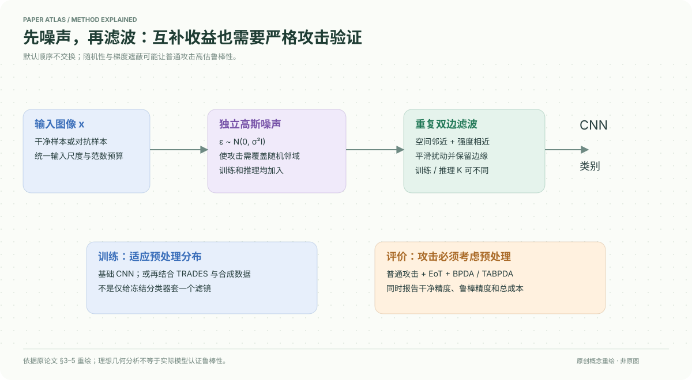

# A Combination of Noise and Bilateral Filters Achieve Supralinear and Scalable Adversarial Robustness in CNNs

核对日期：2026-10-20。以下实验均为作者报告；本地完成原文阅读与讲解自检，未复现实验。

## 一句话总结

在训练和推理都先加高斯噪声再反复双边滤波，可提高所测CNN的对抗鲁棒性；收益依赖攻击评估、干净精度和训练预算，不能视为普遍安全保证。

## 研究背景与动机

噪声使攻击需要覆盖一定邻域，滤波则把扰动拉向图像流形，两种机制可能互补。只加噪声会损伤画面，只滤波可能挡不住靠近流形的攻击。作者分析理想化几何，再用CNN实验验证组合是否超过单项收益之和。[§1–4，PDF1–4]

## 方法总览

输入x先叠加零均值独立高斯噪声，再执行多次双边滤波，然后送入分类器。训练也使用预处理以适应其分布；进阶实验结合TRADES式对抗训练和EDM合成数据。不是给任意冻结分类器前面加滤镜就得到文中成绩。[§3、5]

## 核心创新与关键设计

可以将流程记为
\[\tilde x=B^{(K)}(x+\epsilon),\quad\epsilon\sim\mathcal N(0,\sigma^2I),\quad\hat y=f_\theta(\tilde x).\]
这里B是双边滤波，兼顾空间距离与像素差异，以平滑噪声并保留边缘；K在训练和推理可不同。本式为讲解记号，原文几何理论进一步假定光滑、理想去噪映射与边界曲率条件，不能把那些假设直接当成实际滤波器满足的定理。[§3–4]

作者以固定对抗区域体积比较不同形状：噪声不利于细长攻击区域，滤波擅长压制远离流形的扰动。理论首先分别分析两者，正文也承认忽略相互作用，顺序不交换，优先噪声后滤波的选择还依赖实验。[PDF3–4]

随机性与不可微/不稳定梯度容易造成攻击失效的假象，因此必须评估EoT和BPDA类自适应攻击，而不只看普通梯度攻击。

## 实验与关键结果

基础消融用CIFAR10和80epoch的EfficientNet-B0；强模型为不同规模WRN、TRADES和EDM数据。Table2的最高配置WRN-82-12用3000epoch、50M合成样本，20/100表示训练20次、推理100次滤波。[§5、Table2，PDF4–5]

| Table2作者报告 | Clean↑ | AutoAttack↑ | EoT AutoAttack↑ |
| --- | --- | --- | --- |
| WRN-28-10，400epoch/1M | 88.96 | 61.60 | 未列 |
| 同训练量，Prepro20/80 | 88.24 | 69.60 | 67.20 |
| WRN-28-10，2400epoch/20M+预处理 | 90.52 | 73.08 | 70.90 |
| 本文最大配置 | 90.12 | 74.32 | 73.00 |
| 文献SotA WRN-94-16，10000epoch/500M | 93.68 | 73.71 | 未列 |

最大配置普通AutoAttack高0.61个百分点，但干净精度低3.56点，训练资源和模型不同，不是完全控制变量的无损替代。所称SotA是论文报告时对手，本地未查询当前排行榜。

## 消融实验与证据强度

Table1的L∞列：基础0.2%，仅滤波1.0%，仅噪声25.5%，噪声后滤波36.5%；组合增益明显超过两单项相对基线的增益和。原表linear/actual gain为26.1/36.2，与按四舍五入均值直接相减存在小差异，阅读时不强行拼成完全一致数字。[PDF5]

EoT列从0.2到18.9%，比普通L∞明显低；Clean从74.5到67.9%。L2下单项已很强，组合并非超线性；“超线性”不涵盖每种攻击。反序滤波后噪声的L∞28.1和EoT15.1，也低于默认顺序。

## 局限与讨论

正文大量附录/表号显示“??”，关键参数和证明的导航不完整；本次没有读到对应补充材料，不能声称可直接复现全部设置。WRN因成本未报告标准差，作者也承认与文献训练复现有差距。[PDF4、8]

作者讨论梯度遮蔽可能解释部分更大扰动下的收益，TABPDA绕过部分遮蔽后收益仍在，但这不排除更强攻击。理论不等于认证鲁棒性，也没有证明对所有分布、ViT或实际安全系统成立。[§6，PDF8]

## 复现提示

重现应先用小模型固定CIFAR10划分、输入范围与范数预算，分别比较Clean、普通攻击、足量EoT与BPDA；报告随机种子、攻击重启、步数、滤波实现和训练/推理K。记录网络加预处理的总推理成本，不能只计分类器FLOPs。

建议 `data/robustness/cifar10/`。本地仅阅读、表格核对，未执行上游代码或攻击，未独立验证论文的安全/计算节省结论；代码许可与版本待核。

## 相关工作与阅读顺序

先读对抗训练与TRADES，再读AutoAttack、EoT和BPDA的威胁模型，最后理解双边滤波。阅读顺序应从Table1的对照和Table2的资源条件进入，再看理想几何解释，避免从漂亮理论图直接跳到安全保证。

## 来源与校验

- [CVF 官方论文页](https://openaccess.thecvf.com/content/CVPR2026/html/Stalder_A_Combination_of_Noise_and_Bilateral_Filters_Achieve_Supralinear_and_CVPR_2026_paper.html) · [所读 PDF](https://openaccess.thecvf.com/content/CVPR2026/papers/Stalder_A_Combination_of_Noise_and_Bilateral_Filters_Achieve_Supralinear_and_CVPR_2026_paper.pdf)。页码均为该 PDF 的页序。
- 阅读范围：正文、公式与实验表；补充材料、上游代码与权重未逐项核验。许可证和固定代码 commit 尚未确认，不复制原文全文或数据。
- PDF SHA-256：`cbb0c83bfcbec9c5491c755371dba03813c407460e75360881f99dc29ebc1bf2`；版本为本次下载的 CVF 接收稿，核对日期 2026-10-20。

- 视觉核对：已渲染查看 PDF 第5页，核对关键公式或实验表；正文阅读到结论与局限，未读独立补充材料。
