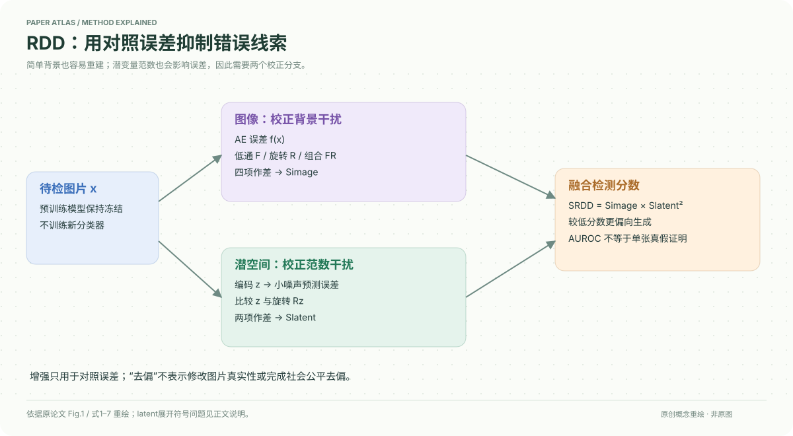

# A Debiased Reconstruction-based Framework for Training-Free Detection of AI-Generated Images

核对日期：2026-10-20。以下实验均为作者报告；本地完成原文阅读与讲解自检，未复现实验。

## 一句话总结

RDD用旋转、低通变换前后的重建误差差值削弱图像背景和latent范数的干扰，再融合图像与潜空间信号，实现无需训练新检测器的AI图片检测。

## 研究背景与动机

重建误差并不只反映真假：黑背景、简单纹理的真实图片也很容易被自编码器重建，会被误判成生成图。另一方面，图像级AE误差对不共享该AE的GAN可能无效。作者因此既校正图像分支，又增加扩散潜空间分支。[§1–3，PDF1–5]

“去偏”在此指去除检测分数中的干扰因素，与社会群体公平不是同一个问题；“免训练”仍依赖预训练扩散模型。

## 方法总览

图像分支比较原图、低通图、90°旋转图及二者组合的AE误差；latent分支编码图像，加少量噪声后用噪声预测误差衡量，再与旋转latent对照。最终相乘，统一约定较低分数更偏向生成图。[Fig.1、式1–7，PDF2–5]

## 核心创新与关键设计

原始AE误差记f(x)=d(x,AE(x))，d取LPIPS。令F为低通、R为90°旋转，则
\[S_{image}=f(x)-f(Fx)-\lambda_R f(Rx)+\lambda_R f(FRx).\]
这是差值校正，不是除法归一化；组合试图抵消仍保留在变换图中的背景贡献。[式1–4，PDF3–4]

潜空间先测噪声预测误差
\[f_{latent,t}(z)=\mathbb E_\epsilon d(\epsilon_\theta(z_t,t,\varnothing),\epsilon).\]
潜变量旋转不改变范数，因此用旋转前后差值减弱范数相关干扰。按原文式6的首行定义记为S_latent=f_latent(Rz)−f_latent(z)。该式随后展开的求和项顺序相反，存在符号核对问题；最终平方消除了整体符号对RDD的影响，但单独latent分支的分数方向仍应对照代码。[PDF5]

最终
\[S_{RDD}=S_{image}\,[S_{latent}(E(x))]^2.\]
平方与乘法是作者采用的尺度融合设计，不是自动产生校准概率的贝叶斯推断。

## 实验与关键结果

主要检测设置融合SD1.4、SD2-base与MiniSD，t=0.05、λ_R=0.5，单A100；先前动机例子的t=0.025不是全实验默认。评价为AUROC↑，不需先定阈值，但部署仍需阈值与误报率校准。[§4.1，PDF6]

| 作者报告 | GenImage平均 | LSUN-Bedroom平均 |
| --- | --- | --- |
| AEROBLADE | 0.932 | 0.476 |
| WaRPAD | 0.946 | 0.934 |
| RDD | 0.981 | 0.940 |

Table1–2，PDF6。GenImage以ImageNet真实图为对照，LSUN-Bedroom含GAN与图像级扩散且统一256×256。平均最好不意味着所有生成器最好：GenImage ADM中RDD0.926低于WaRPAD0.986；LSUN的Diff-PjGAN为0.935也低于WaRPAD0.988。归因任务另设λ_R=0.25，S_image耗时0.292s对比LatentTracer14.65s；该速度不应套到完整RDD检测上。[Table6、§4.3，PDF8]

## 消融实验与证据强度

Table3：图像原误差在GenImage为0.902，去偏后0.969；latent原误差在LSUN为0.666，去偏后0.963。融合RDD的LSUN0.940反而低于单latent0.963，是跨基准折中，不能说每处都协同提升。[PDF7]

乘方指数1/2/3时，GenImage为0.986/0.981/0.971，LSUN为0.858/0.940/0.957，默认2并非每个数据集单独最优。高斯核默认3、σ0.8；ColorJitter与RandomResizedCrop的GenImage0.907/0.841较差，表明不是任意增强都有效。

## 局限与讨论

多次AE重建和latent网络调用增加开销，作者在§5明确承认。JPEG与中心裁剪测试不能证明对所有处理或对抗攻击稳健；训练分布、未知生成器和真实图中的人工处理仍会影响误报。高AUROC不提供单张图片真假事实的确定结论。

原文latent展开符号、分数聚合细节和部署阈值需代码核对；本地未运行检测器或独立估算误报。

## 复现提示

固定三套模型版本及LPIPS版本，明确图像缩放、核参数、旋转与编码顺序，复用噪声的方式也需核验。先在授权小样本上分别检查AE、图像去偏、latent去偏与融合分支的分数方向，再报告AUROC、指定真实误报率下的检出率及总耗时。

建议 `data/aigi-detection/`；不上传私人图片或模型权重。上游代码commit、许可证与补充材料本次未逐项核验，暂不提供声称可直接复现的运行命令。

## 相关工作与阅读顺序

先读AEROBLADE的AE重建信号，再看本文黑背景反例和Fig.6范数偏差；最后看Table3，而不是只看最高平均AUROC。可与DID对照：RDD利用增强前后误差校正且免训练，DID使用二次重建和有监督分类器。

## 来源与校验

- [CVF 官方论文页](https://openaccess.thecvf.com/content/CVPR2026/html/Choi_A_Debiased_Reconstruction-based_Framework_for_Training-Free_Detection_of_AI-Generated_Images_CVPR_2026_paper.html) · [所读 PDF](https://openaccess.thecvf.com/content/CVPR2026/papers/Choi_A_Debiased_Reconstruction-based_Framework_for_Training-Free_Detection_of_AI-Generated_Images_CVPR_2026_paper.pdf)。页码均为该 PDF 的页序。
- 阅读范围：正文、公式与实验表；补充材料、上游代码与权重未逐项核验。许可证和固定代码 commit 尚未确认，不复制原文全文或数据。
- PDF SHA-256：`86a8b60e9fb053b0a8c578451f1581d3f178d184c3f45930f6c4678385cb171c`；版本为本次下载的 CVF 接收稿，核对日期 2026-10-20。

- 视觉核对：已渲染查看 PDF 第7页，检查关键实验表、公式或局限；正文读到结论，独立补充材料未读。
