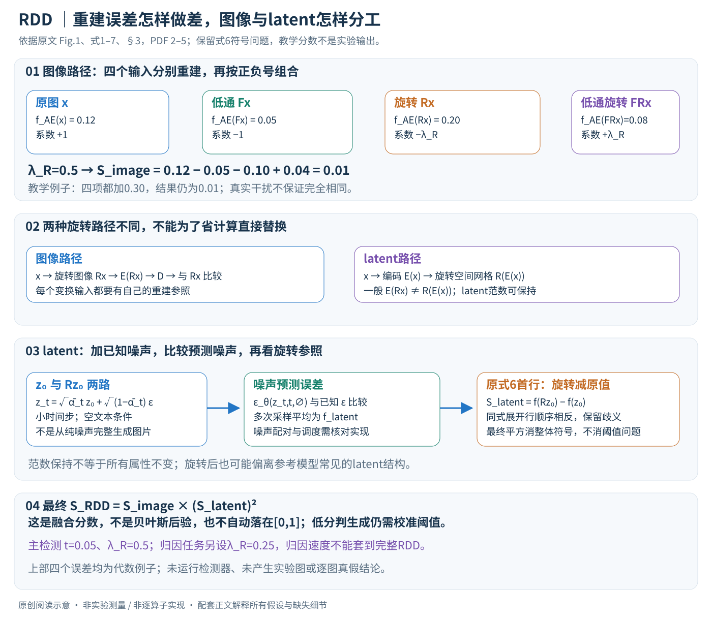

# A Debiased Reconstruction-based Framework for Training-Free Detection of AI-Generated Images

核对日期：2026-10-20。以下实验均为作者报告；本地完成原文阅读与讲解自检，未复现实验。

方法与配图详细版返工：2026-10-23。重读§2–4并核对式1–7；展开四项校正、噪声预测、旋转顺序、符号歧义和融合边界，未复现。

## 一句话总结

RDD用旋转、低通变换前后的重建误差差值削弱图像背景和latent范数的干扰，再融合图像与潜空间信号，实现无需训练新检测器的AI图片检测。

## 研究背景与动机

重建误差并不只反映真假：黑背景、简单纹理的真实图片也很容易被自编码器重建，会被误判成生成图。另一方面，图像级AE误差对不共享该AE的GAN可能无效。作者因此既校正图像分支，又增加扩散潜空间分支。[§1–3，PDF1–5]

“去偏”在此指去除检测分数中的干扰因素，与社会群体公平不是同一个问题；“免训练”仍依赖预训练扩散模型。

## 方法总览

### 检测器不重新训练，但仍依赖预训练模型与分数约定

RDD给一张待检图片计算分数，作者约定低分更倾向生成图、高分更倾向真实图；部署时仍需阈值。所谓training-free，是不再用真假训练集拟合一个新分类器，并不意味着没有预训练扩散模型、感知距离网络、超参数或算力成本。（§2.1、§3，PDF第2–5页）

它有两条互补路径：图像级路径比较原图及变换图的自编码器重建误差；latent级路径比较原latent及旋转latent的噪声预测误差。最后用乘法融合。图像级更利用与LDM自编码器的重建关系，latent级补充对其他生成方式的判别线索，不能把两条误差混写为同一种“图片MSE”。

原创阅读图依据Fig.1、式1–7及§3，PDF第2–5页。四个误差和公共偏移为代数教学例子；没有虚构图片检测结果或实验分布。图中特别区分\(E(Rx)\)与\(R(E(x))\)，并保留式6符号歧义。

| 量 | 含义 | 计算边界 |
|---|---|---|
| E、D | LDM自编码器的编码/解码 | \(AE(x)=D(E(x))\)，不是整套扩散采样 |
| \(f_{AE}(x)\) | x与AE(x)之间的感知距离 | 图像级采用LPIPS |
| F、R | 低通滤波与90°空间旋转 | 不是训练增强，而是推理计分的一部分 |
| \(z_0\) | \(E(x)\)，C'×H'×W' | latent旋转作用于此空间网格 |
| \(z_t,\epsilon_i\) | 加噪latent和已知噪声样本 | 用噪声预测残差计算分数 |
| \(S_{image},S_{latent}\) | 两条校正分数 | 都不是已校准概率 |
| \(S_{RDD}\) | 最终乘积 | 分数方向和阈值需独立验证 |

## 核心创新与关键设计

### 1. 先理解“重建好”为什么可能被误用

原始自编码器信号为\(f_{AE}(x)=d(x,AE(x))\)。相关LDM生成图可能更适合该AE的表示，因此重建误差小；但一张真实的简单背景图也可能容易压缩重建。误差混有纹理、背景与模型适配程度，不能直接等同真假证据。（§3.2，PDF第3页）

作者用移除背景的真实南瓜图说明问题：语义仍是真实照片，但黑背景让误差接近生成图。这是针对实例属性的分数干扰，不是在声称所有黑背景图都真实或所有高频纹理都伪造。LPIPS还比较预训练视觉特征而非逐像素绝对误差，其版本和图像归一化会影响数值。

### 2. 一般去偏形式：变换保留干扰、改变取证敏感性

作者提出

\[S_{f,T,\lambda}(x)=f(x)-\lambda f(Tx).\]

理想意图是：T保留某些干扰属性，却改变对来源敏感的重建行为，减去变换后的分数以削弱共同干扰。这里是**减法校正**，不是把一个误差除以另一个；“normalize”一词不能自动翻译成除法或概率归一化。（式1，PDF第3页）

可用解释性分解\(f(x)=a(x)+b(x)\)，a表示希望保留的来源相关部分，b表示实例干扰。若\(b(Tx)\approx b(x)\)，且\(\lambda=1\)，共同项可能相消。但这只是设计直觉，不是原文证明所有图都存在这种可分解偏差；T也可能一起破坏有用信号。

### 3. 低通分支：比较原图与去高频图的AE误差

令F为低通，作者定义

\[S_{LFID}(x)=f_{AE}(x)-f_{AE}(Fx).\]

背景简洁度等低频属性可能在滤波后大体保留，高频重建差异则变化。作者观察真实图和部分LDM图在高频残差上不同，因此用这两项的差，而不只是问“哪张图模糊后重建更好”。（式2、Fig.4，PDF第4页）

它不是先把原图与AE重建相减再做一次滤波；必须对Fx重新编码解码，比较Fx与AE(Fx)。若把比较对象写成x与AE(Fx)，就把滤波本身的失真直接混入了原公式。

### 4. 旋转分支：90°之后重新重建，而不是只转误差图

旋转分支为

\[S_{RID}(x)=f_{AE}(x)-\lambda_R f_{AE}(Rx).\]

Rx要完整经过AE，再与Rx比较。作者观察相关生成图旋转后重建残差变化更明显，而一些背景属性仍保留，因此把它作为参照。旋转在这里不是为了让分类器学习旋转不变性，也不要求AE本身满足\(AE(Rx)=R(AE(x))\)。（式3、Fig.5，PDF第4页）

若AE完全旋转等变、感知距离也完全相应不变，某些差值信号反而会减弱。方法利用的是实际预训练模型与图像来源对变换的响应差异，不是一个对任意AE都成立的来源检测定理。

### 5. 四项组合怎样得到？

作者再对旋转分数应用低通差值：

\[S_{image}=S_{RID}(x)-S_{RID}(Fx)\]
\[=f_{AE}(x)-f_{AE}(Fx)-\lambda_R f_{AE}(Rx)
+\lambda_R f_{AE}(FRx).\]

所以图像路径需要原图、低通图、旋转图和低通旋转组合图的四次重建/距离评估。它不是任意四个误差平均，也不是一个新的神经网络融合头。（式4、Fig.1(a)，PDF第2、4页）

**代数例子。** 四个误差依次为0.12、0.05、0.20、0.08，\(\lambda_R=0.5\)，得\(0.12-0.05-0.10+0.04=0.01\)。若四项都增加共同偏移0.30，结果仍为0.01，因为系数和\(1-1-0.5+0.5=0\)。这说明完全共同的加性干扰为何可能抵消；它不证明真实背景影响必然相同，更不表示0.01在任意配置下一定判假。

原文讨论滤波/旋转次序可交换；对理想各向同性低通和90°网格旋转可理解这种关系，但实际插值、边界填充、矩形裁剪和实现顺序仍需固定。不能由交换性的文字推断所有随机裁剪、色彩增强都可替换F/R，Table中的替代增强也没有同样效果。

### 6. latent分支测的是已知噪声能否被预测

先编码\(z_0=E(x)\)，再按小时间步加噪：

\[z_t=\sqrt{\bar\alpha_t}z_0+\sqrt{1-\bar\alpha_t}\epsilon,
\quad\epsilon\sim\mathcal N(0,I).\]

噪声预测网络在空文本条件\(\varnothing\)下输出\(\epsilon_\theta(z_t,t,\varnothing)\)，与已知epsilon比较并多次平均：

\[f_{latent,t}(z_0)=\frac1n\sum_i
d_{latent}(\epsilon_\theta(z_{t,i},t,\varnothing),\epsilon_i).\]

这里不需要知道这张图生成时的原始seed；epsilon是检测过程中新加的已知噪声。也不需要从纯噪声完整反向生成一张图，当前分数来自选定t处的噪声预测评估。\(d_{latent}\)在动机实验使用L2距离，不能自动改称逐像素图像MSE。（§2.2、式5，PDF第3–5页）

### 7. 为什么latent误差也需要参照？

作者观察latent范数与噪声预测误差相关：某些高范数latent误差更低，可能掩盖真假差别。90°旋转空间网格是元素重排，能保持L2范数；因此用旋转latent作为“同范数、不同几何排列”的参照，试图削弱范数相关干扰。（§3.3、Fig.6，PDF第5页）

注意这里先编码后旋转：\(R(E(x))\)。图像分支是先旋转图片后编码：\(E(Rx)\)。普通卷积/注意力编码器没有保证两者相等，所以不能为节省调用次数随意替换。也不能把latent旋转画成一张实际拍摄旋转照片后的新物理场景。

范数保持只是必要的参照属性之一，不证明其他所有因素都固定；旋转也可能产生模型训练中不常见的结构。观察到范数相关不等于已经得到完整的因果偏差模型，真实图像编辑、异常纹理或未知来源仍可能改变分布。

### 8. 式6存在符号冲突，需要保留两行的区别

式6首行定义为

\[S_{latent}(z_0)=f_{latent,t}(Rz_0)-f_{latent,t}(z_0).\]

但同式随后展开的样本和写成原latent误差减旋转latent误差，方向相反。本笔记按首行描述定义，同时明确这一不一致；最终平方使整体换号不改变RDD，但单独latent分数方向、AUROC标签约定和单分支阈值仍需源码核对。（已对照PDF第5页渲染公式）

式6两项使用相同epsilon下标，实际实现怎样共享噪声样本、随机种子及时间步映射也需确认。直接旋转已加噪的zt会同时旋转噪声，与先旋转z0再加入同一epsilon不完全一样；不能把它们当作无需说明的等价优化。

### 9. 乘法融合表达互补，但不是概率推断

原文最终分数是

\[S_{RDD}(x)=S_{image}(x)\,[S_{latent}(E(x))]^2.\]

作者用latent平方配合图像LPIPS的平方特征距离尺度，并选择乘法平衡不同范围。平方使latent项非负且消除整体换号，但不让图像项自动非负，也不产生[0,1]概率。若图像校正项为负，乘积仍为负；若任一项接近0，另一条分支再大也可能被压小。（式7，PDF第5页）

所以它是一个经实验选定的融合规则，而不是两个独立证据概率相乘的贝叶斯后验。消融也表明默认平方是跨基准折中：在LSUN单独latent去偏0.963高于融合0.940，在GenImage融合更强。不能说两条分支在每种生成器上都互相加分。（Table 3–4，PDF第7页）

### 10. 多参考模型与噪声采样的成本

主检测使用SD1.4、SD2-base、MiniSD作为参考模型集合，固定\(t=0.05,\lambda_R=0.5\)。动机图中的\(t=0.025,n=16\)是另一处明确设置，不能将它不加核对当作所有主实验的完整默认采样配方。正文明确Simage做平均，但最终各模型/各分支的完整聚合顺序还需实现确认。（§3.3、§4.1，PDF第5–6页）

每套参考模型的图像级四次AE路径、latent级原/旋转两路噪声评估和感知网络都有开销。Monte Carlo次数越多通常减少随机估计波动，但提高成本；不同模型latent形状和噪声规范还可能不同。正文没有充分给出整套RDD的每图实测时间，本地也没有估算或测量。

### 11. 来源归因是另一个条件任务

论文还用Simage区分“来自候选LDM M1”与“来自其他候选模型”，并改\(\lambda_R=0.25\)。它要求选定M1对应AE作为参照，回答相对归属问题，不是无候选列表地识别互联网上任意生成模型。（§4.3、Table 6，PDF第8页）

0.292秒是该Simage归因实验的报告速度，不能套到包含多模型、latent去噪与全部预处理的RDD检测。候选模型共享AE时，来源区分能力也需要具体测试；“图片像某AE流形”不直接证明作者身份、生成时间或完整内容来源。

### 12. 复现先固定分数方向，再谈高AUROC

应逐项固定AE/去噪器/LPIPS版本、输入缩放、latent尺度、滤波核与边界、90°旋转顺序、时间步调度及噪声配对。先检查四项Simage、两项Slatent与最终乘积，明确低分判生成的方向；再报告AUROC和指定真实误报率下的检出，而非给一张图的分数赋予未经校准的真假事实。

JPEG和裁剪实验支持所测扰动条件下的鲁棒性，不覆盖所有编辑链、未知模型或对抗处理。免训练也不免除阈值、测试分布和基率的校准需求。本次完成原文与式1–7重读、关键公式页视觉核对及代数示例自检；代码、权重许可和补充材料尚未逐项核验，**未运行图片检测或复现实验**。

## 实验与关键结果

主要检测设置融合SD1.4、SD2-base与MiniSD，t=0.05、λ_R=0.5，单A100；先前动机例子的t=0.025不是全实验默认。评价为AUROC↑，不需先定阈值，但部署仍需阈值与误报率校准。[§4.1，PDF6]

| 作者报告 | GenImage平均 | LSUN-Bedroom平均 |
| --- | --- | --- |
| AEROBLADE | 0.932 | 0.476 |
| WaRPAD | 0.946 | 0.934 |
| RDD | 0.981 | 0.940 |

Table1–2，PDF6。GenImage以ImageNet真实图为对照，LSUN-Bedroom含GAN与图像级扩散且统一256×256。平均最好不意味着所有生成器最好：GenImage ADM中RDD0.926低于WaRPAD0.986；LSUN的Diff-PjGAN为0.935也低于WaRPAD0.988。归因任务另设λ_R=0.25，S_image耗时0.292s对比LatentTracer14.65s；该速度不应套到完整RDD检测上。[Table6、§4.3，PDF8]

## 消融实验与证据强度

Table3：图像原误差在GenImage为0.902，去偏后0.969；latent原误差在LSUN为0.666，去偏后0.963。融合RDD的LSUN0.940反而低于单latent0.963，是跨基准折中，不能说每处都协同提升。[PDF7]

乘方指数1/2/3时，GenImage为0.986/0.981/0.971，LSUN为0.858/0.940/0.957，默认2并非每个数据集单独最优。高斯核默认3、σ0.8；ColorJitter与RandomResizedCrop的GenImage0.907/0.841较差，表明不是任意增强都有效。

## 局限与讨论

多次AE重建和latent网络调用增加开销，作者在§5明确承认。JPEG与中心裁剪测试不能证明对所有处理或对抗攻击稳健；训练分布、未知生成器和真实图中的人工处理仍会影响误报。高AUROC不提供单张图片真假事实的确定结论。

原文latent展开符号、分数聚合细节和部署阈值需代码核对；本地未运行检测器或独立估算误报。

## 复现提示

固定三套模型版本及LPIPS版本，明确图像缩放、核参数、旋转与编码顺序，复用噪声的方式也需核验。先在授权小样本上分别检查AE、图像去偏、latent去偏与融合分支的分数方向，再报告AUROC、指定真实误报率下的检出率及总耗时。

建议 `data/aigi-detection/`；不上传私人图片或模型权重。上游代码commit、许可证与补充材料本次未逐项核验，暂不提供声称可直接复现的运行命令。

## 相关工作与阅读顺序

先读AEROBLADE的AE重建信号，再看本文黑背景反例和Fig.6范数偏差；最后看Table3，而不是只看最高平均AUROC。可与DID对照：RDD利用增强前后误差校正且免训练，DID使用二次重建和有监督分类器。

## 来源与校验

- [CVF 官方论文页](https://openaccess.thecvf.com/content/CVPR2026/html/Choi_A_Debiased_Reconstruction-based_Framework_for_Training-Free_Detection_of_AI-Generated_Images_CVPR_2026_paper.html) · [所读 PDF](https://openaccess.thecvf.com/content/CVPR2026/papers/Choi_A_Debiased_Reconstruction-based_Framework_for_Training-Free_Detection_of_AI-Generated_Images_CVPR_2026_paper.pdf)。页码均为该 PDF 的页序。
- 阅读范围：正文、公式与实验表；补充材料、上游代码与权重未逐项核验。许可证和固定代码 commit 尚未确认，不复制原文全文或数据。
- PDF SHA-256：`86a8b60e9fb053b0a8c578451f1581d3f178d184c3f45930f6c4678385cb171c`；版本为本次下载的 CVF 接收稿，核对日期 2026-10-20。

- 视觉核对：已渲染查看 PDF 第7页，检查关键实验表、公式或局限；正文读到结论，独立补充材料未读。
