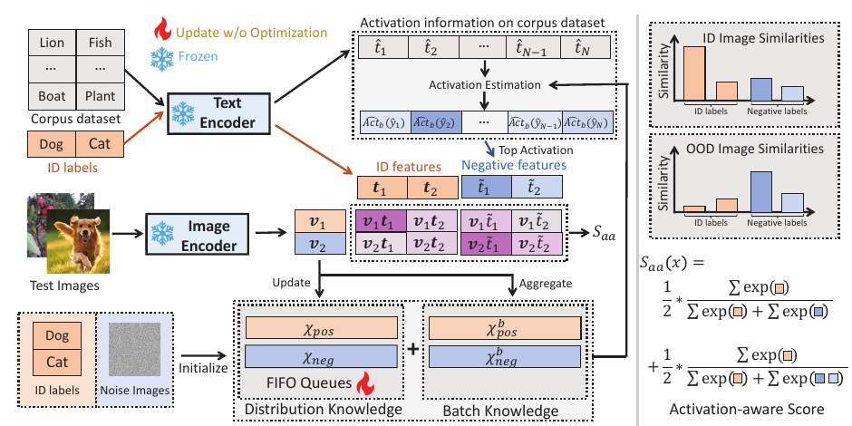

# Activation Matters: Test-time Activated Negative Labels for OOD Detection with Vision-Language Models

核对日期：2026-10-21。实验数值均为作者报告；本地完成原文阅读与讲解自检，未复现实验。

## 一句话总结

TANL在测试流中缓存高置信ID/OOD样本，按候选词在两类缓存上的激活差选择负标签，并以排序前缀评分增强OOD检测。

## 研究背景与动机

NegLabel从远离已知类别的词中选负标签，但“远离ID词”未必能描述当前未知图像。TANL使用测试分布中实际激活的词，减少无关负标签对分数的干扰。[§1–3，PDF1–4]

training-free表示不更新CLIP参数，仍会更新缓存与标签，属于有状态测试适应；不能按每个测试样本完全独立的静态检测器解释结果。

## 方法总览

原论文Fig.2，PDF第4页。仅裁切相关图示，保留图内科学标签；著作权属于原作者，用于本篇方法分析，不并入本站原创图授权。[来源与作者](https://openaccess.thecvf.com/content/CVPR2026/html/Zhang_Activation_Matters_Test-time_Activated_Negative_Labels_for_OOD_Detection_with_CVPR_2026_paper.html) · [PDF](https://openaccess.thecvf.com/content/CVPR2026/papers/Zhang_Activation_Matters_Test-time_Activated_Negative_Labels_for_OOD_Detection_with_CVPR_2026_paper.pdf)。点击可打开高清图。

先把ID文本特征和高斯噪声图像特征分别作为正负FIFO初始化。每批用现有检测分数找高置信样本，估计所有候选词在正负集合上的归一化概率均值差，挑前M个。可把本批信息以小权重混入历史估计，再重算分数、更新FIFO。[Fig.2、§3.3，PDF4–5]

主文Algorithm1先用S_aa挑本批样本、后计算新S_aa，实际初始评分与更新先后须从实现确定；不能把尚未计算的新分数用于它自身的前置选择。Fig.1使用真实ID/OOD标签做动机分析，不代表正式在线方法能访问测试真值。

## 核心创新与关键设计

候选词y的激活是对应softmax概率在样本集上的均值，选择分数为：
\[\widehat{Act}_d(y)=Act(X_{neg},y)-Act(X_{pos},y).\]
它是归一化概率差，不是原始余弦距离。按激活高到低排序负词t̃_j，定义A=Σ_i exp(vt_i)、b_j=exp(vt̃_j)，则：
\[S_{aa}(v)=\frac1M\sum_{m=1}^M\frac{A}{A+\sum_{j=1}^m b_j}.\]
高排名负词出现在更多前缀分母里，影响更强。公式为简写，实际温度0.01不能漏掉；分数越高越像ID。[式5–15，PDF4–5]

高置信正阈值γ+(1-γ)g，负阈值γ-γg，中间不入队；历史/本批加权α=0.95，空本批子集时退回历史统计。理论要求负标签更常响应OOD，但softmax均值排序和伪标签误差并不严格保证阈值事件概率p₁<p₂；正文理论分析是解释性条件，不是所有测试流必改善的证明。[式16，PDF5–7]

## 实验与关键结果

CLIP ViT-B/16，提示模板“The nice <label>”，M1000、队列L300、gap0.2。ImageNet-1K为ID，对iNaturalist、SUN、Places、Textures做检测；另有OpenOOD近/远OOD和full-spectrum设置。[§4.1，PDF7]

| 作者报告 | NegLabel | CSP | TANL |
| --- | --- | --- | --- |
| 四组平均FPR95↓ | 25.40% | 17.51% | 9.81% |
| 四组平均AUROC↑ | 94.21% | 95.76% | 97.97% |

来源Table1，PDF6。对CSP下降7.70**个百分点**，相对约44%；摘要17.5→9.8的对照是CSP，不是NegLabel。Places本文FPR95仍21.90%，不能从平均9.81推断每种未知分布都低于10%。

OpenOOD近/远FPR95为60.06/17.21，ID分类66.82%；full-spectrum近/远为68.71/22.48，远低于“未知都能可靠拒绝”的程度。不同协议数值不能与主表混用。[Table2–3，PDF6–7]

## 消融实验与证据强度

Table4已渲染核对：仅分布适应61.57/17.52，批适应60.85/17.25；分别加前缀评分后60.59/17.27与60.06/17.21，均为近/远FPR95。[PDF7] 消融支持激活标签和评分的改进，批知识权重大到压过历史时会退化。[Fig.3，PDF8]

batch256时ViT-B/16为527FPS，对NegLabel592、MCM625、AdaNeg476；不是无额外计算，也不是单样本实时延迟。ResNet50为790FPS、FPR95 10.37；更换骨干同时影响质量。计时硬件等细节在未读补充材料。[Table5，PDF8]

## 局限与讨论

错入缓存可能自强化，测试顺序、ID/OOD比例、分布突变及队列暖启动都会影响结果；从其他测试集合继承缓存会污染协议，必须显式说明重置边界。

阈值γ自动确定方法、候选词库、早期错误分析与医疗OOD详细实验在附录，本次未核验。不可把“无需训练”扩展为无需阈值或完全不接触测试分布；也不能把冻结的ID分类准确率当成OOD拒绝正确率。

## 复现提示

[作者代码入口](https://github.com/YBZh/OpenOOD-VLM)尚未核验commit、许可证或自动阈值实现。建议 `experiments/recognition/tanl/`，按ImageNet与各OOD数据许可取得样本，仓库只留配置、划分和索引。

先在小型获许可数据验证评分方向、前缀求和、温度与FIFO初始状态，再固定批次顺序、每组缓存重置和阈值校准来源；额外报告类别不平衡与突变流表现。本次未执行CLIP或检测实验，全部数值来自作者。

## 相关工作与阅读顺序

先读CLIP、MCM与NegLabel的ID概率质量，再读TANL激活统计和FIFO更新。最后对照Table1/2/3的不同协议与Algorithm1的更新顺序，理解测试适应收益和缓存依赖。

## 来源与校验

- [CVF官方论文页](https://openaccess.thecvf.com/content/CVPR2026/html/Zhang_Activation_Matters_Test-time_Activated_Negative_Labels_for_OOD_Detection_with_CVPR_2026_paper.html) · [所读PDF](https://openaccess.thecvf.com/content/CVPR2026/papers/Zhang_Activation_Matters_Test-time_Activated_Negative_Labels_for_OOD_Detection_with_CVPR_2026_paper.pdf)。页码均为PDF页序。
- 所读版本：2026-10-21从CVF下载的开放接收稿；PDF SHA-256：`6336ae2ae73b86cfb449b02d6412dac40345aa6af0f664e4c7a4a666f59ad948`。
- 阅读范围：正文、方法公式、实验与消融；补充材料、代码及权重未逐项核验。reviewed表示本地讲解自检，不表示独立同行评审或实验复现。
- 方法图与关键公式/表格已渲染核对，所引原图已单独检查；未对新文章进行浏览器交互验收。作者图示与本站原创素材权利分开记录。
