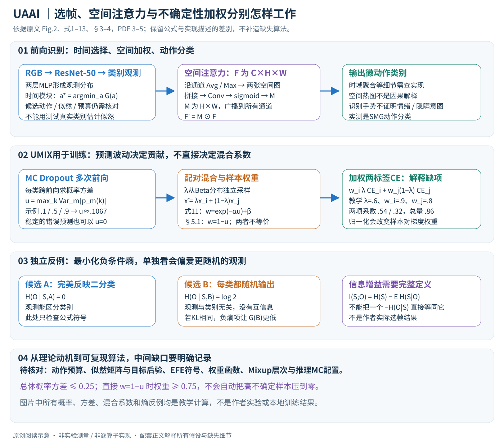

# Active Inference for Micro-Gesture Recognition: EFE-Guided Temporal Sampling and Adaptive Learning

核对日期：2026-10-22。实验数值均为作者报告；本地完成原文阅读与讲解自检，未复现实验。

方法与配图详细版返工：2026-10-23。重读式1–13与实验，展开似然/后验接口、熵符号反例、空间广播、MC方差与UMIX有效权重；未复现。

## 一句话总结

UAAI结合时序选帧、空间注意力与MC Dropout不确定性加权Mixup，用较有信息的观测训练微动作分类器。

## 研究背景与动机

微动作幅度小、短暂且个体差异大，均匀处理整段视频容易淹没关键瞬间。作者以主动推理为动机，同时减少无关帧和不可靠训练样本影响。[§1–2，PDF1–3]

本文评估动作类别识别，没有验证对个人真实情绪、隐瞒意图或心理疾病的判断。介绍中的应用愿景不能当作由SMG分类准确率证明的能力。

## 方法总览

### 三个模块分别选择时间、加权空间、调整训练损失

UAAI输入一段RGB微动作视频，输出动作类别。编码器采用ImageNet预训练ResNet-50，轻量两层MLP把视觉表示转为类别层面的观测；时间模块尝试选择信息较有价值的帧，空间模块给局部特征加权，UMIX根据MC Dropout预测波动重新加权混合样本的训练贡献。（§3–4、§5.1，PDF第3–6页）

这三个模块不是同一种“不确定性操作”。时间模块通过作者定义的Expected Free Energy（EFE）为观察动作打分；空间模块实际实现为卷积空间注意力；UMIX的样本不确定度来自多次随机前向的类别概率方差。需要分别核对，不能把三者统一画成一个已经验证的贝叶斯最优决策器。

原创图依据式1–13和Fig.2，PDF第3–5页。概率、方差与加权系数均为独立教学例子；没有运行微动作识别、情绪判断或模型训练。

供对照的作者总览图：

原文Fig.2，PDF第5页；保留科学标签的局部摘录，著作权属于原作者，不并入本站原创图授权。[来源与作者](https://openaccess.thecvf.com/content/CVPR2026/html/Feng_Active_Inference_for_Micro-Gesture_Recognition_EFE-Guided_Temporal_Sampling_and_Adaptive_CVPR_2026_paper.html) · [PDF](https://openaccess.thecvf.com/content/CVPR2026/papers/Feng_Active_Inference_for_Micro-Gesture_Recognition_EFE-Guided_Temporal_Sampling_and_Adaptive_CVPR_2026_paper.pdf)。

### 先分清状态、观测和动作

| 符号 | 论文中角色 | 尚不能直接假定的实现细节 |
|---|---|---|
| \(I_{1:L}\) | RGB视频帧序列 | 采样帧预算与停止规则未完整列出 |
| \(z_t=f_\theta(I_t)\) | 帧特征 | 多帧最终如何聚合须核对实现 |
| \(s\) | 隐藏的微动作类别 | 不是由实验验证的个人心理状态 |
| \(o\) | 视觉特征经分类器形成的类别观测 | 离散类别与softmax向量的转化规则需明确 |
| \(a_t\) | 下一次观察/选帧的动作 | 候选集合、跨度及是否允许跳过未读帧未充分披露 |
| \(q(s\mid o)\) | 近似后验信念 | 与EFE中的目标后验不是自动相同的量 |

本文用\(L\)表示视频帧数、\(M\)表示MC随机前向次数，以免原文多处使用\(T\)时把两种预算混在一起。这只是笔记记号调整，不是更改模型。

## 核心创新与关键设计

### 时间选择的意图：按候选观测对信念的影响打分

作者把选帧写成POMDP中的观察动作选择，式2为

\[
a_t^*=\arg\min_{a_t\in\mathcal A}G_t(a_t).
\]

若能对每个候选动作预测未来类别观测及信念变化，就可先计算其期望分数，再选择一个动作。这里“主动”指模型选择看哪里/何时看，不是主动学习中向人工索取新标签。（§4.2，PDF第4页）

作者定义动作相关似然矩阵

\[
A_a(i,j)=p(o=j\mid s=i,a),
\]

行是真实动作类别，列是观测到的类别。均匀先验\(p(s=i)=1/K\)下，对离散观测\(o=j\)，标准贝叶斯更新应为

\[
q(s=i\mid o=j,a)=
\frac{A_a(i,j)p(s=i)}{\sum_{i'}A_a(i',j)p(s=i')}.
\]

这个后验展开是对原文所述Bayesian updating的解释，不是作者额外给出的实现伪代码。教学例子：两类似然矩阵为\(\begin{bmatrix}.9&.1\\.2&.8\end{bmatrix}\)，先验各一半，观察到第一类时后验为\((.9/1.1,.2/1.1)\approx(.818,.182)\)，而不是直接取softmax的某一行当作完整似然矩阵。

重要空缺在于：网络对一张帧输出\(p(s\mid I)\)并不直接给出所有\(p(o\mid s,a)\)。矩阵如何从训练数据/预测统计估计、动作依赖性怎样获得、目标信念如何构造，正文没有足够可执行细节。估计似然也不能使用测试帧真实类别，否则会引入标签泄漏。对尚未读取的未来帧，还需说明打分所需特征来自哪里；如果已经把整段视频全部送入昂贵骨干，再做选择，不能据选中帧数直接声称节省了骨干计算。

### EFE公式的符号与“信息增益”并不自动一致

式3包含两项：预测后验与目标后验的KL，以及**负的条件观测熵**，概括为

\[
G(a)=\mathbb E\left[
D_{\rm KL}(q(s'\mid o')\Vert p(s'\mid o'))
-H(p(o'\mid s',a))\right].
\]

作者文字称第二项对应信息增益，但条件熵本身不等于信息增益。标准互信息可写作\(I(S;O\mid a)=H(S)-\mathbb E_O H(S\mid O,a)\)，也可按相应联合分布写成\(H(O\mid a)-\mathbb E_S H(O\mid S,a)\)。不能只取一个负条件熵就宣称已实现这两个完整表达。（§4.2，PDF第4页）

一个独立反例可以检查符号：二分类先验各半，候选A的观测完美反映类别，\(H(O\mid S,A)=0\)；候选B无论类别都随机输出，\(H(O\mid S,B)=\log2\)，完全没有类别信息。若两者KL项相同，原式的负熵部分使\(G(B)=G(A)-\log2\)，最小化会偏向B。这说明不能脱离其他项的具体定义，把这个负号单独解释成“更确定的观测一定更好”。反例不是作者实验失败，也不证明实际实现一定选错帧；它指出正文公式与文字解释之间需要澄清。

式1也有记号冲突：KL参考写成\(p(s\mid o)\)，文字却称先验\(p(s)\)。通常的变分自由能恒等式是

\[
\mathcal F=\mathbb E_q[-\log p(o\mid s)]
+D_{\rm KL}(q(s)\Vert p(s))
=D_{\rm KL}(q(s)\Vert p(s\mid o))-\log p(o).
\]

将第一种写法的先验直接替成后验而仍保留原accuracy项，不是同一个恒等式。上式用于解释差别，**没有擅自替作者修正训练代码**。最终训练究竟显式优化哪些自由能项、如何与UMIX交叉熵组合，仍需源码或作者说明。

### 空间模块：沿通道池化，再得到一张共享空间mask

选帧后的特征记作\(F\in\mathbb R^{C\times H\times W}\)。式8–9先沿通道做平均和最大池化，得到两张\(1\times H\times W\)图，拼接成\(2\times H\times W\)，经过卷积和sigmoid得到\(M\in(0,1)^{H\times W}\)。式6再用

\[
F'_{c,h,w}=M_{h,w}F_{c,h,w}
\]

对所有通道广播加权。（§4.3，PDF第4页）这不是先沿时间挑帧的操作，也不是直接删掉输入图像中的某块像素。正文公式写拼接，Fig.2示意用了加号且没有清楚列出卷积，讲解以式9为主要计算描述，并保留图文差别供复现核对。

作者将空间EFE近似为\(\sum_iG_{t,i}\)，再写加权\(\sum_iM_iG_{t,i}\)。但正文未充分定义局部EFE怎样计算、为何普通卷积mask就是其最优解。如果所有\(G_{t,i}>0\)，且只最小化这个不带其他约束的加权和，趋向\(M_i=0\)就能降目标；还需要分类损失、约束或更完整推导才能避免平凡解。因此本笔记称其为带主动推理动机的学习空间注意力，不把热图本身当作已验证的因果解释或严格EFE优化证书。

### MC Dropout的不确定度是预测波动，不是标签错误率

在时间与空间选择之后，对同一训练样本保持dropout启用，做\(M\)次随机前向，得到各次类别概率\(\hat p_m\)。按式10：

\[
u(I)=\max_k\operatorname{Var}_{m=1}^{M}
\left[\hat p_m(y=k\mid I)\right].
\]

这里先对每个类别算跨前向方差，再取类别最大值；不是先取最大类别概率再求方差，也不是预测熵或直接的分类错误概率。论文实验用dropout率0.3、\(M=5\)。（§4.4、§5.1，PDF第4、6页）

独立例子：二分类的第一类概率分别为\(.1,.5,.9\)，第二类为相应补数。用总体方差，两类方差均为\(.32/3\approx.1067\)，所以\(u=.1067\)。如果每次都给错误类别\(.99\)概率，方差仍可为零：稳定并不等于正确。若用样本无偏方差，数值又不同，原文未充分说明具体实现的方差归一化，不能把教学算法默认当成作者配置。

对取值在\([0,1]\)的概率变量，总体方差至多\(.25\)。因而如果实现直接用\(w=1-u\)且无额外归一化，它的权重只落在\([.75,1]\)；不能说它会把最不确定样本权重压到零。这一范围是概率方差的数学界限，不是作者报告的权重分布；使用无偏估计或其他重标度时须重新分析。

### UMIX：混合比例与样本贡献是两个旋钮

原式11写样本权重\(w_i=\exp(-\alpha u_i)+\beta\)；但§5.1实现说明写\(w_i=1-u_i\)。两者通常不等价，超参数\(\alpha,\beta\)与方差是否缩放也需核实。（PDF第5–6页）

式12从\(\operatorname{Beta}(\alpha_{\rm mix},\alpha_{\rm mix})\)采样\(\lambda\)，再形成\(\tilde x=\lambda x_i+(1-\lambda)x_j\)和软标签。实验给出\(\alpha_{\rm mix}=.4\)。这是**独立采样的混合系数**；按所列公式，不能说\(\lambda\)本身已经由\(u_i,u_j\)自动决定。正文相关工作里的“同时调整混合比例”比实际公式更强，需以可核查实现为准。

式13第二项排版漏印\(\mathcal L_{\rm ce}\)。依据两标签交叉熵的语境，可以将其**意图**解释为

\[
\mathcal L_{ij}=w_i\lambda\operatorname{CE}(f_\theta(\tilde x),y_i)
+w_j(1-\lambda)\operatorname{CE}(f_\theta(\tilde x),y_j),
\]

但需明确这是对缺项的解释，不冒称原PDF已经完整印出。\(x\)具体指像素视频、特征还是其他处理后的张量，混合发生的层次也要查代码；不能看到Mixup就自行指定所有实现细节。

教学数值：\(\lambda=.6,w_i=.9,w_j=.8\)，两项系数为\(.54,.32\)，和为\(.86\)。可等价理解为总损失乘\(.86\)，再按\(.54/.86\approx.628\)与\(.32/.86\approx.372\)组合标签损失。于是输入仍按\(.6/.4\)混合，损失的有效标签比例却不同；若再擅自把权重和归一到1，也会改变不同样本对之间的总梯度权重。此处不是作者实际样本权重。

### 训练流程与推理流程不能混成一条箭头

训练时需要有标签视频：提取特征、建立观察信念并选帧、做空间加权，对样本进行多次dropout前向以估计波动，再采样配对与\(\lambda\)，以加权混合损失更新模型。原文没有完整列出不确定度是否detach、是否缓存、每次参数更新都重估与否，这些选择会影响目标和开销，不能在“伪代码”里补成已经确认的作者算法。

推理时没有真实标签，也不需要把待识别视频与有标签样本Mixup后训练。时间/空间模块仍参与分类；是否继续运行MC Dropout、如何聚合多次输出与设置停止规则，正文未充分明确。若使用MC推理，其成本应单列，不能把训练\(M=5\)默认等同于每次部署必须五遍，或直接说推理只有一次前向。

### 完整复现还需要的接口与验证

必须补足动作集合及预算、似然矩阵估计、目标后验来源、EFE符号和熵的实际计算、空间卷积配置、时域聚合、方差估计规则、权重函数、Mixup层次及梯度边界。也应保留官方人物划分，解释3712与3699样本计数差额，比较相同帧预算下的准确率、实际解码/特征计算成本和长尾类别表现。

降低高方差样本权重可能抑制噪声，也可能抑制少见但重要的真实动作；需要按类别检查。注意力落在手部只说明模型响应位置，不能证明该位置导致心理状态。此次返工只阅读、推导和绘图，SMG动作分类结果不能外推为读心、测谎、临床诊断或个人真实情绪识别能力。

## 实验与关键结果

SMG40人、488分钟、16微动作加非动作共17类。正文3712片段，但训练2452/验证637/测试610合计3699，差13未说明，不补造样本。RGB224²、batch32、Adam、验证选学习率1e-4到5e-4、dropout0.3、MC次数5，报告3次运行均值。[§5.1，PDF5–6]

| SMG准确率，作者报告 | 数值 |
| --- | --- |
| TSM / TRN（RGB） | 58.69 / 59.51% |
| VideoMamba（RGB） | 55.08% |
| UAAI（RGB） | 63.47% |
| MS-G3D（骨架） | 64.75% |

来源Table1，PDF6。比TRN增加3.96个百分点，仍低于骨架方法1.28pp。Logic-in-Frames61.31、VideoTree59.51均较低，但单数据集领先不能泛化为所有微动作场景最优。

## 消融实验与证据强度

基线50.49%，仅UMIX57.54%，仅时间56.40%，仅空间55.40%，完整63.47%，支持模块组合价值。[Table3，PDF7]

MC2/5/8次的训练墙钟约152/204/255秒，吞吐645/523/392样本每秒；所计区间与硬件未充分给出，不据此推算全程训练或推理时间。[Table4，PDF8] 文中说报告平均观测帧数，主文未见数表，不能把减少计算写成已测量端到端加速。

## 局限与讨论

高不确定度也可能来自罕见重要类别，减权可能压制长尾学习。论文提跨主体、低样本与噪声鲁棒性，但主表没有分别列出两种主体协议、标注噪声强度和跨数据集迁移，应限于实际报告设置。

EFE公式、UMIX权重和数据计数待核，动作预算与停止准则也未完整交代。本研究没有临床或真实心理测量实验，不能扩展成读心、测谎或诊断工具。

## 复现提示

正文未提供可确认的专用源码仓库，固定commit、许可证和下载条件待核；从CVF来源页追踪作者资料，不以同名项目代替源码。建议 `experiments/recognition/uaai/`，SMG数据存于仓库外。

复现先固定官方划分及人物隔离，解决3699/3712差额、权重函数与EFE似然估计，再比较同样帧预算。未运行训练、噪声实验或情绪推断，数值均为作者报告。

## 相关工作与阅读顺序

先读Mixup、MC Dropout与空间注意力，再复习条件熵和互信息。最后对照式1/3/11与§5.1，检查自由能动机与实际可执行算法之间的距离。

## 来源与校验

- [CVF官方论文页](https://openaccess.thecvf.com/content/CVPR2026/html/Feng_Active_Inference_for_Micro-Gesture_Recognition_EFE-Guided_Temporal_Sampling_and_Adaptive_CVPR_2026_paper.html) · [所读PDF](https://openaccess.thecvf.com/content/CVPR2026/papers/Feng_Active_Inference_for_Micro-Gesture_Recognition_EFE-Guided_Temporal_Sampling_and_Adaptive_CVPR_2026_paper.pdf)。页码均为PDF页序。
- 所读版本：2026-10-21从CVF下载的开放接收稿；PDF SHA-256：`4f23d2434d8b0a9894675f2921a7b692b278abe66ba139110a6e9f9675f87cd1`。
- 阅读范围：正文、方法公式、实验与消融；补充材料、代码及权重未逐项核验。reviewed表示本地讲解自检，不表示独立同行评审或实验复现。
- 方法图与关键公式/表格已渲染核对，所引原图已单独检查；2026-10-23已逐张检查原创详图，并验收文章公式、图片加载与页面宽度。作者图示与本站原创素材权利分开记录。
