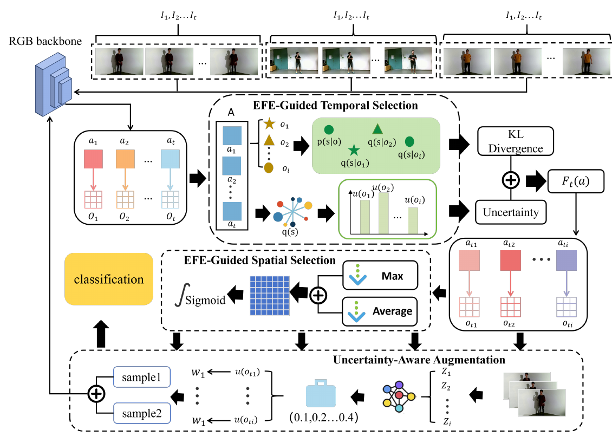

# Active Inference for Micro-Gesture Recognition: EFE-Guided Temporal Sampling and Adaptive Learning

核对日期：2026-10-22。实验数值均为作者报告；本地完成原文阅读与讲解自检，未复现实验。

## 一句话总结

UAAI结合时序选帧、空间注意力与MC Dropout不确定性加权Mixup，用较有信息的观测训练微动作分类器。

## 研究背景与动机

微动作幅度小、短暂且个体差异大，均匀处理整段视频容易淹没关键瞬间。作者以主动推理为动机，同时减少无关帧和不可靠训练样本影响。[§1–2，PDF1–3]

本文评估动作类别识别，没有验证对个人真实情绪、隐瞒意图或心理疾病的判断。介绍中的应用愿景不能当作由SMG分类准确率证明的能力。

## 方法总览

原论文Fig.2，PDF第5页。仅裁切相关图示，保留图内科学标签；著作权属于原作者，用于本篇方法分析，不并入本站原创图授权。[来源与作者](https://openaccess.thecvf.com/content/CVPR2026/html/Feng_Active_Inference_for_Micro-Gesture_Recognition_EFE-Guided_Temporal_Sampling_and_Adaptive_CVPR_2026_paper.html) · [PDF](https://openaccess.thecvf.com/content/CVPR2026/papers/Feng_Active_Inference_for_Micro-Gesture_Recognition_EFE-Guided_Temporal_Sampling_and_Adaptive_CVPR_2026_paper.pdf)。点击可打开高清图。

ImageNet预训练ResNet50提取RGB特征，两层MLP形成类别观测；时间模块按Expected Free Energy选择观测。空间模块拼接通道平均/最大池化结果，经卷积与sigmoid得到M，再以M⊙F加权；训练加入不确定性引导的UMIX增强。[Fig.2、§4，PDF4–5]

空间操作是学习特征掩码，主文未证明它精确解出EFE优化。图中加号和式9拼接的关系须核验，不能因命名便将普通注意力等同严格贝叶斯求解器。

## 核心创新与关键设计

MC Dropout运行T次，以类别预测概率最大方差衡量波动：
\[u(I)=\max_k\operatorname{Var}_t[\widehat p_t(y=k\mid I)].\]
它不是标签错误概率。式11权重exp(-αu)+β，§5.1却写1-u，两函数不相同，需代码确认。[PDF4–6]

Mixup取λ∼Beta(0.4,0.4)，输入λx_i+(1-λ)x_j，式13以w_iλ、w_j(1-λ)加权两标签交叉熵，但第二项漏印L_ce。λ按给定公式独立采样，不能称混合比例本身由u控制。[式11–13，PDF5]

理论还有不一致：式1将KL参考写为p(s|o)，文字却称先验p(s)；式3负条件熵不直接等于信息增益，最小化负熵本身反而偏好更大熵。目标后验、动作集合和似然矩阵估计没有充分说明，不能照式子声称已证明最大信息增益。[PDF3–4]

## 实验与关键结果

SMG40人、488分钟、16微动作加非动作共17类。正文3712片段，但训练2452/验证637/测试610合计3699，差13未说明，不补造样本。RGB224²、batch32、Adam、验证选学习率1e-4到5e-4、dropout0.3、MC次数5，报告3次运行均值。[§5.1，PDF5–6]

| SMG准确率，作者报告 | 数值 |
| --- | --- |
| TSM / TRN（RGB） | 58.69 / 59.51% |
| VideoMamba（RGB） | 55.08% |
| UAAI（RGB） | 63.47% |
| MS-G3D（骨架） | 64.75% |

来源Table1，PDF6。比TRN增加3.96个百分点，仍低于骨架方法1.28pp。Logic-in-Frames61.31、VideoTree59.51均较低，但单数据集领先不能泛化为所有微动作场景最优。

## 消融实验与证据强度

基线50.49%，仅UMIX57.54%，仅时间56.40%，仅空间55.40%，完整63.47%，支持模块组合价值。[Table3，PDF7]

MC2/5/8次的训练墙钟约152/204/255秒，吞吐645/523/392样本每秒；所计区间与硬件未充分给出，不据此推算全程训练或推理时间。[Table4，PDF8] 文中说报告平均观测帧数，主文未见数表，不能把减少计算写成已测量端到端加速。

## 局限与讨论

高不确定度也可能来自罕见重要类别，减权可能压制长尾学习。论文提跨主体、低样本与噪声鲁棒性，但主表没有分别列出两种主体协议、标注噪声强度和跨数据集迁移，应限于实际报告设置。

EFE公式、UMIX权重和数据计数待核，动作预算与停止准则也未完整交代。本研究没有临床或真实心理测量实验，不能扩展成读心、测谎或诊断工具。

## 复现提示

正文未提供可确认的专用源码仓库，固定commit、许可证和下载条件待核；从CVF来源页追踪作者资料，不以同名项目代替源码。建议 `experiments/recognition/uaai/`，SMG数据存于仓库外。

复现先固定官方划分及人物隔离，解决3699/3712差额、权重函数与EFE似然估计，再比较同样帧预算。未运行训练、噪声实验或情绪推断，数值均为作者报告。

## 相关工作与阅读顺序

先读Mixup、MC Dropout与空间注意力，再复习条件熵和互信息。最后对照式1/3/11与§5.1，检查自由能动机与实际可执行算法之间的距离。

## 来源与校验

- [CVF官方论文页](https://openaccess.thecvf.com/content/CVPR2026/html/Feng_Active_Inference_for_Micro-Gesture_Recognition_EFE-Guided_Temporal_Sampling_and_Adaptive_CVPR_2026_paper.html) · [所读PDF](https://openaccess.thecvf.com/content/CVPR2026/papers/Feng_Active_Inference_for_Micro-Gesture_Recognition_EFE-Guided_Temporal_Sampling_and_Adaptive_CVPR_2026_paper.pdf)。页码均为PDF页序。
- 所读版本：2026-10-21从CVF下载的开放接收稿；PDF SHA-256：`4f23d2434d8b0a9894675f2921a7b692b278abe66ba139110a6e9f9675f87cd1`。
- 阅读范围：正文、方法公式、实验与消融；补充材料、代码及权重未逐项核验。reviewed表示本地讲解自检，不表示独立同行评审或实验复现。
- 方法图与关键公式/表格已渲染核对，所引原图已单独检查；未对新文章进行浏览器交互验收。作者图示与本站原创素材权利分开记录。
