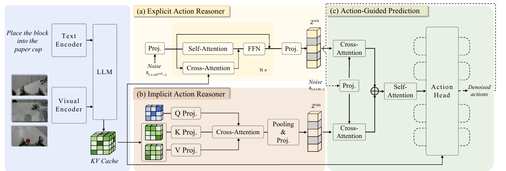

# ACoT-VLA: Action Chain-of-Thought for Vision-Language-Action Models

核对日期：2026-10-21。实验数值均为作者报告；本地完成原文阅读与讲解自检，未复现实验。

## 一句话总结

ACoT-VLA先预测较粗、较长的参考动作轨迹，再结合VLM内部特征生成实际执行动作，把中间推理落在动作空间。

## 研究背景与动机

语言步骤与目标图像都可能帮助机器人，但最终还要转换成连续控制量。作者尝试直接用动作表示未来计划，缩短中间表示与控制输出之间的距离。显式参考轨迹负责长程结构，隐式分支从共享VLM的KV缓存提取动作相关上下文。[§1–3，PDF1–4]

这里的Action CoT是学习得到的动作条件，不是可读的语言思维链；较高成功率也不能单独证明模型学会了因果规划。

## 方法总览

原论文Fig.2，PDF第3页。仅裁切相关图示，保留图内科学标签；著作权属于原作者，用于本篇方法分析，不并入本站原创图授权。[来源与作者](https://openaccess.thecvf.com/content/CVPR2026/html/Zhong_ACoT-VLA_Action_Chain-of-Thought_for_Vision-Language-Action_Models_CVPR_2026_paper.html) · [PDF](https://openaccess.thecvf.com/content/CVPR2026/papers/Zhong_ACoT-VLA_Action_Chain-of-Thought_for_Vision-Language-Action_Models_CVPR_2026_paper.pdf)。点击可打开高清图。

共享骨干采用π0.5：SigLIP视觉编码与Gemma 2B语言骨干。显式动作推理器EAR通过18层Transformer反复查询对应VLM层的KV缓存，利用flow matching生成参考动作。隐式动作推理器IAR对缓存作低维交叉注意力，汇成另一组条件。动作头分别关注两组条件、融合后去噪，输出短期执行序列。[Fig.2、§3，PDF3–5]

训练时EAR条件中的显式动作表示采用真实参考动作的teacher forcing；部署时改用模型生成参考动作。两者有分布差异，不能把训练期真实轨迹描述为部署可获得信息。

## 核心创新与关键设计

显式分支每层可概括为：
\[\widetilde h_i=\mathrm{SelfAttn}(h_{i-1})+\mathrm{CrossAttn}(h_{i-1},K_i,V_i),\qquad h_i=h_{i-1}+\mathrm{FFN}(\widetilde h_i).\]
它把视觉语言上下文带入动作流；不是先生成未来图像。IAR使用可学习查询，并将2048维缓存投影至128维做注意力，实验主配置查询数为1。[§3.2–3.3，PDF4–5]

参考动作采用15步、间隔2，覆盖等效30步；执行动作采用10步、间隔1。参考轨迹更粗、更远，但不能理解成机器人跳过中间物理状态。两条flow matching均方损失以0.5/0.5加权。[§3.4、§4.1，PDF5–6]

## 实验与关键结果

LIBERO四套件共40任务，每任务50条示范，评估各50次尝试，共2000次。作者训练用8张H100、bf16，推理使用RTX4090；AdamW、梯度裁剪1、EMA0.999。[§4.1，PDF5–6]

| 作者报告 | π0.5 | ACoT-VLA | 解释 |
| --- | --- | --- | --- |
| LIBERO平均成功率 | 96.9% | 98.5% | +1.6个百分点 |
| LIBERO-Long主表 | 92.4% | 97.0% | +4.6个百分点 |
| LIBERO-Plus零样本平均 | 85.7% | 86.6% | 同为在LIBERO训练后测试 |
| VLABench平均IS / PS | 60.2 / 43.1 | 63.5 / 47.4 | 全部冻结LLM、训练60K步 |

来源Table1–3，PDF6–7。Plus的冻结LLM版本仅83.6%，低于π0.5的85.7%；主方法相机扰动72.6也低于75.8，不能声称每种泛化都更强。VLABench常识轨道IS/PS为52.3/37.8，低于π0.5的57.5/41.6。

G1与AgileX实机任务平均成功率66.7%，对照π0.5为61.0%；正文未完整给出各项重复试验数，本次未读补充材料，不据此推算置信区间。[Fig.3，PDF8]

## 消融实验与证据强度

Table4中基线96.9%，仅EAR98.3%，仅IAR98.1%，两者98.5%，支持平均互补。但Long这一消融子项EAR96.6%高于两分支96.0%，也不同于主表97.0%，应保留实验口径差别。[PDF7]

参考轨迹的间隔2、长度15优于表中其他组合；这个结论来自受控消融，不表示任意动作频率都该选间隔2。IAR的Query、Attention Pooling、Downsample分别97.0/97.3/98.1%，支持低维交互设计；没有独立测量就不承诺新增分支零时延。

## 局限与讨论

参考动作本身可能出错，且teacher forcing不能消除部署误差累积。论文没有证明参考轨迹满足运动学或接触约束；实机任务种类与规模也不足以覆盖开放环境。

平均提升掩盖了部分常识、相机和噪声条件下降。学习率文字将峰值与衰减目标都写为5×10⁻⁵，具体调度需要代码配置核实；本地不把这段文字补成未经来源支持的训练配方。

## 复现提示

从[作者代码入口](https://github.com/AgibotTech/ACoT-VLA)核对commit、许可证和模型访问条件，再固定π0.5版本、冻结策略、动作归一化、轨迹取样及teacher forcing开关。建议 `experiments/robotics/acot-vla/`，示范和权重在仓库外存放。

先分别验证EAR训练/推理条件与动作时间索引，再比较同seed基线成功率和推理耗时。本次仅阅读原文、核对图表与公式，未取得固定上游版本，未运行仿真或实机，全部数值为作者报告。

## 相关工作与阅读顺序

先了解行为克隆、动作分块与flow matching，再比较语言CoT、CoT-VLA的未来视觉条件与本文动作条件，最后阅读Table2和Table4的失败子项。重点问题是中间计划能否稳定帮助执行，而不只是把分支命名为“推理”。

## 来源与校验

- [CVF官方论文页](https://openaccess.thecvf.com/content/CVPR2026/html/Zhong_ACoT-VLA_Action_Chain-of-Thought_for_Vision-Language-Action_Models_CVPR_2026_paper.html) · [所读PDF](https://openaccess.thecvf.com/content/CVPR2026/papers/Zhong_ACoT-VLA_Action_Chain-of-Thought_for_Vision-Language-Action_Models_CVPR_2026_paper.pdf)。页码均为PDF页序。
- 所读版本：2026-10-21从CVF下载的开放接收稿；PDF SHA-256：`bb44ba288614225a3ba750def425c4a3829f3ff827ca5fb91c15b533d132560e`。
- 阅读范围：正文、方法公式、实验与消融；补充材料、代码及权重未逐项核验。reviewed表示本地讲解自检，不表示独立同行评审或实验复现。
- 方法图与关键公式/表格已渲染核对，所引原图已单独检查；未对新文章进行浏览器交互验收。作者图示与本站原创素材权利分开记录。
