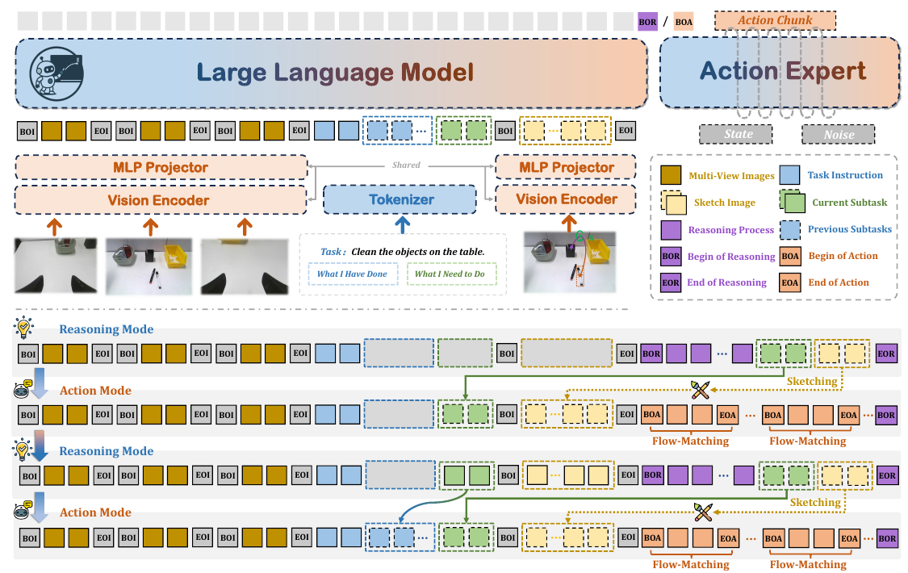

# Action-Sketcher: From Reasoning to Action via Visual Sketches for Robotic Manipulation

核对日期：2026-10-21。实验数值均为作者报告；本地完成原文阅读与讲解自检，未复现实验。

## 一句话总结

Action-Sketcher在推理与执行之间插入可编辑的框、点和箭头草图，用同一VLA循环规划子任务并生成动作。

## 研究背景与动机

长任务中的语言指令可能无法唯一指定物体或接触位置，隐式计划也难被人发现和纠正。作者把空间意图画到机器人当前视角，使人能够在动作前修改目标框、抓取点或方向，再交给低层控制。[§1，PDF2–3]

草图是可查看的意图接口，不是执行正确性的形式化证明；同一2D箭头也无法唯一决定三维位姿与接触力。

## 方法总览

原论文Fig.2，PDF第4页。仅裁切相关图示，保留图内科学标签；著作权属于原作者，用于本篇方法分析，不并入本站原创图授权。[来源与作者](https://openaccess.thecvf.com/content/CVPR2026/html/Tan_Action-Sketcher_From_Reasoning_to_Action_via_Visual_Sketches_for_Robotic_CVPR_2026_paper.html) · [PDF](https://openaccess.thecvf.com/content/CVPR2026/papers/Tan_Action-Sketcher_From_Reasoning_to_Action_via_Visual_Sketches_for_Robotic_CVPR_2026_paper.pdf)。点击可打开高清图。

上下文包括多相机图像、总任务、已完成子任务、当前子任务与草图图像。模型输出BOR时进入推理，先决定下一子任务、生成结构化草图，再把它渲染回视图；输出BOA时动作专家用flow matching生成连续动作块。起始上下文为空，必须先推理。[Fig.2、§3.2，PDF4–5]

具体基座π0，语言头负责离散计划与草图描述，动作专家负责连续控制。模式切换由学习的token选择，不是主文已给出一套确定性风险检测器；事件识别错误本身也可能成为故障。

## 核心创新与关键设计

草图表示为S_t=(B_t,P_t,A_t)：B为物体框，P为图像点，A含平移箭头及以点为中心的轴向旋转提示。平移给起止点，旋转还指明x/y/z轴与方向；这些都定义在ego-view图像参考中。[式1–6，PDF3–5]

为避免动作样本过多压倒推理样本，训练按模式均衡采样：
\[P(d)=\begin{cases}1/(2|D_R|),&d\in D_R,\\1/(2|D_A|),&d\in D_A.\end{cases}\]
即先各以一半概率选模式，再在该模式均匀选样本；不是每个样本总体同权。[式7，PDF6]

框增广维持IoU≥0.8，点在小圆内扰动、箭头随点更新。摘要提“强化”，但主文没有可执行的RL奖励/更新式；本篇按实际介绍的自回归监督、flow matching、增广与均衡采样解释，不自行补成GRPO方案。

## 实验与关键结果

阶段一3.4M空间样本、870K时序，部分解释由GPT-4o生成；阶段二2600实机长轨迹加1700已有轨迹，形成21K推理到草图样本；阶段三联合训练动作与模式。完整超参数在未读附录。[§3.2.3，PDF5–6]

| 作者报告 | Action-Sketcher | 对照 |
| --- | --- | --- |
| LIBERO Long | 96.0% | OpenVLA-OFT94.5% |
| LIBERO平均 | 96.9% | OpenVLA-OFT97.1% |
| 复杂RoboTwin Stack Blocks | 34.5% | π0.5 7.0% |
| 复杂RoboTwin Hang Mugs | 25.0% | π0.5 27.0% |
| 实机整理/倒茶/取放 | 52.0 / 27.6 / 67.0% | π0.5 31.2 / 20.0 / 34.5% |

来源Table1–2，PDF7–8。实机三项是**平均子任务完成率**，仿真是整任务完成，不能混为同一种成功率。论文称各项领先与表中平均、Hang Mugs例外不符。所用RoboTwin增加杂乱度，不应与标准协议或其他论文直接排名。

## 消融实验与证据强度

Stack Blocks仿真/整理桌面实机完整为34.5/52.0%；去空间推理13.8/23.9，去草图9.8/15.0；去关键点26.6/43.6，去箭头29.9/48.2，支持接口与组件的作用。[Table4，PDF8]

人工暂停并编辑草图后，整理、倒茶、取放完成率变成75.0/44.0/85.5%，分别增加23.0/16.4/18.5个百分点。[Table3] 这是额外人工辅助条件，不能算纯自主性能，也不支持正文“接近完美”的概括，尤其倒茶仍44%。去阶段三为0也包含动作映射尚未学会的因素。

## 局限与讨论

失败归因中模式12%、推理66%、动作19%，合计97%，主文未交代剩余比例；草图生成占所有失败61%，说明可解释接口也成为主要瓶颈。[Fig.4，PDF7]

主文未给全套试验数、种子、人工编辑频次和延迟分布，因此不能从“实时”用语推导控制频率。草图只暴露部分外部计划，不保证语言理由忠实反映内部决策；多视角与2D轴提示仍需在控制中消解深度歧义。

## 复现提示

从[项目页](https://action-sketcher.github.io/)核验代码、数据和模型发布版本、许可证。本次未核验commit或附录，未调用GPT-4o或运行机器人。建议 `experiments/robotics/action-sketcher/`，数据、权重在仓库外。

验证时分开统计整任务成功、子任务完成、人工干预与每次模式切换耗时；保存草图坐标、渲染视角、原图缩放和修订历史。先用临时场景检查点/框映射，再测试动作；本文没有执行这些复现实验。

## 相关工作与阅读顺序

先读π0的动作专家，再比较RT-Sketch、TraceVLA与MolmoAct的中间接口。最后沿BOR→子任务→草图→BOA追踪一次循环，对照Table2表注判断每个数字究竟在衡量什么。

## 来源与校验

- [CVF官方论文页](https://openaccess.thecvf.com/content/CVPR2026/html/Tan_Action-Sketcher_From_Reasoning_to_Action_via_Visual_Sketches_for_Robotic_CVPR_2026_paper.html) · [所读PDF](https://openaccess.thecvf.com/content/CVPR2026/papers/Tan_Action-Sketcher_From_Reasoning_to_Action_via_Visual_Sketches_for_Robotic_CVPR_2026_paper.pdf)。页码均为PDF页序。
- 所读版本：2026-10-21从CVF下载的开放接收稿；PDF SHA-256：`60108bac3519a4e6d63cf9d58a7e59e2b5e4e07594a6760f90c5ee02861d4518`。
- 阅读范围：正文、方法公式、实验与消融；补充材料、代码及权重未逐项核验。reviewed表示本地讲解自检，不表示独立同行评审或实验复现。
- 方法图与关键公式/表格已渲染核对，所引原图已单独检查；未对新文章进行浏览器交互验收。作者图示与本站原创素材权利分开记录。
