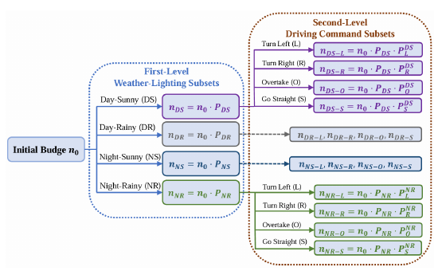

# ActiveAD: Planning-Oriented Active Learning for End-to-End Autonomous Driving

核对日期：2026-10-22。实验数值均为作者报告；本地完成原文阅读与讲解自检，未复现实验。

## 一句话总结

ActiveAD先按驾驶元信息分层挑初始数据，再以规划偏差、接近风险和邻车不确定性选择精标片段，提高标注利用率。

## 研究背景与动机

端到端驾驶需要昂贵3D框和车道监督，大量直行日志未必同样有价值。方法以完整clip为单位，利用自车轨迹与较廉价的速度、天气、光照、驾驶指令挑片段。[§1–3，PDF1–3]

未精标不代表完全无标签，自车真实轨迹与元信息已可用。任务是训练数据选择，不是车辆在线主动探索道路或自动标出全部目标框。

## 方法总览

原论文Fig.2，PDF第4页。仅裁切相关图示，保留图内科学标签；著作权属于原作者，用于本篇方法分析，不并入本站原创图授权。[来源与作者](https://openaccess.thecvf.com/content/CVPR2026/html/Lu_ActiveAD_Planning-Oriented_Active_Learning_for_End-to-End_Autonomous_Driving_CVPR_2026_paper.html) · [PDF](https://openaccess.thecvf.com/content/CVPR2026/papers/Lu_ActiveAD_Planning-Oriented_Active_Learning_for_End-to-End_Autonomous_Driving_CVPR_2026_paper.pdf)。点击可打开高清图。

配图仅展示**初始化**：分昼夜/晴雨四组，再分左转、右转、超车、直行，组内按速度等间隔抽样。训练当前标注集后，在剩余池算三种分数，新标高分clip、从头重训，预算10%→20%→30%。[Fig.2、Algorithm1，PDF4–5]

DE是规划与记录自车轨迹的L2，SC看与预测邻车的最近距离，AU看附近邻车多模态未来轨迹概率熵。三项归一化[0,1]后相加排序，L是选样分数，不是替代VAD训练损失。

## 核心创新与关键设计

初始化P_x=n_x^γ/Σ_z n_z^γ，子组同理，γ=0.5。公式γ=1按数量比例、γ=0非空组等额；正文却称γ=1各类别等额，有误。降低γ提高少数组相对抽样率，并不使其绝对配额必然最多。[式1–2，PDF3–4]

\[L=L_{DE}+\alpha L_{SC}+\beta L_{AU},\quad L_{AU}=-\sum_a e^{\delta_d-d_a}\sum_i P_i(a)\log P_i(a).\]
α=β=1，置信阈值0.5、距离3m。SC式4直接写轨迹相减、漏距离范数；按文字应是距离，需代码确认。“与最近距离正相关”又与exp(-距离)反向，不能照印刷式实现成向量指数。[PDF4–5]

## 实验与关键结果

nuScenes采用VAD-Tiny、AdamW、20epoch、lr2e-4、weight decay0.01；初始10%后两轮各10%。部分基线重评或转换指标，按表注比较。[§5.1、Table1，PDF5–6]

| 作者报告 | 平均L2米↓ | 平均碰撞率↓ |
| --- | --- | --- |
| VAD-Tiny100% | 0.70 | 0.25% |
| 随机30% | 0.78 | 0.37% |
| ActiveAD30% | 0.68 | 0.21% |
| VAD-Base100% | 0.69 | 0.20% |

30%接近全量Tiny，不在所有基座指标都更优；开环碰撞统计不等于真实闭环风险。

CARLA Town05 Long全量DS33.24、RC76.33；本文30%31.77/76.44，DS仍低1.47。Short20%63.21/88.92，30%63.24/88.04，增加数据不使所有指标上升。[Table5，PDF8] 全为仿真，没有验证真实道路部署。

## 消融实验与证据强度

30%同初始化：仅DE0.70米/0.35%，DE+SC0.73/0.26%，三项0.68/0.21%；SC改善碰撞但部分牺牲L2，AU再调折中。[Table2，PDF7]

10%碰撞主表与γ表0.43%，消融表0.41%，设置或试验差异待核。夜间L2本文1.03高于Coreset0.97，左转碰撞0.25高于全量0.13，所以不支持所有场景领先。[Table3–4]

## 局限与讨论

预测漏掉的邻车也可能被选样漏掉，少数关键场景不一定高分。结果依赖原池分布、元数据及预训练，30%足够是有限设置观察，不是通用数据规模规律。

预算按clip数，复杂片段标注人时可能更高；还有多轮全池推理与从头训练，不能将少70%片段改写成总成本降低70%。主文未充分给seed方差、全流程算力和人工劳动测量。

## 复现提示

[作者代码](https://github.com/Thinklab-SJTU/ActiveAD)需核验commit、许可证、VAD和nuScenes版本。建议 `experiments/robotics/activead/`，记录各轮ID、可用元信息、标签解锁顺序及归一化范围，不在选样前使用尚未获取的3D真值。

先用小型获许可日志核对空分组、取整、去重、SC距离和并列排序，再比较重训。未运行模型、CARLA或车辆，指标全部是作者报告。

## 相关工作与阅读顺序

先理解主动学习标注池和规划评价，再看分层配额与三分数互补，最后核对Algorithm1从头训练与Table5闭环，分别评价人工标注节省、算力及驾驶质量。

## 来源与校验

- [CVF官方论文页](https://openaccess.thecvf.com/content/CVPR2026/html/Lu_ActiveAD_Planning-Oriented_Active_Learning_for_End-to-End_Autonomous_Driving_CVPR_2026_paper.html) · [所读PDF](https://openaccess.thecvf.com/content/CVPR2026/papers/Lu_ActiveAD_Planning-Oriented_Active_Learning_for_End-to-End_Autonomous_Driving_CVPR_2026_paper.pdf)。页码均为PDF页序。
- 所读版本：2026-10-21从CVF下载的开放接收稿；PDF SHA-256：`73ad66324d3222b6db58a9a1cd3b6d4ce8763c81630b88e66553938ce81dc05a`。
- 阅读范围：正文、方法公式、实验与消融；补充材料、代码及权重未逐项核验。reviewed表示本地讲解自检，不表示独立同行评审或实验复现。
- 方法图与关键公式/表格已渲染核对，所引原图已单独检查；未对新文章进行浏览器交互验收。作者图示与本站原创素材权利分开记录。
