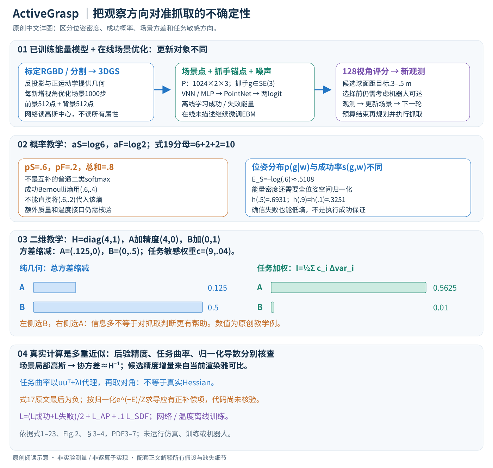
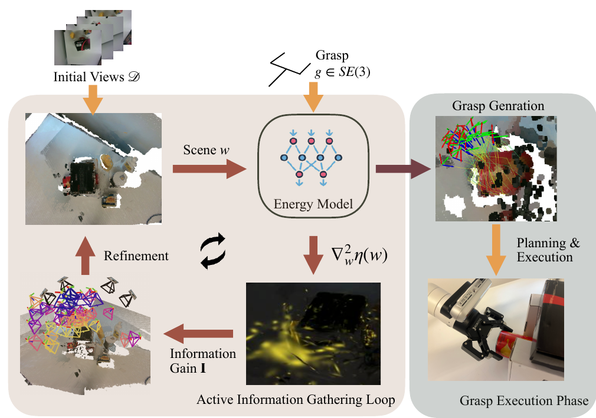

# ActiveGrasp: Information-Guided Active Grasping with Calibrated Energy-based Model

核对日期：2026-10-29。实验数值均为作者报告；本地完成原文阅读与讲解自检，未复现实验。

## 一句话总结

ActiveGrasp以校准能量模型估计抓取成功的不确定性，从候选相机视角中选择预计最能改善抓取判断的观测。

## 研究背景与动机

杂乱场景中多看见表面不一定能抓住目标，只看2D/3D抓取热图也丢失姿态方向。作者在SE(3)位姿上建模成功与失败，用任务相关信息指导下一视角。[§1–2，PDF1–2]

目标是把有限观测用于抓取，不是全面重建；较低不确定性不自动保证真实执行成功。

## 方法总览

原论文Fig.2，PDF第3页。仅裁切相关图示，保留图内科学标签；著作权属于原作者，用于本篇方法分析，不并入本站原创图授权。[来源与作者](https://openaccess.thecvf.com/content/CVPR2026/html/Lei_ActiveGrasp_Information-Guided_Active_Grasping_with_Calibrated_Energy-based_Model_CVPR_2026_paper.html) · [PDF](https://openaccess.thecvf.com/content/CVPR2026/papers/Lei_ActiveGrasp_Information-Guided_Active_Grasping_with_Calibrated_Energy-based_Model_CVPR_2026_paper.pdf)。点击可打开高清图。

标定RGBD和目标分割初始化3DGS，每加一视角优化1000步。模型输入前景/背景各512点、抓手锚点和噪声尺度，输出成功/失败logit；训练联合成功与失败score matching、AP排序、SDF及可学习温度。[Fig.2、§3–4.1，PDF3–6]

距目标0.3–0.5m球面Fibonacci采128候选，按指标选观测，预算用完再生成抓取、规划检查和执行。使用深度、分割和机器人正运动学，不是无需标定单目系统。

## 核心创新与关键设计

### 1. 任务接口：观测、场景、抓取和成功事件是四个不同对象

机器人已知一组标定RGBD观测\(D\)和每张图的目标分割，先建立场景，再在有限预算内选择额外相机位姿\(x\)。一次选择后，机器人真的移动并获取新图\(y_x\)，重新优化场景；预算耗尽才生成最终抓取、做可达性/碰撞检查并执行。输入包含相机标定、机器人正运动学和目标掩码，不是单张RGB直接输出机械臂动作。[PDF3、6–7，Fig.2]

| 符号 | 表示与维度 |
| --- | --- |
| \(w\in\mathbb R^P\) | 将当前3DGS所有待估参数展平的场景变量；\(P\)依高斯数量与参数化而变 |
| \(g\in SE(3)\) | 抓手坐标到世界坐标的刚体变换，\(4\times4\)齐次矩阵，6个自由度 |
| \(\xi\in\mathbb R^6\) | 位姿局部扰动；通过李代数指数映射成为小刚体变换 |
| \(\mathcal P\in\mathbb R^{1024\times2\times3}\) | 能量模型的场景输入：前景512点、背景512点，每点由坐标与语义标记两个3维向量构成 |
| \(A_g\in\mathbb R^{M\times3}\) | 世界坐标下的抓手锚点；锚点数\(M\)正文未指定 |
| \((a_S,a_F)\) | 对当前抓取、场景、噪声级别预测的两个logit |
| \(s(g,w)\) | 成功事件的概率参数；不是位姿空间上的概率密度 |
| \(H_D\in\mathbb R^{P\times P}\) | 当前场景估计附近的精度/曲率近似；实际使用对角表示避免存储稠密矩阵 |
| \(\eta(w)\) | 对抓取位姿采样后，平均的成功事件Bernoulli熵 |

\(g\)作用于锚点\(a_m\)时，\(a_m^{world}=Ra_m^{gripper}+t\)。旋转和平移属于不同单位，局部扰动和梯度需沿底座规定的\(SE(3)\)度量实现，不能把16个齐次矩阵元素当成16个独立自由度更新。

### 2. 从RGBD到能量模型：哪些3DGS属性真正作为输入

RGBD反投影初始化高斯，正运动学提供观测相机位姿。每新增一视角，作者优化3DGS 1000步；语义通道用渲染分割图与2D分割标签的交叉熵监督。实验将高斯设为各向同性，球谐阶数0。[PDF6，§4.1]

目标分割噪声通过DBSCAN筛选：正文参数为最少50点、距离0.01。由最大前景簇确定目标中心，再取该中心半径\(r\)范围内的局部场景。**这个裁剪半径\(r\)不是候选相机球面的0.3–0.5m半径；正文此处没有给\(r\)的具体值。**前景和背景分别最远点采样为512个中心，组成1024点。

每点送入VNN的表示是\(\left[\begin{smallmatrix}p\\l\end{smallmatrix}\right]\in\mathbb R^{2\times3}\)，其中\(p\)为三维位置，前景\(l=(1,1,1)\)、背景\(l=(0,0,0)\)。不能将其误写成标准两类one-hot \((1,0)\)，也不能说整个高斯的协方差、颜色、透明度都直接进入该网络。[PDF6–7]

场景点经VNN提取特征；抓手固定锚点经\(g\)转换到世界后由MLP编码。两组特征沿空间/点轴拼接，送入融合噪声级别嵌入的PointNet，最后MLP输出两logit。正文未给全套通道宽度与锚点数量，因此不能伪造一个确定的拼接后张量通道表。

### 3. 能量与成功概率：先校准，再使用它计算任务熵

普通EBM给出的是位姿分布：
\[
p(g\mid w)=\frac{e^{-E_\theta(g,w)}}{Z(w)},\qquad
Z(w)=\int_{SE(3)}e^{-E_\theta(g,w)}\,dg.
\]
它回答“在当前场景里哪些位姿更常被模型采样”。同一个位姿的密度还依赖全空间归一化，不能直接当成抓取成功率。ActiveGrasp因此预测成功与失败logit，并按原式19定义：
\[
p_S=\frac{e^{a_S}}{e^{a_S}+e^{a_F}+2},\qquad
p_F=\frac{e^{a_F}}{e^{a_S}+e^{a_F}+2},\qquad
E_S=-\log p_S,\quad E_F=-\log p_F.
\]
教学例\(a_S=\log6,a_F=\log2\)时，\(p_S=.6,p_F=.2\)，总和.8；\(E_S\approx.5108,E_F\approx1.6094\)。**原式的\(+2\)使两者并不互补。**因此用成功概率\(s=p_S\)计算Bernoulli熵时，失败补集是\(1-p_S=.4\)，不能换成\(p_F=.2\)。额外质量如何解释、温度究竟在logit还是能量哪一位置缩放，需要附录/实现核验；本文保留原定义，不擅自归一成普通二类softmax。[PDF5–6，式18–20]

两个logit也存在共同偏移敏感性：普通二类softmax对共同加常数不变，这里固定\(+2\)破坏该性质。因而概率幅度需要校准监督与稳定化，不能只看成功logit高于失败logit就认定真实概率准确。

### 4. 离线训练：成功与失败各学一个位姿能量场

对真值成功或失败抓取\(g\)，在局部切空间采样高斯噪声并映回流形：
\[
\widehat g=g\operatorname{Exp}(\sigma_k\widehat\xi),\qquad
\xi\sim\mathcal N(0,I_6),
\quad q(\widehat g\mid g)\propto
\exp\left[-\|\operatorname{Log}(g^{-1}\widehat g)\|^2/(2\sigma_k^2)\right].
\]
\(\widehat\xi\)是李代数矩阵表示；\(\widehat g\)才是带噪位姿。原公式用\(\partial/\partial g\)简记流形上的导数，实现时需要明确定义局部坐标与左/右扰动方式。成功DSM用\(E_S\)，失败DSM用\(E_F\)：
\[
\mathcal L^+=\mathbb E\|\nabla_g E_S+\nabla_g\log q(g\mid g^+)\|^2,
\qquad
\mathcal L^-=\mathbb E\|\nabla_g E_F+\nabla_g\log q(g\mid g^-)\|^2.
\]
上式省略原式对各噪声级别的平均，只为显示两分支的区别。因为\(\nabla\log p=-\nabla E\)，匹配能量梯度的目标是\(-\nabla\log q\)。一维局部教学中，真值0、噪声后位置.1、\(\sigma=.2\)，目标\(\nabla E=.1/.04=2.5\)；沿负能量梯度走会回到样本附近。失败分支学习失败密度，不是直接把失败真值改标成成功；它通过共享网络和两类概率耦合影响成功能量。[PDF4–5，式5–8、21]

AP损失提供排序监督：对概率\(p_i\)与分箱中心\(b_j\)，原式22的软分箱权重为
\[
w_i^j=\max\left(0,1-\frac{|p_i-b_j|}{\Delta}\right).
\]
例如\(p_i=.62,b_j=.6,\Delta=.1\)，权重.8；到中心.8的距离.18，大于箱宽，权重0。再用分箱累计正负样本得到可微AP；正文没有列出引用实现的全部累计和边界约定，不能补写成已核验的作者代码。AP只对近无噪声样本\(k<.01\)计算，并非所有噪声级别都强制做概率排序。[PDF5–6]

总损失为
\[
\mathcal L_{EBM}=\frac{\mathcal L^++\mathcal L^-}{2}
+\lambda_1\mathcal L_{AP}+\lambda_2\mathcal L_{SDF},
\qquad\lambda_1=1,\quad\lambda_2=.1.
\]
SDF项比较参考点的预测距离与真值距离，用L1误差约束几何。方法节提到深度生成SDF，具体训练说明使用Acronym仿真网格并由Open3D计算目标表面附近SDF；这不是实机运行时能随时取得的物体真值。网络和可学习温度离线更新200k步，Adam学习率\(10^{-3}\)、batch24。AP不是适当概率评分规则，不能单凭优化AP证明校准；ECE和真实执行对照才提供经验检验。[PDF4、6]

### 5. 任务熵：不确定的是成功事件，而不是有多少可采样位姿

令\(h(s)=-s\log s-(1-s)\log(1-s)\)，则
\[
\eta(w)=\mathbb E_{g\sim p(g\mid w)}[h(s(g,w))].
\]
对自然对数，\(s=.5\)时\(h\approx.6931\)最大；\(s=.9\)或\(.1\)时均约.3251。看到更多表面后，可能发现多种有效抓法，位姿分布反而更分散，位姿Shannon熵上升；同时这些抓法的成功概率从.5走向.9，成功事件熵下降。两种熵衡量不同问题。[PDF4，式9–12、Fig.3]

由\(h'(s)=\log((1-s)/s)\)、\(h''(s)=-1/[s(1-s)]\)可知，熵在概率两端对误差很敏感；在参数\(w\)空间的曲率还依赖网络一阶、二阶导数，不能把\(h''(s)\)直接当\(\nabla_w^2\eta\)。同样，确信失败\(s=.1\)也会降低熵，所以低熵本身不是“存在能成功的抓取”的证明。

### 6. 从场景后验到候选视角分数：一步步展开近似

在当前MAP估计\(w^*\)附近，作者用高斯近似场景后验，协方差\(\Sigma_D\approx H_D^{-1}\)。对\(\delta=w-w^*\)做二阶展开：
\[
\eta(w)\approx\eta(w^*)+\nabla\eta(w^*)^\top\delta
+\tfrac12\delta^\top C\delta,\qquad C=\nabla_w^2\eta(w^*).
\]
高斯中心处\(\mathbb E\delta=0\)，线性项期望消失；利用\(\mathbb E[\delta^\top C\delta]=\operatorname{tr}(C\Sigma_D)\)，得到式14。比较当前与新增观测后的协方差，就得到原式15的评分结构：
\[
I_x\approx\tfrac12\operatorname{tr}
\left[C(H_D^{-1}-H_{D+x}^{-1})\right].
\]
直观上，新视角若减少了**任务熵敏感方向**上的场景不确定性，分数更高。它不是直接把一张未来真值RGBD提前送进网络；当前渲染器对候选相机的导数用于估计新观测能提供多少局部约束。[PDF4–5，式1–3、13–16]

为避免\(P\times P\)稠密矩阵，式3用渲染雅可比的Gauss–Newton/对角近似加\(\lambda I\)；若渲染\(f(x,w)\)是多像素多通道向量，雅可比应理解为对各输出通道梯度的外积累加。正文没有给全套噪声权重、逐通道收缩或优化器状态接口，不应将简写的梯度乘积当成已完整指定的实现。

另外，原文将后验曲率描述为“Shannon entropy的Hessian”；从\(\Sigma\approx H^{-1}\)的Laplace构造看，常规所需的是负对数后验的局部曲率。本文用“后验精度近似”解释式1–3，明确这份术语差异，而不把两者直接等同。

作者还将\(C\)替换为\(uu^\top+\lambda I\)，其中\(u=\nabla_w\eta\)。这是正半定外积代理，不是一般函数真实Hessian的恒等式。若同时只保留对角，则\(c_i\approx u_i^2+\lambda\)，评分可写成逐参数求和的阅读展开：
\[
I_x\approx\frac12\sum_i c_i
\left(\frac1{h_i}-\frac1{h_i+d_{x,i}}\right),
\]
其中\(h_i>0\)为当前对角精度、\(d_{x,i}\ge0\)为候选贡献。这个展开假定采用可加的对角近似，解释为何不需要矩阵求逆；没有声称原代码一定以这一行实现。若精度增量非负且\(c_i\ge0\)，代理分数非负，但这不证明真实条件互信息被精确估计。

### 7. 贯穿选视角例子：少看一点几何，可能更有助于抓取

设场景只剩两个待估参数，\(H_D=\operatorname{diag}(4,1)\)。候选A增加精度\((4,0)\)，候选B增加\((0,1)\)；教学中忽略很小的正则，任务权重\(c=(9,.04)\)：
\[
I_A=\tfrac12\left[9(1/4-1/8)\right]=.5625,
\qquad
I_B=\tfrac12\left[.04(1-1/2)\right]=.01.
\]
不乘任务权重时，A总方差减少.125、B减少.5，纯几何方差准则更偏B；引入任务敏感方向后却选A。可把第一参数想成夹爪将接触的表面、第二参数想成与抓取关系小的背景。此解释不是作者实际高斯参数分组或测得收益，数字是为说明迹公式而构造的二维例。

### 8. 熵梯度的归一化项：保留原式疑点，给出可核查推导

原式17最后一项印为\(-\mathbb E[h]\mathbb E[\nabla_w E]\)。若采用式4的\(p=e^{-E}/Z\)，且可交换积分与求导，则：
\[
\nabla_w\log Z=-\mathbb E[\nabla_wE],\qquad
\nabla_w\log p=-\nabla_wE+\mathbb E[\nabla_wE],
\]
\[
\nabla_w\mathbb E_p[h]
=\mathbb E_p[\nabla_wh]-\mathbb E_p[h\nabla_wE]
+\mathbb E_p[h]\mathbb E_p[\nabla_wE].
\]
最后应为正的归一化补偿项。一个快速检查是给能量加与\(g\)无关、只依赖\(w\)的常数：归一化后的位姿分布不变，两个能量梯度项应恰好抵消；原印负号不满足这个检查。这里展示的是基于已印式4的数学核对，**不是已证明作者代码有同样错误**。本文尚未核验独立附录与实现；复现时必须先确认实际使用哪一公式，而不是悄悄替原文改符号。[PDF5，式17]

### 9. 在线闭环、参数更新与执行边界

离线能量模型训练结束后，在线重建优化的是当前场景\(w\)；正文未描述在线继续微调EBM。每轮用当前场景采样抓取、估计\(\eta\)相关导数，针对128个候选计算分数。候选通过球面Fibonacci方式提出，中心为目标，距离在0.3–0.5m间采样；评分最大者仍需机器人能够移动到达，不能将几何球面上的全部位姿视为天然可执行。[PDF6–7]

新图加入后重新优化3DGS 1000步，再计算下一轮候选。模拟实验初始2视角、主动2视角；真机初始4、主动2。预算结束后，按成功能量采样/排序抓取，路径规划剔除碰撞和不可达抓取，最后执行。局部采样的一种底座更新形式是
\[
g_{k-1}=g_k\operatorname{Exp}\left(-\alpha_k^2\nabla_gE(g_k,\sigma_k,w)
+\alpha_k\xi\right),\quad \xi\sim\mathcal N(0,I_6),
\]
负能量梯度加随机扰动在\(SE(3)\)上演化；具体采样步数、初始化和接受规则正文未完全列明。[PDF4，式8]

若\(P\)巨大，稠密曲率存储\(O(P^2)\)不现实，对角方法把该部分压到\(O(P)\)；但每个候选的渲染雅可比、熵估计的抓取采样、场景更新及机器人移动都有成本。128候选的评分约9.61秒是作者测量，不是整个感知—移动—抓取闭环耗时。局部高斯忽略多峰后验，外积忽略真实曲率符号，对角忽略参数关联；分割、接触摩擦或新域材料失真都会影响结果。无须另训一个视角策略，是该设计的一个取舍，不能强化为全局最优视角或物理成功保证。

## 实验与关键结果

Acronym训练200K步、batch24、Adam lr1e-3，AP仅接近无噪声样本。PyBullet仿真每场景10个YCB物体，20场景×5目标×4重复=400试验，初始2视角加2；实机Kinova7DoF+RealSense初始4加2，三场景各10次。[§4，PDF6–8]

| 作者报告，仿真400次 | 成功率 | ECE↓ |
| --- | --- | --- |
| 校准模型+随机2新视角 | 74.25% | 0.06 |
| 校准模型+ActiveNGF | 74.00% | 0.06 |
| 校准模型+ActiveGrasp | 79.00% | 0.02 |

来源Table1，PDF6。同抓取模型增加4.75pp较能隔离选视角收益；不同抓取骨干的差距不能全算给NBV。随机多8视角报76.50%，但该行计数合计402而非400，其他部分行也有计数/百分比冲突，不据此重算精确统计。

实机本文9/10、8/10、9/10合计26/30，样本小，不能认为普遍成功率86.7%已充分确定。[Table2，PDF7]

## 消融实验与证据强度

Acronym原模型AP34.69、ECE0.17，完整AP87.84、ECE0.03；Bullet ECE0.35→0.05。模块间几何距离有折中，并非每次添加都提升所有指标；这里0.05与主表0.02是不同实验。[Table3，PDF8]

AP衡量排序，不是严格概率校准的适当评分规则；低ECE是经验表现，不构成跨分布成功保证。选视角9.61±0.09秒，比ACE18.24快、比FisherRF7.43慢，未含全程移动、3DGS更新及执行，不能称整体实时。[§4.5.2]

## 局限与讨论

材料、摩擦和遮挡变化可能破坏校准；局部高斯、对角曲率和外积忽略多峰后验及高斯点关联，这是作者承认的边界。[§5，PDF8]

低条件熵也可能表示确信失败，是否存在好抓法还依赖采样与排序。近似选样、AP训练和经验ECE不证明无偏或执行保证，公式归一化和梯度符号需先查明。

## 复现提示

正文只承诺公开源码，未给可确认专用仓库，不写成已经下载验证。以CVF官方页追踪发布，commit/许可证待核。建议 `experiments/robotics/activegrasp/`，Acronym/YCB数据与网格按许可存仓库外。

先检查概率归一化、式17梯度、视角可达和400次计数，再做同模型同预算比较。本地未执行模型、仿真或机器人，结果均为作者报告。

## 相关工作与阅读顺序

先读SE(3)能量模型与抓取成功校准，再区分位姿熵和成功事件条件熵。最后看高斯后验/曲率近似与Table1同模型对照，避免将信息论动机直接当成已证最优视角。

## 来源与校验

- [CVF官方论文页](https://openaccess.thecvf.com/content/CVPR2026/html/Lei_ActiveGrasp_Information-Guided_Active_Grasping_with_Calibrated_Energy-based_Model_CVPR_2026_paper.html) · [所读PDF](https://openaccess.thecvf.com/content/CVPR2026/papers/Lei_ActiveGrasp_Information-Guided_Active_Grasping_with_Calibrated_Energy-based_Model_CVPR_2026_paper.pdf)。页码均为PDF页序。
- 所读版本：2026-10-21从CVF下载的开放接收稿；PDF SHA-256：`9af4fc55e689f9050777f76cd41bdfe863d9e84165cbbd76f42aed7e0d1204df`。
- 阅读范围：正文、方法公式、实验与消融；补充材料、代码及权重未逐项核验。reviewed表示本地讲解自检，不表示独立同行评审或实验复现。
- 方法图与关键公式/表格已渲染核对，所引原图已单独检查；早期稿未做浏览器交互验收；本轮已补Chrome无头渲染与视觉验收。作者图示与本站原创素材权利分开记录。

- 2026-10-29方法与图片联合返工：重读PDF3–8，核对原Fig.2与公式渲染页；Chrome无头浏览器完整渲染新SVG并人工视觉检查，文章106处KaTeX公式、0错误。二维信息增益与归一化梯度用合成数值核算；未复现仿真或真机。桌面Computer Use原生管道不可用，未声称做交互式GUI验收。
