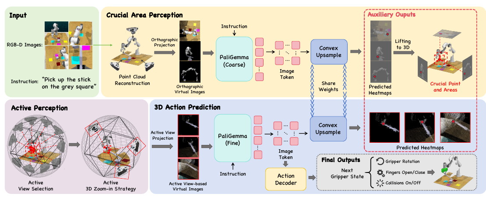

# ActiveVLA: Injecting Active Perception into Vision-Language-Action Models for Precise 3D Robotic Manipulation

核对日期：2026-10-22。实验数值均为作者报告；本地完成原文阅读与讲解自检，未复现实验。

## 一句话总结

ActiveVLA先从三张正交视图定位操作区域，再从已有点云中挑选虚拟视角并放大渲染，提升VLA的精细三维定位；它主要改变观测的表示，不能凭空补出传感器没有采集到的几何信息。（PDF第1–4页）

## 研究背景与动机

一个像素误差对大物体抓取可能影响很小，对插孔、杯柄或细小接触区域却可能决定成败。固定相机让模型同时承担“找目标”和“看清局部”两项任务。作者提出先粗定位，再针对局部选择更合适的表示视角。这里的active perception主要通过点云重渲染实现，应与机器人真正移动摄像头、获取新证据的闭环主动感知区别开来。（PDF第1–3页）

## 方法总览

原论文Fig.2，PDF第4页。仅裁切相关图示，保留图内科学标签；著作权属于原作者，用于本篇方法分析，不并入本站原创图授权。[来源与作者](https://openaccess.thecvf.com/content/CVPR2026/html/Liu_ActiveVLA_Injecting_Active_Perception_into_Vision-Language-Action_Models_for_Precise_3D_CVPR_2026_paper.html) · [PDF](https://openaccess.thecvf.com/content/CVPR2026/papers/Liu_ActiveVLA_Injecting_Active_Perception_into_Vision-Language-Action_Models_for_Precise_3D_CVPR_2026_paper.pdf)。点击可打开高清图。

校准RGB-D观测先合成点云，并渲染俯视、正视和右视三张正交图。每像素包含RGB、深度和世界坐标，共7个通道。粗阶段使用基于PaliGemma的表示与热图预测，跨视角提升到三维，得到关键操作位置。细阶段围绕该位置生成球面候选虚拟相机，按可见性、距离与方向多样性选择三个视角，再放大4倍重渲染。细阶段三维热图确定平移，另一分支预测旋转、夹爪与碰撞标志。（PDF第3–5页）

## 核心创新与关键设计

**选视角。** 可见性用点云与射线的邻近关系近似；距离项经Z-score标准化，多样性项汇总候选间的角度分离。它们是对当前点云的几何评分，并非执行后成功率的直接估计。等半径球面可能使距离项方差为零，对称候选集也可能使多样性项近似相同；退化情况如何处理仍需实现核查。（PDF第4–5页）

**放大。** 若视场角为 \(\alpha\)、放大倍数为 \(z\)，对应覆盖宽度为 \(W=2d\tan(\alpha/(2z))\)。固定输出像素数时，局部在图上占据更多像素，但原始RGB-D的采样精度并没有提高。遮挡区域若从未被观测，换一个虚拟视角仍可能只显示空洞。

**动作。** 三个视角热图汇入三维网格得到平移峰值；旋转按各轴72个5°区间离散，结合全局和局部特征预测动作。碰撞标志只是预测输出，不构成碰撞安全证明。（PDF第4–5页）

## 实验与关键结果

RLBench含18项任务，每任务100条示范；使用四台校准摄像头。训练资源报告为8张H100与192个vCPU。以下均为作者结果。（PDF第5–7页）

| 协议与指标 | BridgeVLA | ActiveVLA |
|---|---:|---:|
| RLBench平均成功率/% | 88.2 | 91.8 |
| COLOSSEUM平均成功率/% | 64.0 | 65.9 |
| COLOSSEUM全部扰动同时出现/% | 18.7 | 21.4 |
| GemBench平均成功率/% | 50.0 | 51.3 |

表1–3表明提升幅度随协议变化。COLOSSEUM的78.3是桌面颜色扰动单项，不能当作整体成功率。GemBench的L4仅1.2%，低于LOTUS++的17.4%；L1的92.4%也低于LOTUS的94.3%。真实Kinova GEN2与D455实验主要提供图4的定性展示，没有可直接引用的真实任务成功次数与统计表。（PDF第6–8页）

## 消融实验与证据强度

表4中，RLBench固定视角基线为87.6%、推理0.26秒；加视角选择后89.4%、0.45秒；再加放大为91.8%、0.53秒。COLOSSEUM对应63.6→64.5→65.9%，GemBench为48.9→49.4→51.3%。这是精度与推理成本的交换，表中秒数不等于包含机械臂运动的完整控制周期。（PDF第7页）

图5中，1到6个视角的成功率依次82.2、87.3、91.8、92.0、91.7、91.8%。选三个视角更像成本折中，严格最高数值出现在四视角。放大1到6倍为89.4、90.1、90.8、91.8、91.4、90.9%，过度放大也会丢失上下文。（PDF第8页）

## 局限与讨论

点云密度、标定和深度噪声决定了可重渲染的细节上限。新增虚拟视角不能自动解决未观测遮挡。复杂组合扰动与长程泛化仍然薄弱，真实机器人展示也不足以证明稳定部署。候选球面构造与距离标准化等退化处理不完整时，复现可能得到不同选视角结果；式(4)的顶点计数也需要结合实际细分规则核实，不能仅据公式自行实现后称为官方实现。（PDF第4–8页）

## 复现提示

[作者项目页](https://ZhenyangLiu.github.io/ActiveVLA)是后续代码与配置核对入口，本轮未核查代码commit、许可证或权重。复现需要固定RGB-D融合方式、7通道归一化、粗阶段网格、虚拟相机候选与遮挡阈值、放大倍数以及动作坐标系。先离线比较同一份点云在各视角的渲染和热图，再评估仿真成功率；真实硬件执行不在本轮验证范围。120k RoboPoint子集预训练与任务示范训练也应分别登记，避免遗漏前置数据成本。（PDF第3–5页）

## 相关工作与阅读顺序

先读BridgeVLA的多视角热图与三维动作定位，再了解RVT系列的虚拟视图表示；ActiveVLA的增量主要是围绕粗预测位置选视角与局部重渲染。随后阅读COLOSSEUM的扰动维度、GemBench的泛化层级，能避免把不同协议的成功率放在一条排行榜上。理解真实主动感知时，还应关注移动相机采集新观测的工作，两类“主动”具有不同的信息边界。（PDF第2、6–8页）

## 来源与校验

- [CVF官方论文页](https://openaccess.thecvf.com/content/CVPR2026/html/Liu_ActiveVLA_Injecting_Active_Perception_into_Vision-Language-Action_Models_for_Precise_3D_CVPR_2026_paper.html) · [所读PDF](https://openaccess.thecvf.com/content/CVPR2026/papers/Liu_ActiveVLA_Injecting_Active_Perception_into_Vision-Language-Action_Models_for_Precise_3D_CVPR_2026_paper.pdf)。页码均为PDF页序。
- 所读版本：2026-10-22从CVF下载的开放接收稿；PDF SHA-256：`b52851d9df0244a9756aa98d9ee2d236073848a2181b9cc81e29ccc7f6a6d7ef`。
- 阅读范围：正文、方法公式、实验与消融；补充材料、代码及权重未逐项核验。reviewed表示本地讲解自检，不表示独立同行评审或实验复现。
- 方法图与关键公式/表格已渲染核对，所引原图已单独检查；未对新文章进行浏览器交互验收。作者图示与本站原创素材权利分开记录。
