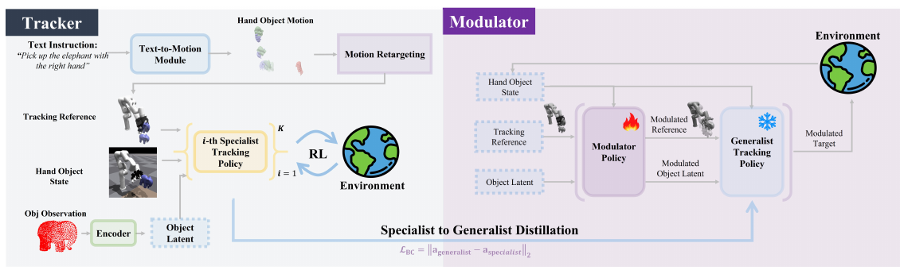

# AdaDexTrack: Dynamic Modulation for Adaptive and Generalizable Dexterous Manipulation Tracking

核对日期：2026-10-22。实验数值均为作者报告；本地完成原文阅读与讲解自检，未复现实验。

## 一句话总结

AdaDexTrack把通用灵巧手跟踪器当作技能载体，通过闭环调整参考轨迹、物体潜变量和关节目标来缓解误差累积；真实实验改善了达标帧比例，但没有证明复杂操作已可稳定完成。（PDF第1–5、8页）

## 研究背景与动机

语言生成的人手运动既有噪声，也不完全适配机器手的关节与接触方式。固定参考轨迹使跟踪器不断追赶偏离状态，微小误差可能在长时程中放大。该论文主张参考本身也应进入反馈环，而不是只在低层动作上纠偏。输入语言先变成手物交互参考，执行阶段并非直接由语言模型每步输出动作。（PDF第1–3页）

## 方法总览

原论文Fig.2，PDF第4页。仅裁切相关图示，保留图内科学标签；著作权属于原作者，用于本篇方法分析，不并入本站原创图授权。[来源与作者](https://openaccess.thecvf.com/content/CVPR2026/html/Adalibieke_AdaDexTrack_Dynamic_Modulation_for_Adaptive_and_Generalizable_Dexterous_Manipulation_Tracking_CVPR_2026_paper.html) · [PDF](https://openaccess.thecvf.com/content/CVPR2026/papers/Adalibieke_AdaDexTrack_Dynamic_Modulation_for_Adaptive_and_Generalizable_Dexterous_Manipulation_Tracking_CVPR_2026_paper.pdf)。点击可打开高清图。

图2左侧是训练技能载体：DiffH2O生成语言条件轨迹，重定向到6自由度机械臂加16关节手；PPO训练多个专用跟踪器，再从成功示范用离线行为克隆蒸馏成通用跟踪器。右侧冻结跟踪器，另训RL调制器，在当前手物状态下调整三类接口。观测包括本体状态、物体6D位姿、点云编码的物体潜变量及当前和未来1/2/4/12步参考。（PDF第3–5页）

## 核心创新与关键设计

**参考调制R。** 以小残差更新未来手与物体目标，示意为 \(\hat s^x_{t+k}\leftarrow\hat s^x_{t+k}+\lambda_xa^{ref,x}_{t+k}\)，让短期可跟踪目标成为重新接轨的中间点。位姿旋转的合法表示和约束需要实现核对，不能对四元数直接任意相加。（PDF第5页）

**潜变量调制O。** 将固定物体编码换成在线64维变量，借连续条件改变已蒸馏策略的动作倾向；这更像调用已有技能的控制接口，不是在线重建真实物体几何。潜变量的连续性也不自动保证语义平滑与安全。

**目标调制T。** 关节命令增加小残差 \(a'_t=a_t+\Delta a_t\)，之后由PD执行。跟踪器和调制器优化共同任务目标。式(1)列出关节、手体、物体跟踪及接近误差的加权平方项，却称其为reward；具体权重符号在正文未充分给出，若采用奖励最大化，不能直接假定所有误差项都是正奖励。（PDF第4–5页）

## 实验与关键结果

可行性筛选后有2,765条轨迹、50个物体。未见轨迹分割2,212/553；未见物体分割45个物体2,520条训练、5个物体245条测试，在Isaac Gym评估。Mean-error成功率要求整条平均误差达标；Completion是逐帧达标比例再跨轨迹平均，两者不能互换。（PDF第5–6页）

| 表1作者结果 | DexTrack | 通用跟踪器 | R+O+T |
|---|---:|---:|---:|
| 未见轨迹Mean-error/%↑ | 76.13 | 62.20 | 88.99 |
| 未见轨迹Completion/%↑ | 73.89 | 65.01 | 77.92 |
| 未见物体Mean-error/%↑ | 39.59 | 24.08 | 46.12 |
| 未见物体Completion/%↑ | 47.37 | 42.52 | 53.78 |
| 未见物体位置误差/cm↓ | 18.06 | 21.74 | 15.45 |

真实XArm6+LEAP Hand由FoundationPose估计位姿。60条未见轨迹、15物体的Completion从26.63升至52.36%；20条未见物体轨迹、2物体为22.27→36.71%。这些是达标帧比例，不能称为52.36%的整项任务成功率。（表2，PDF第8页）

## 消融实验与证据强度

未见轨迹中，R使Mean-error从62.20升至67.09，R+T为84.45，R+O+T为88.99；但Completion从R+T的80.42降到全模块77.92，手腕和手指误差也并非单调改善。正文“增加组件一致改善”需要限定指标，不能覆盖表中反例。（PDF第6–7页）

未见物体中全模块相对R+T的Completion47.51→53.78更好，说明O的收益更贴合跨物体场景。图6的数据规模曲线支持更多参考数据的价值，但正文未给每点精确表格，本笔记不从低分辨率曲线虚构小数。（PDF第7–8页）

## 局限与讨论

真实测试主动排除了位姿对称歧义物体，系统仍依赖明确6D位姿。所谓zero-shot指策略不在真实任务中微调；此前仍采集真机正弦运动做系统辨识，并给指尖和物体贴高摩擦胶带，因此不等于完全无真实数据或硬件调整。基线DexTrack不含未公开的同伦示范挖掘，ObjDex部分组件由作者重实现，比较不能无条件代表原系统最高性能。表1旋转误差列标rad、正文解释写degrees，引用数值时应保留并核对单位差异。（PDF第5–8页）

## 复现提示

[作者项目页](https://janebek.github.io/AdaDexTrack)为后续资料入口；代码commit、许可证、补充材料与训练成本未核查。复现先区分语义改写产生的相近轨迹是否跨集合，再记录专家数量、蒸馏数据、参考残差界、潜变量范围、PD参数和系统辨识数据。作者用GPT-5改写语言是原研究的数据制作过程，本轮未调用付费API。未下载运动数据、训练策略或执行真实机械臂动作。（PDF第3–8页）

## 相关工作与阅读顺序

先了解HOI重定向与PPO跟踪，再读DexTrack的专家蒸馏，最后比较AdaDexTrack三处调制的分工。DMP/RMP也能调整运动，但其表示和技能来源不同。阅读实验时，把物体位置误差、整轨平均阈值成功率和逐帧Completion分开，才能判断“跟得更稳”是否已经等于“完成用户任务”。（PDF第2–8页）

## 来源与校验

- [CVF官方论文页](https://openaccess.thecvf.com/content/CVPR2026/html/Adalibieke_AdaDexTrack_Dynamic_Modulation_for_Adaptive_and_Generalizable_Dexterous_Manipulation_Tracking_CVPR_2026_paper.html) · [所读PDF](https://openaccess.thecvf.com/content/CVPR2026/papers/Adalibieke_AdaDexTrack_Dynamic_Modulation_for_Adaptive_and_Generalizable_Dexterous_Manipulation_Tracking_CVPR_2026_paper.pdf)。页码均为PDF页序。
- 所读版本：2026-10-22从CVF下载的开放接收稿；PDF SHA-256：`9715d1e0f931a439fad77bf44139e6b810d668a8401eb7d0eb9a12e03ca3f98f`。
- 阅读范围：正文、方法公式、实验与消融；补充材料、代码及权重未逐项核验。reviewed表示本地讲解自检，不表示独立同行评审或实验复现。
- 方法图与关键公式/表格已渲染核对，所引原图已单独检查；未对新文章进行浏览器交互验收。作者图示与本站原创素材权利分开记录。
