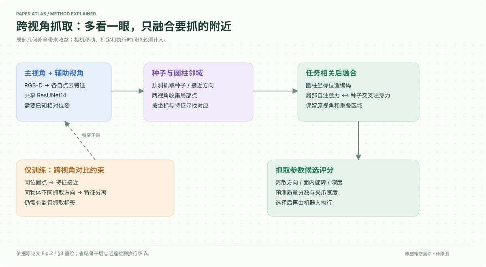

# A Cross-view Fusion Framework for Robust 6-DoF Grasp Pose Estimation

核对日期：2026-10-20。以下实验均为作者报告；本地完成原文阅读与讲解自检，未复现实验。

## 一句话总结

额外看一个视角，但只在抓取种子的局部圆柱区域融合特征，结合跨视角一致性与方向区分训练，减少角落遮挡导致的6DoF抓取错误。

## 研究背景与动机

单视角RGB-D常看不到物体背面或遮挡处；先构建完整多视角场景又会增加移动和重建耗时。作者选择任务驱动后融合：每个视角保留自身细节，只围绕候选抓取区域交换信息。[§1–2，PDF1–2]

额外观察不是免费信息；既要有相对位姿，也要付出相机移动或标定成本。

## 方法总览

两个视角分别经共享稀疏ResUNet14编码；训练时跨视角点对施加对比约束。主视角预测抓取种子和接近方向，以此在两个点云中收集圆柱邻域，结合坐标与特征对齐，转为圆柱坐标，交替局部自注意力和种子交叉注意力，最后预测离散旋转—深度候选的分数和夹爪宽度。[Fig.2，PDF3–5]

## 核心创新与关键设计

### 对齐相同位置，也区分不同方向
空间一致性最小化匹配点特征平方距离；同一物体不同抓取方向的非匹配点使用间隔损失：
\[L_{dis}=\frac1{N_{non}}\sum\max(0,M-\|f_1-f_2\|_2)^2,\quad M=1-\cos\theta.\]
方向越不同，要求特征间隔越大；整体还有有监督抓取损失，并不是整个训练无标签。[式4–6，PDF4]

### 融合抓取相关几何
利用已知相对变换把邻域置于共同坐标，再按
\[S_{ij}=-\|p_i-p_j\|_2^2+\lambda_{feat}\langle\bar f_i,\bar f_j\rangle\]
寻找对应并平均坐标和特征。该步骤缓解噪声，不意味着无需机器人运动学或标定。[式8–9]

局部圆柱坐标采用θ=atan2(z,y)、r=√(y²+z²)、d=x，对应面内旋转、径向几何和接近深度。它让几何更贴近抓取参数，但半径不是直接等于最终夹爪宽度，仍由网络预测。注意力先处理各视角及重叠区域，再把上下文汇入种子。[式10–12，PDF5]

## 实验与关键结果

每点云采样15000点、特征512维，1024种子、300方向，邻域K=8，12面内旋转×4深度，GraspNet训练8epoch；测试辅助视角从同场景256视角随机取。数据集190场景，100训练、90测试，Seen/Similar/Novel各30。[§4.1–4.2，PDF6]

| RealSense AP↑，作者Table1 | Seen | Similar | Novel |
| --- | --- | --- | --- |
| GSNet | 65.70 | 53.75 | 23.98 |
| ZeroGrasp | 70.53 | 62.15 | 26.46 |
| 本文2视角 | 74.08 | 62.38 | 27.27 |

AP综合不同摩擦系数的抓取评价，不等于真实机器人成功率。[PDF6]

Dobot CR5+D435的5组场景、每组3次清空实验，12个未见物体中每场景4–6个；SR本文96%、GSNet82%、GraspNet77%。总周期4.6s，单视角3.2s、6视角8.5s，推理仅0.0041s。整体时间还包含观察/重建和执行，不能把4.1ms当作完整抓取周期。[Table3–4，PDF8]

## 消融实验与证据强度

Table2：单视角基础Seen/Similar/Novel为63.80/56.90/23.80，直接预融合辅助视角仅64.34/57.11/24.03。加入两种自监督约束、仍单视角为69.36/59.53/26.08；完整后融合为74.08/62.38/27.27。表末平均AP相对基础提高6.41点，Seen单独提高10.28点，不应混淆。[PDF7]

对20个从基础AP<40的197样本中随机选出的角落视角，报告平均增益28.11。它说明困难子集收益更大，但不是整个测试集平均提升28.11。[Fig.6，PDF8]

## 局限与讨论

需要两视角相对位姿以及稳定的场景；对齐可以缓解部分误差，未证明任意标定错误下鲁棒。辅助视角随机取的离线协议，与真实机器人选择何处观察不同，主动视角规划不是本文解决的任务。真实实验只有12个物体与有限重复，未提供所有部署环境的成功保证。

与单视角方法比较含额外观测信息；应结合Table2的内部对照判断模块贡献，不能把全部增益归于网络结构。

## 复现提示

先确认GraspNet官方数据、相机参数和抓取标签许可，保存 `data/graspnet/`，按官方场景划分避免视角泄漏。固定辅助视角随机种子，记录机器人手眼标定、点云变换、圆柱半径/长度、碰撞检测与执行策略。

本地未运行模型或控制机器人；上游代码固定commit、许可证和完整评估脚本待核。复现实机前应先完成离线验证，本笔记的AP和SR均为作者报告。

## 相关工作与阅读顺序

先读GraspNet的候选参数化与AP，再读GSNet的graspness采样；比较VGN/GeneGN的预融合代价后，再看本文对比学习和局部注意力。最后看Table4，理解网络毫秒耗时与机械运动秒级耗时的不同。

## 来源与校验

- [CVF 官方论文页](https://openaccess.thecvf.com/content/CVPR2026/html/Zhu_A_Cross-view_Fusion_Framework_for_Robust_6-DoF_Grasp_Pose_Estimation_CVPR_2026_paper.html) · [所读 PDF](https://openaccess.thecvf.com/content/CVPR2026/papers/Zhu_A_Cross-view_Fusion_Framework_for_Robust_6-DoF_Grasp_Pose_Estimation_CVPR_2026_paper.pdf)。页码均为该 PDF 的页序。
- 阅读范围：正文、公式与实验表；补充材料、上游代码与权重未逐项核验。许可证和固定代码 commit 尚未确认，不复制原文全文或数据。
- PDF SHA-256：`4e05292d63917a79e9f09dc546cb380276fe5e936d0c77df8306c5e55b443f9b`；版本为本次下载的 CVF 接收稿，核对日期 2026-10-20。

- 视觉核对：已渲染查看 PDF 第7页，核对关键公式或实验表；正文阅读到结论与局限，未读独立补充材料。
