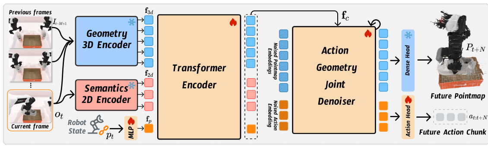

# Action-Geometry Prediction with 3D Geometric Prior for Bimanual Manipulation

核对日期：2026-10-21。实验数值均为作者报告；本地完成原文阅读与讲解自检，未复现实验。

## 一句话总结

GAP融合RGB推断的3D几何、2D语义和机器人状态，用联合扩散预测动作块与未来几何潜变量，辅助双臂操作。

## 研究背景与动机

双臂需要理解物体空间关系与动作后的场景变化。直接点云受深度噪声、遮挡及预处理影响；纯2D策略又可能缺少空间结构。作者用预训练几何模型π³从RGB历史提取几何知识，再以未来几何监督训练控制器。[§1–2，PDF1–2]

RGB-only说的是视觉传感输入，仍使用14维双臂关节/夹爪状态；也不意味着整个机器人无需坐标标定、同步或控制配置。

## 方法总览

原论文Fig.2，PDF第3页。仅裁切相关图示，保留图内科学标签；著作权属于原作者，用于本篇方法分析，不并入本站原创图授权。[来源与作者](https://openaccess.thecvf.com/content/CVPR2026/html/Xu_Action-Geometry_Prediction_with_3D_Geometric_Prior_for_Bimanual_Manipulation_CVPR_2026_paper.html) · [PDF](https://openaccess.thecvf.com/content/CVPR2026/papers/Xu_Action-Geometry_Prediction_with_3D_Geometric_Prior_for_Bimanual_Manipulation_CVPR_2026_paper.pdf)。点击可打开高清图。

从历史均匀取5帧加当前帧进入π³，最后两层融合成1024维几何特征；当前帧经DINOv3提供语义，关节状态经MLP编码。三路token经4层DETR编码器融合，条件DETR去噪器联合生成N×14动作块和未来N步端点的几何潜变量。[Fig.2、§3.2–3.3，PDF3–4]

未来潜变量再解码为点图，每像素3D坐标加置信度共4通道。部署可以跳过点图解码节省成本，但几何潜变量仍是联合生成目标；不是推理时用真实未来图像指导机器人。

## 核心创新与关键设计

动作、未来潜变量、点图的监督可概括为：
\[\mathcal L=\mathbb E[\|\widehat a-a\|_1+\lambda\|\widehat f_{t+N}-f_{t+N}\|_1+\gamma\|\widehat P_{t+N}-P_{t+N}\|_1].\]
模型做干净目标x₀预测，不能照常见噪声预测教程把目标自动换成ε。[式4–7，PDF4]

未来潜变量来自专家示范的π³多帧预提取，因此是伪真值；监督把动作与未来几何放进同一去噪任务，但没有显式动力学求解或碰撞可行性证明。式4将点图也列为加噪目标，框图则强调由潜变量解码，具体哪些张量独立加噪、置信度怎样监督须核对源码。[§3.4–3.5，PDF4–5]

## 实验与关键结果

RoboTwin2.0选16个主臂选择、8个同步双臂、8个顺序协作任务；100条示范设置、3随机seed、每seed100次评估。主要在RTX4090，RDT另用H20；各方法训练日程不同，G3Flow部分任务缺结果，不能视为完全同训练成本比较。[§4.2，PDF5–7]

| 成功率均值，作者报告 | DP3 | Xu等 | GAP |
| --- | --- | --- | --- |
| 主臂选择 | 61.2% | 58.4% | 63.2% |
| 同步双臂 | 45.1% | 47.6% | 51.3% |
| 顺序协作 | 36.0% | 45.5% | 50.4% |

来源Table1–3。平均领先不表示逐项最好：Beat Hammer本文56.3低于DP62.0，三块堆叠仅2.0低于DP3的3.7。主文没有独立点图误差主表，不能把任务成功提升等同已量化几何精度提升。

实机Cobot Magic三台D435i的RGB、每任务50示范/20试验、4090推理；Table5平均40%对Xu等32.5%。表列空杯80%、双鞋20%、挂杯20%、扫描40%；设置正文和Fig.5却出现“三碗”替代空杯，任务名单存在冲突，应保留注明。[PDF8]

## 消融实验与证据强度

四任务消融完整25.1%，去语义24.4%，去未来几何23.6%，同时去3D及未来分支21.0%，支持模块有效但不证明未来分支是唯一主要来源。[Table4，PDF8]

消融所列四任务与主表对应值计算的均值约39.2%不同，说明还有未交代的协议或配置差别，不能把25.1直接接到主表当成一致控制实验。低数据实验中20示范空杯24.7%、双鞋5.0%，显示学习信号，仍是有限成功率而非泛化已解决。[Fig.4，PDF7]

## 局限与讨论

π³重建的尺度、坐标、跨时刻物体运动与遮挡错误会成为伪监督偏差；几何预测不自动带来物理可行控制。各基线预训练和训练预算也不同，单靠平均成功率无法隔离几何骨干、DINOv3及预测目标各自贡献。

主文没有完整给出动作块N、去噪步数与端到端时延，不能保证控制实时性。实机每项20次，挂杯20%意味着4次成功，细小百分比差异的统计解释需要更多重复，而非仅凭均值宣布可靠部署。

## 复现提示

[作者代码](https://github.com/Chongyang-99/GAP)来自论文，commit、许可证和配置未核验。建议 `experiments/robotics/gap/`，记录π³/DINOv3版本、历史帧时间戳、未来伪标签坐标对齐、状态归一化和训练/评估随机种子。

先复核Table4配置与实机任务名单，再用获许可示范验证时间索引，确保未来标签只用于训练。模型、机器人与数据均未在本地运行，本篇结果全部是作者报告。

## 相关工作与阅读顺序

先理解ACT动作分块、Diffusion Policy和DP3，再了解π³多帧几何先验。最后对照Fig.2和损失式，区分“看见当前几何”“预测未来潜变量”和“真实执行动作”三条信息流。

## 来源与校验

- [CVF官方论文页](https://openaccess.thecvf.com/content/CVPR2026/html/Xu_Action-Geometry_Prediction_with_3D_Geometric_Prior_for_Bimanual_Manipulation_CVPR_2026_paper.html) · [所读PDF](https://openaccess.thecvf.com/content/CVPR2026/papers/Xu_Action-Geometry_Prediction_with_3D_Geometric_Prior_for_Bimanual_Manipulation_CVPR_2026_paper.pdf)。页码均为PDF页序。
- 所读版本：2026-10-21从CVF下载的开放接收稿；PDF SHA-256：`10f479d23ebfd17c18c76ea57b36507e7ba5e5f2becd8ab3f865a8c7cfdac901`。
- 阅读范围：正文、方法公式、实验与消融；补充材料、代码及权重未逐项核验。reviewed表示本地讲解自检，不表示独立同行评审或实验复现。
- 方法图与关键公式/表格已渲染核对，所引原图已单独检查；未对新文章进行浏览器交互验收。作者图示与本站原创素材权利分开记录。
