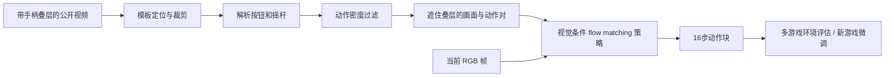

# NitroGen：从带手柄叠层的视频学习游戏动作

论文：**NitroGen: An Open Foundation Model for Generalist Gaming Agents**，Loïc Magne、Anas Awadalla、Guanzhi Wang 等，CVPR 2026，21511–21521 页。完整作者见官方页和 manifest。

[官方论文页](https://openaccess.thecvf.com/content/CVPR2026/html/Magne_NitroGen_An_Open_Foundation_Model_for_Generalist_Gaming_Agents_CVPR_2026_paper.html) · [原文 PDF](https://openaccess.thecvf.com/content/CVPR2026/papers/Magne_NitroGen_An_Open_Foundation_Model_for_Generalist_Gaming_Agents_CVPR_2026_paper.pdf) · [论文项目页](https://nitrogen.minedojo.org)

分类：机器人与智能体 / 视觉动作策略 / 游戏。最后核对：2026-10-19。正文阅读与讲解自检完成，未运行代码或控制游戏。页码为 PDF 页码。获最佳论文荣誉提名，依据[官方大会公告](https://cvpr.thecvf.com/Conferences/2026/News/Closing)。

## 一句话总结

从视频角落的手柄输入可视化中解析动作，构建约四万小时、多游戏的视觉动作数据，训练可迁移的行为克隆策略；其主要价值是数据规模和后续适配基础，而非已经获得任意游戏的通用规划能力。

## 研究背景与动机

互联网上游戏画面很多，但画面不直接告诉模型玩家按了哪些键。真正的动作标签若依靠人工同步记录，采集成本高；靠游戏内部 API 则很难覆盖大量商业游戏。论文利用一个实用线索：部分主播在画面上叠加手柄图示，按钮和摇杆状态随操作变化。[§1–2.1，PDF 1–3]

于是问题从“从游戏变化猜动作”转成“读取输入叠层”。这是有前提的数据源选择，不适用于所有视频，更不等于能从任意无标记游戏视频准确恢复动作。

## 方法总览

根据 Fig.1–2 与 §2 重绘。动作标注网络与最终游戏策略是两套网络；推理策略不需要画面上继续显示手柄标签。

## 核心创新与关键设计

### 1. 动作标签来自显式输入叠层

每个视频抽25帧，用约300种手柄模板结合 SIFT、XFeat 特征匹配，估计仿射变换并裁出叠层区域。动作解析器基于 SegFormer，输入相邻两帧，输出按钮状态与离散11×11摇杆位置掩码，再利用整段视频的轮廓、中心位置与分位数归一化得到连续摇杆坐标。[§2.1，PDF 3–4]

解析器使用约800万合成标注帧训练，通过透明度、大小和压缩变化模拟真实叠层。这并非“调用OCR读按钮文字”，而是围绕控制器图形专门设计的定位和状态解析。

### 2. 去掉大量无操作片段，且遮住标签防泄漏

原始71,000小时数据中，过多静止片段会让策略偏向空动作。作者只保留至少50%时间步有非零按钮或摇杆输入的片段，保留约55%，得到约40,000小时数据。训练画面中的控制器叠层被遮挡，以免模型直接抄答案。[§2.1，PDF 4]

这改善动作分布，但也改变了训练任务分布：等待、菜单、长期停留等行为可能减少。它是数据取舍，不保证所有游戏阶段都更好。

### 3. 单帧视觉条件生成动作块

标准动作空间包括16个二元按钮加4个连续摇杆轴。SigLIP2 把256×256 RGB帧编码为256个图像 token，DiT 通过交叉注意力读取图像特征，生成16步动作块。架构从 GR00T N1 改造，移除语言与状态编码器，保留单动作头。[§2.2–2.3，PDF 4–6]

训练目标为条件 flow matching，可抽象为：

\[
\mathbb E_{a,\epsilon,t,I}
\|v_\theta(a_t,t\mid I)-v^*(a,\epsilon,t)\|^2.
\]

上式仅解释“学习从噪声动作块到示范动作块的向量场”，不是从正文抄录的精确实现公式。插值路径、时间约定和二元动作后处理需查补充材料，本轮未核对，不据此提供伪复现代码。推理使用16步去噪。[§2.3，PDF 6]

动作分块有助于局部连续性，但策略只使用一个上下文帧，并没有因此获得长期记忆或语言任务理解。

### 4. 环境接口支持逐帧研究评估

论文的 gameplay harness 把游戏包装成 Gymnasium 接口，通过控制系统时钟实现暂停与逐帧交互。作者明确把实时或异步部署留给未来。[§2.2，PDF 4] 所以不能直接把研究评估成功率解释成正常实时游戏体验；本文讲解也不执行注入或改动本机游戏环境。

## 实验与关键结果

评估套件包含10款游戏、30个任务：11个战斗、10个导航、9个游戏特定任务。Fig.5 中每款游戏3个任务，每任务5次 rollout，使用人工判定成功。[§2.2、§3，PDF 5–6] 采样规模不大，单任务的少量成功不应被理解成稳定保证。

对动作标注器，六款游戏录制的带真值测试数据中，摇杆平均 \(R^2=0.84\)，按钮平均准确率0.96。[§3，PDF 6] 这不表示最终策略的游戏成功率是96%，两者属于不同实验。

未见游戏迁移实验先把目标游戏从预训练中排除，再以相同目标数据和计算预算比较预训练微调与从头训练。等距视角 roguelike 的平均相对改善约10%，3D动作RPG约25%；后者战斗任务达到52%的相对改善，专属机制任务只有约5%。[§3、Fig.7，PDF 7–8]

“52%”是特定设置的**相对提升**，不是成功率提高52个百分点，也不是所有新游戏的平均提升。

另一个自模仿实验在单个2D类银河城boss任务上报告：

| 配置 | 作者报告成功率 |
| --- | ---: |
| 基础模型 | 18.7% |
| 仅用原有 BC 数据微调 | 30.1% |
| 一轮自模仿 | 53.9% |
| 三轮自模仿 | 90.5% |

来源：Fig.6 与 §3，PDF 7，已对照渲染页面核对。自模仿需要人工挑选模型较好的轨迹，并与原始数据50/50混合训练；不是无人筛选、完全自动强化学习，也不能把90.5%推广为全套30任务的结果。

## 消融实验与证据强度

论文中最有说服力的对照是同架构、同目标数据与计算预算的“预训练后微调 vs 从头训练”，以及“追加原BC数据 vs 自模仿数据”。这帮助排除只因多训练了一段时间就变好的简单解释。

作者称多上下文帧没有收益、动作块优于单步、分割式摇杆解析优于直接回归，但正文未给出覆盖这些设计的完整数值消融表。[§2，PDF 4、6] 本讲解保留其作者报告属性，不给未核实数字，也不声称所有组件都已独立证明必要。

## 局限与讨论

作者明确把系统定位为短时反应型视觉动作模型：不支持语言指令，不负责端到端通关或长期规划，也未设计为能在任意未见游戏中可靠零样本游玩。[§4，PDF 7–8]

数据偏向使用手柄的动作游戏；动作RPG占总时长34.9%，平台跳跃占18.4%。复杂键鼠操作、策略和模拟游戏代表性不足。[Fig.3，PDF 4] 叠层显示有延迟，解析有误差，主播自定义按键与灵敏度也会改变动作含义。大规模数据能容忍部分噪声，却不能消除这些系统性偏差。

从应用角度，这更适合作为游戏视觉动作研究底座。若想用于日常软件助手，还缺少文字输入、明确任务条件、长期状态管理和可靠失败恢复，不能直接迁移成通用桌面 agent。

## 复现提示

正文报告条件 flow matching、16步动作块、单帧上下文，推理16去噪步；AdamW weight decay0.001，WSD学习率调度的恒定阶段为 \(10^{-4}\)，EMA decay0.9999，实验使用 EMA 权重。[§2.3，PDF 6] Fig.5 使用500M模型。

准确训练批量、总步数、硬件预算、去噪细节等不在本轮已核对的正文范围内，不自行补齐。项目声称公开数据、权重和评估套件，但本轮未查当前下载可用性、许可证或commit，不运行第三方程序，不取得商业游戏或视频数据本体。公开视频的可访问性不自动赋予任意再分发权限。

## 相关工作与阅读顺序

VPT 可帮助理解从无动作视频补标签的路线；GR00T N1 解释视觉动作架构来源；行为克隆与自模仿分别解释“模仿人的示范”和“筛选自身好轨迹再学习”。与语言规划型游戏agent相比，NitroGen更重视动作数据和低层控制。

建议先读 Fig.2 数据管线 → §2.3 策略 → Fig.7 迁移对照 → Fig.6 自模仿 → §4 限制。先确认动作标签从哪里来，再谈“通用性”范围。

## 来源与校验

主要依据 CVF 公开接收版正文1–8页；Fig.6所在第7页已渲染查看，补充材料未读。PDF SHA-256：`0e7cd2c59cbe90d04326396cb277d52693577be753c190b339a844d617a91b76`，仅为本地摘要。笔记概念图为重绘，不转载原文全文或作者图片。AI辅助独立撰写并自检，未经过独立专家复核、未复现实验。
