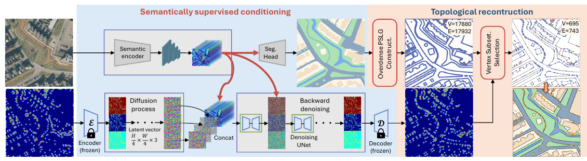

# ACPV-Net: All-Class Polygonal Vectorization for Seamless Vector Map Generation from Aerial Imagery

核对日期：2026-10-21。实验数值均为作者报告；本地完成原文阅读与讲解自检，未复现实验。

## 一句话总结

ACPV-Net联合预测语义分割与顶点热图，再在同一平面图上重建所有地物多边形，使相邻类别共享边界。

## 研究背景与动机

逐类提取建筑、道路和水域轮廓，再把它们拼起来，容易出现缝隙、重叠和两套不一致的公共边。本文把任务改成覆盖整个图块的统一平面分区，显式保留孔洞、嵌套与接壤关系。[§1–3，PDF1–3]

“无缝”描述输出几何关系，不能等同每块地都识别正确，也不能自动扩展成跨图块或跨城市地图完全接合。地籍边界还可能与肉眼可见的纹理边界不一致。

## 方法总览

原论文Fig.2，PDF第4页。仅裁切相关图示，保留图内科学标签；著作权属于原作者，用于本篇方法分析，不并入本站原创图授权。[来源与作者](https://openaccess.thecvf.com/content/CVPR2026/html/Jiao_ACPV-Net_All-Class_Polygonal_Vectorization_for_Seamless_Vector_Map_Generation_from_CVPR_2026_paper.html) · [PDF](https://openaccess.thecvf.com/content/CVPR2026/papers/Jiao_ACPV-Net_All-Class_Polygonal_Vectorization_for_Seamless_Vector_Map_Generation_from_CVPR_2026_paper.pdf)。点击可打开高清图。

分割编码器提供受语义损失监督的条件；真实顶点被编码成高斯混合热图，经冻结VAE压缩到1/4空间尺度，UNet在潜空间学习去噪重建。推理产生分割掩码与顶点热图，再经过确定性几何重建，而不是让扩散模型直接吐出最终多边形序列。[Fig.2、§4.1，PDF4]

重建先保留所有类别转折边界，构造过密平面直线图PSLG；把度不等于2的锚点与附近预测顶点保留，在同一图上简化边界、追踪面并分配类别。[§4.2，PDF4–5]

## 核心创新与关键设计

训练目标同时约束噪声、干净潜变量和语义：
\[\mathcal L_{SSC}=\lambda_\epsilon\mathbb E\|\epsilon-\epsilon_\theta\|_1+\lambda_0\mathbb E\|z_0-\widehat z_0\|_1+\lambda_{seg}\mathcal L_{seg}(\widehat M,M).\]
第三项使条件特征适合语义分割，而不是仅服务于顶点重建；去掉它会产生与类别边界不一致的顶点峰。[式3，PDF4]

几何阶段的关键是公共边只存一次。预测峰在固定半径τ内投影到PSLG并按弧长排序，再保留锚点及关键点。命题1依赖平面图边位于类别转折处、顶点满足关键点条件，完整证明在补充材料；简化实现必须核实交叉、孔洞及环方向，不能把一句命题当成所有输入下正确性的自动保证。[PDF4–5]

## 实验与关键结果

新数据Deventer-512来自荷兰航片，0.3米GSD、512²图块；训练/验证/测试1716/212/220，共84403实例、22679孔洞，最复杂轮廓708顶点。五类为建筑、道路、植被、水体和无植被区。[§5，PDF5]

| 作者报告 | HiSup | ACPV-Net |
| --- | --- | --- |
| Deventer道路IoU / C-IoU | 73.92 / 57.36 | 76.01 / 68.22 |
| Deventer建筑IoU / C-IoU | 81.22 / 70.60 | 82.08 / 77.24 |
| Deventer水体IoU / MTA↓ | 64.84 / 42.22 | 67.96 / 42.63 |
| WHU-Building IoU / C-IoU | 87.63 / 67.15 | 88.50 / 81.45 |

来源Table3–4，PDF7。MTA水体略差，不能写所有指标均最优。N-ratio目标是接近1，不是一味越小越好；道路本文1.07，建筑1.00。

整体地图测试中Gap、Inter、Intra均0.00%，Shared100.00%；这是按两位小数报告的拓扑度量，不是像素分类100%准确。[Table2，PDF6] 各基线逐类结果拼接与本文统一分区属于不同设计，应连同拓扑约束理解比较。

## 消融实验与证据强度

去掉显式语义监督，顶点到边界对齐V2B@2从0.78降到0.38；@2/4/6均值0.85降到0.46。把分布式重建换成判别头，峰宽FWHMx中位数9.55对本文6.09，半高区域面积75对21，支持峰更紧凑。[Table5–6，PDF8]

同一分割与顶点先验下，无PSLG加DP的Shared15.38%、Gap1.04%；PSLG加DP已经达到Shared100%、Gap0%。所以拓扑一致性的主要证据来自共享图结构，不能把它全部归功于顶点选择VSS；VSS相对DP的详细几何优势放在未读补充材料。[Table7，PDF8]

## 局限与讨论

平面分区可以把错误类别无缝拼合，拓扑有效与语义正确是两个问题。地籍式标签依赖地区制图约定，且本文只在一个新多类基准与建筑基准详细量化；跨国家、传感器泛化的更多证据在补充材料，本次未核验。

正文将实现超参数、运行成本、完整指标定义及VSS比较细节留给补充材料；无法据主表判断大范围制图吞吐或显存成本。跨patch边界协调需要另外设计，不能仅以单patch的100%共享边一致性宣称全国地图可直接部署。

## 复现提示

论文给出[作者仓库入口](https://github.com/HeinzJiao/ACPV-Net)，本次未核实代码实际发布状态、commit或许可证。复现应先取得Deventer官方数据访问与地籍许可，再对图块划分、矢量坐标、孔洞和边界精度进行核对；建议 `datasets/remote-sensing/deventer-512/`，数据本体不提交。

实现时先以人工小地图验证公共边、三岔口、图块外边框、嵌套孔洞，再接入模型；另行检查τ、NMS、扩散步数和VAE版本。本次未运行模型或几何算法，报告数值全部来自作者。

## 相关工作与阅读顺序

先理解栅格分割、平面直线图与面追踪，再比较DeepSnake、TopDiG、HiSup等单类轮廓方法。阅读重点是§3的任务约束、§4.2的共享图构造和Table7，而不是只看IoU排行榜。

## 来源与校验

- [CVF官方论文页](https://openaccess.thecvf.com/content/CVPR2026/html/Jiao_ACPV-Net_All-Class_Polygonal_Vectorization_for_Seamless_Vector_Map_Generation_from_CVPR_2026_paper.html) · [所读PDF](https://openaccess.thecvf.com/content/CVPR2026/papers/Jiao_ACPV-Net_All-Class_Polygonal_Vectorization_for_Seamless_Vector_Map_Generation_from_CVPR_2026_paper.pdf)。页码均为PDF页序。
- 所读版本：2026-10-21从CVF下载的开放接收稿；PDF SHA-256：`bf45dc1a4d3791298beaf47e8940d64d76d586784414e7d342558eb44c742a82`。
- 阅读范围：正文、方法公式、实验与消融；补充材料、代码及权重未逐项核验。reviewed表示本地讲解自检，不表示独立同行评审或实验复现。
- 方法图与关键公式/表格已渲染核对，所引原图已单独检查；未对新文章进行浏览器交互验收。作者图示与本站原创素材权利分开记录。
