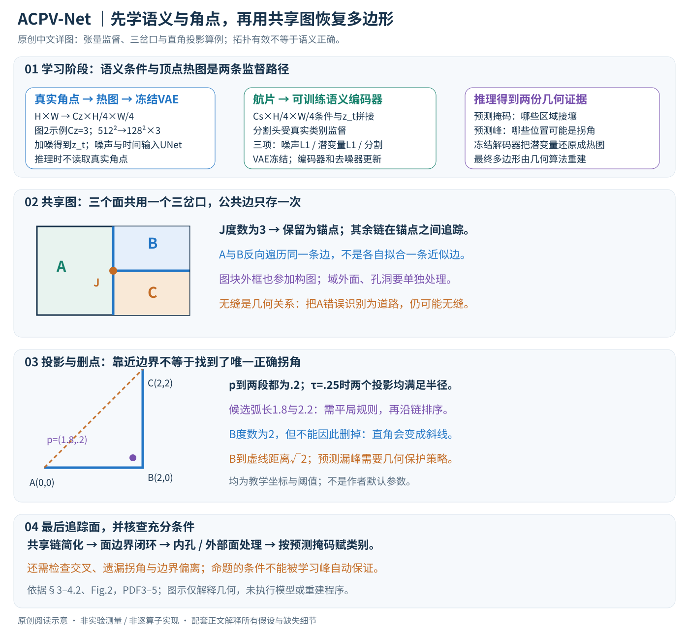

# ACPV-Net: All-Class Polygonal Vectorization for Seamless Vector Map Generation from Aerial Imagery

核对日期：2026-10-21。实验数值均为作者报告；本地完成原文阅读与讲解自检，未复现实验。

方法与配图详细版返工：2026-10-25。补充张量路径、优化对象、共享图与投影算例；未复现实验。

## 一句话总结

ACPV-Net联合预测语义分割与顶点热图，再在同一平面图上重建所有地物多边形，使相邻类别共享边界。

## 研究背景与动机

逐类提取建筑、道路和水域轮廓，再把它们拼起来，容易出现缝隙、重叠和两套不一致的公共边。本文把任务改成覆盖整个图块的统一平面分区，显式保留孔洞、嵌套与接壤关系。[§1–3，PDF1–3]

“无缝”描述输出几何关系，不能等同每块地都识别正确，也不能自动扩展成跨图块或跨城市地图完全接合。地籍边界还可能与肉眼可见的纹理边界不一致。

## 方法总览

原论文Fig.2，PDF第4页。仅裁切相关图示，保留图内科学标签；著作权属于原作者，用于本篇方法分析，不并入本站原创图授权。[来源与作者](https://openaccess.thecvf.com/content/CVPR2026/html/Jiao_ACPV-Net_All-Class_Polygonal_Vectorization_for_Seamless_Vector_Map_Generation_from_CVPR_2026_paper.html) · [PDF](https://openaccess.thecvf.com/content/CVPR2026/papers/Jiao_ACPV-Net_All-Class_Polygonal_Vectorization_for_Seamless_Vector_Map_Generation_from_CVPR_2026_paper.pdf)。点击可打开高清图。

### 输入输出：整幅图的平面分区，不是互不关联的实例轮廓

输入为航片 \(I\in\mathbb R^{H\times W\times k}\)，RGB时k=3；训练还需类别掩码M与矢量角点标注。输出按类别分组的多边形，每个多边形具有外环、可选内孔和单一类别。相邻区域引用同一条几何边，内部不重叠，合起来覆盖图块。这里的坐标是图块二维坐标；转换到地图投影坐标还需影像地理配准，本文模型输出不能直接视为经纬度。（§3，PDF第3页）

式1用内部的并表达覆盖；严格说公共边不属于任何开集内部，理解时应结合条件(c)的“公共边除外”，或用多边形闭包表达覆盖，不能要求边界同时满足开集内部定义。拓扑有效与标签正确是两项不同要求：一条错误的道路边界仍可能构成完全无缝的分区。

原创图中的三区域与坐标为教学例；它说明公共边只生成一次，不代表作者某张测试航片或逐算子实现。

### 从真实角点到去噪目标：冻结的是VAE

训练先把标注角点编码为高斯混合热图 \(y\in[0,1]^{H\times W}\)，角点位置形成峰。高斯宽度、峰重叠的合成/归一化方式不能从“高斯混合”四个字唯一确定，主文未给完整配置。预训练VAE编码器得到

\[
z_0=\mathcal E(y)\in\mathbb R^{C_z\times H/4\times W/4}.
\]

图2标潜变量末维为3，因此图示512×512输入对应128×128×3；正文一般式仍用Cz。单通道热图如何适配预训练VAE输入通道、数值范围和具体检查点须另核查，不能猜成简单复制三份。VAE编码器与解码器均冻结，作者把保峰能力的验证放在补充材料，本轮没有独立验证。（§4.1、Fig.2，PDF第4页）

航片另经可训练语义编码器 \(S_\psi(I)\in\mathbb R^{C_s\times H/4\times W/4}\)。图2用Concat连接语义条件与带噪潜变量；按同尺度通道拼接理解，UNet读取的空间网格是128×128，通道数为Cz+Cs。Cs具体数值及其他条件注入层未在主文明确，不应擅自写成某个网络配置。分割头从语义特征预测类别；最终几何处理需要图像坐标中的离散类别掩码，分割头恢复分辨率的详细路径也需实现核对。

## 核心创新与关键设计

### 去噪、干净潜变量、分割三种监督分别约束什么

正文式2将带噪潜变量、时间t和语义条件送入去噪网络，预测干净潜变量。以下是标准高斯扩散的阅读补充，用于解释噪声项，不是本文额外公开的采样实现：令 \(\alpha_t=1-\beta_t\)、\(\bar\alpha_t=\prod_{s=1}^t\alpha_s\)，则

\[
z_t=\sqrt{\bar\alpha_t}z_0+\sqrt{1-\bar\alpha_t}\epsilon,\qquad\epsilon\sim\mathcal N(0,I).
\]

若采用噪声预测参数化，可由预测噪声反算 \(\widehat z_0=(z_t-\sqrt{1-\bar\alpha_t}\epsilon_\theta)/\sqrt{\bar\alpha_t}\)。本文式2与式3同时使用干净潜变量和噪声预测记号，未明确两者是共享参数化换算还是独立头；这条标准关系帮助理解，却不能作为“作者就是这样实现”的证据。（式2–3，PDF第4页）

\[
\mathcal L_{SSC}=\lambda_\epsilon\mathbb E\|\epsilon-\epsilon_\theta\|_1+
\lambda_0\mathbb E\|z_0-\widehat z_0\|_1+
\lambda_{seg}\mathcal L_{seg}(\widehat M,M).
\]

第一项要求解释加进去的噪声；第二项要求恢复与真实角点热图对应的干净潜变量；第三项让条件分支保留地物类别信息。前两项可通过条件连接更新语义编码器与去噪器，第三项直接更新语义编码器与分割头；冻结VAE不接收参数更新。L1绝对误差在非零处的导数为误差符号，不能把它描述成平方误差。各权重、时间采样、分割损失形式和采样步数主文未完整列出。

语义监督并非直接强制每个预测峰落在边界上，而是通过共享条件改善对齐。作者Table5中V2B@2由无SSC的0.38升到0.78，为经验对齐证据，仍不是逐顶点硬约束。推理时不再读取真实热图或真实掩码：由航片产生语义条件，经迭代去噪得到潜变量，冻结解码器输出 \(\widehat Y=\mathcal D(\widehat z_0)\)，与预测掩码一起进入几何阶段。

### 先构造过密图：公共边只拥有一份坐标

几何输入是 \((\widehat M,\widehat Y)\)，不是RGB图直接生成的多边形序列。对整个多类别掩码提取类别转折位置，并包括图像边框；相邻转折像素连接成一像素宽边界链，每个位置先保留为顶点，形成PSLG \(G=(V,E)\)。此时宁可过密，也不提前逐类删点；若建筑与道路各自简化同一边，两次结果可能不同，缝隙就会出现。（§4.2，PDF第5页）

教学图块内有三个区域A、B、C，三条边在J相交。图里只有一个J和三条入射链，J的度为3。A与B沿同一链相接时，两面的遍历方向可相反，但坐标和边对象一致；“共享”不意味着把两条接近的线算成一条。图块边框也必须参加构图，否则外侧区域可能无法闭合。

### 再选顶点：锚点、投影、弧长排序各自不可省略

把度不等于2的点作为锚点；例如三岔口必须保留，因为删除它会改变面之间的接壤关系。沿锚点之间的度2顶点追踪折线，再从预测热图提取离散峰，将距离不超过固定半径τ的峰投影到最近PSLG位置。随后按该折线的弧长顺序排列，而非按x坐标排序：一条回折道路的x坐标可能往返变化。锚点与投影关键点一起决定简化后的共享链。（§4.2，PDF第5页）

投影的教学算例：链为A=(0,0)→B=(2,0)→C=(2,2)，预测峰p=(1.8,0.2)。到两段的最近距离均为0.2，候选投影分别(1.8,0)和(2,0.2)，沿链弧长分别1.8和2.2。若τ=0.25，两者都够近，因此“最近”仍存在平局，需要确定性规则；主文没有交代这类规则。若τ=0.1，该峰不能依此规则投影。这里的τ仅为教学数值，不是论文超参数。

度2并不等于几何冗余：上例B的度也是2，但将A、C直接连接会把直角折线换成斜线，B到新线的距离为 \(\sqrt2\)。因此没有检测到拐角时，不能只靠“保留锚点”保证形状不变。纯闭环可能所有点度为2，没有上述锚点；环起点选择、少峰时如何处理、重复投影和近邻平局、短接线段是否交叉，以及孔洞方向，都需补充材料/代码确认。这里列出的是实现边界，不宣称作者程序必然存在这些错误。

### 面追踪：从边图恢复带孔多边形

简化在共享图上完成后，追踪所有面的边界，再依据预测掩码分配类别。直观上，沿一条有向边保持同一面位于同侧，直到闭环；但这是面追踪的通用解释，主文未列出半边数据结构或具体转向规则。内孔不能填成实心区域，图块外部的无界面也不能当作待输出地物。（§4.2，PDF第4–5页）

命题1要求边位于标签转折处、相邻面标签不同，且保留的顶点均为移除就改变几何/拓扑的关键点。完整证明在补充材料。学习的峰是否满足条件、简化连线是否仍满足平面嵌入和边界约束，仍需验证。主文中的充分条件不应被扩写成“任意预测、任意阈值都正确”。尤其边框的一侧是域外面，要明确域外处理约定。

### 一次训练与一次推理的完整顺序

训练：读取航片、语义标签和标注角点→构造热图→冻结VAE编码→采样噪声和t→航片语义编码与分割预测→条件去噪→计算三项损失→更新语义编码器、分割头、去噪网络。几何重建在主文中是确定性后处理，不应把面追踪虚构为可微训练损失。

推理：航片→语义条件与掩码→迭代去噪及VAE解码→峰提取→整体PSLG→锚点分链→半径约束投影与弧长排序→共享链简化→面追踪与标签赋值。噪声生成和采样器是否固定影响整条推理的可重复性；论文称“确定性”的是给定掩码和热图后的几何步骤，不代表扩散阶段天然无随机性。

### 开销与消融：结构一致性主要来自共享图

扩散执行多次去噪，成本随采样步数增加；压缩到1/4长宽使空间位置从HW降为HW/16，不表示总运算恰好减少16倍，因为通道数与UNet结构不同。过密边图最坏可随像素数量增长；N个预测峰对E条边朴素搜索为O(NE)，空间索引可加速，但作者实际结构未在主文说明。这是算法级估算，不是本地计时。

图2展示一个样例由17,880顶点/17,932边缩成695顶点/743边，是具体图示，不能写成数据集平均压缩比。Table7保持相同掩码和峰先验，独立逐类DP的Shared为15.38%，共享PSLG加DP已达100.00%；因此顶点生成、共享图结构与VSS顶点选择的贡献要分开解释。VSS相较DP的几何细节位于本轮未核验的补充材料，不能仅凭无缝结果断言VSS在所有几何指标上最优。（PDF第4、8页）

## 实验与关键结果

新数据Deventer-512来自荷兰航片，0.3米GSD、512²图块；训练/验证/测试1716/212/220，共84403实例、22679孔洞，最复杂轮廓708顶点。五类为建筑、道路、植被、水体和无植被区。[§5，PDF5]

| 作者报告 | HiSup | ACPV-Net |
| --- | --- | --- |
| Deventer道路IoU / C-IoU | 73.92 / 57.36 | 76.01 / 68.22 |
| Deventer建筑IoU / C-IoU | 81.22 / 70.60 | 82.08 / 77.24 |
| Deventer水体IoU / MTA↓ | 64.84 / 42.22 | 67.96 / 42.63 |
| WHU-Building IoU / C-IoU | 87.63 / 67.15 | 88.50 / 81.45 |

来源Table3–4，PDF7。MTA水体略差，不能写所有指标均最优。N-ratio目标是接近1，不是一味越小越好；道路本文1.07，建筑1.00。

整体地图测试中Gap、Inter、Intra均0.00%，Shared100.00%；这是按两位小数报告的拓扑度量，不是像素分类100%准确。[Table2，PDF6] 各基线逐类结果拼接与本文统一分区属于不同设计，应连同拓扑约束理解比较。

## 消融实验与证据强度

去掉显式语义监督，顶点到边界对齐V2B@2从0.78降到0.38；@2/4/6均值0.85降到0.46。把分布式重建换成判别头，峰宽FWHMx中位数9.55对本文6.09，半高区域面积75对21，支持峰更紧凑。[Table5–6，PDF8]

同一分割与顶点先验下，无PSLG加DP的Shared15.38%、Gap1.04%；PSLG加DP已经达到Shared100%、Gap0%。所以拓扑一致性的主要证据来自共享图结构，不能把它全部归功于顶点选择VSS；VSS相对DP的详细几何优势放在未读补充材料。[Table7，PDF8]

## 局限与讨论

平面分区可以把错误类别无缝拼合，拓扑有效与语义正确是两个问题。地籍式标签依赖地区制图约定，且本文只在一个新多类基准与建筑基准详细量化；跨国家、传感器泛化的更多证据在补充材料，本次未核验。

正文将实现超参数、运行成本、完整指标定义及VSS比较细节留给补充材料；无法据主表判断大范围制图吞吐或显存成本。跨patch边界协调需要另外设计，不能仅以单patch的100%共享边一致性宣称全国地图可直接部署。

## 复现提示

论文给出[作者仓库入口](https://github.com/HeinzJiao/ACPV-Net)，本次未核实代码实际发布状态、commit或许可证。复现应先取得Deventer官方数据访问与地籍许可，再对图块划分、矢量坐标、孔洞和边界精度进行核对；建议 `datasets/remote-sensing/deventer-512/`，数据本体不提交。

实现时先以人工小地图验证公共边、三岔口、图块外边框、嵌套孔洞，再接入模型；另行检查τ、NMS、扩散步数和VAE版本。本次未运行模型或几何算法，报告数值全部来自作者。

## 相关工作与阅读顺序

先理解栅格分割、平面直线图与面追踪，再比较DeepSnake、TopDiG、HiSup等单类轮廓方法。阅读重点是§3的任务约束、§4.2的共享图构造和Table7，而不是只看IoU排行榜。

## 来源与校验

- [CVF官方论文页](https://openaccess.thecvf.com/content/CVPR2026/html/Jiao_ACPV-Net_All-Class_Polygonal_Vectorization_for_Seamless_Vector_Map_Generation_from_CVPR_2026_paper.html) · [所读PDF](https://openaccess.thecvf.com/content/CVPR2026/papers/Jiao_ACPV-Net_All-Class_Polygonal_Vectorization_for_Seamless_Vector_Map_Generation_from_CVPR_2026_paper.pdf)。页码均为PDF页序。
- 所读版本：2026-10-21从CVF下载的开放接收稿；PDF SHA-256：`bf45dc1a4d3791298beaf47e8940d64d76d586784414e7d342558eb44c742a82`。
- 阅读范围：正文、方法公式、实验与消融；补充材料、代码及权重未逐项核验。reviewed表示本地讲解自检，不表示独立同行评审或实验复现。
- 方法图与关键公式/表格已渲染核对，所引原图已单独检查；2026-10-25详细版完成浏览器上下半图与文章检查：13个公式，无公式错误、损坏图片或横向溢出。作者图示与本站原创素材权利分开记录。
