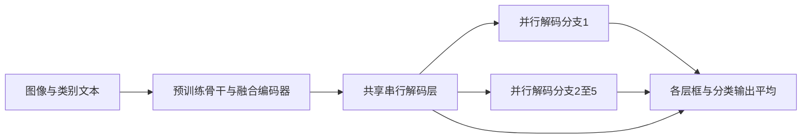

# 跨域少样本检测：微调策略与并行解码器

论文：**A Closer Look at Cross-Domain Few-Shot Object Detection: Fine-Tuning Matters and Parallel Decoder Helps**，Xuanlong Yu、Youyang Sha、Longfei Liu、Xi Shen、Di Yang，CVPR 2026，26593–26603页。

[官方页](https://openaccess.thecvf.com/content/CVPR2026/html/Yu_A_Closer_Look_at_Cross-Domain_Few-Shot_Object_Detection_Fine-Tuning_Matters_CVPR_2026_paper.html) · [PDF](https://openaccess.thecvf.com/content/CVPR2026/papers/Yu_A_Closer_Look_at_Cross-Domain_Few-Shot_Object_Detection_Fine-Tuning_Matters_CVPR_2026_paper.pdf) · [作者列出的代码](https://github.com/Intellindust-AI-Lab/FT-FSOD)

分类：检测与分割 / 跨域 / 少样本。最后核对：2026-10-20。正文精读、自检完成，未运行上游代码。页码使用PDF页码。

## 一句话总结

把预训练检测器的部分串行解码层改成并行分支，配合先冻结再全量微调及按验证表现降学习率，提高少样本跨域适配；重点是利用已有参数与稳定优化，不是额外生成一大批训练图片。

## 研究背景与动机

少量工业缺陷、航拍或文档标注与自然图像预训练域差异大，直接全量微调容易过拟合。复杂数据增强可能增加资源开销，作者因此检查一个更基础的问题：已有开放词汇检测器是否能通过更稳的微调与结构重排获得足够好的结果？[§1，PDF 1–2]

## 方法总览

图对应正文常用的1层共享加5层并行配置，依据Fig.2重绘。训练时分支的去噪query可以重新初始化，常规目标query不做同样随机重置。

## 核心创新与关键设计

标准DETR逐层更新 \(Q_l=D_l(Q_{l-1},E)\)。HED先经过K层共享细化，剩余层改为：

\[
Q_{K+m}=D_{K+m}(Q_K,E),\quad m=1,\ldots,L-K.
\]

每个分支沿用原来不同解码层的参数，形成结构化集成，推理对**全部层，包括共享层**的框和分类预测取平均。[式5–6，PDF 4] 这不是复制出多套完整检测器。参数数量不增加也不自动证明任意实现都没有额外运行开销，实际平均输出、并行kernel和显存仍需测量。

训练时，以概率 \(\tau\) 重初始化各并行分支的去噪query，提升分支输入多样性；去噪query只在训练存在，推理无这项随机过程。[式7] 默认1层串行、5层并行、\(\tau=0.5\)。不应把它误写成推理时随机重置目标位置。

优化分两步：先冻结encoder，再解冻全部参数；plateau调度器根据验证表现降低学习率，首次下降触发阶段切换。数据增强主要是翻转、颜色变化和mixup，无需逐数据集做复杂生成增强搜索。[§3.3，PDF 5]

## 实验与关键结果

采用MMGroundingDINO：CD-FSOD使用Swin-B，ODinW-13与RF100-VL使用Swin-L。不同骨干和不同预训练量不能当作完全控制变量的算法比较。[§4.1，PDF 5–6]

| 基准与设置 | 对照 | 本文 mAP↑ |
| --- | --- | ---: |
| CD-FSOD 1-shot | Domain-RAG 33.6 | 34.9 |
| CD-FSOD 10-shot | Domain-RAG 45.4 | 47.9 |
| ODinW-13 10-shot | MQ-GLIP-L 66.6 | 68.6±0.6 |
| RF100-VL 10-shot | MMGDINO-L 33.6 | 41.9 |

来源Table 1–3，PDF 5–6；第6页已渲染核对。RF100-VL的SAM3为35.7，但作者注明其模型选择协议不同；ODinW-13的SAM3为71.6，高于本文68.6，不能写成本文在所有基准都胜过SAM3。不同模型的参数、预训练和验证选择差异须保留。

CD-Mixed把五个不相交域的测试样本混合，每轮只把一个域当作目标，其余作为目标无关图像。所有方法的mAP都下降，本文随机去噪配合集成的下降较小。[§4.4，PDF 8] 这是特定跨域负样本条件下的鲁棒性证据，不是任意未知分布下的可靠拒识保证。

## 消融实验与证据强度

Table 4的CD-FSOD 1-shot：简单增强加plateau基线30.8，加入渐进微调33.3，单加HED33.1，两者34.9；10-shot时分别47.1、47.1、47.2、47.9，说明少样本程度影响收益。[PDF 7]

Table 5完全并行6层反而差于串行基线，支持保留初始共享细化。不同去噪重置概率的域内结果相近，OOD分析才进一步解释多样性价值。该表的ODinW部分只用一个seed，不能与主表三seed的误差统计混用。

## 局限与讨论

样本少时验证集本身也不稳定；plateau决策依赖验证协议。检测框平均隐含query对应关系，若改造到别的模型，不能随意平均未经匹配的任意框。不同预训练检测器是否同样受益，也需要重新验证。

论文没有独立limitations小节；以上是本笔记依据方法的分析。对工业应用，应按缺陷类别、负样本和域偏移单独评估，不能只看多数据集平均mAP。

## 复现提示

先固定骨干、预训练checkpoint、shot抽样和验证集；再测试1+5结构、\(\tau=0.5\)与渐进微调，记录每阶段学习率和解冻时刻。不能用测试集挑最佳checkpoint。详细学习率、训练时长等在附录，本轮未读，未编造配置。

作者代码URL仅从论文取得，本轮未核验commit、许可证、依赖和可运行性；没有运行下载代码、训练或推理。需要实测训练峰值显存、端到端延迟及不同seed后，才能把它包装成已验证工具。

## 相关工作与阅读顺序

先了解DETR的query与去噪训练，再看GroundingDINO的开放词汇预训练；Deep Ensembles帮助理解多样性，但HED只是共享单模型中的部分分支，不能直接套用独立模型集成的全部性质。

阅读顺序：Fig.2 → 式5–7 → §3.3 → Table 4–5 → Table 2–3的协议说明 → CD-Mixed。先看强基线，再判断新增模块的真实贡献。

## 来源与校验

正文1–8页已读；Table 2–3所在第6页已渲染查看。补充材料未读，未复现实验，AI辅助讲解已自检，无独立专家审稿。PDF SHA-256：`49cfce67b31ff75e238f347f885a55aa196a26c5921ec894fc1963baeb93b966`。版本为CVF公开接收版；不转载原文全文与作者图片。
