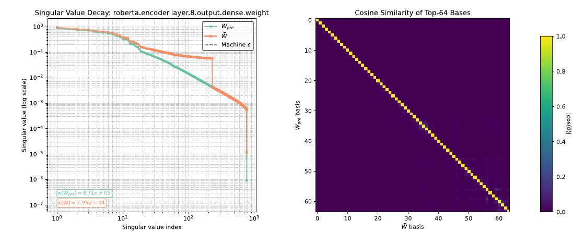

# ACE-Merging: Data-Free Model Merging with Adaptive Covariance Estimation

核对日期：2026-10-21。实验数值均为作者报告；本地完成原文阅读与讲解自检，未复现实验。

## 一句话总结

ACE-Merging从同基座模型的微调增量构造二阶代理，经异质性归一化、低秩结构先验和可选谱修正，在无需原训练样本的情况下合并多个专家。

## 研究背景与动机

平均专家权重会把冲突任务互相稀释。若知道各任务层输入的二阶统计，可以按该统计加权匹配专家输出；数据不可得时，作者尝试从参数增量推断其几何代理。[§1–3，PDF1–3]

“data-free”指合并阶段不直接读取原任务样本，不意味着专家训练不需要数据，也不等于能合并任意不同架构或独立初始化的模型。

## 方法总览

原论文 Fig.2，PDF第5页。仅裁切相关图示，保留图内科学标签，著作权属于原作者；用于本篇方法分析，不并入本站原创图授权。[来源与作者](https://openaccess.thecvf.com/content/CVPR2026/html/Xu_ACE-Merging_Data-Free_Model_Merging_with_Adaptive_Covariance_Estimation_CVPR_2026_paper.html) · [PDF](https://openaccess.thecvf.com/content/CVPR2026/papers/Xu_ACE-Merging_Data-Free_Model_Merging_with_Adaptive_Covariance_Estimation_CVPR_2026_paper.pdf)。点击可打开高清图。

本图展示作者的谱分析证据，非完整算法流程；具体合并步骤见下面的文字与公式。

各层从共同W0算ΔWt，按输出维去均值得到Wtilde，再构造列Gram矩阵。根据各任务增量能量的离散程度决定是否trace归一化；正则化后求闭式线性系统，添加跨任务低秩结构项。高异质层再做低秩SVD谱修正。[§4、Algorithm1，PDF3–6]

Gram矩阵是参数变化构造的代理，不能直接当成准确恢复的真实数据协方差；作者定义Exxᵀ实际上是未中心化输入二阶矩。

## 核心创新与关键设计

在线性层、平方误差和已知二阶矩Σt下，输出匹配有解：
\[\bar W=(\sum_t W_t\Sigma_t)(\sum_t\Sigma_t)^{-1}.\]
实际以\(\hat\Sigma_t\propto\widetilde W_t^\top\widetilde W_t\)替代，强异质时trace归一化再加ridge。[式2–10，PDF2–4]

Theorem1还依赖残差能量与输入方向近似解耦，才能从E[gᵀg]=4E[||e||²xxᵀ]得到与Exxᵀ成比例。累积梯度的Gram包含跨步交叉项，不能由单样本梯度关系直接证明全部微调位移精确恢复统计，正文把它作为实用代理更合适。[PDF3]

CSP按聚合矩阵平均行广播成1cᵀ，通常不是对称矩阵，不能不加说明当作普通对称半正定协方差正则项。[式11–14] 式14–19在增量与最终权重记号间未清晰说明何处加回W0，落地必须核对，不能据其返回值直接覆盖原模型。

异质分数使用log||ΔW||²的方差除以均值平方；零更新、均值接近零以及单位缩放均涉及数值稳定性。只说闭式解不等于无需稳定求解。

## 实验与关键结果

视觉CLIP-ViT B32/B16/L14，8/14/20任务；语言GPT2与RoBERTa的GLUE专家。阈值0.3、谱rank比例0.3；ridge按家族设GPT2 4e-2、RoBERTaBase2e-4、其他1e-5。[§5.1，PDF6]

| 作者报告 | 对照 | ACE |
| --- | --- | --- |
| ViT-B32 20任务平均准确率↑ | Iso-CTS78.1 | 78.8 |
| ViT-B16 8任务↑ | Iso-CTS91.1 | 90.6 |
| GPT2表列GLUE平均↑ | TSV-M70.2 | 74.1 |
| RoBERTaBase归一化平均↑ | WUDI85.3 | 90.4 |
| RoBERTaLarge归一化平均↑ | WUDI88.8 | 91.7 |

来源Table1–3，PDF7–8。GPT2平均只列7项，不含STS-B；相对TSV-M是3.9pp，不是正文称的“超过4pp”。RoBERTa列是相对各自专家归一化分数，不是91.7%原始准确率，不能和GPT2或视觉列直接混比。

## 消融实验与证据强度

RoBERTaLarge基本闭式80.05→自适应88.04→加CSP86.79→谱修正91.68；CSP单独在该序列中下降，并非每个模块都互补增益。GPT2为68.72→71.50→71.51→74.09。[Table4，PDF8]

ViTB16低于异质阈值，归一化与谱修正分支不触发：89.91→89.91→90.60→90.60。图中主方向保持不构成证明估计出了“正确”语义子空间；谱变平的数值变化也不能单独证明泛化。

## 局限与讨论

需要参数和层对应、共享基座与可比较的任务向量；不解决神经元排列或跨架构对齐。Gram、求逆/线性求解和SVD对宽层仍有成本，正文没有完整展示所有大模型运行时间和显存。

代理统计受优化器、学习率、微调时长和数据噪声共同影响。数据不访问有隐私优势，但模型合并并不自动消除已记忆的信息；也不能保证所有任务均优于专家。

## 复现提示

[作者代码](https://github.com/unravel-xu/ACE-Merging/tree/main)来自论文；本次未核验commit/许可证。建议 `experiments/model-merging/ace/` 固定共同W0与各专家哈希，只操作副本，逐层验证中心化轴、trace零值、CSP方向、ridge与加回基座的位置。

记录各任务原始指标及归一化定义，比较求解残差与峰值内存。本地未读取、合并或覆盖任何模型权重，表中结果全部作者报告。

## 相关工作与阅读顺序

先读Task Arithmetic与RegMean，再理解局部线性输出匹配的加权最小二乘解，最后看ACE的统计代理假设、Algorithm1及非单调消融。不要把“估计协方差”理解成无需假设地还原了训练数据。

## 来源与校验

- [CVF官方论文页](https://openaccess.thecvf.com/content/CVPR2026/html/Xu_ACE-Merging_Data-Free_Model_Merging_with_Adaptive_Covariance_Estimation_CVPR_2026_paper.html) · [所读PDF](https://openaccess.thecvf.com/content/CVPR2026/papers/Xu_ACE-Merging_Data-Free_Model_Merging_with_Adaptive_Covariance_Estimation_CVPR_2026_paper.pdf)。页码均为PDF页序。
- 所读版本：2026-10-21从CVF下载的开放接收稿；PDF SHA-256：`bf481c4898698189964d40ffb131f61010d75056966d4bba744cb32da87068a5`。
- 阅读范围：正文、方法公式、实验与消融；补充材料、代码及权重未逐项核验。reviewed表示本地讲解自检，不表示独立同行评审或实验复现。
- 关键公式/算法/表格页面已渲染核对，所引原图已单独检查；作者图示与本站原创素材权利分开记录。
