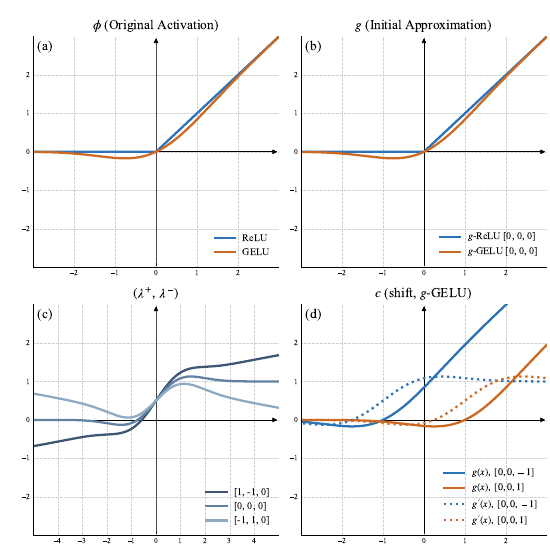
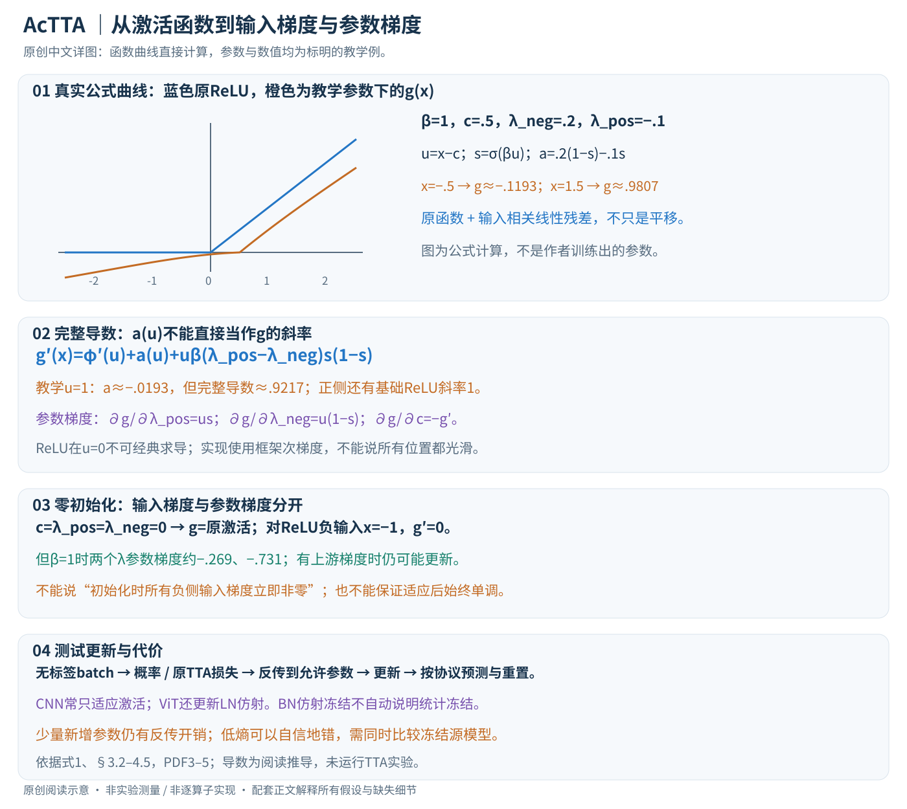

# AcTTA: Rethinking Test-Time Adaptation via Dynamic Activation

核对日期：2026-10-22。实验数值均为作者报告；本地完成原文阅读与讲解自检，未复现实验。

方法与配图详细版返工：2026-10-25。补充前向算例、完整导数、参数梯度和测试更新流程；未复现实验。

## 一句话总结

AcTTA在测试时调整激活函数的中心和两侧残差斜率，用少量新增参数配合已有适应损失改善部分分布偏移任务；它仍需梯度优化，而且小批次下并非总能优于原模型。（PDF第1–3、6页）

## 研究背景与动机

测试时适应常只更新归一化层的仿射参数，但偏移也会改变进入激活函数的特征分布。固定的ReLU或GELU门控可能把变化后的信息截断。作者于是把更新对象扩展到激活函数形状。这里“保持源权重”指基础参数可以冻结，不表示模型行为不变，也不表示无需训练；新增参数仍通过测试数据上的适应目标更新。（PDF第1–3页）

## 方法总览

原论文Fig.1，PDF第3页。仅裁切相关图示，保留图内科学标签；著作权属于原作者，用于本篇方法分析，不并入本站原创图授权。[来源与作者](https://openaccess.thecvf.com/content/CVPR2026/html/Kim_AcTTA_Rethinking_Test-Time_Adaptation_via_Dynamic_Activation_CVPR_2026_paper.html) · [PDF](https://openaccess.thecvf.com/content/CVPR2026/papers/Kim_AcTTA_Rethinking_Test-Time_Adaptation_via_Dynamic_Activation_CVPR_2026_paper.pdf)。点击可打开高清图。

### 它改变可更新参数，不另造一种测试损失

AcTTA把部分层的固定激活替换成可学习函数，再沿用TENT、ETA、SAR等方法的适应目标。在无标签测试batch上前向、计算适应损失、反传并更新允许的参数，之后产生预测或接续测试流。究竟先记预测再更新、还是更新后重新预测，以及跨batch/腐蚀是否重置，应遵循具体适应协议，不能只写一句“在线测试”就省略。（§3.3–4.1，PDF第3–4页）

输入形状不变，例如卷积特征B×C×H×W或Transformer特征B×P×D，激活逐元素输出同形特征。主文公式是标量形式，未完整列出c和lambda按层、通道还是其他维度共享的存储规格，因此新增参数量必须按实际广播规则计算，不能简单认定全网络只多三个标量。

原创曲线直接按文中函数计算，采用标明的教学参数，不是作者实验拟合结果；原Fig.1也已对照PDF第3页重审。

## 核心创新与关键设计

### 从中心平移到两侧残差：每个符号都影响前向

记u=x−c、s=σ(βu)，则式1等价于

\[
a(u)=\lambda_{neg}(1-s)+\lambda_{pos}s,\qquad
g(x)=\phi(u)+a(u)u.
\]

phi是原模型激活，如ReLU或GELU；c平移激活中心，lambda决定额外线性残差在两侧的系数，β控制sigmoid过渡宽度。β不是BatchNorm的偏置beta，两者同字母但角色不同；主文明确学习的三项是lambda_neg、lambda_pos、c，不能自行把β也加入优化器。（式1，PDF第3页）

全部三项零初始化时，c=0且a=0，前向严格恢复原phi。这里“兼容源模型”是初始化性质；适应后输出改变，不能说网络行为始终保持不变。β趋大时过渡更尖锐，但具体β选择及限制需实现核查。

教学令phi=ReLU、β=1、c=.5、lambda_neg=.2、lambda_pos=−.1。x=−.5时u=−1，s≈.269，a≈.1193，输出约−.1193；x=1.5时u=1，s≈.731，a≈−.0193，输出约.9807。负输入可产生非零输出，正侧也不是只能放大；这些数值来自公式而非实验结果。

### lambda不是完整导数：乘积法则不能省

对x求导，在phi可导处有

\[
g'(x)=\phi'(u)+a(u)+u\beta(\lambda_{pos}-\lambda_{neg})s(1-s).
\]

第三项来自a随输入变化，不能只把a当成最终斜率。ReLU正端在远离过渡时的总斜率约1+lambda_pos，负端约lambda_neg；“正侧斜率lambda_pos”的说法漏掉了基础ReLU贡献。ReLU在u=0处不可经典求导，实际反传用框架的次梯度约定；不能因正文称base differentiable而忽视这个点。

沿用上例，在u=1时，导数约1−.0193−.0590=.9217。它与a≈−.0193相差很大，说明残差系数不能直接当网络梯度。

### 零初始化时负侧输入梯度仍可为零，但参数梯度不同

由式1进一步得到

\[
\frac{\partial g}{\partial\lambda_{pos}}=us,\quad
\frac{\partial g}{\partial\lambda_{neg}}=u(1-s),\quad
\frac{\partial g}{\partial c}=-g'(x).
\]

最后一式假设其他参数固定、依赖c仅通过u；这些是对原式的阅读推导，不是作者额外提出的损失。

以ReLU、c=0、两lambda=0、x=−1、β=1为例，输入梯度g'为0，但两个lambda参数梯度分别约−.269与−.731，中心梯度为0。如果上游损失对g的梯度非零，lambda仍可能被更新，随后才改变负侧传递。不能把“新增参数可以学习”简写成“初始化立即在所有负输入处保留非零输入梯度”。

灵活性也不保证单调或稳定：无约束lambda可能使某些区间斜率为负，连续多个可适应层可能放大变化。本文实验展示某些设置可用更大学习率，不是任意参数、任意偏移下的数学保证。

### 一个测试batch怎样更新：以TENT为说明例

对无标签batch，模型输出类别概率p。TENT型目标可写平均预测熵 \(L=-B^{-1}\sum_i\sum_c p_{ic}\log p_{ic}\)。前向使用当前激活参数，反传将熵梯度沿g传到lambda与中心，优化器仅更新选定集合；不把测试真标签放进交叉熵。分类概率中的类别下标c与激活中心c只是重用符号，实际实现应分名。

低熵表示更自信，不表示更正确。假如偏移使模型对错误类别已有偏好，熵最小化可能把错误强化；AcTTA改变可适应函数族，不自动提供正确伪标签。ETA/SAR有不同筛样或稳定机制，应沿用其规则，不能把它们统称同一个熵优化实现。

完全source-free比较中，作者去掉EATA的Fisher正则，称为ETA；不能拿这组结果当完整EATA配置。优化器动量、样本筛选、源统计是否使用、重置时机均需复现记录。（§3.3–4.1）

### CNN与ViT的更新集合不同

WRN/BN实验倾向冻结BN仿射参数、只适应激活，并用约10倍学习率；ViT/LN更适合联合更新LN仿射和激活。冻结BN的gamma/beta并不等价于确认running mean/variance完全不变，BN训练模式和统计策略需要从对应TTA实现核验。原有主干权重冻结也不消除为了获得激活参数梯度而执行的反向计算。（Table2，PDF第4页）

层替换约50%是默认折中，不是所有模型最优：Table4中ViT25%更好，全部替换更差。应记录具体哪些层被替换，不能只给百分比却隐去早层/晚层位置。主文未提供完整模块路径清单，本讲解不猜模块名。

### 开销与失败边界

每个被替换激活新增减法、sigmoid和残差运算，反传还要保存相关中间状态。少量可训练参数减少优化器状态，却不保证峰值显存低：作者WRN28实验从4013MiB到6249MiB，增加约55.7%；112.83ms到164.51ms，增加约45.8%。这些是具体模型与batch的作者测量，不是每个平台固定比例。（Table8）

batch4的反例尤其重要：相对一个已经退化的TTA基线变好，仍可能比冻结源模型更差。评估必须同时看源模型、原TTA、加入AcTTA三组，并区分持续适应与每次重置。当前仅核对论文与公式算例，没有改动真实部署模型或运行适应实验。

## 实验与关键结果

作者在CIFAR10-C、CIFAR100-C与ImageNet-C的15类最高强度腐蚀上报告三种子结果。表5的常规批次结果如下，数值是错误率，越低越好。（PDF第5–6页）

| 模型与数据 | TENT | AcTTA+TENT |
|---|---:|---:|
| WRN28 / CIFAR10-C | 18.51 | 17.03 |
| WRN40 / CIFAR100-C | 35.25 | 33.81 |
| ResNet-BN / ImageNet-C | 66.50 | 64.95 |
| ResNet-GN / ImageNet-C | 69.60 | 66.84 |
| ViT / ImageNet-C | 53.85 | 51.79 |

但组合收益并不普遍：ViT上的SAR从53.90变为54.17，DeYO从47.73变为49.64。batch4时，CIFAR100-C的TENT为57.35，AcTTA后55.03，仍差于不适应源模型46.75；ViT上的SAR从71.81恶化至82.11，ETA+AcTTA为72.70，也差于源模型62.10。（表5–6，PDF第6页）

## 消融实验与证据强度

表2中WRN只更新激活并用10倍学习率为17.03，联合更新仿射与激活为18.06；ViT则联合更新52.37优于只激活且10倍学习率55.30。这说明架构和学习率交互重要，不能从这组数值单独分离“冻结BN”的因果贡献。（PDF第4–5页）

表4显示50%层替换是折中，而非处处最优：WRN40为34.05，全部替换44.97；ViT的25%替换51.40，50%为52.47。表8还报告代价：WRN28、batch128下TENT峰值4,013MiB、112.83ms，AcTTA为6,249MiB、164.51ms。相对TENT约增加56%显存与46%时间，不应把少量参数等同于免费适应。（PDF第5、7页）

## 局限与讨论

熵最小化仍可能强化错误预测；激活更灵活不自动解决类别不平衡、样本顺序或持续偏移造成的漂移。batch4的反例说明小样本稳定性需要逐个协议检验。表7的持续适应结果支持某些遗忘缓解，但没有给出所有原始源模型对照，不能据此声称恢复或超过原始干净集性能。测试流状态如何重置、哪些层适应与学习率选择，都可能影响结论。（PDF第5–7页）

## 复现提示

[作者项目页](https://hyeongyu-kim.github.io/actta/)为后续核查入口；本轮未审查代码commit、许可证或补充材料，未做适应实验。复现时必须记录腐蚀顺序、强度、batch大小、源检查点、激活替换层、优化器状态重置及是否允许源统计信息。应同时报告冻结源模型、原始适应方法及加入AcTTA三组，并统计错误率、耗时与峰值显存。只报告相对某个已崩溃适应基线的提升，会隐藏仍差于源模型的问题。（PDF第4–7页）

## 相关工作与阅读顺序

先理解TENT为何更新归一化仿射参数，再阅读ETA/SAR对可靠样本与稳定性的处理。随后用参数化激活函数的导数理解AcTTA的额外自由度，最后比较表5和表6，尤其关注对源模型的绝对退化。它的价值是一个可组合的参数选择方向，而不是一个独立解决所有测试时偏移的算法。（PDF第2–6页）

## 来源与校验

- [CVF官方论文页](https://openaccess.thecvf.com/content/CVPR2026/html/Kim_AcTTA_Rethinking_Test-Time_Adaptation_via_Dynamic_Activation_CVPR_2026_paper.html) · [所读PDF](https://openaccess.thecvf.com/content/CVPR2026/papers/Kim_AcTTA_Rethinking_Test-Time_Adaptation_via_Dynamic_Activation_CVPR_2026_paper.pdf)。页码均为PDF页序。
- 所读版本：2026-10-22从CVF下载的开放接收稿；PDF SHA-256：`efb5b1d244e829abe34f4488c25587e8214034671d42f7a73688d64d54910a48`。
- 阅读范围：正文、方法公式、实验与消融；补充材料、代码及权重未逐项核验。reviewed表示本地讲解自检，不表示独立同行评审或实验复现。
- 方法图与关键公式/表格已渲染核对，所引原图已单独检查；2026-10-25详细版已完成浏览器上下半图与正文检查，4个公式无错误、坏图或横向溢出；导数教学例通过有限差分核对。作者图示与本站原创素材权利分开记录。
