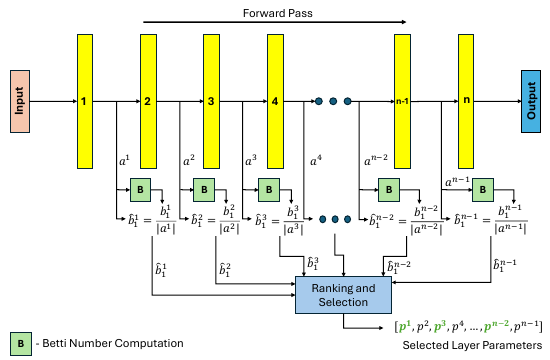

# AdaBet: Gradient-free Layer Selection for Efficient Training of Deep Neural Networks

核对日期：2026-10-22。实验数值均为作者报告；本地完成原文阅读与讲解自检，未复现实验。

## 一句话总结

AdaBet用前向激活的第一Betti数给层与通道排序，再仅微调被选部分，降低模型适应成本；无梯度、无标签指的是选择阶段，后续实验仍采用有监督梯度训练。（PDF第1–6页）

## 研究背景与动机

在资源受限设备上，先对全模型反向传播一遍才能选层，本身就可能触及显存上限。AdaBet希望用前向表示决定哪些层值得更新。作者认为激活空间中较复杂的环状结构提示表示仍需要调整，以此替代Fisher信息选择。不过“环多意味着更适合目标任务微调”主要是经验假设，不能等同于无需标签就能精确测出任务相关性。（PDF第2–4页）

## 方法总览

原论文Fig.4，PDF第5页。仅裁切相关图示，保留图内科学标签；著作权属于原作者，用于本篇方法分析，不并入本站原创图授权。[来源与作者](https://openaccess.thecvf.com/content/CVPR2026/html/Tenison_AdaBet_Gradient-free_Layer_Selection_for_Efficient_Training_of_Deep_Neural_CVPR_2026_paper.html) · [PDF](https://openaccess.thecvf.com/content/CVPR2026/papers/Tenison_AdaBet_Gradient-free_Layer_Selection_for_Efficient_Training_of_Deep_Neural_CVPR_2026_paper.pdf)。点击可打开高清图。

图4展示选择阶段：从本地样本收集可训练子层激活；使用Ripser计算一维拓扑特征；按激活规模归一化并排序；选取比例为ρ的层，必要时继续选取ρch比例的通道；最后使用目标任务损失训练这些参数。小batch时可累积多次前向的激活再统一计算拓扑，选择后恢复较小训练batch。ViT的Q/K/V及输出线性子层合并处理，非参数池化、reshape等不参与排名。（PDF第4–6页）

## 核心创新与关键设计

第一Betti数 \(b_1\)表示一维独立环的数量；持久同调则考察这些结构随尺度如何出现和消失。作者使用的代价感知分数为 \(\hat b_1^i=b_1^i/|a_i|\)，分母是该层激活元素数，不能误写成参数量或MAC数。ρ=0.1表示选10%的层，并不保证恰好10%的参数、显存或计算量。（PDF第3、5页）

激活规模只是资源代理，跨不同卷积核和网络结构并非精确成本。特征点云的距离、过滤尺度与持久特征计数规则也决定实际b1；正文将低b1联系到线性可分性应理解为解释性直觉，拓扑简单本身并不保证分类边界线性。冻结中间权重也未必能切断传向更早可训练层的梯度，因此实际节省依赖层的位置。（PDF第3–5、7页）

## 实验与关键结果

四个ImageNet预训练模型与Dogs、Pets、CUB、Flowers102组合成16组。使用224²输入、batch8、SGDW、weight decay 5×10⁻⁴，默认ρ=0.1、全部通道；正文实验在V100 16GB上，每组准确率平均三次运行。树莓派结果在附录，本轮未读。（PDF第6页）

| 表2的Top-1/% | 全量微调 | Last-K | AdaBet |
|---|---:|---:|---:|
| 16组合平均 | 71.79 | 73.75 | 76.26 |
| Dogs / ResNet50 | 70.87 | 72.80 | 75.52 |
| CUB / ResNet50 | 34.76 | 33.62 | 46.37 |
| CUB / ViT | 85.73 | 79.89 | 79.47 |
| Flowers102 / MobileNetV2 | 61.72 | 65.80 | 61.50 |

均值相对第二高基线提高2.51个百分点，但个别组合明显退步。引言与结论提“平均5%”，摘要及结果节强调2.5%；应以表2明确比较对象，不能混用这两个口径。（PDF第2、6–8页）

表3训练峰值：ResNet50为777.12→261.78MB，ViT386.60→93.64MB，MobileNetV2仅373.58→318.50MB，VGG16为988.77→932.45MB。约40%的平均节省不是每个模型都能达到；峰值还应分别比较选择和训练两阶段。（PDF第7页）

## 消融实验与证据强度

图6–7改变ρ和ρch，显示选层、选通道提供资源折中。作者报告ResNet50在ρ=0.1时相对全模型约省65%显存；通道实验在ρ=0.5、ρch=0.1时也报告大幅节省。曲线可以支持该配置的趋势，不能据图宣称任意任务缩到10%通道都不掉点。（PDF第8页）

选择耗时在ResNet50与ViT的Pets实验平均较ElasticTrainer快约45%，训练每epoch相对全量微调平均快约11%。这是两个阶段不同的比较；不是整个任务端到端都快45%。归一化、batch和累积规模的独立消融位于附录，未核查具体数值。（PDF第7–8页）

## 局限与讨论

拓扑计算在点数和激活维度增加时也有开销，累积激活并不免费；有限样本和尺度阈值可能改变排名。本文比较中Fisher选择不包含某些原方法的元训练，不能外推为完整TinyTrain系统均不如AdaBet。医学个性化只出现在动机，并没有临床实验。能耗、硬件延迟感知以及其他模态仍列作后续方向。（PDF第1、6–8页）

## 复现提示

[作者仓库](https://github.com/Nokia-Bell-Labs/efficient_layer_selection)待核查固定commit和许可证，本轮未执行。严格复现需记录激活采样、向量化方式、距离度量、过滤与持久特征阈值、累积样本数、可训练层分组、ρ/ρch以及每组学习率。资源报告应包含拓扑库的CPU内存、激活缓存和反向所需中间量，不能只统计可训练参数。本文没有运行训练、设备功耗测试或附录树莓派实验。（PDF第5–8页）

## 相关工作与阅读顺序

先理解选择性微调、Fisher信息选层和梯度流，再读持久同调与Betti数。对照ElasticTrainer看动态选择开销，对照TinyTrain时核实是否包含元训练。最后从表2的反例与表3的架构差异理解方法价值：它提供无反向的选择信号，而不是一个对所有模型一致有效的资源最优解。（PDF第2–8页）

## 来源与校验

- [CVF官方论文页](https://openaccess.thecvf.com/content/CVPR2026/html/Tenison_AdaBet_Gradient-free_Layer_Selection_for_Efficient_Training_of_Deep_Neural_CVPR_2026_paper.html) · [所读PDF](https://openaccess.thecvf.com/content/CVPR2026/papers/Tenison_AdaBet_Gradient-free_Layer_Selection_for_Efficient_Training_of_Deep_Neural_CVPR_2026_paper.pdf)。页码均为PDF页序。
- 所读版本：2026-10-22从CVF下载的开放接收稿；PDF SHA-256：`f51e215a52c8ff7ce3f0493ff1e682f57f32553658e35ad1ed75099a484f025b`。
- 阅读范围：正文、方法公式、实验与消融；补充材料、代码及权重未逐项核验。reviewed表示本地讲解自检，不表示独立同行评审或实验复现。
- 方法图与关键公式/表格已渲染核对，所引原图已单独检查；未对新文章进行浏览器交互验收。作者图示与本站原创素材权利分开记录。
