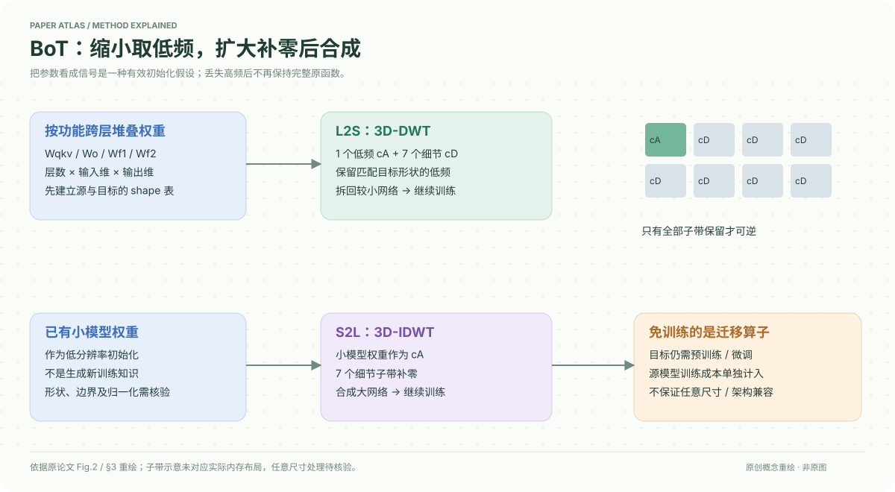

# A Unified Framework for Knowledge Transfer in Bidirectional Model Scaling

核对日期：2026-10-20。以下实验均为作者报告；本地完成原文阅读与讲解自检，未复现实验。

## 一句话总结

BoT把跨层权重堆成三维张量：缩小时保留小波低频子带，扩大时把小模型当低频、补零细节后逆变换，为目标模型提供无需学习映射的初始化。

## 研究背景与动机

小到大常用复制或训练映射，大到小常用选择权重；作者希望用同一算子连接两个方向。将权重视作多分辨率信号是方法假设，不是神经网络知识必定集中于低频的普遍定理。[§1–2，PDF1–2]

BoT免训练指迁移算子不需额外可学习参数，目标模型后续仍需预训练或微调；源模型也已消耗训练成本。

## 方法总览

同功能权重跨层堆叠为Wqkv、Wo、Wf1、Wf2等三维模块。L2S通过3D-DWT提取低频cA，初始化较小模块；S2L把源权重作为cA、七个细节子带置零，以3D-IDWT合成更大模块，再按目标架构拆回层。[Fig.2、§3，PDF3–4]

小波变换的可逆性要求保留全部子带；丢弃高频后的缩小与补零扩大并不保留完整原网络或其函数。

## 核心创新与关键设计

3D-DWT产生一个近似子带和七个细节子带：\((cA,\{cD_m\}_{m=1}^7)=DWT_{3D}(W)\)。两方向可写成
\[W_{small}\leftarrow cA(W_{large}),\qquad W_{large}\leftarrow IDWT_{3D}(W_{small},0,\ldots,0).\]
3个轴分别涉及层与线性矩阵输入/输出维，默认每轴下采样通常为2，递归层数改变尺度。[式1–4，PDF3–4]

“任意尺寸”需要谨慎：普通离散小波的层数与边界延拓不能自动精确匹配任意不同比例的三个维度。非2幂、不同宽深比例、QKV拼接边界、bias/LayerNorm/embedding的处理都需附录或代码确认，正文不能直接支持任意架构即插即用。

## 实验与关键结果

视觉用ImageNet-1K，6层DeiT-S与12层DeiT-B互转、150epoch；语言用BERT与GPT2的6/12层，语料包含英文Wikipedia，GPT另加BookCorpus。[§4，PDF5–7]

| 达到指定性能的FLOPs节省，作者报告 | L2S | S2L |
| --- | --- | --- |
| DeiT | 39.0% | 22.0% |
| BERT | 52.8% | 67.1% |
| GPT | 31.0% | 58.3% |

来源Fig.3–4与§4.2–4.4。Fig.3图注误写为22.0/67.1/58.3，实际曲线及正文为上表L2S口径，不能直接抄图注。节省率\(r=(\omega_{scratch}-\omega_{init})/\omega_{scratch}\)针对达到同一目标损失/准确率，不是完整生命周期成本。

直接微调BERT-S：WS与BoT的GLUE平均60.90→70.29、SQuAD平均21.28→48.25；这是无额外预训练设置。[Table3，PDF7] 进一步预训练后BERT-S GLUE75.59→75.71、SQuAD53.11→55.35（Scratch→BoT），收益明显缩小。[Table4，PDF8]

## 消融实验与证据强度

Fig.5比较不同小波：BERT L2S偏好Haar、S2L偏好bior6.8，GPT L2S偏好coif3、S2L偏好db2；正文连续两处写L2S，但图中第二行是S→B，此处按图行标签区分。[PDF7]

Table4中BERT-B BoT节省67.1% FLOPs、65.3% walltime，GLUE82.70；Scratch81.21。不过SQuAD平均61.61低于bert2BERT61.82，且部分单任务下降，不能写所有下游指标都优胜。图示与消融支持初始化有效，不充分证明提取了与坐标排列无关的“知识基因”。

## 局限与讨论

神经元置换后网络函数可等价，但邻接权重频谱会变化，小波低频的语义依赖参数排列；正文未充分解决这个不变性问题。源模型预训练开销是否可摊销对实际节省很关键。范围集中于同族Transformer，不能据此承诺跨任意架构保性能。

有限实验与曲线不构成函数保持证明；小波家族、边界规则和维度处理影响数值尺度及训练稳定性。

## 复现提示

建议 `models/bot-scaling/`，先保存源checkpoint哈希与目标逐层shape表，在临时副本做变换。必须记录wavelet、axis、level、boundary mode、系数归一化、拆分规则及未迁移参数。比较同目标训练曲线并单列源成本、初始化成本和后续训练成本。

正文和本次所读材料未核验可执行代码commit、许可证或权重，未在本地改写任何模型；结果全部作者报告。

## 相关工作与阅读顺序

先读DWT/IDWT的子带与边界，再读Weight Selection、bert2BERT、LiGO/Mango，最后区分Table3直接微调与Table4再预训练。BoT适合作为初始化研究阅读，不是免训练压缩后立即部署的说明书。

## 来源与校验

- [CVF 官方论文页](https://openaccess.thecvf.com/content/CVPR2026/html/Shen_A_Unified_Framework_for_Knowledge_Transfer_in_Bidirectional_Model_Scaling_CVPR_2026_paper.html) · [所读 PDF](https://openaccess.thecvf.com/content/CVPR2026/papers/Shen_A_Unified_Framework_for_Knowledge_Transfer_in_Bidirectional_Model_Scaling_CVPR_2026_paper.pdf)。页码均为该 PDF 的页序。
- 阅读范围：正文、公式与实验表；补充材料、上游代码与权重未逐项核验。许可证和固定代码 commit 尚未确认，不复制原文全文或数据。
- PDF SHA-256：`c875d3be8bec34c6301b82b1bab0f8438f3a551fc09a491ee48d20284c4ca297`；版本为本次下载的 CVF 接收稿，核对日期 2026-10-20。
- 视觉核对：原PDF第7页已渲染检查，核对关键图表及公式排版。原创方法图为概念重绘，细节以原文为准。
