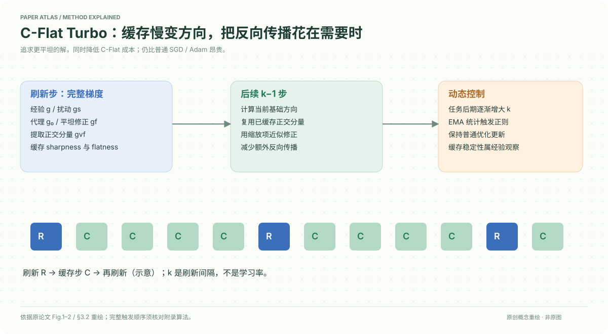

# A Faster Path to Continual Learning

核对日期：2026-10-20。以下实验均为作者报告；本地完成原文阅读与讲解自检，未复现实验。

## 一句话总结

C-Flat Turbo缓存变化较慢的平坦性修正方向，并按任务阶段和梯度统计减少完整更新次数，在保留持续学习正则收益的同时降低C-Flat开销。

## 研究背景与动机

持续学习需要学习新任务又不遗忘旧知识。寻找低损失、平坦区域可减轻遗忘，但C-Flat每步在普通梯度外还要额外三次梯度计算。作者观察到用于平坦性修正的正交分量比原梯度变化慢，因此不必每步重算。[§1、3，PDF1–5]

这是一种优化器近似与调度改造，不是新的记忆回放库或无需训练的持续学习模型。

## 方法总览

完整步骤计算经验梯度、SAM扰动梯度与代理点的平坦性梯度，提取并缓存正交分量；接下来k−1步沿当前梯度结合缓存方向作近似更新。随着任务推进增大刷新间隔，再用在线梯度统计触发正则。[Fig.1–2、§3.2，PDF3–5]

## 核心创新与关键设计

C-Flat目标由经验损失、零阶sharpness与一阶flatness组成：
\[L(\theta)+R_\rho^0(\theta)+\lambda R_\rho^1(\theta).\]
后两项在扰动邻域寻找低损失与较小梯度范数，代价是额外反向传播。记代理点梯度g₀、平坦性修正g_f，关键缓存为
\[g_{vf}=g_f-\frac{\langle g_f,g_0\rangle}{\|g_0\|^2}g_0.\]
它与当前代理梯度正交；“方向不变”是所测训练中变化较慢的经验描述，非对任意任务严格不变。[式1–7]

阶段调度k_t=k₀+10t/N，后期更少刷新。自适应触发用EMA估计\(\|g_0\|^2\)的均值和离散量，衰减0.9；式9超过阈值才应用flatness正则。正文σ记号的更新像方差、阈值却直接相加，具体单位与实现应对照附录算法，不擅自替换为标准差。[式8–9，PDF5]

收敛分析主要约束缓存代理步引入的近似误差，证明在附录A.9，本次未读证明，不宣称独立验证。

## 实验与关键结果

CIFAR100、CUB200、ImageNet-R和ObjectNet；类别顺序种子1993，PTM为ViT-B/16-IN1K，单RTX3090。Avg为阶段平均精度，Last为最终阶段精度，Img/s为训练吞吐，三者不可互换。[§4，PDF6–8]

| Table3动态类别顺序 | Avg↑ | Last↑ | Img/s↑ |
| --- | --- | --- | --- |
| EASE普通优化 | 91.16 | 87.49 | 166.67 |
| EASE+C-Flat | 91.60 | 87.69 | 44.25 |
| EASE+Turbo | 91.75 | 87.74 | 102.74 |
| L2P+C-Flat | 88.62 | 84.04 | 28.63 |
| L2P+Turbo | 89.57 | 84.48 | 65.50 |

Turbo吞吐约为C-Flat的2.3倍，但仍慢于普通优化。正文摘要写1.0–1.25×，§4.2及表格又呈现约2×，存在口径/版本不一致，本笔记按表格明确条件，不统一夸张成一个速度数。[PDF1、6、8]

## 消融实验与证据强度

β与k的敏感性在EASE/CIFAR100上测试，ρ=0.05、λ=0.2，β≈0.8较好，k=2与5在β0.4–1.0区间精度接近。线性调度相较固定k进一步节省计算，但不同方法模型扩展成本不同，不能保证固定加速比。[§4.5–4.6，PDF7–8]

从头训练的MEMO/ResNet18最终精度：普通29.19、C-Flat30.76、Turbo32.24，说明增益相对普通为3.05点，相对C-Flat为1.48点。PTM表1中L2P/CUB的Turbo Last61.97低于C-Flat62.11，并非全部组合精度都上升。

## 局限与讨论

仍需估计平坦性分量，开销高于SGD/Adam。缓存可能在分布突变时过时，后期任务梯度稳定是经验趋势；评价集中于类别增量学习，VLM与强化学习推广尚待验证。[Limitations，PDF8]

摘要与表格速度口径不一致、σ统计量定义及完整缓存伪代码需附录/源码核对。本地未训练任何模型。

## 复现提示

先复现相同骨干与类别顺序的普通优化、C-Flat、固定间隔Turbo，再加调度与触发，分别记录反向次数、训练Img/s、总训练时间、Avg/Last和遗忘指标。不得将任务间隔k误作学习率。

建议 `data/continual-learning/`；保存类别顺序与缓存刷新日志。原文提及PILOT，具体上游代码版本、许可和附录训练超参数本次未核验，不能给出已验证复现命令。

## 相关工作与阅读顺序

先理解SAM在扰动点计算梯度，再看GAM/C-Flat为何需要代理点，随后读LookSAM的缓存思想。最后用本论文Fig.2与Table3连接缓存机制、吞吐和精度，而非把“Turbo”理解为免费加速。

## 来源与校验

- [CVF 官方论文页](https://openaccess.thecvf.com/content/CVPR2026/html/Li_A_Faster_Path_to_Continual_Learning_CVPR_2026_paper.html) · [所读 PDF](https://openaccess.thecvf.com/content/CVPR2026/papers/Li_A_Faster_Path_to_Continual_Learning_CVPR_2026_paper.pdf)。页码均为该 PDF 的页序。
- 阅读范围：正文、公式与实验表；补充材料、上游代码与权重未逐项核验。许可证和固定代码 commit 尚未确认，不复制原文全文或数据。
- PDF SHA-256：`ab107c4983873d5ed653ca6dfb797716b003b556b364fbeba0b32a80f0c2187d`；版本为本次下载的 CVF 接收稿，核对日期 2026-10-20。

- 视觉核对：已渲染查看 PDF 第8页，检查关键实验表、公式或局限；正文读到结论，独立补充材料未读。
