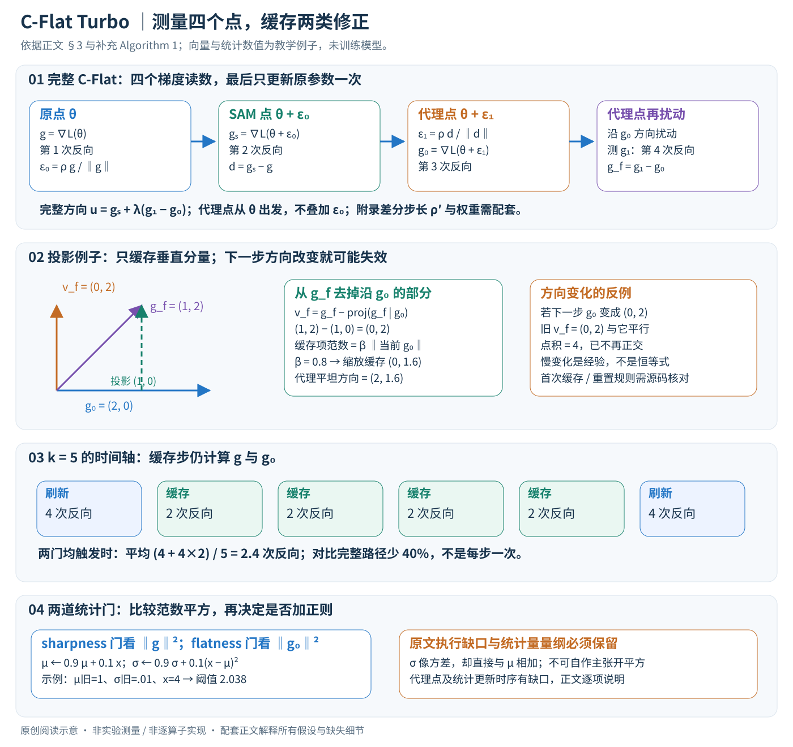

# A Faster Path to Continual Learning

核对日期：2026-10-30。以下实验均为作者报告；本地完成原文阅读与讲解自检，未复现实验。

## 一句话总结

C-Flat Turbo缓存变化较慢的平坦性修正方向，并按任务阶段和梯度统计减少完整更新次数，在保留持续学习正则收益的同时降低C-Flat开销。

## 研究背景与动机

持续学习需要学习新任务又不遗忘旧知识。寻找低损失、平坦区域可减轻遗忘，但C-Flat每步在普通梯度外还要额外三次梯度计算。作者观察到用于平坦性修正的正交分量比原梯度变化慢，因此不必每步重算。[§1、3，PDF1–5]

这是一种优化器近似与调度改造，不是新的记忆回放库或无需训练的持续学习模型。

## 方法总览

下面先走通完整 C-Flat，再解释 Turbo 删掉哪些计算。图中的二维向量是教学例子；训练中所有向量都覆盖当前可训练参数。旧稿将代理步概括为“当前梯度加缓存”过于粗略：附录 Algorithm 1 的代理点梯度仍逐步计算，缓存也分 sharpness 与 flatness 两条。以下按正文与新核对的官方补充材料分别说明。[正文 §3，PDF3–5；补充 A.1–A.2、A.10，PDF1、5]

## 核心创新与关键设计

### 1. 任务、变量与真正被更新的对象

第 T 个持续学习阶段接收当前数据集及底层 CL 方法允许的旧样本；一个 minibatch 为图像与类别标注。模型输出类别分数，原方法定义可微经验损失 L。Turbo 接收损失的梯度并输出参数更新方向；它不更改类别标签，也不自行决定记忆回放策略。

| 符号 | 形状与含义 |
| --- | --- |
| \(\theta\) | 展平为 \(\mathbb R^P\) 的当前可训练参数；原实现可保留多块张量 |
| \(g,g_s,g_0,g_1,g_f,v_s,v_f\) | 都为 P 维梯度或修正向量，绝非模型特征维度 |
| \(\epsilon_0,\epsilon_1\) | P 维临时参数扰动，使用参数空间 ℓ₂ 范数 |
| \(\rho,\rho'\) | 邻域半径与附录有限差分步长；二者含义不同 |
| \(\eta,\lambda,\beta\) | 学习率、flatness 权重、缓存方向缩放系数 |
| \(k,j,t,N\) | 刷新间隔、阶段内迭代、任务阶段编号、任务总数 |

哪些骨干层冻结由 L2P、EASE 等底层方法决定，Turbo 不要求全部模型权重更新。扰动仅用于梯度测量，最终对原参数执行一次优化；推理直接使用训练好的底层模型，不需要缓存梯度或多次扰动前向。[正文 §3.1、§4.1；补充 A.1]

### 2. 从损失目标理解四个测量点

完整目标是
\[
F(\theta)=L(\theta)+R^0_\rho(\theta)+\lambda R^1_\rho(\theta),\quad
R^0_\rho=\max_{\|\epsilon\|\leq\rho}L(\theta+\epsilon)-L(\theta),\quad
R^1_\rho=\rho\max_{\|\epsilon\|\leq\rho}\|\nabla L(\theta+\epsilon)\|.
\]

零阶项检查附近损失是否陡升，一阶项约束附近梯度的大小。邻域小且损失足够平滑时，梯度变化与 Hessian 有关；“降低该项”不能无条件等同于把所有 Hessian 特征值变小，更不能单凭平坦性保证旧任务不遗忘。

一次完整更新在**同一当前 minibatch 的损失**上依次取四个梯度，以下使用正文式4–5的半径写法：

1. 原点计算 \(g=\nabla L(\theta)\)，确定本批降低损失的方向。
2. 取 \(\epsilon_0=\rho g/\|g\|\)，在 SAM 点计算 \(g_s=\nabla L(\theta+\epsilon_0)\)。因为 \(L+R^0\) 已合成邻域最坏损失，其更新方向为 \(g_s\)，不能再额外加一次 g。
3. 令 \(d=g_s-g\)，取 \(\epsilon_1=\rho d/\|d\|\)。这是朝梯度范数增大方向的近似；代理参数 \(\theta_p=\theta+\epsilon_1\) 从原点出发，不把 \(\epsilon_0\) 再叠上去。在此计算 \(g_0=\nabla L(\theta_p)\)。
4. 在代理点继续测量 \(g_1=\nabla L(\theta_p+\rho g_0/\|g_0\|)\)，构造 \(g_f=g_1-g_0\)，方向为 \(u=g_s+\lambda g_f\)。恢复原参数后，以 SGD 写法为 \(\theta\leftarrow\theta-\eta u\)。若底层用 Adam，则 u 进入其动量与二阶矩状态，不能直接称为同一个 SGD 位移。

每次梯度需要相应前向和反向，因此完整路径为四次反向，比普通优化多三次；四个点不是四次正式参数更新。[正文式1–5、Fig.1，PDF3；补充 A.1、Algorithm 1]

### 3. 为什么两个梯度之差能代替二阶计算

作为阅读补充，令 \(H_p=\nabla^2L(\theta_p)\)，非零 \(g_0\) 时有
\[
\nabla\|\nabla L(\theta_p)\|=H_p\frac{g_0}{\|g_0\|},\quad
\nabla L(\theta_p+\rho'\hat g_0)-g_0\approx\rho'H_p\hat g_0,
\quad \hat g_0=g_0/\|g_0\|.
\]

于是 \(\nabla R^1\approx(\rho/\rho')(g_1-g_0)\)。附录 A.2 明确写 \(\rho'\ll\rho\)，将常数 \(\rho/\rho'\) 吸收到 λ；正文则为简写使用 ρ 扰动及无系数差分。复现时必须统一“差分步长—权重”的约定，不能一边改小步长一边沿用未重标定的 λ。附录推导忽略最优扰动随 θ 的导数，使用局部 Taylor 与差分近似，不是精确求解邻域最大值。[补充式10–15，PDF1]

这也解释了为什么不用显式 P×P Hessian：额外反向和 P 维向量操作取代矩阵存储。所有归一化在梯度接近零时需数值保护；论文算法未说明具体 eps、跳过规则及自动混合精度处理，本文不补造作者实现。

### 4. 缓存的是正交分量，下一步不会自动继续正交

从最新测得的 SAM 与 proxy 梯度提取
\[
v_s=g_s-\frac{\langle g_s,g\rangle}{\|g\|^2}g,\qquad
v_f=g_f-\frac{\langle g_f,g_0\rangle}{\|g_0\|^2}g_0.
\]

投影相减得到 \(\langle v_s,g\rangle=0\)、\(\langle v_f,g_0\rangle=0\)。第一条相对经验梯度，第二条相对**代理梯度**，不能互换。作者观察这两类修正随训练变化较慢，尤其 v_f；这是缓存的经验依据，“direction-invariant”不意味着数学上永不变化。[正文式6–7、Fig.3–4，PDF4–5]

到非刷新步，当前 g 与 g₀ 已改变。用旧缓存构造
\[
\tilde g_s=g+\beta\frac{\|g\|}{\|v_s^{cache}\|}v_s^{cache},\qquad
\tilde g_f=g_0+\beta\frac{\|g_0\|}{\|v_f^{cache}\|}v_f^{cache}.
\]

缩放使缓存项的范数等于 β 倍当前参照梯度范数，而不是直接复制旧修正大小。附录 Algorithm 1 第22行确实将“g₀ 加缩放缓存”整体命名为 g_f，因此它与刷新步 \(g_1-g_0\) 的定义存在近似差别；本文保留这一写法，不擅自删去 g₀。旧缓存也没有在新参照方向上重新投影的明确步骤，因此不能保证下一步仍正交。

正文说缓存方向、附录 A.9 证明又用 EMA 状态建模，但 Algorithm 1 只写 cache，没有给方向 EMA 的系数和递推。下节 δ=0.9 是梯度**标量统计**的衰减，不能擅自用于向量缓存。

### 5. 两道触发、阶段调度与一次真实执行顺序

正文给 proxy 梯度范数平方 \(x_j=\|g_{0,j}\|^2\) 的统计：
\[
\mu_{f,j}=0.9\mu_{f,j-1}+0.1x_j,\qquad
\sigma_{f,j}=0.9\sigma_{f,j-1}+0.1(x_j-\mu_{f,j})^2.
\]

在 \(x_j>\mu_{f,j}+\sigma_{f,j}\) 时触发 flatness；附录算法使用 ≥，sharpness 另有针对 \(\|g\|^2\) 的统计与门。σ 更新的量纲像方差而阈值直接与均值相加，不等于标准“均值加一倍标准差”，不能自行开平方纠正文献。[正文式8–9；补充 Algorithm 1]

按附录伪代码，当前 g 总要计算，先决定 sharpness 分支；该分支触发且 \(j\bmod k=0\) 时计算 g_s 并刷新 v_s，否则使用缓存构造 \(\tilde g_s\)；未触发则 u=g。随后**仍计算代理参数和 g₀**，再由 flatness 门决定是否添加 λg_f：刷新步测 g₁并缓存 v_f，普通代理步用上一节式子。最后仅更新一次原 θ。

但 Algorithm 1 有几处不能按纸面无歧义执行：第4行在当步 g₀ 计算前更新其统计，未声明用上一步值还是挪动顺序；若 sharpness 门关闭，后续依赖 g_s−g 的代理点如何取得没有交代；j 从1开始且 k>1 时会先用缓存，但首次缓存如何建立未写；非整数 k 如何取整、任务边界是否重置缓存也未写。完整教学说明必须保留这些缺口，不能把自己补齐的伪代码叫作者代码。

阶段调度为 \(k_t=k_0+10t/N\)。例如以 k₀=5、N=10、t=0/5/10 解释会得5/10/15；这是代数示意，实际阶段从0还是1编号及取整需核实。k 增大拉长缓存年龄，不是改变学习率。统计触发、周期刷新、任务阶段是三种不同时间尺度。

### 6. 二维贯穿例子：投影、归一化与缓存过时

仅为验证公式，设一次测量 \(g=(3,0),g_s=(3,1),g_0=(2,0),g_1=(3,2)\)，所有值是构造的梯度读数，不声称来自同一真实损失。取 β=0.8、λ=0.2：

- SAM 修正 \(g_s-g=(0,1)\)；其正交缓存 \(v_s=(0,1)\)。
- \(g_f=(1,2)\)，沿 g₀ 的投影为 (1,0)，故 \(v_f=(0,2)\)，点积确为0。
- 非刷新步若参照值恰好不变，\(\tilde g_s=(3,2.4)\)、\(\tilde g_f=(2,1.6)\)，合成 \(\tilde u=(3.4,2.72)\)。真正完整方向则为 \(u=(3.2,1.4)\)。缓存机制只是近似，两个方向无需相等。
- 若随后 \(g_0=(0,2)\)，旧 \(v_f=(0,2)\) 与它反而平行，点积4；“上一步正交”不能证明当前仍有效。突变任务或大步更新尤其需要监控缓存年龄。

另以标量门例子：上一均值1、上一 σ=0.01、当前 x=4，则新均值1.3、新 σ=0.738、阈值2.038，当前会触发。其数值仅演示论文的更新顺序，未消除上述算法中统计更新时间的缺口。

### 7. 能省多少：按附录反向次数算，而非宣传倍数

如果两道门均触发，刷新步4次反向；缓存步仍有 g 与 g₀两次，省掉 g_s 与 g₁。固定间隔 k、忽略门关闭和任务边界时，平均反向次数为
\[
\frac{4+2(k-1)}{k}=2+\frac2k.
\]

k=5 对应2.4次，相比完整4次约少40%，理想反向主导加速仅4/2.4≈1.67倍；它不是每步1次、也不是5倍。触发门能进一步改变成本，但 proxy 步按伪代码仍存在；实际吞吐还受模型扩展、数据读取、优化器及实现影响，不能用这条算式反推实验表错误。缓存至少增加两份 P 维向量，float32 共8P字节；其他梯度与优化器状态另计，未测峰值显存。[补充 Algorithm 1]

### 8. 收敛结论成立的条件

本次补读 A.9：作者把代理方向写为真实 C-Flat 梯度 G 加确定偏差 b 与零均值噪声 ξ，并假设平滑性、梯度与噪声有界、学习率与扰动按 \(1/\sqrt j\) 缩减，以及缓存跟踪偏差满足加权界。其平均梯度范数平方上界含常数残差；只有更强的偏差衰减 \(\Delta_j=O(1/\sqrt j)\) 才给出 \(O((1+\log J)/\sqrt J)\) 到零的界。方向变化较慢的实验图不能单独证明这些假设，对一般任务也没有无条件收敛或精度不降的保证。[补充式17–31、Theorem 1，PDF3–5]

## 实验与关键结果

CIFAR100、CUB200、ImageNet-R和ObjectNet；类别顺序种子1993，PTM为ViT-B/16-IN1K，单RTX3090。Avg为阶段平均精度，Last为最终阶段精度，Img/s为训练吞吐，三者不可互换。[§4，PDF6–8]

| Table3动态类别顺序 | Avg↑ | Last↑ | Img/s↑ |
| --- | --- | --- | --- |
| EASE普通优化 | 91.16 | 87.49 | 166.67 |
| EASE+C-Flat | 91.60 | 87.69 | 44.25 |
| EASE+Turbo | 91.75 | 87.74 | 102.74 |
| L2P+C-Flat | 88.62 | 84.04 | 28.63 |
| L2P+Turbo | 89.57 | 84.48 | 65.50 |

Turbo吞吐约为C-Flat的2.3倍，但仍慢于普通优化。正文摘要写1.0–1.25×，§4.2及表格又呈现约2×，存在口径/版本不一致，本笔记按表格明确条件，不统一夸张成一个速度数。[PDF1、6、8]

## 消融实验与证据强度

β与k的敏感性在EASE/CIFAR100上测试，ρ=0.05、λ=0.2，β≈0.8较好，k=2与5在β0.4–1.0区间精度接近。线性调度相较固定k进一步节省计算，但不同方法模型扩展成本不同，不能保证固定加速比。[§4.5–4.6，PDF7–8]

从头训练的MEMO/ResNet18最终精度：普通29.19、C-Flat30.76、Turbo32.24，说明增益相对普通为3.05点，相对C-Flat为1.48点。PTM表1中L2P/CUB的Turbo Last61.97低于C-Flat62.11，并非全部组合精度都上升。

## 局限与讨论

仍需估计平坦性分量，开销高于SGD/Adam。缓存可能在分布突变时过时，后期任务梯度稳定是经验趋势；评价集中于类别增量学习，VLM与强化学习推广尚待验证。[Limitations，PDF8]

摘要与表格速度口径不一致；本次已核对官方附录，σ统计量量纲、首次缓存、关闭 sharpness 后的代理点、EMA 更新时间仍需源码核对。本地未训练任何模型。

## 复现提示

先复现相同骨干与类别顺序的普通优化、C-Flat、固定间隔Turbo，再加调度与触发，分别记录反向次数、训练Img/s、总训练时间、Avg/Last和遗忘指标。不得将任务间隔k误作学习率。

建议 `data/continual-learning/`；保存类别顺序与缓存刷新日志。原文提及PILOT，本次补读官方附录A.1–A.3和A.9–A.10，具体上游代码版本与许可未核验，不能给出已验证复现命令。

## 相关工作与阅读顺序

先理解SAM在扰动点计算梯度，再看GAM/C-Flat为何需要代理点，随后读LookSAM的缓存思想。最后用本论文Fig.2与Table3连接缓存机制、吞吐和精度，而非把“Turbo”理解为免费加速。

## 来源与校验

- [CVF 官方论文页](https://openaccess.thecvf.com/content/CVPR2026/html/Li_A_Faster_Path_to_Continual_Learning_CVPR_2026_paper.html) · [所读 PDF](https://openaccess.thecvf.com/content/CVPR2026/papers/Li_A_Faster_Path_to_Continual_Learning_CVPR_2026_paper.pdf)。页码均为该 PDF 的页序。
- 阅读范围：正文方法重读与既往实验表；本次补读官方补充A.1–A.3、A.9–A.10，A.9条件与结论核对，未独立验证全部收敛证明；上游代码与权重未核验。许可证和固定代码 commit 尚未确认，不复制原文全文或数据。
- PDF SHA-256：`ab107c4983873d5ed653ca6dfb797716b003b556b364fbeba0b32a80f0c2187d`；版本为本次下载的 CVF 接收稿，核对日期 2026-10-20。

- 视觉核对：已渲染查看 PDF 第8页，检查关键实验表、公式或局限；正文读到结论，独立补充材料未读。

- [本次所读官方补充材料](https://openaccess.thecvf.com/content/CVPR2026/supplemental/Li_A_Faster_Path_CVPR_2026_supplemental.pdf)：SHA-256 `a5002b956bf5463edf38b7a667b7134d3e5d2daf59640fe43f9a1de37b4f2edf`，核对日期2026-10-30。正文方法页3、5与补充算法页5已渲染逐项查看。

- 方法与配图v2联合自检：2026-10-30，投影/缩放、EMA示例与反向次数独立数值核对；Chrome无头浏览器整图截图逐项查看，正文55个公式渲染且0个KaTeX错误；静态阅读验证，不代表训练复现。
