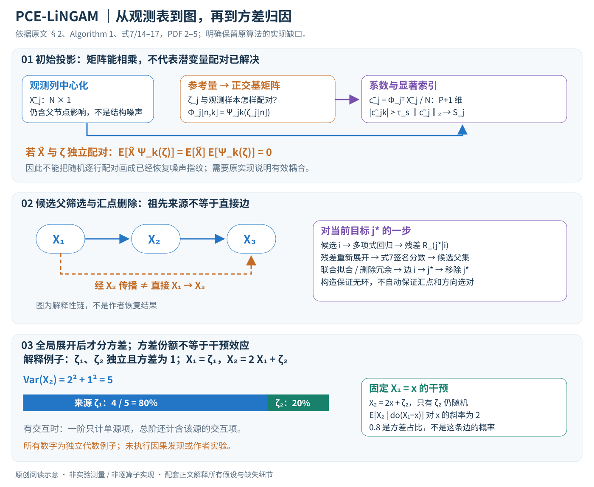

# A Polynomial Chaos Framework for Causal Discovery in Nonlinear Uncertain Systems

核对日期：2026-10-20。以下实验均为作者报告；本地完成原文阅读与讲解自检，未复现实验。

方法与配图详细版返工：2026-10-23。重读§2及Algorithm 1，核对公式与伪代码；补充逐步计算、形状、统计条件和实现缺口，未复现。

## 一句话总结

PCE-LiNGAM尝试把非高斯噪声写成正交多项式展开，用系数“指纹”寻找因果图，再做方差归因；正文提出若干保证，但关键假设与可实现细节仍需独立核验。

## 研究背景与动机

工业传感器含非线性、长尾、漂移和离群点，简单线性或高斯噪声模型可能失配。多项式混沌展开可表达随机变量并追踪方差传播，作者希望把它用于逆向识别因果结构。[§1–2，PDF1–3]

这里的chaos是随机正交展开术语，不是确定性混沌系统的同义词；从观测数据恢复因果仍需要强结构假设。

## 方法总览

### 先分开三个问题：找图、拟合机制、解释方差

输入是一张观测表 \(X\in\mathbb R^{N\times d}\)：行是样本，列是变量。作者希望仅凭这张表，输出有向无环图 \(\hat G\)、各节点对父变量的函数关系，以及外生噪声的多项式展开系数。最后再利用拟合的代理模型计算方差来自哪些噪声源。它不是输入因果图后做预测的普通回归，也没有把时间戳、干预记录或已知真图当作推断输入。（§2.1–2.4，PDF第2–5页）

必须把这三个输出的证据强度分开：预测关系拟合好，不等于方向已经可识别；图方向选定，也不等于其方差占比就是干预效应。本文的核心尝试是用同一套多项式基连接三个问题，而不是用一个标准回归器直接解决全部因果问题。

原创阅读示意依据§2、Algorithm 1与式7、14–17，PDF第2–5页。上半部对应作者的计算路线；中部标出从观测样本到潜变量基样本尚需说明的接口；底部的线性模型与数值为本笔记的代数例子，不是作者实验或已恢复的真实因果图。

| 符号 | 角色与维度 | 能否直接观测 |
|---|---|---|
| \(X_{:,j}\in\mathbb R^N\) | 第j个测量变量的全部样本 | 是 |
| \(Pa(j),f_j\) | 直接父节点集合及结构函数 | 否，需要推断 |
| \(\epsilon_j\) | 第j个节点自身的外生随机性 | 否，拟合父节点后才得到残差估计 |
| \(\zeta_j\in\mathbb R^{m_j}\) | 用来参数化噪声的标准化参考随机变量 | 潜变量；不在输入观测表中 |
| \(\Psi_{jk},c_{jk}\) | 正交归一基与其展开系数 | 基需选择，系数需估计 |
| \(\tilde c_j\in\mathbb R^{P+1}\) | 把中心化观测直接展开得到的初始系数 | 与最终结构残差的系数不是同一个量 |
| \(S_j\subseteq\{1,\ldots,P\}\) | 系数向量中相对显著的索引 | 从初始展开及阈值计算 |
| \(D_{j,\alpha}\) | 节点j对多个独立噪声源的全局展开系数 | 图、函数及噪声表示确定后再计算 |

原文用P统一表示截断索引上限，含常数项时有P+1个系数；多维展开的总次数p、交互阶数q在后文另行出现，不应把它们混成同一数字。

### 第一步：把结构机制和噪声分别表示

结构方程为

\[X_j=f_j(X_{Pa(j)})+\epsilon_j,\qquad
\epsilon_j=\sum_{k=0}^{P}c_{jk}\Psi_{jk}(\zeta_j).\]

左边是测量，第一项是父变量解释的系统部分，第二项是这个节点新引入的随机性。\(f_j\)可以非线性，但噪声仍以**加性**方式进入；“可处理非线性”不能读成已经覆盖任意带隐藏混杂、反馈环或任意异方差的生成过程。各节点外生噪声相互独立、图无环，是后续推理的基础。（式1–3，PDF第2–3页）

PCE的意思不是把原观测X随便做高次幂，而是把随机量写到一个指定概率测度下的正交基中。如果参考量是标准高斯，可考虑归一化Hermite基；若参考量均匀分布，可考虑归一化Legendre基。关键条件是

\[\mathbb E[\Psi_{jk}(\zeta_j)\Psi_{j\ell}(\zeta_j)]
=\mathbf 1[k=\ell],\quad \Psi_{j0}=1.\]

由此常数系数代表均值，非恒定系数的平方和表示所保留展开的方差。这一步依赖有限二阶矩、基的归一化和展开近似。仅说“用Hermite”而没给归一化，就不能直接套用平方和公式；无限方差噪声也不能无条件使用该二阶解释。

**解释例子。** 设\(\zeta\sim\mathcal N(0,1)\)，取\(\Psi_0=1,\Psi_1=\zeta,\Psi_2=(\zeta^2-1)/\sqrt2\)。若噪声为\(\epsilon=2\Psi_1+0.5\Psi_2\)，则均值0、方差\(4+0.25=4.25\)。一次项和二次项是“这种随机量由哪些正交成分组成”，不是“两条因果边”。这是本笔记的代数说明，不是论文的实验配置。

### 第二步：从中心化变量得到初始“指纹”

Algorithm 1先令\(\tilde X_j=X_{:,j}-\operatorname{mean}(X_{:,j})\)，构造基矩阵

\[\Phi_j[n,k]=\Psi_{jk}(\zeta_j^{(n)}),\qquad
\Phi_j\in\mathbb R^{N\times(P+1)},\]

再用样本投影

\[\tilde c_j=\frac1N\Phi_j^\top\tilde X_j\]

计算系数。形状是\((P+1)\times N\)乘\(N\times1\)，得到P+1维向量。主导索引按\(|\tilde c_{jk}|>\tau_s\|\tilde c_j\|_2\)筛选；阈值相对于整个向量的能量，而不是拿所有变量用一个固定绝对数值截断。作者把索引集合和对应系数称为signature，用来区分随机性模式。（式5、Algorithm 1第1–8行，PDF第4页）

这里有一个容易被流程图掩盖的区别：初始\(\tilde X_j\)仍包含父节点传来的信号，所以\(\tilde c_j\)一般不是节点自身噪声的\(c_j\)。作者的设想是父源会在后代中留下可追踪成分，后续回归能剥离这部分“污染”。但这种解释需要把不同节点放到可比较的基和潜变量坐标中；相同索引k出现在两个局部基里，并不自动表示同一个外生随机源。

**实现缺口必须在这里解释。** 观测表没有\(\zeta_j^{(n)}\)。Algorithm 1第3行只说从参考分布生成基样本，第5行却把它逐行和观测配对。若它们独立生成、独立配对，对于已中心化X和非恒定零均值基，有

\[\mathbb E[\tilde X_j\Psi_{jk}(\zeta_j)]
=\mathbb E[\tilde X_j]\mathbb E[\Psi_{jk}(\zeta_j)]=0.\]

有限样本可能剩下随机波动，但这不是所需的噪声指纹。有效投影需要解释观测/残差如何与参考量建立依赖，例如某种明确的可识别映射；本笔记不把任何自行补的映射冒充原算法。这个问题不否定所有PCE方法，而是限制**本篇伪代码能否由读者唯一实现**。（对Algorithm 1的独立核查，PDF第4–5页）

## 核心创新与关键设计

### 先读可识别主张的条件，再读算法

Assumption 2.1要求各节点噪声存在足够高但有限阶的正交展开；Assumption 2.2进一步要求每个噪声的能量集中在较少主导项上，且不同节点的主导索引集合不完全相同。Theorem 2.3据此主张，在真实系数的随机选择下几乎处处可由联合分布唯一识别DAG。这里“几乎处处”针对系数分布中的例外集合，不是说拿到任何有限观测表都能100%选对图。（PDF第2–4页）

正文的论证路线是：把每个节点展开到所有独立噪声源上，非祖先的来源不应出现；父源会经函数传播，且独特主导成分难以由其他来源完全冒充。但论证不能把“固定真实噪声坐标中出现某源”直接等同于“仅凭观测可恢复同一坐标”；替代模型可能使用另一套潜变量表示。不同局部基的索引集合不相同，也不直接等价于可比较的分布形状唯一。再加上祖先与直接父节点的区别，本文本地核查尚未确认该定理的完整证明，故以下介绍其计算意图，不把可识别性主张当作已验证保证。

### 第三步：用候选父变量解释目标，检查剩余成分

对候选\(X_i\to X_j\)，先用多项式回归拟合\(\hat f_{j,i}(X_i)\)，再逐样本相减：

\[R_{j\mid i}=X_{:,j}-\hat f_{j,i}(X_{:,i})\in\mathbb R^N.\]

直观上，如果Xi解释了Xj的一部分生成机制，残差中由Xi引入的成分应减少；接着重新展开残差，得到与\(\tilde c_j\)比较的系数向量。作者式7的分数为

\[I(j,i)=
\frac{\|P_{S_j}(\tilde c_{R_{j\mid i}})\|_2}
{\|P_{S_j}(\tilde c_j)\|_2}
-\rho(\tilde c_{R_{j\mid i}},\tilde c_i).\]

\(P_{S_j}\)表示只保留初始主导索引，不是概率；第一项比较原先主导成分剩下多少，第二项扣除残差签名与候选变量签名的相关性。Algorithm 1第20行以\(I(j,i)>\tau_i\)加入候选父集。原文未完整定义\(\rho\)、阈值标定和分母接近0时的处理。因此本笔记保留原方向，不擅自换成一个熟悉的独立性检验，也不把它称为已校准的p值。（§2.3、式7、Algorithm 1第15–22行，PDF第4页）

需要注意，系数相关性与随机变量独立性不是同义词。即使选定某个Pearson相关实现，零相关也只排除该度量下的线性关系，不能自动兑现噪声独立假设。不同噪声基之间如何对齐，同样影响这个分数的可解释性。

### 第四步：由汇点删除顺序构造无环图

作者不是枚举所有DAG，而是维护尚未处理的节点集合V：选择“最强独特签名”的\(j^*\)，把它当作汇点；对其余节点逐一做上述回归/签名检验；多父节点时联合拟合并做冗余父节点删除；把边指向\(j^*\)，然后从V移除它。重复直到V为空。（Algorithm 1第9–31行，PDF第4页）

若第一个移除节点确实是汇点，这个顺序是反向拓扑顺序。**无环性可以来自删除构造本身，方向正确性却不能靠无环性证明**：因为每条边总是从尚未删除节点指向当前删除节点，所以不会形成沿删除顺序返回的环；但错误选汇点仍会得到一个无环但方向错的图。

第12行的\(\|sig[j]-sig[i]\|_{unique}\)没有充分定义距离、不同主导集合怎样对齐及最后只剩一个节点时如何处理。正文的“独特噪声指纹”直觉，也没有直接证明“最独特的变量一定没有子节点”。这些是读Algorithm 1时需要逐个落实的接口，不应在讲解中画成已完成的黑盒。

**用链式例子区分祖先和父节点。** 若真实链为\(X_1\to X_2\to X_3\)，则X1的随机性可以经X2传播到X3；在X3中检测到X1来源，并不能据此额外添加\(X_1\to X_3\)。联合回归、条件独立或冗余删除需要识别“间接传递”与“直接作用”。原文算法确实列了联合检验和删冗余步骤，但未充分指定其统计实现；本笔记既不省略这一步，也不宣称已解决其正确性。

另外，第25行联合拟合允许\(\sum_i\beta_{ij}g_i(X_i)\)，第33行最终残差却写成\(X_j-\sum_i\beta_{ij}X_i\)，而§2.4式8重新使用一般\(\hat f_j\)。线性、加性非线性与含乘积交互的结构并不等价；实现前需要统一采用哪一种函数族，尤其Table 1的DS2明确含乘积项。这里只保留原文差异，不暗中替作者换算法。

### 第五步：图确定后，重新估计节点自身残差

在选定父集后应按式8形成

\[\hat\epsilon_j=X_j-\hat f_j(X_{\hat{Pa}(j)}),\qquad
\hat c_{jk}\approx\frac1N\sum_n\hat\epsilon_j^{(n)}\Psi_{jk}(\zeta_j^{(n)}).\]

这才是作者要用来描述节点自身外生随机性的展开，不能拿初始边缘签名直接替代。它依赖结构函数拟合质量，也仍然依赖前面未充分说明的残差—参考变量耦合。回归漏掉一条真实父边，会把可解释信号留进“噪声”；函数过拟合则可能把噪声也吸收进去。正文没有提供足以在本地唯一重建这些过程的完整实现。（式8–10，PDF第5页）

### 第六步：从局部噪声递推到全局方差归因

仅有单节点噪声系数还不能给出祖先贡献。作者把节点j展开在所有独立外生变量的乘积基中：

\[X_j\approx\sum_\alpha D_{j,\alpha}\Phi_\alpha(\zeta_1,\ldots,\zeta_d),
\quad \Phi_\alpha=\prod_i\Psi_{i,\alpha_i}(\zeta_i).\]

多重索引\(\alpha\)说明这一项依赖哪些噪声源。线性边可直接传递系数；非线性函数会生成更高次项和交互项，作者用Galerkin投影表达其系数计算。对有限阶近似，平方和对应保留的代理展开；若有截断误差，就不能直接当作真实总体方差的精确分解。（式4、11–14，PDF第3、5页）

在独立输入、正交归一及方差非零的条件下：

\[\operatorname{Var}(X_j)\approx\sum_{\alpha\ne0}D_{j,\alpha}^2,\]
\[S_{ij}=\frac{\sum_{\alpha_i>0,\ \alpha_{k\ne i}=0}D_{j,\alpha}^2}
{\sum_{\alpha\ne0}D_{j,\alpha}^2},\qquad
S^T_{ij}=\frac{\sum_{\alpha_i>0}D_{j,\alpha}^2}
{\sum_{\alpha\ne0}D_{j,\alpha}^2}.\]

一阶Sobol指数只数“单独依赖来源i”的项；总阶还包括“i与别的来源一起出现”的交互项。因而总阶可以高于一阶，多来源总阶之和也可以超过1，因为交互项被多个来源共同计入。它们解释的是独立噪声源的方差份额，不是对观测节点做\(do(X_i=x)\)后的均值变化。（式15–17，PDF第5页）

**可手算的完整例子。** 令两个独立标准化来源方差均为1，\(X_1=\zeta_1, X_2=2X_1+\zeta_2\)。X2的全局一次项系数为2和1，所以总方差5，来源1占4/5，来源2占1/5。若干预把X1固定为x，则\(X_2=2x+\zeta_2\)，来源1不再随机；其均值对x的变化率是2，既不是0.8也不是“80%概率存在一条边”。这个区别说明为什么方差归因有用，却不能代替干预效应。

原文式18还定义\(\gamma_{ij}\)：用“含来源i的系数能量”减去“不含i但含j自身来源的能量”，再除以总能量。这是作者自定义的相对方差强度，允许负值，不是一个概率。把它与一阶Sobol、总阶Sobol分别报告，才能避免不同量混名。（PDF第5、8页）

### 第七步：重采样区间、稀疏拟合与计算规模

置信区间通过bootstrap重采样，再重新拟合得到的Sobol序列取分位数；DS1用B=150。它回答“在这套样本重采样和拟合流程下，代理归因多不稳定”，不自动包含未知混杂、错误图族或未建模机制造成的不确定性。也不能把150次拟合中某条边出现的频率，直接偷换为本文没有定义的图后验概率。（式19、§3.3，PDF第5、8页）

全局多项式基可能迅速膨胀。若d维、保留总次数不超过p的完整基，基数为\(\binom{d+p}{p}\)；例如d=7、p=3时是120。作者提出再限制非零变量个数\(\|\alpha\|_0\le q\)，只允许低阶交互，并用

\[\hat D_j=\arg\min_D\|X_j-\Phi D\|_2^2+\lambda_{PCE}\|D\|_1\]

做稀疏拟合。这里p限制次数，q限制同时参与的来源数量；它们解决不同的计算问题。稀疏解并不等于真实因果边稀疏，因为展开项和图边是不同对象。（式20–21，PDF第5页）

初始系数投影约需\(O(Nd(P+1))\)次标量级运算。若每轮都对剩余r个节点中的候选目标做r−1次回归，最直接的算法需要\(\sum_{r=1}^d(r-1)=d(d-1)/2\)次候选回归，此外还有选点、联合拟合、基计算和bootstrap开销。这是按伪代码计数的解释，不是实测运行时间；作者没有给出足以推算大规模工业系统吞吐率的完整配置。

### “训练—推理”在这里应怎样理解？

这篇不是训练一个跨场景神经网络后在每个新样本上输出因果图。主要工作是对当前观测表拟合图、回归函数和PCE系数；得到模型后，才进行代理预测和方差分析。新工业装置、不同噪声分布或结构漂移通常要求重新检查并拟合，而不是把旧图当通用识别器直接迁移。

要忠实复现，应先补齐参考量耦合、签名距离、相关性函数、阈值、函数族和冗余检验，再谈最终F1；不要把本笔记的线性例子或一个自选替代实现，记为作者算法复现。本文当前完成的是原文方法解释和独立代数核查，**未执行作者代码，未验证定理，也未复现实验**。

## 实验与关键结果

六个均为已知DAG的合成/工业传感器模拟数据，d=4–7、N1000–1500；不是大规模真实工厂验证。DS1为四节点菱形，含sign非线性，噪声Uniform、Exponential、截断Cauchy和Beta。[Table1、式22，PDF6]

| 作者Table2跨DS1–6平均 | F1↑ | SHD↓ |
| --- | --- | --- |
| PCE-LiNGAM | 0.756±0.185 | 3.7±3.1 |
| ICA-LiNGAM | 0.502±0.156 | 8.3±3.5 |
| NOTEARS | 0.483±0.167 | 6.8±4.5 |
| CAM | 0.274±0.244 | 13.7±7.6 |

原表±不能直接当作重复随机种子的标准误或置信区间，需明确汇总方式。DS1报告F1=1、SHD0，DS6与NOTEARS同为0.571，不能说每个数据集都严格独占第一。[PDF7–8]

DS1不确定性用bootstrap B150、95%区间；X1→X2的一阶Sobol0.642±0.038，X1→X3的一阶0.100±0.086、总阶0.654±0.500，后者很不稳定。

## 消融实验与证据强度

正文主要比较算法与数据集，未提供PCE阶数、稀疏阈值、基选择和指纹提取移除的系统受控消融。Table2整体比较不能独立证明所谓“噪声指纹”是增益原因。DS1方向不对称边际0.017–0.084属于单例诊断，不是所有图都可识别的证明。[§3，PDF7–8]

Sobol区间是代理与重采样下的方差归因不确定性，不能直接称作因果图后验概率或每条边的真实干预效应置信度。

## 局限与讨论

正文P=0时只剩常数项，却称可退化为高斯/非高斯LiNGAM，按式2并不成立。DS4异方差、DS6漂移也不直接满足固定独立加性噪声假设；截断Cauchy具有有限方差，不能拿实验结果证明对无限方差Cauchy的二阶PCE/Sobol理论有效。[PDF3、6]

有限小图、未说明的独立性检验/阈值与潜变量耦合限制复现。该笔记是带批判性核对的原文讲解，算法可靠性和理论正确性尚未由本地验证。

## 复现提示

复现前应先解决ζ与观测残差如何耦合、独立性分数实现、父/祖先区别和阶数截断选择。先用已知DAG合成样例，比较独立随机ζ与有效映射的系数结果，再评估边方向、重复种子分布与干预仿真，不直接用于工业控制。

建议 `data/pce-lingam/` 保存合成配置；正文未给出本次可核验的固定代码仓库和许可证。未执行第三方实现，不能声称实验复现或安全部署通过。

## 相关工作与阅读顺序

先读LiNGAM/加性噪声可识别条件，再学习PCE正交基和Sobol方差分解，最后回到本文Algorithm1检查哪些量可从观测计算。不要由“有定理”直接跳到任意非线性工业数据因果结论。

## 来源与校验

- [CVF 官方论文页](https://openaccess.thecvf.com/content/CVPR2026/html/Cao_A_Polynomial_Chaos_Framework_for_Causal_Discovery_in_Nonlinear_Uncertain_CVPR_2026_paper.html) · [所读 PDF](https://openaccess.thecvf.com/content/CVPR2026/papers/Cao_A_Polynomial_Chaos_Framework_for_Causal_Discovery_in_Nonlinear_Uncertain_CVPR_2026_paper.pdf)。页码均为该 PDF 的页序。
- 阅读范围：正文、公式与实验表；补充材料、上游代码与权重未逐项核验。许可证和固定代码 commit 尚未确认，不复制原文全文或数据。
- PDF SHA-256：`36a71b21872a2e07b429dd46a809804076f12c163f650b62c9a2e62015cf9a99`；版本为本次下载的 CVF 接收稿，核对日期 2026-10-20。

- 视觉核对：PDF第4页已渲染查看，核对原表/算法；独立补充材料和上游实现未读。
