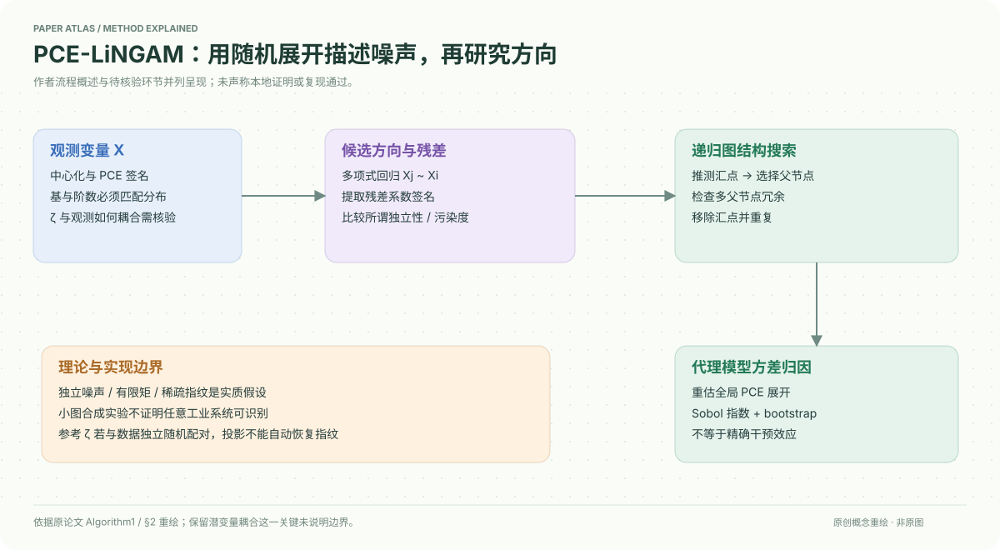

# A Polynomial Chaos Framework for Causal Discovery in Nonlinear Uncertain Systems

核对日期：2026-10-20。以下实验均为作者报告；本地完成原文阅读与讲解自检，未复现实验。

## 一句话总结

PCE-LiNGAM尝试把非高斯噪声写成正交多项式展开，用系数“指纹”寻找因果图，再做方差归因；正文提出若干保证，但关键假设与可实现细节仍需独立核验。

## 研究背景与动机

工业传感器含非线性、长尾、漂移和离群点，简单线性或高斯噪声模型可能失配。多项式混沌展开可表达随机变量并追踪方差传播，作者希望把它用于逆向识别因果结构。[§1–2，PDF1–3]

这里的chaos是随机正交展开术语，不是确定性混沌系统的同义词；从观测数据恢复因果仍需要强结构假设。

## 方法总览

先中心化观测并提取PCE系数签名，候选父变量通过多项式回归形成残差，比较残差与候选变量签名，递归移除推测汇点得到DAG；在学习图上重估展开，计算Sobol方差归因及bootstrap区间。[Algorithm1、§2.3–2.4，PDF4–5]

图中流程是作者算法概述，不表示本地已经实现或确认其可识别定理。

## 核心创新与关键设计

结构方程假定独立外生噪声：
\[X_j=f_j(X_{Pa(j)})+\epsilon_j,\quad\epsilon_j=\sum_{k=0}^Pc_{jk}\Psi_{jk}(\zeta_j).\]
有限阶近似、正交基、独立噪声与不同变量具有不同稀疏主导系数集合，是原文可识别讨论的重要条件。Hermite/Legendre等基要与参考分布匹配；“任意噪声”并非没有矩条件和截断误差。[Assumptions2.1–2.2]

若全局展开基确为正交归一，则
\[\operatorname{Var}(X_j)=\sum_{\alpha\ne0}D_{j,\alpha}^2,\qquad S_{ij}=\frac{\sum_{\alpha:\alpha_i>0,\alpha_{k\ne i}=0}D_{j,\alpha}^2}{\sum_{\alpha\ne0}D_{j,\alpha}^2}.\]
它是已学代理模型的方差分解，不直接等于干预平均处理效应。[式14–17]

**需要核验的核心环节：**Algorithm1从参考分布生成ζ后直接与观测X配对投影，正文没有完整说明如何构造二者的依赖耦合。若独立随机配对，非恒定项期望通常为零，不能直接恢复噪声指纹。仅有每个变量边缘分布的“独特指纹”也不自动区分直接父节点与祖先。Theorem2.3的正文论证未充分消除此实现与识别问题，本笔记只记录作者主张，不背书为已验证定理。[PDF3–4]

## 实验与关键结果

六个均为已知DAG的合成/工业传感器模拟数据，d=4–7、N1000–1500；不是大规模真实工厂验证。DS1为四节点菱形，含sign非线性，噪声Uniform、Exponential、截断Cauchy和Beta。[Table1、式22，PDF6]

| 作者Table2跨DS1–6平均 | F1↑ | SHD↓ |
| --- | --- | --- |
| PCE-LiNGAM | 0.756±0.185 | 3.7±3.1 |
| ICA-LiNGAM | 0.502±0.156 | 8.3±3.5 |
| NOTEARS | 0.483±0.167 | 6.8±4.5 |
| CAM | 0.274±0.244 | 13.7±7.6 |

原表±不能直接当作重复随机种子的标准误或置信区间，需明确汇总方式。DS1报告F1=1、SHD0，DS6与NOTEARS同为0.571，不能说每个数据集都严格独占第一。[PDF7–8]

DS1不确定性用bootstrap B150、95%区间；X1→X2的一阶Sobol0.642±0.038，X1→X3的一阶0.100±0.086、总阶0.654±0.500，后者很不稳定。

## 消融实验与证据强度

正文主要比较算法与数据集，未提供PCE阶数、稀疏阈值、基选择和指纹提取移除的系统受控消融。Table2整体比较不能独立证明所谓“噪声指纹”是增益原因。DS1方向不对称边际0.017–0.084属于单例诊断，不是所有图都可识别的证明。[§3，PDF7–8]

Sobol区间是代理与重采样下的方差归因不确定性，不能直接称作因果图后验概率或每条边的真实干预效应置信度。

## 局限与讨论

正文P=0时只剩常数项，却称可退化为高斯/非高斯LiNGAM，按式2并不成立。DS4异方差、DS6漂移也不直接满足固定独立加性噪声假设；截断Cauchy具有有限方差，不能拿实验结果证明对无限方差Cauchy的二阶PCE/Sobol理论有效。[PDF3、6]

有限小图、未说明的独立性检验/阈值与潜变量耦合限制复现。该笔记是带批判性核对的原文讲解，算法可靠性和理论正确性尚未由本地验证。

## 复现提示

复现前应先解决ζ与观测残差如何耦合、独立性分数实现、父/祖先区别和阶数截断选择。先用已知DAG合成样例，比较独立随机ζ与有效映射的系数结果，再评估边方向、重复种子分布与干预仿真，不直接用于工业控制。

建议 `data/pce-lingam/` 保存合成配置；正文未给出本次可核验的固定代码仓库和许可证。未执行第三方实现，不能声称实验复现或安全部署通过。

## 相关工作与阅读顺序

先读LiNGAM/加性噪声可识别条件，再学习PCE正交基和Sobol方差分解，最后回到本文Algorithm1检查哪些量可从观测计算。不要由“有定理”直接跳到任意非线性工业数据因果结论。

## 来源与校验

- [CVF 官方论文页](https://openaccess.thecvf.com/content/CVPR2026/html/Cao_A_Polynomial_Chaos_Framework_for_Causal_Discovery_in_Nonlinear_Uncertain_CVPR_2026_paper.html) · [所读 PDF](https://openaccess.thecvf.com/content/CVPR2026/papers/Cao_A_Polynomial_Chaos_Framework_for_Causal_Discovery_in_Nonlinear_Uncertain_CVPR_2026_paper.pdf)。页码均为该 PDF 的页序。
- 阅读范围：正文、公式与实验表；补充材料、上游代码与权重未逐项核验。许可证和固定代码 commit 尚未确认，不复制原文全文或数据。
- PDF SHA-256：`36a71b21872a2e07b429dd46a809804076f12c163f650b62c9a2e62015cf9a99`；版本为本次下载的 CVF 接收稿，核对日期 2026-10-20。

- 视觉核对：PDF第4页已渲染查看，核对原表/算法；独立补充材料和上游实现未读。
