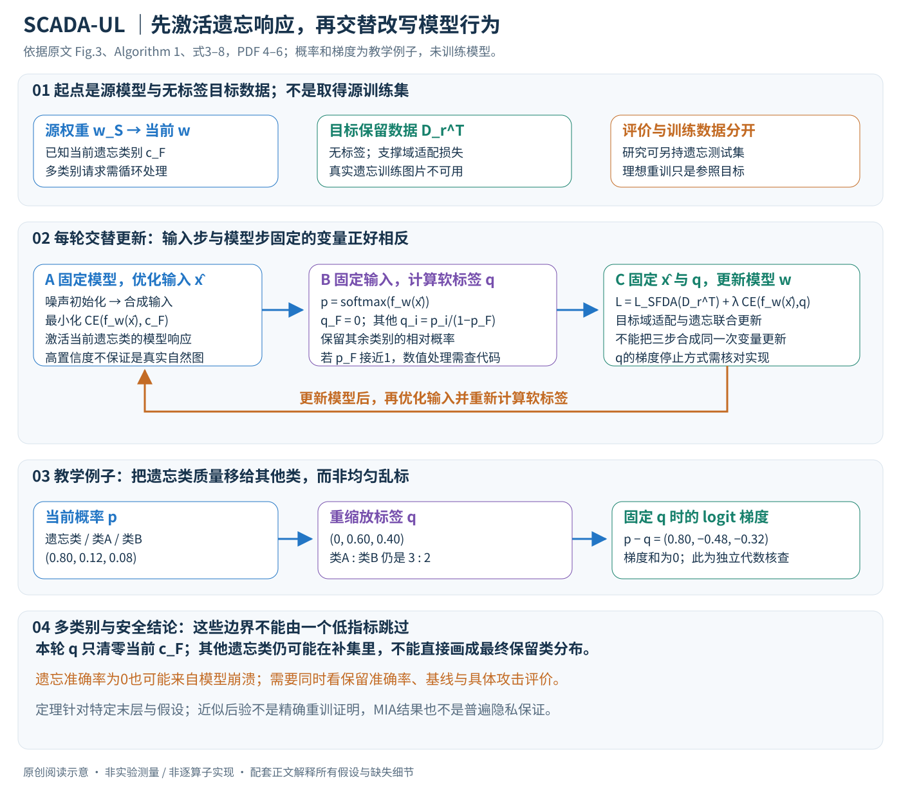

# SCADA-UL：在跨域适配时遗忘源域独有类别

论文：**$\oslash$ Source Models Leak What They Shouldn't $\nrightarrow$: Unlearning Zero-Shot Transfer in Domain Adaptation Through Adversarial Optimization**，Arnav Devalapally、Poornima Jain、Kartik Srinivas、Vineeth N. Balasubramanian，CVPR2026，1543–1553页。

[官方页](https://openaccess.thecvf.com/content/CVPR2026/html/Devalapally_oslash_Source_Models_Leak_What_They_Shouldnt_nrightarrow_Unlearning_Zero-Shot_CVPR_2026_paper.html) · [PDF](https://openaccess.thecvf.com/content/CVPR2026/papers/Devalapally_oslash_Source_Models_Leak_What_They_Shouldnt_nrightarrow_Unlearning_Zero-Shot_CVPR_2026_paper.pdf) · [论文所列代码](https://github.com/D-Arnav/SCADA)

分类：学习方法／机器遗忘／域适配。核对：2026-10-20。正文精读与自检，未复现实验；页码为PDF页码。

方法与配图详细版返工：2026-10-23。重读§3–6并核对Algorithm 1；展开交替变量、软标签/梯度、多类互补集与近似目标边界，未复现。

## 一句话总结

只有源模型和目标保留类数据时，交替生成会触发遗忘类别的合成输入、重新标注这些输入并适配目标域，尝试削弱源域独有类别的迁移能力。

## 研究背景与动机

源数据不能共享，不代表共享源模型就没有知识残留。普通source-free domain adaptation旨在提升目标域任务，未必会抹去目标数据中没出现的类别。SCADA-UL要求同时做好保留类和遗忘类。[PDF 1–3] 本文的“泄露”首先指残留类别能力，不能直接等同于已重建出某个个人训练样本。

## 方法总览

### 同时适配与遗忘，且手里没有真实遗忘样本

SCADA-UL给定源模型\(w_S\)、无标签目标保留数据\(D_r^T\)和要遗忘的源域独有类别集合\(C_F\)，输出适配后的模型。它拿不到源训练数据，也拿不到目标域遗忘类训练样本。目标不仅是在保留类上识别准确，还要削弱原本能迁移到目标域的遗忘类能力。（Definition 1、§3，PDF第3–4页）

类别集合满足\(C_T\subset C_S\)，\(C_F=C_S\setminus C_T\)。评价时可以另外持有目标遗忘集来测遗忘程度；这不等于算法训练阶段获得了这些图片。“数据不可用”与“研究者无法评估”是两个不同范围。

原创图依据Fig.3、Algorithm 1、式3–8，PDF第4–6页。概率与梯度为独立教学例子；合成输入用于探测模型当前类别响应，不是从私人源数据中取回的原始图片。

| 量 | 角色 | 边界 |
|---|---|---|
| \(w_S,w_T\) | 已训练源模型与当前目标模型 | 目标模型从源权重初始化 |
| \(D_r^T\) | 目标保留类无标签数据 | 支撑source-free domain adaptation |
| \(c_F\) | 当前处理的一个遗忘类别 | 多类时按类别循环 |
| \(\hat x_{c_F}\) | 从噪声优化的合成输入 | 只是模型响应代理，不保证像真实该类图片 |
| \(p=f_{w_T}(\hat x)\) | 全部源类别的softmax | 每轮随模型与输入改变 |
| q（原文\(\hat y\)） | 清零当前遗忘类后重缩放的软标签 | 不由真实遗忘样本标注得到 |
| \(L_{SFDA},L_{MU}\) | 目标域适配与遗忘损失 | 同一模型更新中的两项 |

## 核心创新与关键设计

### 1. 理想目标是像重训一样，但重训只作研究参照

最直接的理想做法，是从源数据中移除遗忘类别，重新训练源模型，再适配到目标保留数据。但源数据缺失，所以该做法在问题设定中不可执行。作者以其作为gold-standard参照，不能把表中的Retrain当成用户实际可运行的替代方案。（§3–4，PDF第3–4页）

普通SFDA只看到目标保留类，也不保证抹去其他类别：源模型已有表示可能在目标遗忘类上继续有效。目标数据里没出现某类，与模型参数里不再保留该类可用信息并不等价，这正是额外遗忘目标的动机。

### 2. 从后验比值到可优化目标，中间有近似假设

作者将理想后验近似分为“适配倾向”与“遗忘数据似然”之比，最大化对数后得到

\[\log p(w\mid w_S,D_r^T)-\log p(D_f^S\mid w).\]

前项希望保持源知识并适应目标，后项希望降低遗忘数据的解释能力。但\(D_f^S\)不可得，所以这仍不是可直接计算的训练式，需要下一步的合成代理。（式1，PDF第4页）

推导依赖数据条件独立和用模型权重近似原数据后验等假设，正文也将其与近似Gaussian后验联系起来。类别集合不相交不自动证明数据在给定参数后满足所需独立；因此这个比值解释是建模路线，不是已经认证输出参数分布与精确重训一致。

### 3. 第一个优化问题：固定模型，让合成输入触发遗忘类

从噪声初始化\(\hat x\)，固定当前\(w_T\)，最小化

\[L_{ADV}(w_T,\hat x)=CE(f_{w_T}(\hat x),c_F).\]

与一般模型训练相反，这一步更新的是输入像素/输入变量，不是模型权重。交叉熵降低会提高模型把该输入判为cF的概率，因此它寻找“当前模型仍能响应的遗忘类别方向”。（式3、Algorithm 1，PDF第5页）

不应把这种高置信输入直接称为真实遗忘数据的分布样本。优化可以找到模型外推的异常模式，高置信并不保证自然图像语义、全部类内多样性或真实数据密度。本文没有本地生成这些输入，也没有用它们推断私人源样本。

输入优化的数值范围、初始化分布、约束、每类样本数量和具体步数会影响结果，主文把详细设置和消融放到附录。讲解保留算法角色，不凭常见做法补上未核验的像素裁剪或图像先验。

### 4. 清零一个类别，再按原比例分配剩余概率

对当前模型概率p，标签q定义为

\[q_{c_F}=0,\qquad
q_i=\frac{p_i}{\sum_{j\ne c_F}p_j}=\frac{p_i}{1-p_{c_F}},\quad i\ne c_F.\]

它等于在模型当前分布下，附加“不是当前遗忘类”条件后的重归一化。保留的类别相对比例不变：\(q_i/q_j=p_i/p_j\)。这是对模型分布的条件化，不是对真实样本类别的已知后验，也不是新增人工正确标签。（式4，PDF第5页）

**手算例子。** 三类分别为当前遗忘F和其他A/B，\(p=(0.80,0.12,0.08)\)。清零F后剩余质量0.20，得到\(q=(0,0.60,0.40)\)。算法没有随机指定A为唯一正确类，也没有把A/B强行改成各0.5，而是保留原来的3:2相对偏好。

当\(p_F\)接近1时，分母接近0。实际数值稳定、是否以logits重新算非F softmax、以及q是否停止梯度，必须核对实现。尤其q由同一个模型产生，若不detach，求导的目标与固定软标签交叉熵不相同，不能忽略这个接口。

### 5. 第二个优化问题：固定合成输入，更新模型

对真实目标batch做SFDA，对当前合成输入做软标签交叉熵：

\[L_{MU}=CE(f_{w_T}(\hat x),q),\]
\[\min_{w_T}\ L_{SFDA}(w_T,x_T)+\lambda L_{MU}(w_T,\hat x,q).\]

这一模型更新同时降低当前遗忘类的输出倾向，并保持/适配目标保留类。SFDA并不是“随便拿目标样本做有标签CE”，因为目标数据无标签；本文主实验采用SF(DA)²的适配损失，具体聚类/图结构和伪标签实现来自该基线，不能在讲解中换成自选简化版后声称同一方法。（式5–7、§5，PDF第5、7页）

两项损失都可作用于模型，但\(L_{ADV}\)不在这一步作为“让模型更会识别F”的正向训练项一起最小化。若把所有损失简单相加、同时更新w和x，会与Algorithm 1的交替目标不同。

### 6. 一个循环中更新谁，顺序不能省略

先由当前\(\hat x\)计算p与q，采样真实目标保留数据，按适配+遗忘目标更新w；随后固定更新后的w，再对\(\hat x\)最小化\(L_{ADV}\)，重新找能激活F的输入。重复直到训练结束。（Algorithm 1、式8，PDF第5–6页）

因此合成输入不是一次生成后永久缓存的静态“忘记集”。模型刚学会压制某些响应，输入优化又去寻找它当前仍会响应的模式；两者构成对抗式的探测/抑制循环。最终实现分别对两个不同变量做最小化，与概念上的min-w/max-x似然式相容，但不能把符号照抄成两个优化器对同一个损失无差别更新。

对比“适配前一次遗忘”或“适配后才遗忘”，同时进行能减少能力被重新迁移或整体破坏的某些问题；Table 5支持作者所测OfficeHome设置下的优势，不证明所有域和所有遗忘请求都只能这样做。

### 7. 固定软标签时，梯度具体改变了什么？

若q停止梯度，softmax logits u的交叉熵梯度是\(\partial L/\partial u_i=p_i-q_i\)。以上例得到\((0.80,-0.48,-0.32)\)：梯度下降降低F logit，提高A/B logits，且三项和为0。这是对软标签CE的独立推导，不是作者额外报告的实验梯度。

它解释了“压低F并保留其他类相对结构”的局部方向，却不保证任意真实遗忘样本都被覆盖，也不保证每个中间特征被删除。单个保留类的logit梯度幅度在此例中也不大于F，因此不能不加条件把它概括为“所有保留类每一步梯度都比遗忘类大”。

原文Theorem 1针对最后层权重给出带常数与条件的梯度范数界，详细证明在附录。最后层权重、合并类别集合与单个logit是不同对象；界中的比例系数也影响能否推出谁更大。本次没有独立重做证明，不由一句梯度解释推出全部参数或隐层知识已被精确清除。（§4.2，PDF第6–7页）

### 8. 多类轮换不等于每次把全部遗忘类同时置零

Algorithm 1对各\(c_F\in C_F\)分别维护合成输入，并在每个epoch内轮换。其标签式分母排除的是**当前一个类别**，其余源类别里可能还包含其他待遗忘类。因此多类遗忘要看整个循环收敛后的效果，不能把单类的互补集合直接叫成最终目标保留集合\(C_T\)。（PDF第5–6页）

这种轮换可能存在类别间干扰，尤其相似类别共享表示时。正文报告多类效果，但不等于已证明任意大遗忘集合都稳定；每类更新份额、顺序和遗忘权重也影响结果，需保留配置。

### 9. 两个扩展还需要额外先验

未知遗忘类别变体UC-SCADA-UL仍知道遗忘类数量，利用类别权重排序选底部类别；并不是在完全不知道哪些知识应保留时自动发现所有敏感概念。连续变体C-SCADA-UL接收多轮不相交遗忘集合，后续只用部分目标数据并减少epoch。（§4.3，PDF第7页）

先前已遗忘类别会不会被新的重分配标签重新提高、长期累计损害多少保留能力，需要连续评价，而不能因为单次成功就推断无限轮请求都无损。正文把完整扩展结果放到附录，本篇未逐项核验。

### 10. 遗忘准确率为0，为什么还不够？

在该研究任务中，目标遗忘集准确率越低越符合“削弱类别能力”，保留集准确率则越高越好。随机破坏模型也可能让遗忘准确率降到0，所以必须同时看保留效用。Table 6随机标签的保留准确率只有1.5%，恰好说明单个遗忘数值不能验收算法。（PDF第8页）

类别预测不再正确，也不代表中间表示无法被其他探针、再训练或攻击恢复。作者另测的MIA使用熵特征区分保留数据与未见类数据，是类别级改造协议，不应等同所有标准成员推断或训练样本删除评估。某个攻击器准确率低，也可能受标签、平衡与攻击器能力影响，不能当作形式化隐私保证。（§5、Table 4，PDF第7–8页）

### 11. 合成代理到真实遗忘分布之间仍有距离

作者把高置信合成集近似为遗忘集的替代，并用后验解释联系理想重训目标。但“当前模型很自信”本身不保证代理覆盖真实\(D_f\)的支持集；主文还说明某个与理想目标的关系使用“初始化后不再优化输入”的额外假设，而实际算法仍继续交替更新。（式9及后文，PDF第6页）

因此应分别记录：算法实际执行式8、推导的近似条件、表中经验遗忘表现。三者有关联，不能直接串成“已证明与重训完全等价”。医学/遥感实验也是模型研究，不由此得到任何临床或制度性删除保证。

### 12. 成本与复现边界

成本包括目标数据SFDA训练、每类合成输入初始化、每次模型更新后的输入优化；类别数、合成样本数和步数都会增加开销。它避免原源数据重训，但不是无需优化的权重编辑。正文完整时间和超参数在附录，本地没有实测。

复现优先核对来源/目标split、遗忘类集合、SFDA基线、q的detach与数值稳定、每类输入范围/数量/更新步、轮换顺序及三随机种子。评价同时保留类、遗忘类和多种探针，而不是只让最终分类头不输出某类。

本次重读§3–6并渲染核对标签与Algorithm 1；概率、梯度和类别互补关系为独立解释。补充材料、上游代码、许可及精确优化配置尚未逐项核验，**未生成合成输入、修改源模型或复现实验**。

## 实验与关键结果

Table 2（PDF 6，已渲染核对）多类遗忘的均值如下；保留准确率越高越好，遗忘类准确率在此任务中越低越好：

| 数据 | 只适配：保留／遗忘 | SCADA：保留／遗忘 | 重训：保留／遗忘 |
| --- | --- | --- | --- |
| OfficeHome | 75.8／58.1 | 75.1／0.0 | 76.3／0.0 |
| Office31 | 76.8／90.1 | 76.6／0.0 | 77.4／0.0 |
| DomainNet-126 | 67.7／38.7 | 65.6／0.0 | 66.3／0.0 |

均为作者三次试验统计，表中标准差未在此重复。重训需要原设置中不可用的源保留数据，因此是参照而非可直接执行的方案。Score定义为保留准确率／(100+遗忘准确率)，不能与普通准确率混用。[§5]

作者也报告熵特征攻击评价，本文平均MIA42.2、重训53.1。[Table 4，PDF 8] 攻击任务是作者改造的类别级判别；一个攻击器准确率低不证明所有攻击失效，也不构成差分隐私、法律合规或精确删除证明。

## 消融实验与证据强度

OfficeHome在适配前做遗忘，遗忘准确率仍52.0；适配后做则保留准确率降到58.2；同步训练得到75.1／0.0。重缩放标签对应75.1／0.0，均匀标签70.5／3.5，随机标签1.5／0.0。[Table 5–6，PDF 8] 随机标签说明单把遗忘准确率降到零可能只是把模型整体破坏。

## 局限与讨论

后验推导使用条件独立与模型近似；作者对后验目标的解释不等于已证明参数分布与重训一致。正文的梯度分析是最后层权重层面的条件结果，不能推出所有中间表示已删除。医学和遥感只是研究场景，不据此提供合规或临床保证。

## 复现提示

基线域适配采用SF(DA)²；应固定源／目标划分、遗忘类别、三随机种子，分别报告保留、遗忘与攻击结果。核对标签重缩放的数值稳定和是否停止梯度、多类别轮换与交替更新。详细超参数和证明在补充材料，本轮未读；代码commit、许可证、数据下载条件未核验，不执行第三方代码。

## 相关工作与阅读顺序

SHOT解释无源域适配，PADA强调减轻负迁移，机器遗忘强调移除特定影响。前两者不天然等于遗忘。建议定义1→Algorithm 1→Table 2→Table 5–6→MIA协议，再读理论解释。

## 来源与校验

正文1–8页已读，第6页关键表渲染查看。PDF SHA-256：`26e0fcbfee5fac014a3866b14770f6f0d112c381183a7776aeaf38ef2c96da25`。AI辅助讲解自检，无独立专家审稿、未复现实验；补充材料未读，原文图与全文不转载。
