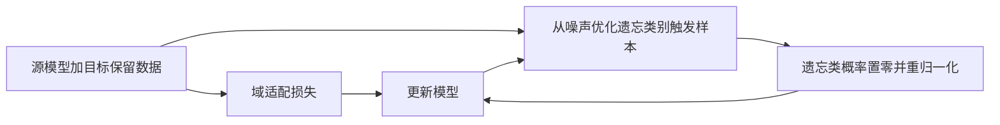

# SCADA-UL：在跨域适配时遗忘源域独有类别

论文：**$\oslash$ Source Models Leak What They Shouldn't $\nrightarrow$: Unlearning Zero-Shot Transfer in Domain Adaptation Through Adversarial Optimization**，Arnav Devalapally、Poornima Jain、Kartik Srinivas、Vineeth N. Balasubramanian，CVPR2026，1543–1553页。

[官方页](https://openaccess.thecvf.com/content/CVPR2026/html/Devalapally_oslash_Source_Models_Leak_What_They_Shouldnt_nrightarrow_Unlearning_Zero-Shot_CVPR_2026_paper.html) · [PDF](https://openaccess.thecvf.com/content/CVPR2026/papers/Devalapally_oslash_Source_Models_Leak_What_They_Shouldnt_nrightarrow_Unlearning_Zero-Shot_CVPR_2026_paper.pdf) · [论文所列代码](https://github.com/D-Arnav/SCADA)

分类：学习方法／机器遗忘／域适配。核对：2026-10-20。正文精读与自检，未复现实验；页码为PDF页码。

## 一句话总结

只有源模型和目标保留类数据时，交替生成会触发遗忘类别的合成输入、重新标注这些输入并适配目标域，尝试削弱源域独有类别的迁移能力。

## 研究背景与动机

源数据不能共享，不代表共享源模型就没有知识残留。普通source-free domain adaptation旨在提升目标域任务，未必会抹去目标数据中没出现的类别。SCADA-UL要求同时做好保留类和遗忘类。[PDF 1–3] 本文的“泄露”首先指残留类别能力，不能直接等同于已重建出某个个人训练样本。

## 方法总览

依据Fig.3和Algorithm 1重绘。循环更新合成输入，是方法的一部分，不是一次生成后永久不变。

## 核心创新与关键设计

目标类别集合是源类别子集，遗忘集为 \(C_F=C_S\setminus C_T\)。不使用源训练数据或目标遗忘类训练数据；这些遗忘类的测试样本仍可用于研究评估。[§3]

先固定模型，最小化 \(CE(f_w(\hat x),c_F)\)，找到让模型自信预测遗忘类的输入。随后将其输出概率p改成：

\[
\hat y_{c_F}=0,\qquad \hat y_i=p_i/\sum_{j\ne c_F}p_j.
\]

再最小化 \(L_{SFDA}+\lambda CE(f_w(\hat x),\hat y)\)，之后重新优化输入。多类遗忘按类别轮流更新。[式3–8，PDF 5–6] 保留相对概率比随机指定一个错误类更少破坏原有结构，但合成触发样本并不必然覆盖真实遗忘分布。

未知遗忘类变体仍假定知道遗忘类别数量；连续变体接收多轮不相交遗忘请求。不能把“未知类别”理解成什么先验都不需要。[§4.3，PDF 7]

## 实验与关键结果

Table 2（PDF 6，已渲染核对）多类遗忘的均值如下；保留准确率越高越好，遗忘类准确率在此任务中越低越好：

| 数据 | 只适配：保留／遗忘 | SCADA：保留／遗忘 | 重训：保留／遗忘 |
| --- | --- | --- | --- |
| OfficeHome | 75.8／58.1 | 75.1／0.0 | 76.3／0.0 |
| Office31 | 76.8／90.1 | 76.6／0.0 | 77.4／0.0 |
| DomainNet-126 | 67.7／38.7 | 65.6／0.0 | 66.3／0.0 |

均为作者三次试验统计，表中标准差未在此重复。重训需要原设置中不可用的源保留数据，因此是参照而非可直接执行的方案。Score定义为保留准确率／(100+遗忘准确率)，不能与普通准确率混用。[§5]

作者也报告熵特征攻击评价，本文平均MIA42.2、重训53.1。[Table 4，PDF 8] 攻击任务是作者改造的类别级判别；一个攻击器准确率低不证明所有攻击失效，也不构成差分隐私、法律合规或精确删除证明。

## 消融实验与证据强度

OfficeHome在适配前做遗忘，遗忘准确率仍52.0；适配后做则保留准确率降到58.2；同步训练得到75.1／0.0。重缩放标签对应75.1／0.0，均匀标签70.5／3.5，随机标签1.5／0.0。[Table 5–6，PDF 8] 随机标签说明单把遗忘准确率降到零可能只是把模型整体破坏。

## 局限与讨论

后验推导使用条件独立与模型近似；作者对后验目标的解释不等于已证明参数分布与重训一致。正文的梯度分析是最后层权重层面的条件结果，不能推出所有中间表示已删除。医学和遥感只是研究场景，不据此提供合规或临床保证。

## 复现提示

基线域适配采用SF(DA)²；应固定源／目标划分、遗忘类别、三随机种子，分别报告保留、遗忘与攻击结果。核对标签重缩放的数值稳定和是否停止梯度、多类别轮换与交替更新。详细超参数和证明在补充材料，本轮未读；代码commit、许可证、数据下载条件未核验，不执行第三方代码。

## 相关工作与阅读顺序

SHOT解释无源域适配，PADA强调减轻负迁移，机器遗忘强调移除特定影响。前两者不天然等于遗忘。建议定义1→Algorithm 1→Table 2→Table 5–6→MIA协议，再读理论解释。

## 来源与校验

正文1–8页已读，第6页关键表渲染查看。PDF SHA-256：`26e0fcbfee5fac014a3866b14770f6f0d112c381183a7776aeaf38ef2c96da25`。AI辅助讲解自检，无独立专家审稿、未复现实验；补充材料未读，原文图与全文不转载。
