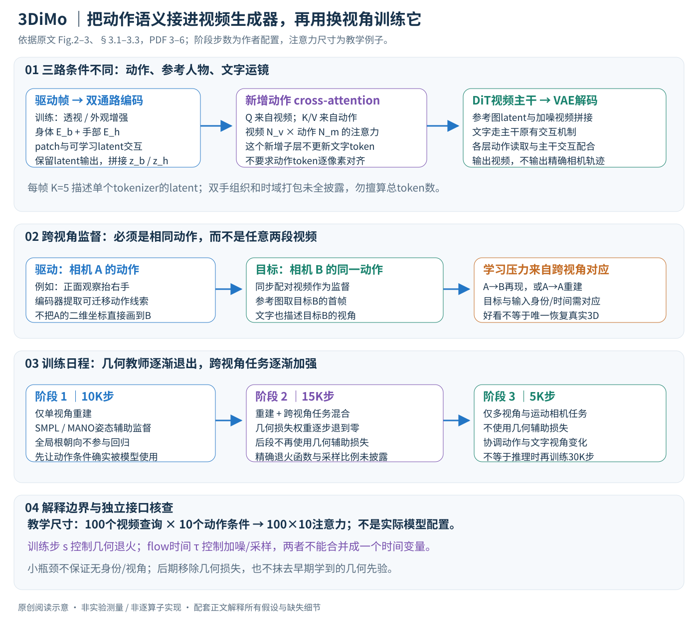

# 3D-Aware Implicit Motion Control for View-Adaptive Human Video Generation

作者：Zhixue Fang, Xu He, Songlin Tang, Haoxian Zhang, Qingfeng Li, Xiaoqiang Liu, Pengfei Wan, Kun Gai。

分类：video；交付形式：Markdown 中文论文讲解。

核对日期：2026-10-20。以下实验均为作者报告；本地完成原文阅读与讲解自检，未复现实验。

方法与配图详细版返工：2026-10-23。重读§3–4、Fig.2–3，区分动作/相机条件、训练步与flow时间、几何教师的退出边界；未复现。

## 一句话总结

3DiMo把驱动视频压缩为隐式动作token，通过丰富视角训练和逐渐撤去的几何辅助监督，实现动作迁移与文字运镜的共存。

## 研究背景与动机

二维姿态控制会绑定驱动视角；SMPL重建又可能错误估计前后关系和接触。本文希望生成器自身三维先验参与动作解释，而非强行投影外部骨架，但也不宣称完全没有使用参数化人体监督（第1–3页）。

## 方法总览

### 输入、输出与“3D-aware”的准确含义

3DiMo接收参考人物图像\(I_R\)、驱动视频\(V_D\)和包含视角/运镜描述的文字\(\mathcal T\)，输出人物采用参考图外观、动作来自驱动视频、观察方向受文字影响的新视频。作者使用有预训练空间与动态先验的DiT视频生成器，而不是先恢复精确三维骨架，再逐帧按指定相机矩阵渲染。（§3，PDF第3–4页）

这里的“3D-aware”指一种学习到的控制能力：动作在改变观察方向时仍尽量合理，不意味着接口输出可测量的三维关节、相机标定、可执行人体动力学状态，或保证每个动作具有唯一三维解释。文字中的“镜头向左绕行”也不是给定外参\(R_t,t_t\)后的数值轨迹保证。原文自己将精确相机控制与本文关注的动作表达区分开。（Introduction、§3.2，PDF第2、5页）

原创图依据Fig.2–3、§3.1–3.3，PDF第3–6页。图中注意力尺寸与瓶颈反例是独立解释；训练阶段步数来自作者，未在本地生成视频。

| 对象 | 进入哪里 | 提供什么条件 |
|---|---|---|
| 驱动视频\(V_D\) | 身体/手部动作编码器 | 动作语义，尽量减少身份与驱动视角泄漏 |
| 参考图\(I_R\) | VAE编码，再与加噪视频token拼接 | 输出人物外观及初始朝向线索 |
| 文字\(\mathcal T\) | 生成器原有文字交互机制 | 场景、视角、文字运镜 |
| 目标视频\(V_{\rm tgt}\) | 训练时的生成目标 | 同视角重建或同动作跨视角再现 |
| SMPL/MANO估计姿态 | 训练早期的辅助解码器监督 | 帮助动作编码器初始化，不是最终强制渲染条件 |

理解这个分工很关键：动作不是从文字里凭空生成的，文字也不是额外动作编码器；两个条件在同一个视频生成器中相互作用，未被证明完全独立。

### 动作编码：保留少量latent查询，而非整张二维控制图

每个驱动帧先切成patch并映射为视觉token。设这一帧有\(P\)个patch、隐藏宽度\(d\)，其矩阵为\(X_t\in\mathbb R^{P\times d}\)。加入\(K=5\)个可学习latent token，经若干Transformer层交互，最后只保留latent位置的输出作为动作表达。以下是对§3.2文字的形状化说明，不是原文编号公式：

\[
H_t=\operatorname{Transformer}([X_t;L]),\qquad
z_t=H_t[\text{latent positions}]\in\mathbb R^{K\times d}.
\]

生成器因此读取的是少量语义token，而不是与输出像素一一对齐的姿态图。可学习latent是训练参数，输出\(z_t\)则随输入帧改变；不能把“只有5个可学习token”理解为所有视频使用同一份常量动作条件。（§3.2，PDF第4–5页）

这种语义瓶颈改变了信息传递偏好：编码器需要把动作信息集中到少量向量，弱化对原始二维网格的直接复制。但它不构成信息论上的身份删除或视角不变证明。只要向量仍有足够容量，网络仍可能在其中保留视角和服装；原文随后专门引入增强与跨视角训练，正是因为结构本身不够。

### 身体和手分别编码，再一起作为动作条件

单个紧凑表示不容易兼顾全身大幅运动与小范围手势。作者使用身体编码器\(E_b\)和手编码器\(E_h\)，得到\(z_b,z_h\)，再拼接\(z=[z_b;z_h]\)供生成器读取。早期辅助几何解码器也读取这个组合。（§3.2–3.3，PDF第5–6页）

手部通路的意义是给细粒度动作单独分配表达能力，而不是让手凭空获得更精确的三维真值。最终控制仍依赖视频可见性、预处理和生成先验。正文没有完整列出双手如何组织、所有裁剪/丢失手处理规则、时域压缩以及每层token打包细节，因此不能仅据“每帧5个latent”就断言整个系统在所有阶段恰好有\(5T\)、\(10T\)或\(15T\)个条件token。需结合实现核对时间对齐与左右手组织。

### 增强的作用：减少捷径，保留动作学习任务

训练时在编码前对驱动帧应用随机透视变换，以及颜色抖动、轻微空间变换等外观增强。其目的分别是：让相同动作能对应不同二维投影，降低编码器死记驱动视角的倾向；让驱动者外观不再是可靠线索，减少输出直接复制驱动身份。（§3.2，PDF第5页）

这里必须限制“增强不改变动作”的说法。二维透视变换是训练扰动，不等于真实三维相机绕行后重新显露被遮挡身体表面；过强扰动也可能破坏手部形态。增强提高学习压力，但不凭空提供背面观测、接触真值或精确三维视角群上的不变性证明。具体变换范围、帧间是否共用参数，以及增强是否造成时间抖动，正文没有完整配置，复现时不能自行填成作者设置。

## 核心创新与关键设计

### 动作怎样进入DiT：视频作查询，动作作键和值

生成主干先在latent空间建模视频。因果3D VAE负责时空压缩；参考图latent与加噪视频token拼接，文字、参考图、视频通过主干原有的full self-attention交互。作者在每个full self-attention后追加动作cross-attention，明确说明**只有视频token读取动作token，文字token在这个新增子层保持不变**。（§3.1–3.2，PDF第3–5页）

用单头注意力写出这个接口，可以看清其与二维对齐控制的区别。令当前视频特征\(U\in\mathbb R^{N_v\times d_v}\)，动作特征\(Z\in\mathbb R^{N_m\times d_m}\)，则其核心计算可解释为：

\[
Q=UW_Q,\quad K_m=ZW_K,\quad V_m=ZW_V,
\]
\[
A=\operatorname{softmax}\left(\frac{QK_m^\top}{\sqrt{d_k}}\right),\qquad
O=AV_m.
\]

这里\(A\)有\(N_v\times N_m\)个权重，而不是一张必须和输出图像同宽同高的姿态控制图。某个视频位置可以读取多个动作latent，并不要求动作token第\(j\)项就是输出像素第\(j\)项。多头、投影、残差、归一化等应按实际实现核对；上述公式只是标准cross-attention的解释展开，原文未给出逐算子配置。

例如仅作尺寸核查，假设一个子层有\(N_v=100\)个视频查询、\(N_m=10\)个动作条件，则注意力矩阵是\(100\times10\)，而非\(100\times100\)。这不是作者模型真实token数量，也不能直接换算显存：实际还存在主干自注意力、多个头、时域打包与VAE压缩。

“文字token在新增动作层不更新”也不等于“动作与文字完全不能互相影响”。动作改变视频特征，后续主干self-attention仍可把视频、参考图与文字关联起来；相机文字最终影响输出，恰恰依赖这种生成器中的语义协同。

### 为什么要跨视角配对：不让重建目标奖励二维捷径

同视角重建时，以驱动视频本身作为监督，模型只需把驱动的二维运动复制到同一观察方向，便可能取得良好损失。即使动作token还保留了相机朝向，这个任务也未必惩罚它。因此，低重建误差不是三维解耦的充分证据。（§3.3，PDF第5页）

作者增加两类更有约束力的数据：固定多相机同步拍到的同一动作，以及同一动作在不同相机轨迹下的观察。给定驱动\(V_D\)，训练监督可以选择\(V_D\)本身，也可以选择与其具有相同动作的另一视角视频\(V_D'\)。**参考图取监督目标的首帧**，而不是不加区分地总取驱动视频首帧。（§3.3，PDF第5–6页）

以教学场景说明：相机A拍正面抬右手，相机B同步拍侧面；输入动作用A，监督视频用B，参考图也取B的首帧，文字描述B视角。模型要从A的运动线索在B视角重现右手动作。把A的二维手臂位置机械复制到B画面通常不能完成这个任务，因而跨视角配对迫使编码器和生成器利用更可迁移的动作线索。

这个约束来自“相同动作且时间对应”的数据，不是随机给两段不同动作视频贴上“跨视角”标签就能获得。不同相机之间的同步、人物对应、有效帧、遮挡和运动轨迹标注影响监督质量。本文不把这种任务压力等同于唯一三维恢复证明；模型仍可能依靠预训练人体先验补全未见部分。

### 数据规模有两个分类轴，不能相加两次

Fig.3同时按**来源**和**相机任务**统计。来源为互联网600K、采集100K、UE渲染60K，总计760K；任务为单视角600K、多视角80K、运动相机80K，同样总计760K。它们是同一数据集合的两种划分，不是两批各760K的数据。（PDF第5页，Fig.3；数量为作者报告）

互联网单视角提供丰富动作和真实外观；UE数据提供可控动作/相机但有合成域差距；真实多视角采集弥补跨视角一致性。Qwen2.5-VL用于生成/统一视角和运镜文字，也会引入描述噪声。统计总量不意味着所有视频均可公开取得；正文明确包含自有采集，原始数据许可、具体拆分和可下载版本须另查。（§3.3，PDF第5–6页）

### 渐进三阶段：先让动作通路工作，再让它适应换视角

| 阶段 | 数据任务 | 几何辅助 | 主要学习压力 |
|---|---|---|---|
| 1，10K步 | 仅单视角重建 | 使用 | 先建立稳定、表达丰富的动作编码 |
| 2，15K步 | 重建与跨视角再现的混合 | 前期使用，逐步退到零；后期移除 | 从二维重建过渡到跨视角动作语义 |
| 3，5K步 | 仅多视角与运动相机任务 | 不使用 | 进一步协调动作与文字视角/运镜 |

任务安排来自§3.3，步数来自§4.1（PDF第6页）。第二阶段正文描述为balanced mixture，但没有完整逐来源采样概率，不能擅自把全部来源都设成等比例；几何退火的精确起止步数和函数也没有公开在这些正文段落中。

第三阶段不是新的推理算法，也不是让模型在用户生成时重新训练30K步。它是离线训练日程。作者的消融指出只训阶段1时像素指标可以不错，但镜头指令失效；阶段2有时只让背景运动、人物仍朝前；阶段3改善协同。这些观察帮助解释阶段作用，不能把阶段数与所有视频上的三维正确率直接画成一条无实测支持的增长曲线。（§4.4，PDF第7–8页）

### 早期几何教师怎样退出：提供初始化，不永久钉死重建误差

训练早期，预训练视频生成器可能只凭参考图就生成看似合理的动作，从而减少对新动作编码器的依赖；生成损失对动作语义也没有专门强调。作者加入轻量MLP几何解码器\(D_g\)，把\([z_b;z_h]\)回归到现成SMPL/MANO估计器给出的姿态伪标签。**全局根朝向不参与此监督**，以免把相机相关方向强行绑定到动作表达。（§3.3，PDF第6页）

可以用下式组织训练目标的关系，但必须说明这是笔记概括，正文没有编号公式或完整损失范数：

\[
\mathcal L(s)=\mathcal L_{\rm flow}
+\lambda_{\rm geo}(s)\,\mathcal L_{\rm geo}
\big(D_g([z_b;z_h]),\theta_{\rm pseudo}^{\neg\mathrm{root}}\big).
\]

\(s\)是**训练步数**，\(\lambda_{\rm geo}(s)\)随训练逐渐退火，并在阶段2后段及整个阶段3为零；它不是扩散采样时间。\(\theta_{\rm pseudo}^{\neg\mathrm{root}}\)表示去掉全局根朝向后的几何监督，避免把本文误读成全程使用相机坐标SMPL旋转进行像素对齐。

为解释flow的v-prediction，可以选一个常见线性约定：\(x_\tau=(1-\tau)x_0+\tau\epsilon\)，目标速度为\(\epsilon-x_0\)，用条件速度场去拟合。该写法仅解释“预测速度”与“直接重建RGB”不同；论文正文没有列明其噪声插值方向、时间采样、调度和全部权重，不能把这一教学约定当成作者实际配置。扩散/flow时间\(\tau\)与上面的训练步\(s\)也不能混用。

辅助解码器退场后，梯度主要通过视频生成任务回传到动作编码器。已有几何先验仍可以留在训练所得权重里，所以“后期不使用SMPL损失”不等于“整个模型从未利用过SMPL/MANO知识”。推理时不需要把每次输入先拟合成SMPL控制序列，这是另一个层面的区别。

### 一次推理怎样走，以及哪些问题仍需查实现

1. 按训练所需方式准备参考图与驱动视频，整理身体/手部通路。训练用了随机增强不等于推理必须随机扭曲输入；具体推理预处理须看实现。
2. 编码得到动作条件，参考图经VAE进入主干；文字写明希望的视角、场景和运镜。
3. 从视频噪声latent开始迭代生成；在各DiT层，视频token通过新增cross-attention读取动作，主干原有机制处理图像与文字。
4. VAE解码成输出视频。辅助SMPL/MANO监督不在推理中作为损失反向优化，也没有显式数值相机轨迹的保证。

尚需实现核对的项目包括：预训练生成器确切版本与权重、动作时序打包、双手裁剪与缺失处理、参考latent掩码、辅助姿态参数化及尺度、退火函数、flow调度与推理步数、classifier-free guidance和负面提示。本文不以常见开源视频模型的默认值补齐这些空缺。

### 方法自检：三种容易被“隐式三维”掩盖的错误推论

**瓶颈不自动去身份。** 一个latent即使只用某个分量编码衣服颜色，仍可以同时用其他分量编码动作。因此“token少”只能是归纳偏好，去身份需要增强、跨身份评价及泄漏检查支持。

**根朝向不监督，不代表没有方向条件。** 朝向还可来自参考图和文字。否则正面驱动要在侧面参考图中重现动作时，模型反而缺少输出朝向的依据。

**跨视角生成好看，不代表恢复了真实三维轨迹。** 静态相机FID/FVD、用户三维合理性评分、跨视角动作一致性和精确关节/相机误差衡量的对象不同。本地此次只重读正文、核对图示与计算接口，没有训练模型或测量任何视频指标。

## 实验与关键结果

数据按来源为互联网600k、自采100k、UE60k；121帧、约480×854面积、batch64、Adam10⁻⁵，三阶段10k/15k/5k步约3天，不能由此推断单卡时长。第7页150个评估视频静态相机条件下，FID36.92/FVD297.4优于Uni3C41.28/321.9；PSNR17.96、SSIM0.7390低于MTVCrafter18.03/0.7489。30人MOS总体4.38±0.08。

## 消融实验与证据强度

第7–8页表2：去几何监督FID51.3，通道拼接48.2，全模型36.9；SMPL控制39.7。仅第一阶段PSNR18.3高于全模型18.0，但新视角运镜能力差，说明像素指标不能独立验证解耦。去手编码FID38.1/FVD298.7，小幅退化同时有手势定性差异。

## 局限与讨论

文字运镜是生成式能力，不保证精确相机矩阵或轨迹控制。定量主表固定相机，跨视角优势还依赖定性结果与用户评价。部分自有采集数据和未完整披露的预训练生成器，会限制完全复现；动作合理性不等于真实人体动力学测量。

## 复现提示

分别验证同视图重建、跨视图动作一致性及运镜，而非只报FID。保留辅助监督退火、数据配比、手裁剪和训练阶段；核查预训练DiT与私有数据可得性。论文给出3DiMo项目页，本地未下载、训练或执行视频生成。

## 相关工作与阅读顺序

先读人体动画AnimateAnyone、MimicMotion，再比较Uni3C和MTVCrafter的显式3D控制；最后看隐式token如何与DiT跨注意力配合。

## 来源与校验

- 已渲染并目视核对 PDF 第7页关键表格/图；其余正文与公式通过原文文本核对。
- [CVF 官方论文页](https://openaccess.thecvf.com/content/CVPR2026/html/Fang_3D-Aware_Implicit_Motion_Control_for_View-Adaptive_Human_Video_Generation_CVPR_2026_paper.html) · [所读 PDF](https://openaccess.thecvf.com/content/CVPR2026/papers/Fang_3D-Aware_Implicit_Motion_Control_for_View-Adaptive_Human_Video_Generation_CVPR_2026_paper.pdf)。页码均为该 PDF 的页序。
- 阅读范围：正文、公式与实验表；补充材料、上游代码与权重未逐项核验。许可证和固定代码 commit 尚未确认，不复制原文全文或数据。
- PDF SHA-256：`0db5368bf2dd8ac4782ed302de502701f579f53e9fe3c6270c9fdc46ca35da8c`；版本为本次下载的 CVF 接收稿，核对日期 2026-10-20。
