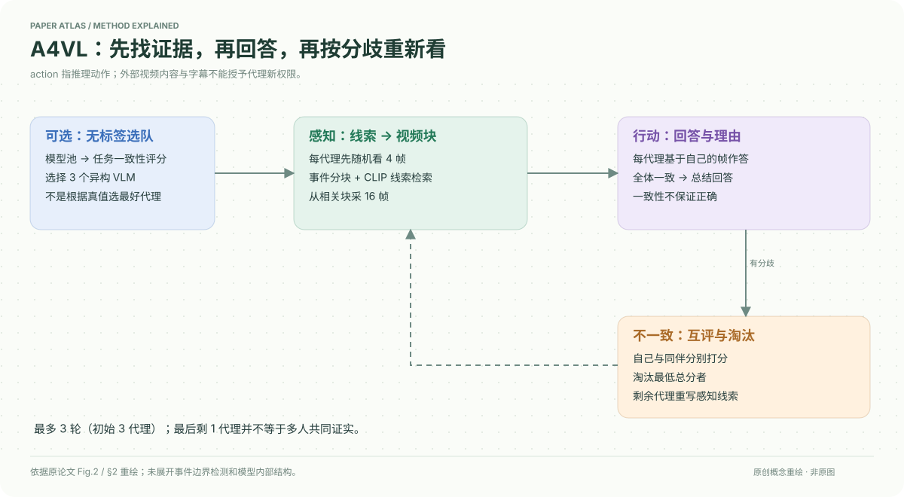

# A Multi-Agent Perception-Action Alliance for Efficient Long Video Reasoning

核对日期：2026-10-20。以下实验均为作者报告；本地完成原文阅读与讲解自检，未复现实验。

## 一句话总结

A4VL让三种VLM先提线索、检索相关视频块，再回答、互评与淘汰，分轮聚焦关键帧；减少单次看帧量的代价是多模型协作和额外调用。

## 研究背景与动机

长视频中问题常只涉及短事件，均匀增加帧密度会引入冗余和干扰。单代理也可能检索错时间段。作者把“看哪里”与“如何回答”交替进行，用多模型差异帮助修正线索。[§1，PDF1–2]

论文中的action是回答、评议和重检索，不是操控视频中实体或真实机器人。

## 方法总览

可选离线teaming从8个模型选择3个；每个代理随机看4帧提线索，事件切块后用CLIP匹配，再采16帧回答。全体一致则总结，否则互评并移除最低分者，剩余代理改线索进入下一轮。初始3代理意味着最多3轮，最终单代理的一致性不能当作多人证据。[Fig.2–4、§2]

## 核心创新与关键设计

teaming在无标签视频问答样本上，以代理所选答案的群体频率作为得分，选择高平均分模型：
\[s_i=\frac1K\sum_q f_{q,a_i(q)}.\]
它偏好与群体一致，不直接估计正确率，可能保留共同偏差。[§2.1，PDF3]

事件分块使用DINOv2、HSV/运动/清晰度及边界检测。线索与块的相似度超过ρ0.8时，softmax分配16帧；都低于阈值则只取最相关块。相似度的具体校准需实现核验，不能把原始CLIP余弦默认当作可跨数据共享的0.8概率。[§2.2]

每轮代理给自己与其他答案打1–10分，按总分淘汰最低者。评分依据答案和理由，可能受表达流畅度影响；共同回答错误也可提前停止。[式8–12，PDF5–6]

## 实验与关键结果

三模型从含7B至78B的8模型池选出，实际强组合含InternVL3-78B、InternVL3.5-38B、Qwen2.5-VL72B或LLaVA72B。默认六张H200，非Plus用户普通本机可直接复制的低成本方案。[§3.1、Table2]

| 作者Table1，ACC↑ | A4VL | 对照 |
| --- | --- | --- |
| NeXT-QA子集1493问 | 85.1 | InternVL3-78B 84.0 |
| EgoSchema500问 | 82.2 | LVAgent78.4 |
| LongVideoBench1337问 | 72.2 | LVAgent66.9 |
| MLVU-Test | 58.0 | InternVL3.5-38B56.1 |

**Video-MME口径冲突：**Table1表注说有字幕/无字幕，但正文把首值当无字幕，Table4又明确无/有。故暂记录原对A4VL77.2/82.8，不自行确定顺序或复述相应提升。正文EgoSchema82.2对76.8标“+3.2”也不符相减5.4，本笔记以明列对照数为准。[PDF6–8]

Table3每问时间，MLVU本文74s、InternVL3-78B204s、GPT4o127s；NeXT本文18s反而慢于InternVL的15s。硬件/API环境与离线选队/预处理是否计入还需核验。

## 消融实验与证据强度

EgoSchema随机初看+事件行动采样82.2/37s，双随机80.2/35s，初看事件+行动随机79.6/37s，支持两阶段不同采样用途。全一致82.2/37s，多数一致81.4/26s，体现质量/延迟折中。[Table5–6]

不淘汰的最高分融合80.8/60s，多数融合79.4/60s，低于默认82.2/37s。多轮上升曲线支持继续取证，但淘汰同时减少模型数，不能解释成只靠更多推理token就必然提高。[Table7、Fig.5，PDF8]

## 局限与讨论

共同错误、互评偏好和多数导向teaming会削弱多样性；最终共识不等于事实正确。短暂事件可能被4帧预览漏掉，错误线索可持续强化误检索。字幕依赖与协议冲突需先澄清，不能拿未定口径的排行榜做确定宣传。

六H200和多大模型是实质资源要求，免训练不等于零成本；本地未调用任何付费API或部署这些代理。

## 复现提示

源码入口 `https://github.com/git-disl/A4VL`，许可证与commit尚未核验。先固定字幕设置、选队样本与任务测试集隔离、各模型提示词、帧采样种子和CLIP分数归一化。记录代理数、实际轮次、总调用、预处理和总GPU秒，而不只最终回答延迟。

建议 `data/a4vl/`；先用授权短视频验证取帧和时间戳，不让外部视频或字幕中的指令改变代理权限。本地仅原文解析。

## 相关工作与阅读顺序

先读VideoAgent的检索问答，再看A4VL的选队、事件块和剪枝。将“多人投票”“互评淘汰”“重新采集视觉证据”三个作用分开；后者才是避免纯文本争辩绕圈的关键设计。

## 来源与校验

- [CVF 官方论文页](https://openaccess.thecvf.com/content/CVPR2026/html/Xu_A_Multi-Agent_Perception-Action_Alliance_for_Efficient_Long_Video_Reasoning_CVPR_2026_paper.html) · [所读 PDF](https://openaccess.thecvf.com/content/CVPR2026/papers/Xu_A_Multi-Agent_Perception-Action_Alliance_for_Efficient_Long_Video_Reasoning_CVPR_2026_paper.pdf)。页码均为该 PDF 的页序。
- 阅读范围：正文、公式与实验表；补充材料、上游代码与权重未逐项核验。许可证和固定代码 commit 尚未确认，不复制原文全文或数据。
- PDF SHA-256：`5feca98a5235808952c0545c367873aec2cc0d979dc8347a3971f7ccad88e50e`；版本为本次下载的 CVF 接收稿，核对日期 2026-10-20。

- 视觉核对：PDF第7页已渲染查看，核对原表/算法；独立补充材料和上游实现未读。
