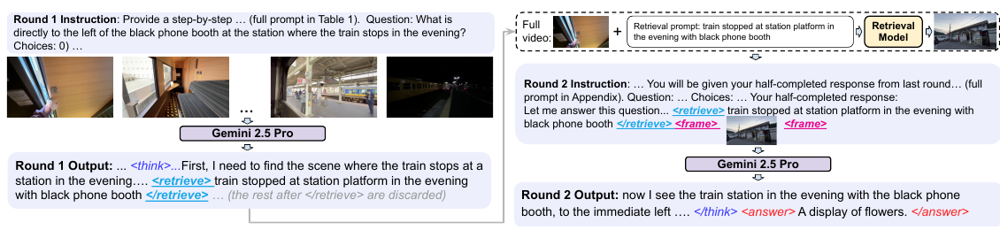

# Act2See: Emergent Active Visual Perception for Video Reasoning

核对日期：2026-10-21。实验数值均为作者报告；本地完成原文阅读与讲解自检，未复现实验。

## 一句话总结

ACT2SEE让视频问答模型在文本推理中请求额外原视频帧，或合成假设画面，再基于插入的画面完成回答。

## 研究背景与动机

固定1fps采样可能遗漏短暂关键事件，纯文本推理也无法补回没看到的视觉细节。作者通过监督微调教模型自行决定何时补看、查询什么，以及何时调用生成器表示反事实场景。[§1–2，PDF1–3]

补看的原视频帧是观测证据；生成画面只是工具给出的假设。生成得像并不能证明反事实在物理上成立，两者必须在解释与实现中清楚区分。

## 方法总览

原论文Fig.1，PDF第2页。仅裁切相关图示，保留图内科学标签；著作权属于原作者，用于本篇方法分析，不并入本站原创图授权。[来源与作者](https://openaccess.thecvf.com/content/CVPR2026/html/Q._Act2See_Emergent_Active_Visual_Perception_for_Video_Reasoning_CVPR_2026_paper.html) · [PDF](https://openaccess.thecvf.com/content/CVPR2026/papers/Q._Act2See_Emergent_Active_Visual_Perception_for_Video_Reasoning_CVPR_2026_paper.pdf)。点击可打开高清图。

第一轮模型输出推理文本与带标签的检索或生成查询，运行器在调用结束标签处停止。检索工具TFVTG借助BLIP-2从3fps候选中寻找片段，返回中间帧；生成分支也先检索条件帧，再由Stable Diffusion 3.5 Large按查询编辑/合成。把结果插回上下文，第二轮完成答案。[Fig.1、Algorithm1、§3.2，PDF2–4]

主算法只安排一次额外工具调用和两轮回答，不是无限次自主搜索。模型产生的是调用文本，实际读取和合成图片依赖外部工具；“涌现”描述经SFT后观察到的调用行为，并非未经训练自发形成整套能力。

## 核心创新与关键设计

Gemini 2.5 Pro生成训练轨迹；原有人工推理标注只在后处理时做质量参照，不提前提供。先过滤错答并限次重生成，再以BGE-M3语义相似度>0.8过滤、做格式检查并人工抽查100条。最终3373条中1608条含新帧，1026次检索、582次生成，占47.67%。[§3.3–3.4，PDF4–5]

对Qwen3-VL-8B-Thinking做文本自回归SFT：
\[\mathcal L=-\frac1N\sum_i\sum_t\log p_\theta(y_t^{(i)}\mid V^{(i)},Q^{(i)},y_{<t}^{(i)}).\]
工具查询文本参与损失，插入图片不按文本token计损失。式1省略了前文定义的选项A，实际输入仍含选项，复现不要据省略公式删掉它。[PDF3]

## 实验与关键结果

来源MINERVA、CausalVQA、Social Genome分别贡献1307/1334/732条。LoRA训练8张A100，学习率2.5×10⁻⁶、batch1、1个epoch；推理使用同样检索与生成工具。[§3.4、§4.3，PDF5]

| 准确率，作者报告 | 原Qwen3-VL-8B-Thinking | ACT2SEE |
| --- | --- | --- |
| Video-MME，无字幕 | 71.8 | 74.2 |
| VideoEspresso | 41.5 | 46.8 |
| EgoNormia | 48.9 | 51.3 |
| VCR-Bench | 38.2 | 47.1 |
| ViTIB | 60.2 | 63.3 |

来源Table2，PDF6。表列1fps是初始采样，检索另外搜索3fps候选，不能称总视觉预算与无工具基线相同。Gemini在Video-MME84.3、EgoNormia64.7、VCR61.3仍更高；Chain-of-Frames的Video-MME75.3也高于74.2，不能写全面最优。[Table3]

正文拿VideoEspresso与GPT-4o比较帧数的括号写反，按表格本文1fps、GPT-4o3fps理解；FPS与总帧数仍须区分。

## 消融实验与证据强度

1000条数据消融中，纯文本71.9、仅检索72.8、仅生成72.4、混合73.7，支持混合工具条件对该设置有益；它不能隔离“生成图像内容”与额外文本/计算预算的所有影响。[Table8，PDF8]

用人工来源校验的SFT为Video-MME73.7/ViTIB62.0，用模型生成来源校验仅68.6/58.3；数据集内容也不同，不能把全部差距归为人类标注这一单一因素。[Table7] 提前给教师真实CoT时调用率5.26%、准确率72.2；不提前给45.21%、73.7。[Table6，PDF7]

## 局限与讨论

语义相似度过滤与100例人工检查无法保证每步推理真实，重生成到正确答案也可能保留事后解释。生成器可能合成违背查询的图，如文中咖啡豆应进机器却进入杯子；这会把模型自己的想象再次当作支持信号。[Fig.4、§4.4，PDF6–7]

主文未提供完整调用时延、显存和成本控制；没有等预算的系统测量就不能承诺效率。Algorithm1生成分支第15行使用未定义q_r，按上下文应使用生成查询q_g，但须核对代码，不能直接照抄运行。[PDF3] §2.1一处把构造实现写作Qwen，与§3.2明确的Gemini教师不一致，本篇按实验细节区分教师与学生。

## 复现提示

[作者代码入口](https://github.com/martinmamql/act2see)尚未核验commit与许可证。建议 `experiments/video/act2see/`，固定数据版本、训练/测试视频去重、初始与检索采样率、生成模型和工具停止条件，分别记录观测帧与合成帧的来源。

本次未调用Gemini、图像生成或付费API，也未执行模型训练。数据构造需要外部教师并不代表本仓库已经重建了3373条数据；本文只做原文精读、图表核对与独立中文讲解。

## 相关工作与阅读顺序

先读视频采样与检索、ViTCoT的两轮插帧，再比较FrameMind/ReWatch-R1的强化学习与本文SFT。最后对照Algorithm1和Fig.4，检查新增画面究竟是重新观察，还是未经事实验证的反事实假设。

## 来源与校验

- [CVF官方论文页](https://openaccess.thecvf.com/content/CVPR2026/html/Q._Act2See_Emergent_Active_Visual_Perception_for_Video_Reasoning_CVPR_2026_paper.html) · [所读PDF](https://openaccess.thecvf.com/content/CVPR2026/papers/Q._Act2See_Emergent_Active_Visual_Perception_for_Video_Reasoning_CVPR_2026_paper.pdf)。页码均为PDF页序。
- 所读版本：2026-10-21从CVF下载的开放接收稿；PDF SHA-256：`06854ff8066bc18d3d5d1a5731548b23b7abba3343f62c220987003c47c31af0`。
- 阅读范围：正文、方法公式、实验与消融；补充材料、代码及权重未逐项核验。reviewed表示本地讲解自检，不表示独立同行评审或实验复现。
- 方法图与关键公式/表格已渲染核对，所引原图已单独检查；未对新文章进行浏览器交互验收。作者图示与本站原创素材权利分开记录。
